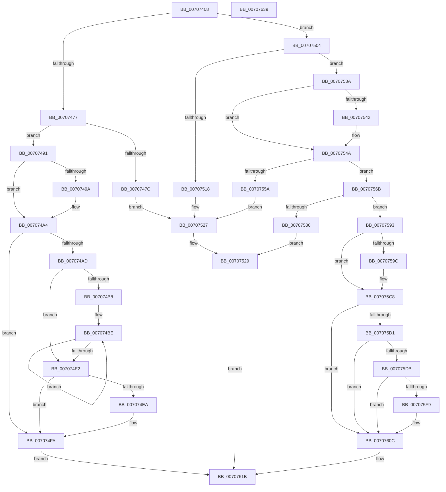

# HalpInterruptUnmap

- RVA: `0x00707408`–`0x0070763A` (길이 `562` bytes)
- VA: `0x0000000140707408`
- 실행 섹션: `PAGE`
- PDB 이름 있음: `예`; PDB Function 태그: `아니요`
- unwind 정보 RVA: `0x000C3B78`
- 디코드: `156`개 명령, `562/562` bytes 표시
- 미해석 바이트: `0` (있으면 어셈블리에 `.byte`로 보존)

> 이 문서는 커널 이미지의 기계어와 PDB 기호를 분석해 생성했습니다. 4번과 5번은 함수 원형과 자료형을 바이너리 사용 방식에서 추정한 C 해석이며 원본 소스 복구 결과는 아닙니다.

## 1. Dependencies

- 직접 호출 지점: **16**; 고유 호출 대상: **12**
- 직접 호출자로 확인된 함수: **2**
- RIP 상대 이미지 참조: **1**

### Outgoing calls
- `0x00707491` → [HalpInterruptIsHvLineBasedRemappingSupported](../../text/4B/HalpInterruptIsHvLineBasedRemappingSupported_function_004B0E38.md) (function, `0x004B0E38`)
- `0x0070749F` → [HalpHvUnmapDeviceMsiRange](../../pagelk/B5/HalpHvUnmapDeviceMsiRange_function_00B5C930.md) (function, `0x00B5C930`)
- `0x007074A4` → [HalpInterruptIsRemappingRequired](../../text/4B/HalpInterruptIsRemappingRequired_function_004B7AB0.md) (function, `0x004B7AB0`)
- `0x007074CE` → [HalpSetIrtEntry](../../text/48/HalpSetIrtEntry_function_0048A830.md) (function, `0x0048A830`)
- `0x007074F5` → [HalpIrtFreeIndex](HalpIrtFreeIndex_function_0070AE30.md) (function, `0x0070AE30`)
- `0x007074FA` → [DefaultAddProfileSource](../../text/4E/DefaultAddProfileSource_function_004E1110.md) (function, `0x004E1110`)
- `0x0070750F` → [HalpInterruptGsiToLine](../../text/2D/HalpInterruptGsiToLine_function_002D2DD0.md) (function, `0x002D2DD0`)
- `0x00707530` → [HalpInterruptSetProblemEx](../../text/48/HalpInterruptSetProblemEx_function_0048AC8C.md) (function, `0x0048AC8C`)
- `0x0070754D` → [HalpInterruptLookupController](../../text/2D/HalpInterruptLookupController_function_002D20D4.md) (function, `0x002D20D4`)
- `0x00707573` → [HalpInterruptFindLines](../../text/2D/HalpInterruptFindLines_function_002D2C88.md) (function, `0x002D2C88`)
- `0x00707593` → [HalpInterruptIsHvLineBasedRemappingSupported](../../text/4B/HalpInterruptIsHvLineBasedRemappingSupported_function_004B0E38.md) (function, `0x004B0E38`)
- `0x007075BA` → [HalpHvUnmapIoApicDeviceInterrupt](../../pagelk/B5/HalpHvUnmapIoApicDeviceInterrupt_function_00B5C9D4.md) (function, `0x00B5C9D4`)
- `0x007075C8` → [HalpInterruptIsRemappingRequired](../../text/4B/HalpInterruptIsRemappingRequired_function_004B7AB0.md) (function, `0x004B7AB0`)
- `0x007075D1` → [HalpInterruptModel](../../text/4A/HalpInterruptModel_function_004ACA38.md) (function, `0x004ACA38`)
- `0x007075EB` → [HalpSetIrtEntry](../../text/48/HalpSetIrtEntry_function_0048A830.md) (function, `0x0048A830`)
- `0x00707607` → [HalpIrtFreeIndex](HalpIrtFreeIndex_function_0070AE30.md) (function, `0x0070AE30`)

### Direct callers
- [HalpTimerUnmapInterrupt](../../text/54/HalpTimerUnmapInterrupt_function_0054A140.md) at `0x0054A294`
- [HaliRemoveInterruptRemapping](HaliRemoveInterruptRemapping_function_007073E0.md) at `0x007073F6`

### Static image references
- `0x00707529` → RVA `0x00010AA8` (`.rdata`; read)

## 2. Other-region calls and transfers

- 다른 실행 섹션으로 향하는 call: **14**
  - `0x00707491` → [HalpInterruptIsHvLineBasedRemappingSupported](../../text/4B/HalpInterruptIsHvLineBasedRemappingSupported_function_004B0E38.md) (`PAGE` → `.text`)
  - `0x0070749F` → [HalpHvUnmapDeviceMsiRange](../../pagelk/B5/HalpHvUnmapDeviceMsiRange_function_00B5C930.md) (`PAGE` → `PAGELK`)
  - `0x007074A4` → [HalpInterruptIsRemappingRequired](../../text/4B/HalpInterruptIsRemappingRequired_function_004B7AB0.md) (`PAGE` → `.text`)
  - `0x007074CE` → [HalpSetIrtEntry](../../text/48/HalpSetIrtEntry_function_0048A830.md) (`PAGE` → `.text`)
  - `0x007074FA` → [DefaultAddProfileSource](../../text/4E/DefaultAddProfileSource_function_004E1110.md) (`PAGE` → `.text`)
  - `0x0070750F` → [HalpInterruptGsiToLine](../../text/2D/HalpInterruptGsiToLine_function_002D2DD0.md) (`PAGE` → `.text`)
  - `0x00707530` → [HalpInterruptSetProblemEx](../../text/48/HalpInterruptSetProblemEx_function_0048AC8C.md) (`PAGE` → `.text`)
  - `0x0070754D` → [HalpInterruptLookupController](../../text/2D/HalpInterruptLookupController_function_002D20D4.md) (`PAGE` → `.text`)
  - `0x00707573` → [HalpInterruptFindLines](../../text/2D/HalpInterruptFindLines_function_002D2C88.md) (`PAGE` → `.text`)
  - `0x00707593` → [HalpInterruptIsHvLineBasedRemappingSupported](../../text/4B/HalpInterruptIsHvLineBasedRemappingSupported_function_004B0E38.md) (`PAGE` → `.text`)
  - `0x007075BA` → [HalpHvUnmapIoApicDeviceInterrupt](../../pagelk/B5/HalpHvUnmapIoApicDeviceInterrupt_function_00B5C9D4.md) (`PAGE` → `PAGELK`)
  - `0x007075C8` → [HalpInterruptIsRemappingRequired](../../text/4B/HalpInterruptIsRemappingRequired_function_004B7AB0.md) (`PAGE` → `.text`)
  - `0x007075D1` → [HalpInterruptModel](../../text/4A/HalpInterruptModel_function_004ACA38.md) (`PAGE` → `.text`)
  - `0x007075EB` → [HalpSetIrtEntry](../../text/48/HalpSetIrtEntry_function_0048A830.md) (`PAGE` → `.text`)
- 별도 외부 분기/꼬리 이동을 확인하지 못했습니다.

## 3. Assembly (complete function range)

```asm
00707408  48 8B C4                        mov rax, rsp
0070740B  48 89 58 08                     mov qword ptr [rax + 8], rbx
0070740F  48 89 70 10                     mov qword ptr [rax + 0x10], rsi
00707413  48 89 78 18                     mov qword ptr [rax + 0x18], rdi
00707417  4C 89 60 20                     mov qword ptr [rax + 0x20], r12
0070741B  55                              push rbp
0070741C  41 56                           push r14
0070741E  41 57                           push r15
00707420  48 8B EC                        mov rbp, rsp
00707423  48 83 EC 70                     sub rsp, 0x70
00707427  48 8B 7D 40                     mov rdi, qword ptr [rbp + 0x40]
0070742B  33 C0                           xor eax, eax
0070742D  48 89 45 F8                     mov qword ptr [rbp - 8], rax
00707431  0F 57 C0                        xorps xmm0, xmm0
00707434  0F 11 45 C8                     movups xmmword ptr [rbp - 0x38], xmm0
00707438  45 33 FF                        xor r15d, r15d
0070743B  8B 47 10                        mov eax, dword ptr [rdi + 0x10]
0070743E  4C 8D 67 04                     lea r12, [rdi + 4]
00707442  8B 5F 0C                        mov ebx, dword ptr [rdi + 0xc]
00707445  89 45 D0                        mov dword ptr [rbp - 0x30], eax
00707448  41 8B 04 24                     mov eax, dword ptr [r12]
0070744C  0F 11 45 D8                     movups xmmword ptr [rbp - 0x28], xmm0
00707450  83 4D D8 FF                     or dword ptr [rbp - 0x28], 0xffffffff
00707454  89 45 F8                        mov dword ptr [rbp - 8], eax
00707457  8B 07                           mov eax, dword ptr [rdi]
00707459  44 89 7D 40                     mov dword ptr [rbp + 0x40], r15d
0070745D  89 5D C8                        mov dword ptr [rbp - 0x38], ebx
00707460  44 89 7D D4                     mov dword ptr [rbp - 0x2c], r15d
00707464  C7 45 DC 01 00 00 00            mov dword ptr [rbp - 0x24], 1
0070746B  0F 11 45 E8                     movups xmmword ptr [rbp - 0x18], xmm0
0070746F  85 C0                           test eax, eax
00707471  0F 84 8D 00 00 00               je 0x140707504
00707477  83 F8 03                        cmp eax, 3
0070747A  74 15                           je 0x140707491
0070747C  C7 44 24 20 99 0C 00 00         mov dword ptr [rsp + 0x20], 0xc99
00707484  41 8D 57 13                     lea edx, [r15 + 0x13]
00707488  45 8D 47 02                     lea r8d, [r15 + 2]
0070748C  E9 96 00 00 00                  jmp 0x140707527
00707491  E8 A2 99 DA FF                  call 0x1404b0e38
00707496  84 C0                           test al, al
00707498  74 0A                           je 0x1407074a4
0070749A  48 89 7C 24 20                  mov qword ptr [rsp + 0x20], rdi
0070749F  E8 8C 54 45 00                  call 0x140b5c930
007074A4  E8 07 06 DB FF                  call 0x1404b7ab0
007074A9  84 C0                           test al, al
007074AB  74 4D                           je 0x1407074fa
007074AD  8B 75 48                        mov esi, dword ptr [rbp + 0x48]
007074B0  48 8D 5F 28                     lea rbx, [rdi + 0x28]
007074B4  85 F6                           test esi, esi
007074B6  74 2A                           je 0x1407074e2
007074B8  4C 8B F3                        mov r14, rbx
007074BB  44 8B FE                        mov r15d, esi
007074BE  41 8B 04 24                     mov eax, dword ptr [r12]
007074C2  4C 8D 45 C8                     lea r8, [rbp - 0x38]
007074C6  49 8B D6                        mov rdx, r14
007074C9  89 45 F8                        mov dword ptr [rbp - 8], eax
007074CC  B1 01                           mov cl, 1
007074CE  E8 5D 33 D8 FF                  call 0x14048a830
007074D3  49 83 C6 58                     add r14, 0x58
007074D7  4D 8D 64 24 58                  lea r12, [r12 + 0x58]
007074DC  49 83 EF 01                     sub r15, 1
007074E0  75 DC                           jne 0x1407074be
007074E2  8B 0B                           mov ecx, dword ptr [rbx]
007074E4  0F BA E1 1E                     bt ecx, 0x1e
007074E8  72 10                           jb 0x1407074fa
007074EA  44 8B 07                        mov r8d, dword ptr [rdi]
007074ED  81 E1 FF FF FF 3F               and ecx, 0x3fffffff
007074F3  8B D6                           mov edx, esi
007074F5  E8 36 39 00 00                  call 0x14070ae30
007074FA  E8 11 9C DD FF                  call 0x1404e1110
007074FF  E9 17 01 00 00                  jmp 0x14070761b
00707504  8B 4F 38                        mov ecx, dword ptr [rdi + 0x38]
00707507  48 8D 55 C0                     lea rdx, [rbp - 0x40]
0070750B  4C 89 7D C0                     mov qword ptr [rbp - 0x40], r15
0070750F  E8 BC B8 BC FF                  call 0x1402d2dd0
00707514  85 C0                           test eax, eax
00707516  79 22                           jns 0x14070753a
00707518  45 33 C0                        xor r8d, r8d
0070751B  C7 44 24 20 44 0C 00 00         mov dword ptr [rsp + 0x20], 0xc44
00707523  41 8D 50 12                     lea edx, [r8 + 0x12]
00707527  33 C9                           xor ecx, ecx
00707529  4C 8D 0D 78 95 90 FF            lea r9, [rip - 0x6f6a88]
00707530  E8 57 37 D8 FF                  call 0x14048ac8c
00707535  E9 E1 00 00 00                  jmp 0x14070761b
0070753A  8D 43 FD                        lea eax, [rbx - 3]
0070753D  83 F8 01                        cmp eax, 1
00707540  77 08                           ja 0x14070754a
00707542  C6 45 CC 01                     mov byte ptr [rbp - 0x34], 1
00707546  44 89 7D D0                     mov dword ptr [rbp - 0x30], r15d
0070754A  8B 4D C0                        mov ecx, dword ptr [rbp - 0x40]
0070754D  E8 82 AB BC FF                  call 0x1402d20d4
00707552  4C 8B F0                        mov r14, rax
00707555  48 85 C0                        test rax, rax
00707558  75 11                           jne 0x14070756b
0070755A  C7 44 24 20 64 0C 00 00         mov dword ptr [rsp + 0x20], 0xc64
00707562  8D 50 11                        lea edx, [rax + 0x11]
00707565  44 8D 40 01                     lea r8d, [rax + 1]
00707569  EB BC                           jmp 0x140707527
0070756B  48 8D 55 40                     lea rdx, [rbp + 0x40]
0070756F  48 8D 4D C0                     lea rcx, [rbp - 0x40]
00707573  E8 10 B7 BC FF                  call 0x1402d2c88
00707578  48 8B F0                        mov rsi, rax
0070757B  48 85 C0                        test rax, rax
0070757E  75 13                           jne 0x140707593
00707580  C7 44 24 20 6C 0C 00 00         mov dword ptr [rsp + 0x20], 0xc6c
00707588  8D 50 12                        lea edx, [rax + 0x12]
0070758B  45 33 C0                        xor r8d, r8d
0070758E  49 8B CE                        mov rcx, r14
00707591  EB 96                           jmp 0x140707529
00707593  E8 A0 98 DA FF                  call 0x1404b0e38
00707598  84 C0                           test al, al
0070759A  74 2C                           je 0x1407075c8
0070759C  8B 45 40                        mov eax, dword ptr [rbp + 0x40]
0070759F  48 6B D8 38                     imul rbx, rax, 0x38
007075A3  48 8B 46 28                     mov rax, qword ptr [rsi + 0x28]
007075A7  83 4C 03 0C 10                  or dword ptr [rbx + rax + 0xc], 0x10
007075AC  48 8B 56 28                     mov rdx, qword ptr [rsi + 0x28]
007075B0  41 8B 8E 00 01 00 00            mov ecx, dword ptr [r14 + 0x100]
007075B7  48 03 D3                        add rdx, rbx
007075BA  E8 15 54 45 00                  call 0x140b5c9d4
007075BF  48 8B 46 28                     mov rax, qword ptr [rsi + 0x28]
007075C3  83 64 18 0C EF                  and dword ptr [rax + rbx + 0xc], 0xffffffef
007075C8  E8 E3 04 DB FF                  call 0x1404b7ab0
007075CD  84 C0                           test al, al
007075CF  74 3B                           je 0x14070760c
007075D1  E8 62 54 DA FF                  call 0x1404aca38
007075D6  83 F8 01                        cmp eax, 1
007075D9  75 31                           jne 0x14070760c
007075DB  8B 47 04                        mov eax, dword ptr [rdi + 4]
007075DE  4C 8D 45 C8                     lea r8, [rbp - 0x38]
007075E2  48 8D 57 28                     lea rdx, [rdi + 0x28]
007075E6  89 45 F8                        mov dword ptr [rbp - 8], eax
007075E9  33 C9                           xor ecx, ecx
007075EB  E8 40 32 D8 FF                  call 0x14048a830
007075F0  8B 4F 28                        mov ecx, dword ptr [rdi + 0x28]
007075F3  0F BA E1 1E                     bt ecx, 0x1e
007075F7  72 13                           jb 0x14070760c
007075F9  44 8B 07                        mov r8d, dword ptr [rdi]
007075FC  81 E1 FF FF FF 3F               and ecx, 0x3fffffff
00707602  BA 01 00 00 00                  mov edx, 1
00707607  E8 24 38 00 00                  call 0x14070ae30
0070760C  8B 4D 40                        mov ecx, dword ptr [rbp + 0x40]
0070760F  48 8B 46 30                     mov rax, qword ptr [rsi + 0x30]
00707613  48 03 C9                        add rcx, rcx
00707616  44 88 7C C8 0C                  mov byte ptr [rax + rcx*8 + 0xc], r15b
0070761B  4C 8D 5C 24 70                  lea r11, [rsp + 0x70]
00707620  49 8B 5B 20                     mov rbx, qword ptr [r11 + 0x20]
00707624  49 8B 73 28                     mov rsi, qword ptr [r11 + 0x28]
00707628  49 8B 7B 30                     mov rdi, qword ptr [r11 + 0x30]
0070762C  4D 8B 63 38                     mov r12, qword ptr [r11 + 0x38]
00707630  49 8B E3                        mov rsp, r11
00707633  41 5F                           pop r15
00707635  41 5E                           pop r14
00707637  5D                              pop rbp
00707638  C3                              ret
00707639  CC                              int3
```

## 4. C-style interpretation (structured pseudocode)

```c
__int64 __fastcall HalpInterruptUnmap(__int64 a1, __int64 a2, __int64 a3, __int64 a4, unsigned int a5, unsigned int a6)
{
    __int64 result;
    __int64 v_r14;
    __int64 v_r15;
    __int64 v_rbx;
    __int64 v_rsp;
    unsigned __int64 v_stack_m18;
    unsigned __int64 v_stack_m20;
    unsigned __int64 v_stack_m30;
    unsigned int v_stack_m3C;
    unsigned __int64 v_stack_m40;
    unsigned int v_stack_m44;
    unsigned int v_stack_m48;
    unsigned __int8 v_stack_m4C;
    unsigned __int64 v_stack_m50;
    unsigned __int64 v_stack_m58;
    unsigned int v_stack_m68;
    unsigned int v_stack_p28;

    *(unsigned __int64 *)(v_rsp + 8) = v_rbx;
    *(unsigned __int64 *)(v_rsp + 16) = v_rsi;
    *(unsigned __int64 *)(v_rsp + 24) = v_rdi;
    *(unsigned __int64 *)(v_rsp + 32) = v_r12;
    v_rsp = (v_rsp) - (112);
    result = 0;
    v_stack_m20 = 0;
    v_stack_m50 = v_xmm0;
    v_r15 = 0;
    v_stack_m48 = (unsigned int)((unsigned int)(*(unsigned int *)(a5 + 16)));
    v_stack_m40 = v_xmm0;
    v_stack_m20 = (unsigned int)((unsigned int)(*(unsigned int *)(a5 + 4)));
    v_stack_p28 = 0;
    v_stack_m50 = (unsigned int)((unsigned int)(*(unsigned int *)(a5 + 12)));
    v_stack_m44 = 0;
    v_stack_m3C = 1;
    v_stack_m30 = v_xmm0;
    if ((unsigned int)((unsigned int)(*(unsigned int *)(a5))) == 0) goto loc_00707504;
    if (((unsigned int)((unsigned int)(*(unsigned int *)(a5)))) == 3) goto loc_00707491;
    v_stack_m68 = 0xC99ULL;
    goto loc_00707527;
loc_00707491:
    result = HalpInterruptIsHvLineBasedRemappingSupported(a1, v_r15 + 19, v_r15 + 2, a4);
    if ((unsigned __int8)(result) != 0) {
        v_stack_m68 = a5;
        result = HalpHvUnmapDeviceMsiRange(a1, v_r15 + 19, v_r15 + 2, a4);
    }
    result = HalpInterruptIsRemappingRequired(a1, v_r15 + 19, v_r15 + 2, a4);
    if ((unsigned __int8)(result) == 0) goto loc_007074FA;
    if ((unsigned int)((unsigned int)(a6)) == 0) goto loc_007074E2;
loc_007074BE:
    v_stack_m20 = (unsigned int)((unsigned int)(*(unsigned int *)(a5 + 4)));
    result = HalpSetIrtEntry(1, a5 + 40, v_stack_m50, a4);
    v_r14 = (a5 + 40) + (88);
    v_r15 = ((unsigned int)((unsigned int)((unsigned int)(a6)))) - (1);
    if (condition_is_not_equal) goto loc_007074BE;
loc_007074E2:
    if (!(condition_is_below)) {
        a3 = *(unsigned int *)(a5);
        a1 = (unsigned int)(((unsigned int)(*(unsigned int *)(a5 + 40))) & (0x3FFFFFFFULL));
        a2 = (unsigned int)((unsigned int)(a6));
        result = HalpIrtFreeIndex(a1, a2, a3, a4);
    }
    result = DefaultAddProfileSource(a1, a2, a3, a4);
    goto loc_0070761B;
loc_00707504:
    v_stack_m58 = v_r15;
    result = HalpInterruptGsiToLine((unsigned int)(*(unsigned int *)(a5 + 56)), v_stack_m58, a3, a4);
    if (!sign_flag) goto loc_0070753A;
    a3 = 0;
    v_stack_m68 = 0xC44ULL;
loc_00707527:
    a1 = 0;
loc_00707529:
    result = HalpInterruptSetProblemEx(a1, a3 + 18, a3, v_rip - 7301768);
    goto loc_0070761B;
loc_0070753A:
    if (((unsigned int)(a5 + 40 - 3)) <= 1) {
        v_stack_m4C = 1;
        v_stack_m48 = (unsigned int)(v_r15);
    }
    result = HalpInterruptLookupController((unsigned int)(v_stack_m58), a3 + 18, a3, v_rip - 7301768);
    if (result != 0) goto loc_0070756B;
    v_stack_m68 = 0xC64ULL;
    goto loc_00707527;
loc_0070756B:
    result = HalpInterruptFindLines(v_stack_m58, a5, result + 1, v_rip - 7301768);
    if (result != 0) goto loc_00707593;
    v_stack_m68 = 0xC6CULL;
    a3 = 0;
    goto loc_00707529;
loc_00707593:
    result = HalpInterruptIsHvLineBasedRemappingSupported(result, result + 18, a3, v_rip - 7301768);
    v_rbx = a5 + 40;
    if ((unsigned __int8)(result) != 0) {
        result = a5;
        v_rbx = (a5 + 40) * (result);
        result = *(unsigned __int64 *)(result + 40);
        a2 = *(unsigned __int64 *)(result + 40);
        a1 = *(unsigned int *)(result + 256);
        a2 = (a2) + (v_rbx);
        result = HalpHvUnmapIoApicDeviceInterrupt(a1, a2, a3, v_rip - 7301768);
        result = *(unsigned __int64 *)(result + 40);
    }
    result = HalpInterruptIsRemappingRequired(a1, a2, a3, v_rip - 7301768);
    if ((unsigned __int8)(result) == 0) goto loc_0070760C;
    result = HalpInterruptModel(a1, a2, a3, v_rip - 7301768);
    if (((unsigned int)(result)) != 1) goto loc_0070760C;
    v_stack_m20 = (unsigned int)((unsigned int)(*(unsigned int *)(a5 + 4)));
    a1 = 0;
    result = HalpSetIrtEntry(a1, a5 + 40, v_stack_m50, v_rip - 7301768);
    if (!(condition_is_below)) {
        a3 = *(unsigned int *)(a5);
        a1 = (unsigned int)(((unsigned int)(*(unsigned int *)(a5 + 40))) & (0x3FFFFFFFULL));
        a2 = 1;
        result = HalpIrtFreeIndex(a1, a2, a3, v_rip - 7301768);
    }
    a1 = ((unsigned int)(a5)) + ((unsigned int)(a5));
    *(unsigned __int8 *)(*(unsigned __int64 *)(result + 48) + a1 * 8 + 12) = (unsigned __int8)(v_r15);
loc_0070761B:
    return *(unsigned __int64 *)(result + 48);
}
```

## 5. (Beta) C Style

```c
int64_t HalpInterruptUnmap(int64_t Arg1, int64_t Arg2, int64_t Arg3, int64_t Arg4, void *Arg5, uint32_t Arg6)
{
    uint8_t *arg5 = (uint8_t *)Arg5;

    int64_t result;
    int64_t local_r14;
    int64_t local_r15;
    int64_t local_rbx;
    int64_t local_rsp;
    uint64_t v_stack_m18;
    uint64_t v_stack_m20;
    uint64_t v_stack_m30;
    uint32_t v_stack_m3C;
    uint64_t v_stack_m40;
    uint32_t v_stack_m44;
    uint32_t v_stack_m48;
    uint8_t v_stack_m4C;
    uint64_t v_stack_m50;
    uint64_t v_stack_m58;
    uint32_t v_stack_m68;
    uint32_t v_stack_p28;

    *(uint64_t *)(local_rsp + 0x8) = local_rbx;
    *(uint64_t *)(local_rsp + 0x10) = local_rsi;
    *(uint64_t *)(local_rsp + 0x18) = local_rdi;
    *(uint64_t *)(local_rsp + 0x20) = local_r12;
    local_rsp = (local_rsp) - (112);
    result = 0;
    v_stack_m20 = 0;
    v_stack_m50 = v_xmm0;
    local_r15 = 0;
    v_stack_m48 = (uint32_t)((uint32_t)(*(uint32_t *)(arg5 + 0x10)));
    v_stack_m40 = v_xmm0;
    v_stack_m20 = (uint32_t)((uint32_t)(*(uint32_t *)(arg5 + 0x4)));
    v_stack_p28 = 0;
    v_stack_m50 = (uint32_t)((uint32_t)(*(uint32_t *)(arg5 + 0xC)));
    v_stack_m44 = 0;
    v_stack_m3C = 1;
    v_stack_m30 = v_xmm0;
    if ((uint32_t)((uint32_t)(*(uint32_t *)(arg5))) == 0) goto loc_00707504;
    if (((uint32_t)((uint32_t)(*(uint32_t *)(arg5)))) == 3) goto loc_00707491;
    v_stack_m68 = 0xC99ULL;
    goto loc_00707527;
loc_00707491:
    result = HalpInterruptIsHvLineBasedRemappingSupported(Arg1, local_r15 + 19, local_r15 + 2, Arg4);
    if ((uint8_t)(result) != 0) {
        v_stack_m68 = Arg5;
        result = HalpHvUnmapDeviceMsiRange(Arg1, local_r15 + 19, local_r15 + 2, Arg4);
    }
    result = HalpInterruptIsRemappingRequired(Arg1, local_r15 + 19, local_r15 + 2, Arg4);
    if ((uint8_t)(result) == 0) goto loc_007074FA;
    if ((uint32_t)((uint32_t)(Arg6)) == 0) goto loc_007074E2;
loc_007074BE:
    v_stack_m20 = (uint32_t)((uint32_t)(*(uint32_t *)(arg5 + 0x4)));
    result = HalpSetIrtEntry(1, Arg5 + 40, v_stack_m50, Arg4);
    local_r14 = (Arg5 + 40) + (88);
    local_r15 = ((uint32_t)((uint32_t)((uint32_t)(Arg6)))) - (1);
    if (condition_is_not_equal) goto loc_007074BE;
loc_007074E2:
    if (!(condition_is_below)) {
        Arg3 = *(uint32_t *)(arg5);
        Arg1 = (uint32_t)(((uint32_t)(*(uint32_t *)(arg5 + 0x28))) & (0x3FFFFFFFULL));
        Arg2 = (uint32_t)((uint32_t)(Arg6));
        result = HalpIrtFreeIndex(Arg1, Arg2, Arg3, Arg4);
    }
    result = DefaultAddProfileSource(Arg1, Arg2, Arg3, Arg4);
    goto loc_0070761B;
loc_00707504:
    v_stack_m58 = local_r15;
    result = HalpInterruptGsiToLine((uint32_t)(*(uint32_t *)(arg5 + 0x38)), v_stack_m58, Arg3, Arg4);
    if (!sign_flag) goto loc_0070753A;
    Arg3 = 0;
    v_stack_m68 = 0xC44ULL;
loc_00707527:
    Arg1 = 0;
loc_00707529:
    result = HalpInterruptSetProblemEx(Arg1, Arg3 + 18, Arg3, v_rip - 7301768);
    goto loc_0070761B;
loc_0070753A:
    if (((uint32_t)(Arg5 + 40 - 3)) <= 1) {
        v_stack_m4C = 1;
        v_stack_m48 = (uint32_t)(local_r15);
    }
    result = HalpInterruptLookupController((uint32_t)(v_stack_m58), Arg3 + 18, Arg3, v_rip - 7301768);
    if (result != 0) goto loc_0070756B;
    v_stack_m68 = 0xC64ULL;
    goto loc_00707527;
loc_0070756B:
    result = HalpInterruptFindLines(v_stack_m58, Arg5, result + 1, v_rip - 7301768);
    if (result != 0) goto loc_00707593;
    v_stack_m68 = 0xC6CULL;
    Arg3 = 0;
    goto loc_00707529;
loc_00707593:
    result = HalpInterruptIsHvLineBasedRemappingSupported(result, result + 18, Arg3, v_rip - 7301768);
    local_rbx = Arg5 + 40;
    if ((uint8_t)(result) != 0) {
        result = Arg5;
        local_rbx = (Arg5 + 40) * (result);
        result = *(uint64_t *)(result + 0x28);
        Arg2 = *(uint64_t *)(result + 0x28);
        Arg1 = *(uint32_t *)(result + 0x100);
        Arg2 = (Arg2) + (local_rbx);
        result = HalpHvUnmapIoApicDeviceInterrupt(Arg1, Arg2, Arg3, v_rip - 7301768);
        result = *(uint64_t *)(result + 0x28);
    }
    result = HalpInterruptIsRemappingRequired(Arg1, Arg2, Arg3, v_rip - 7301768);
    if ((uint8_t)(result) == 0) goto loc_0070760C;
    result = HalpInterruptModel(Arg1, Arg2, Arg3, v_rip - 7301768);
    if (((uint32_t)(result)) != 1) goto loc_0070760C;
    v_stack_m20 = (uint32_t)((uint32_t)(*(uint32_t *)(arg5 + 0x4)));
    Arg1 = 0;
    result = HalpSetIrtEntry(Arg1, Arg5 + 40, v_stack_m50, v_rip - 7301768);
    if (!(condition_is_below)) {
        Arg3 = *(uint32_t *)(arg5);
        Arg1 = (uint32_t)(((uint32_t)(*(uint32_t *)(arg5 + 0x28))) & (0x3FFFFFFFULL));
        Arg2 = 1;
        result = HalpIrtFreeIndex(Arg1, Arg2, Arg3, v_rip - 7301768);
    }
    Arg1 = ((uint32_t)(Arg5)) + ((uint32_t)(Arg5));
    *(uint8_t *)(*(uint64_t *)(result + 0x30) + Arg1 * 8 + 0xC) = (uint8_t)(local_r15);
loc_0070761B:
    return *(uint64_t *)(result + 0x30);
}
```

### 관측된 메모리 오프셋

구조체 형식이 확인되지 않은 접근은 인자 기준의 오프셋으로만 기록했습니다.

| 기준 인자 | 오프셋 표현 | 폭 (bit) | 접근 |
|---|---:|---:|---|
| `Arg5` | `+ 0x0` | `32` | `R` |
| `Arg5` | `+ 0x4` | `32` | `R` |
| `Arg5` | `+ 0x4` | `64` | `R` |
| `Arg5` | `+ 0xC` | `32` | `R` |
| `Arg5` | `+ 0x10` | `32` | `R` |
| `Arg5` | `+ 0x28` | `32` | `R` |
| `Arg5` | `+ 0x28` | `64` | `R` |
| `Arg5` | `+ 0x38` | `32` | `R` |
| `Arg5` | `+ 0x58` | `64` | `R` |

## 6. Execution-region graph

[열기: 2D/3D 그래프와 함수 탐색 컨트롤 패널](../../../control-panel.html?section=page&rva=0x00707408&view=graph)

- 2D 그래프는 위에서 아래로 흐르고, 3D 그래프는 빈 공간을 드래그해 회전합니다. Shift+드래그는 이동, 휠은 확대·축소, 함수 노드 선택은 대상 보고서 이동입니다.

### Static fallback


