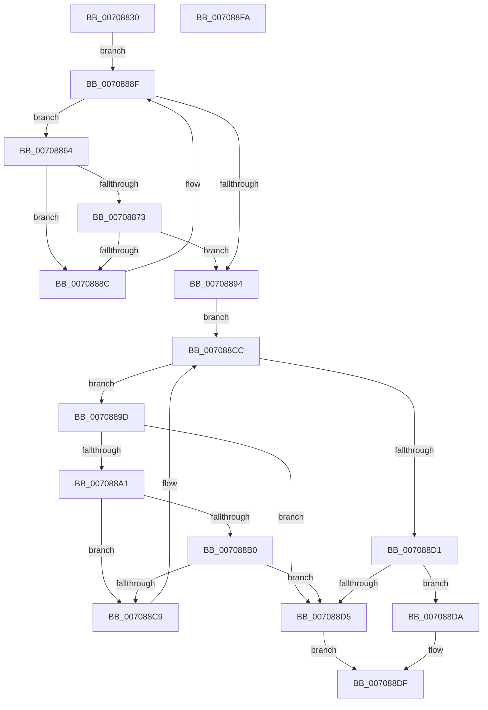

# HalpIommuLocateFromDevice

- RVA: `0x00708830`–`0x007088FB` (길이 `203` bytes)
- VA: `0x0000000140708830`
- 실행 섹션: `PAGE`
- PDB 이름 있음: `예`; PDB Function 태그: `아니요`
- unwind 정보 RVA: `0x00084C9C`
- 디코드: `64`개 명령, `203/203` bytes 표시
- 미해석 바이트: `0` (있으면 어셈블리에 `.byte`로 보존)

> 이 문서는 커널 이미지의 기계어와 PDB 기호를 분석해 생성했습니다. 4번과 5번은 함수 원형과 자료형을 바이너리 사용 방식에서 추정한 C 해석이며 원본 소스 복구 결과는 아닙니다.

## 1. Dependencies

- 직접 호출 지점: **2**; 고유 호출 대상: **1**
- 직접 호출자로 확인된 함수: **2**
- RIP 상대 이미지 참조: **1**

### Outgoing calls
- `0x00708883` → [guard_dispatch_icall](../../text/6B/guard_dispatch_icall_function_006BAAD0.md) (function, `0x006BAAD0`)
- `0x007088C0` → [guard_dispatch_icall](../../text/6B/guard_dispatch_icall_function_006BAAD0.md) (function, `0x006BAAD0`)

### Direct callers
- [IommuCreateAtsDevice](../../text/56/IommuCreateAtsDevice_function_00564BB0.md) at `0x00564C0C`
- [HalpQueryIommuReservedRegionInformation](HalpQueryIommuReservedRegionInformation_function_00708904.md) at `0x00708946`

### Static image references
- `0x00708848` → RVA `0x00FC1740` (`.data`; read)

## 2. Other-region calls and transfers

- 다른 실행 섹션으로 향하는 call: **2**
  - `0x00708883` → [guard_dispatch_icall](../../text/6B/guard_dispatch_icall_function_006BAAD0.md) (`PAGE` → `.text`)
  - `0x007088C0` → [guard_dispatch_icall](../../text/6B/guard_dispatch_icall_function_006BAAD0.md) (`PAGE` → `.text`)
- 별도 외부 분기/꼬리 이동을 확인하지 못했습니다.

## 3. Assembly (complete function range)

```asm
00708830  48 89 5C 24 08                  mov qword ptr [rsp + 8], rbx
00708835  48 89 6C 24 10                  mov qword ptr [rsp + 0x10], rbp
0070883A  48 89 74 24 18                  mov qword ptr [rsp + 0x18], rsi
0070883F  57                              push rdi
00708840  41 56                           push r14
00708842  41 57                           push r15
00708844  48 83 EC 30                     sub rsp, 0x30
00708848  48 8B 3D F1 8E 8B 00            mov rdi, qword ptr [rip + 0x8b8ef1]
0070884F  4C 8D 3D EA 8E 8B 00            lea r15, [rip + 0x8b8eea]
00708856  33 DB                           xor ebx, ebx
00708858  4C 8B F2                        mov r14, rdx
0070885B  8A C3                           mov al, bl
0070885D  8B F3                           mov esi, ebx
0070885F  48 8B E9                        mov rbp, rcx
00708862  EB 2B                           jmp 0x14070888f
00708864  4C 8B 97 D0 00 00 00            mov r10, qword ptr [rdi + 0xd0]
0070886B  48 8B F7                        mov rsi, rdi
0070886E  4D 85 D2                        test r10, r10
00708871  74 19                           je 0x14070888c
00708873  48 8B 4F 10                     mov rcx, qword ptr [rdi + 0x10]
00708877  45 33 C9                        xor r9d, r9d
0070887A  45 33 C0                        xor r8d, r8d
0070887D  48 8B D5                        mov rdx, rbp
00708880  49 8B C2                        mov rax, r10
00708883  E8 48 22 FB FF                  call 0x1406baad0
00708888  84 C0                           test al, al
0070888A  75 08                           jne 0x140708894
0070888C  48 8B 3F                        mov rdi, qword ptr [rdi]
0070888F  49 3B FF                        cmp rdi, r15
00708892  75 D0                           jne 0x140708864
00708894  48 8B 3D A5 8E 8B 00            mov rdi, qword ptr [rip + 0x8b8ea5]
0070889B  EB 2F                           jmp 0x1407088cc
0070889D  84 C0                           test al, al
0070889F  75 34                           jne 0x1407088d5
007088A1  4C 8B 97 D0 00 00 00            mov r10, qword ptr [rdi + 0xd0]
007088A8  48 8B F7                        mov rsi, rdi
007088AB  4D 85 D2                        test r10, r10
007088AE  74 19                           je 0x1407088c9
007088B0  48 8B 4F 10                     mov rcx, qword ptr [rdi + 0x10]
007088B4  45 33 C9                        xor r9d, r9d
007088B7  41 B0 01                        mov r8b, 1
007088BA  48 8B D5                        mov rdx, rbp
007088BD  49 8B C2                        mov rax, r10
007088C0  E8 0B 22 FB FF                  call 0x1406baad0
007088C5  84 C0                           test al, al
007088C7  75 0C                           jne 0x1407088d5
007088C9  48 8B 3F                        mov rdi, qword ptr [rdi]
007088CC  49 3B FF                        cmp rdi, r15
007088CF  75 CC                           jne 0x14070889d
007088D1  84 C0                           test al, al
007088D3  74 05                           je 0x1407088da
007088D5  49 89 36                        mov qword ptr [r14], rsi
007088D8  EB 05                           jmp 0x1407088df
007088DA  BB 25 02 00 C0                  mov ebx, 0xc0000225
007088DF  48 8B 6C 24 58                  mov rbp, qword ptr [rsp + 0x58]
007088E4  8B C3                           mov eax, ebx
007088E6  48 8B 5C 24 50                  mov rbx, qword ptr [rsp + 0x50]
007088EB  48 8B 74 24 60                  mov rsi, qword ptr [rsp + 0x60]
007088F0  48 83 C4 30                     add rsp, 0x30
007088F4  41 5F                           pop r15
007088F6  41 5E                           pop r14
007088F8  5F                              pop rdi
007088F9  C3                              ret
007088FA  CC                              int3
```

## 4. C-style interpretation (structured pseudocode)

```c
__int64 __fastcall HalpIommuLocateFromDevice(__int64 a1, __int64 a2, int a3, int a4)
{
    __int64 result;
    __int64 v_rbx;
    __int64 v_rsp;
    unsigned __int64 v_stack_p10;
    unsigned __int64 v_stack_p18;
    unsigned __int64 v_stack_p8;

    v_stack_p8 = v_rbx;
    v_stack_p10 = v_rbp;
    v_stack_p18 = v_rsi;
    v_rsp = (v_rsp) - (48);
    v_rbx = 0;
    goto loc_0070888F;
loc_00708864:
    if (*(unsigned __int64 *)(*(unsigned __int64 *)(v_rip + 9146097) + 208) == 0) goto loc_0070888C;
    a4 = 0;
    a3 = 0;
    result = guard_dispatch_icall(*(unsigned __int64 *)(*(unsigned __int64 *)(v_rip + 9146097) + 16), a1, a3, a4);
    if ((unsigned __int8)(result) != 0) goto loc_00708894;
loc_0070888C:
loc_0070888F:
    if ((*(unsigned __int64 *)(*(unsigned __int64 *)(v_rip + 9146097))) != (v_rip + 9146090)) goto loc_00708864;
loc_00708894:
    goto loc_007088CC;
loc_0070889D:
    if ((unsigned __int8)(result) != 0) goto loc_007088D5;
    if (*(unsigned __int64 *)(*(unsigned __int64 *)(v_rip + 9146021) + 208) == 0) goto loc_007088C9;
    a4 = 0;
    result = guard_dispatch_icall(*(unsigned __int64 *)(*(unsigned __int64 *)(v_rip + 9146021) + 16), a1, 1, a4);
    if ((unsigned __int8)(result) != 0) goto loc_007088D5;
loc_007088C9:
loc_007088CC:
    if ((*(unsigned __int64 *)(*(unsigned __int64 *)(v_rip + 9146021))) != (v_rip + 9146090)) goto loc_0070889D;
    if ((unsigned __int8)(result) == 0) goto loc_007088DA;
loc_007088D5:
    *(unsigned __int64 *)(a2) = *(unsigned __int64 *)(v_rip + 9146021);
    goto loc_007088DF;
loc_007088DA:
loc_007088DF:
    v_rsp = (v_rsp) + (48);
    return (unsigned int)((unsigned int)((unsigned int)(0xC0000225ULL)));
}
```

## 5. (Beta) C Style

```c
int64_t HalpIommuLocateFromDevice(int64_t Arg1, void *Arg2, int32_t Arg3, int32_t Arg4)
{
    uint8_t *arg2 = (uint8_t *)Arg2;

    int64_t result;
    int64_t local_rbx;
    int64_t local_rsp;
    uint64_t v_stack_p10;
    uint64_t v_stack_p18;
    uint64_t v_stack_p8;

    v_stack_p8 = local_rbx;
    v_stack_p10 = local_rbp;
    v_stack_p18 = local_rsi;
    local_rsp = (local_rsp) - (48);
    local_rbx = 0;
    goto loc_0070888F;
loc_00708864:
    if (*(uint64_t *)(*(uint64_t *)(v_rip + 0x8B8EF1) + 0xD0) == 0) goto loc_0070888C;
    Arg4 = 0;
    Arg3 = 0;
    result = guard_dispatch_icall(*(uint64_t *)(*(uint64_t *)(v_rip + 0x8B8EF1) + 0x10), Arg1, Arg3, Arg4);
    if ((uint8_t)(result) != 0) goto loc_00708894;
loc_0070888C:
loc_0070888F:
    if ((*(uint64_t *)(*(uint64_t *)(v_rip + 0x8B8EF1))) != (v_rip + 9146090)) goto loc_00708864;
loc_00708894:
    goto loc_007088CC;
loc_0070889D:
    if ((uint8_t)(result) != 0) goto loc_007088D5;
    if (*(uint64_t *)(*(uint64_t *)(v_rip + 0x8B8EA5) + 0xD0) == 0) goto loc_007088C9;
    Arg4 = 0;
    result = guard_dispatch_icall(*(uint64_t *)(*(uint64_t *)(v_rip + 0x8B8EA5) + 0x10), Arg1, 1, Arg4);
    if ((uint8_t)(result) != 0) goto loc_007088D5;
loc_007088C9:
loc_007088CC:
    if ((*(uint64_t *)(*(uint64_t *)(v_rip + 0x8B8EA5))) != (v_rip + 9146090)) goto loc_0070889D;
    if ((uint8_t)(result) == 0) goto loc_007088DA;
loc_007088D5:
    *(uint64_t *)(arg2) = *(uint64_t *)(v_rip + 0x8B8EA5);
    goto loc_007088DF;
loc_007088DA:
loc_007088DF:
    local_rsp = (local_rsp) + (48);
    return (uint32_t)((uint32_t)((uint32_t)(0xC0000225ULL)));
}
```

### 관측된 메모리 오프셋

구조체 형식이 확인되지 않은 접근은 인자 기준의 오프셋으로만 기록했습니다.

| 기준 인자 | 오프셋 표현 | 폭 (bit) | 접근 |
|---|---:|---:|---|
| `Arg2` | `+ 0x0` | `64` | `W` |

## 6. Execution-region graph

[열기: 2D/3D 그래프와 함수 탐색 컨트롤 패널](../../../control-panel.html?section=page&rva=0x00708830&view=graph)

- 2D 그래프는 위에서 아래로 흐르고, 3D 그래프는 빈 공간을 드래그해 회전합니다. Shift+드래그는 이동, 휠은 확대·축소, 함수 노드 선택은 대상 보고서 이동입니다.

### Static fallback


