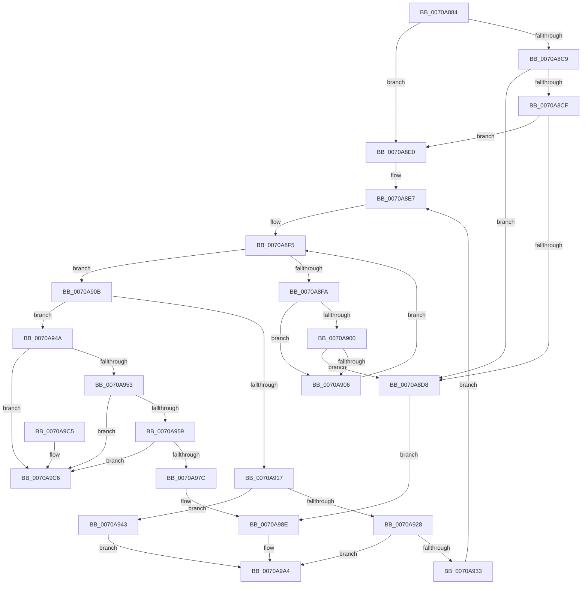

# HalpIrtAllocateDeviceAperture

- RVA: `0x0070A884`–`0x0070A9CD` (길이 `329` bytes)
- VA: `0x000000014070A884`
- 실행 섹션: `PAGE`
- PDB 이름 있음: `예`; PDB Function 태그: `아니요`
- unwind 정보 RVA: `0x000C45E0`
- 디코드: `89`개 명령, `329/329` bytes 표시
- 미해석 바이트: `0` (있으면 어셈블리에 `.byte`로 보존)

> 이 문서는 커널 이미지의 기계어와 PDB 기호를 분석해 생성했습니다. 4번과 5번은 함수 원형과 자료형을 바이너리 사용 방식에서 추정한 C 해석이며 원본 소스 복구 결과는 아닙니다.

## 1. Dependencies

- 직접 호출 지점: **5**; 고유 호출 대상: **3**
- 직접 호출자로 확인된 함수: **2**
- RIP 상대 이미지 참조: **7**

### Outgoing calls
- `0x0070A8B8` → [ExAcquireFastMutex](../../text/20/ExAcquireFastMutex_function_0020E5A0.md) (function, `0x0020E5A0`)
- `0x0070A91E` → [ExReleaseFastMutex](../../text/25/ExReleaseFastMutex_function_002519C0.md) (function, `0x002519C0`)
- `0x0070A928` → [HalpIrtExtendApertureRange](HalpIrtExtendApertureRange_function_0070AC38.md) (function, `0x0070AC38`)
- `0x0070A93C` → [ExAcquireFastMutex](../../text/20/ExAcquireFastMutex_function_0020E5A0.md) (function, `0x0020E5A0`)
- `0x0070A995` → [ExReleaseFastMutex](../../text/25/ExReleaseFastMutex_function_002519C0.md) (function, `0x002519C0`)

### Direct callers
- [HalpInitializeInterruptRemappingBspLate](HalpInitializeInterruptRemappingBspLate_function_0070A708.md) at `0x0070A835`
- [HalpIrtAllocateIndex](HalpIrtAllocateIndex_function_0070A9D4.md) at `0x0070AA4D`

### Static image references
- `0x0070A8A7` → RVA `0x00F90980` (`.data`; read)
- `0x0070A8BD` → RVA `0x00F90978` (`.data`; read)
- `0x0070A8CF` → RVA `0x00F90740` (`.data`; read)
- `0x0070A8E0` → RVA `0x00F90710` (`.data`; read)
- `0x0070A8EE` → RVA `0x00F90730` (`.data`; read)
- `0x0070A959` → RVA `0x00F90730` (`.data`; write)
- `0x0070A987` → RVA `0x00F90710` (`.data`; write)

## 2. Other-region calls and transfers

- 다른 실행 섹션으로 향하는 call: **4**
  - `0x0070A8B8` → [ExAcquireFastMutex](../../text/20/ExAcquireFastMutex_function_0020E5A0.md) (`PAGE` → `.text`)
  - `0x0070A91E` → [ExReleaseFastMutex](../../text/25/ExReleaseFastMutex_function_002519C0.md) (`PAGE` → `.text`)
  - `0x0070A93C` → [ExAcquireFastMutex](../../text/20/ExAcquireFastMutex_function_0020E5A0.md) (`PAGE` → `.text`)
  - `0x0070A995` → [ExReleaseFastMutex](../../text/25/ExReleaseFastMutex_function_002519C0.md) (`PAGE` → `.text`)
- 별도 외부 분기/꼬리 이동을 확인하지 못했습니다.

## 3. Assembly (complete function range)

```asm
0070A884  48 8B C4                        mov rax, rsp
0070A887  48 89 58 08                     mov qword ptr [rax + 8], rbx
0070A88B  48 89 68 10                     mov qword ptr [rax + 0x10], rbp
0070A88F  48 89 70 18                     mov qword ptr [rax + 0x18], rsi
0070A893  48 89 78 20                     mov qword ptr [rax + 0x20], rdi
0070A897  41 54                           push r12
0070A899  41 56                           push r14
0070A89B  41 57                           push r15
0070A89D  48 83 EC 20                     sub rsp, 0x20
0070A8A1  44 8B E1                        mov r12d, ecx
0070A8A4  45 8B F1                        mov r14d, r9d
0070A8A7  48 8D 0D D2 60 88 00            lea rcx, [rip + 0x8860d2]
0070A8AE  41 8B F0                        mov esi, r8d
0070A8B1  44 8B FA                        mov r15d, edx
0070A8B4  33 ED                           xor ebp, ebp
0070A8B6  33 FF                           xor edi, edi
0070A8B8  E8 E3 3C B0 FF                  call 0x14020e5a0
0070A8BD  48 8B 1D B4 60 88 00            mov rbx, qword ptr [rip + 0x8860b4]
0070A8C4  48 85 DB                        test rbx, rbx
0070A8C7  74 17                           je 0x14070a8e0
0070A8C9  41 83 FE 03                     cmp r14d, 3
0070A8CD  75 09                           jne 0x14070a8d8
0070A8CF  83 3D 6A 5E 88 00 01            cmp dword ptr [rip + 0x885e6a], 1
0070A8D6  75 08                           jne 0x14070a8e0
0070A8D8  01 73 14                        add dword ptr [rbx + 0x14], esi
0070A8DB  E9 AE 00 00 00                  jmp 0x14070a98e
0070A8E0  4C 8D 35 29 5E 88 00            lea r14, [rip + 0x885e29]
0070A8E7  48 8B 1D 22 5E 88 00            mov rbx, qword ptr [rip + 0x885e22]
0070A8EE  48 8D 0D 3B 5E 88 00            lea rcx, [rip + 0x885e3b]
0070A8F5  49 3B DE                        cmp rbx, r14
0070A8F8  74 11                           je 0x14070a90b
0070A8FA  44 39 63 18                     cmp dword ptr [rbx + 0x18], r12d
0070A8FE  75 06                           jne 0x14070a906
0070A900  44 39 7B 1C                     cmp dword ptr [rbx + 0x1c], r15d
0070A904  74 D2                           je 0x14070a8d8
0070A906  48 8B 1B                        mov rbx, qword ptr [rbx]
0070A909  EB EA                           jmp 0x14070a8f5
0070A90B  48 8B 1D 1E 5E 88 00            mov rbx, qword ptr [rip + 0x885e1e]
0070A912  48 3B D9                        cmp rbx, rcx
0070A915  75 33                           jne 0x14070a94a
0070A917  48 8D 0D 62 60 88 00            lea rcx, [rip + 0x886062]
0070A91E  E8 9D 70 B4 FF                  call 0x1402519c0
0070A923  83 FD 01                        cmp ebp, 1
0070A926  73 1B                           jae 0x14070a943
0070A928  E8 0B 03 00 00                  call 0x14070ac38
0070A92D  8B F8                           mov edi, eax
0070A92F  85 C0                           test eax, eax
0070A931  78 71                           js 0x14070a9a4
0070A933  FF C5                           inc ebp
0070A935  48 8D 0D 44 60 88 00            lea rcx, [rip + 0x886044]
0070A93C  E8 5F 3C B0 FF                  call 0x14020e5a0
0070A941  EB A4                           jmp 0x14070a8e7
0070A943  BF 9A 00 00 C0                  mov edi, 0xc000009a
0070A948  EB 5A                           jmp 0x14070a9a4
0070A94A  48 8B 03                        mov rax, qword ptr [rbx]
0070A94D  48 39 4B 08                     cmp qword ptr [rbx + 8], rcx
0070A951  75 73                           jne 0x14070a9c6
0070A953  48 39 58 08                     cmp qword ptr [rax + 8], rbx
0070A957  75 6D                           jne 0x14070a9c6
0070A959  48 89 05 D0 5D 88 00            mov qword ptr [rip + 0x885dd0], rax
0070A960  48 89 48 08                     mov qword ptr [rax + 8], rcx
0070A964  44 89 63 18                     mov dword ptr [rbx + 0x18], r12d
0070A968  44 89 7B 1C                     mov dword ptr [rbx + 0x1c], r15d
0070A96C  89 73 14                        mov dword ptr [rbx + 0x14], esi
0070A96F  48 8B 05 9A 5D 88 00            mov rax, qword ptr [rip + 0x885d9a]
0070A976  4C 39 70 08                     cmp qword ptr [rax + 8], r14
0070A97A  75 4A                           jne 0x14070a9c6
0070A97C  48 89 03                        mov qword ptr [rbx], rax
0070A97F  4C 89 73 08                     mov qword ptr [rbx + 8], r14
0070A983  48 89 58 08                     mov qword ptr [rax + 8], rbx
0070A987  48 89 1D 82 5D 88 00            mov qword ptr [rip + 0x885d82], rbx
0070A98E  48 8D 0D EB 5F 88 00            lea rcx, [rip + 0x885feb]
0070A995  E8 26 70 B4 FF                  call 0x1402519c0
0070A99A  48 8B 4C 24 60                  mov rcx, qword ptr [rsp + 0x60]
0070A99F  8B 53 10                        mov edx, dword ptr [rbx + 0x10]
0070A9A2  89 11                           mov dword ptr [rcx], edx
0070A9A4  48 8B 5C 24 40                  mov rbx, qword ptr [rsp + 0x40]
0070A9A9  8B C7                           mov eax, edi
0070A9AB  48 8B 7C 24 58                  mov rdi, qword ptr [rsp + 0x58]
0070A9B0  48 8B 6C 24 48                  mov rbp, qword ptr [rsp + 0x48]
0070A9B5  48 8B 74 24 50                  mov rsi, qword ptr [rsp + 0x50]
0070A9BA  48 83 C4 20                     add rsp, 0x20
0070A9BE  41 5F                           pop r15
0070A9C0  41 5E                           pop r14
0070A9C2  41 5C                           pop r12
0070A9C4  C3                              ret
0070A9C5  CC                              int3
0070A9C6  B9 03 00 00 00                  mov ecx, 3
0070A9CB  CD 29                           int 0x29
```

## 4. C-style interpretation (structured pseudocode)

```c
__int64 __fastcall HalpIrtAllocateDeviceAperture(int a1, int a2, int a3, int a4, __int64 a5)
{
    __int64 result;
    __int64 v_rbp;
    __int64 v_rdi;
    __int64 v_rsp;
    unsigned __int64 v_stack_p10;
    unsigned __int64 v_stack_p18;
    unsigned __int64 v_stack_p20;
    unsigned __int64 v_stack_p8;

    *(unsigned __int64 *)(v_rsp + 8) = v_rbx;
    *(unsigned __int64 *)(v_rsp + 16) = v_rbp;
    *(unsigned __int64 *)(v_rsp + 24) = v_rsi;
    *(unsigned __int64 *)(v_rsp + 32) = v_rdi;
    v_rsp = (v_rsp) - (32);
    v_rbp = 0;
    v_rdi = 0;
    result = ExAcquireFastMutex(v_rip + 8937682, a2, a3, a4);
    if (*(unsigned __int64 *)(v_rip + 8937652) == 0) goto loc_0070A8E0;
    if (((unsigned int)((unsigned int)(a4))) != 3) goto loc_0070A8D8;
    if ((*(unsigned int *)(v_rip + 8937066)) != 1) goto loc_0070A8E0;
loc_0070A8D8:
    goto loc_0070A98E;
loc_0070A8E0:
loc_0070A8E7:
loc_0070A8F5:
    if ((*(unsigned __int64 *)(v_rip + 8936994)) == (v_rip + 8937001)) goto loc_0070A90B;
    if ((*(unsigned int *)(*(unsigned __int64 *)(v_rip + 8936994) + 24)) != ((unsigned int)((unsigned int)(a1)))) goto loc_0070A906;
    if ((*(unsigned int *)(*(unsigned __int64 *)(v_rip + 8936994) + 28)) == ((unsigned int)((unsigned int)(a2)))) goto loc_0070A8D8;
loc_0070A906:
    goto loc_0070A8F5;
loc_0070A90B:
    if ((*(unsigned __int64 *)(v_rip + 8936990)) != (v_rip + 8937019)) goto loc_0070A94A;
    result = ExReleaseFastMutex(v_rip + 8937570, a2, a3, a4);
    if (0 >= 1) goto loc_0070A943;
    result = HalpIrtExtendApertureRange(v_rip + 8937570, a2, a3, a4);
    if (sign_flag) goto loc_0070A9A4;
    v_rbp = (unsigned int)((v_rbp) + 1);
    result = ExAcquireFastMutex(v_rip + 8937540, a2, a3, a4);
    goto loc_0070A8E7;
loc_0070A943:
    goto loc_0070A9A4;
loc_0070A94A:
    if ((*(unsigned __int64 *)(*(unsigned __int64 *)(v_rip + 8936990) + 8)) != (v_rip + 8937540)) goto loc_0070A9C6;
    if ((*(unsigned __int64 *)(*(unsigned __int64 *)(*(unsigned __int64 *)(v_rip + 8936990)) + 8)) != (*(unsigned __int64 *)(v_rip + 8936990))) goto loc_0070A9C6;
    *(unsigned __int64 *)(v_rip + 8936912) = *(unsigned __int64 *)(*(unsigned __int64 *)(v_rip + 8936990));
    *(unsigned __int64 *)(*(unsigned __int64 *)(*(unsigned __int64 *)(v_rip + 8936990)) + 8) = v_rip + 8937540;
    *(unsigned int *)(*(unsigned __int64 *)(v_rip + 8936990) + 24) = (unsigned int)((unsigned int)(a1));
    *(unsigned int *)(*(unsigned __int64 *)(v_rip + 8936990) + 28) = (unsigned int)((unsigned int)(a2));
    *(unsigned int *)(*(unsigned __int64 *)(v_rip + 8936990) + 20) = (unsigned int)((unsigned int)(a3));
    if ((*(unsigned __int64 *)(*(unsigned __int64 *)(v_rip + 8936858) + 8)) != (v_rip + 8937001)) goto loc_0070A9C6;
    *(unsigned __int64 *)(*(unsigned __int64 *)(v_rip + 8936990)) = *(unsigned __int64 *)(v_rip + 8936858);
    *(unsigned __int64 *)(*(unsigned __int64 *)(v_rip + 8936990) + 8) = v_rip + 8937001;
    *(unsigned __int64 *)(*(unsigned __int64 *)(v_rip + 8936858) + 8) = *(unsigned __int64 *)(v_rip + 8936990);
    *(unsigned __int64 *)(v_rip + 8936834) = *(unsigned __int64 *)(v_rip + 8936990);
loc_0070A98E:
    result = ExReleaseFastMutex(v_rip + 8937451, a2, a3, a4);
    *(unsigned int *)(a5) = (unsigned int)((unsigned int)(*(unsigned int *)(*(unsigned __int64 *)(v_rip + 8936990) + 16)));
loc_0070A9A4:
    v_rsp = (v_rsp) + (32);
    return (unsigned int)((unsigned int)((unsigned int)(0xC000009AULL)));
loc_0070A9C6:
    return (unsigned int)((unsigned int)((unsigned int)(0xC000009AULL)));
}
```

## 5. (Beta) C Style

```c
int64_t HalpIrtAllocateDeviceAperture(int32_t Arg1, int32_t Arg2, int32_t Arg3, int32_t Arg4, void *Arg5)
{
    uint8_t *arg5 = (uint8_t *)Arg5;

    int64_t result;
    int64_t local_rbp;
    int64_t local_rdi;
    int64_t local_rsp;
    uint64_t v_stack_p10;
    uint64_t v_stack_p18;
    uint64_t v_stack_p20;
    uint64_t v_stack_p8;

    *(uint64_t *)(local_rsp + 0x8) = local_rbx;
    *(uint64_t *)(local_rsp + 0x10) = local_rbp;
    *(uint64_t *)(local_rsp + 0x18) = local_rsi;
    *(uint64_t *)(local_rsp + 0x20) = local_rdi;
    local_rsp = (local_rsp) - (32);
    local_rbp = 0;
    local_rdi = 0;
    result = ExAcquireFastMutex(v_rip + 8937682, Arg2, Arg3, Arg4);
    if (*(uint64_t *)(v_rip + 0x8860B4) == 0) goto loc_0070A8E0;
    if (((uint32_t)((uint32_t)(Arg4))) != 3) goto loc_0070A8D8;
    if ((*(uint32_t *)(v_rip + 0x885E6A)) != 1) goto loc_0070A8E0;
loc_0070A8D8:
    goto loc_0070A98E;
loc_0070A8E0:
loc_0070A8E7:
loc_0070A8F5:
    if ((*(uint64_t *)(v_rip + 0x885E22)) == (v_rip + 8937001)) goto loc_0070A90B;
    if ((*(uint32_t *)(*(uint64_t *)(v_rip + 0x885E22) + 0x18)) != ((uint32_t)((uint32_t)(Arg1)))) goto loc_0070A906;
    if ((*(uint32_t *)(*(uint64_t *)(v_rip + 0x885E22) + 0x1C)) == ((uint32_t)((uint32_t)(Arg2)))) goto loc_0070A8D8;
loc_0070A906:
    goto loc_0070A8F5;
loc_0070A90B:
    if ((*(uint64_t *)(v_rip + 0x885E1E)) != (v_rip + 8937019)) goto loc_0070A94A;
    result = ExReleaseFastMutex(v_rip + 8937570, Arg2, Arg3, Arg4);
    if (0 >= 1) goto loc_0070A943;
    result = HalpIrtExtendApertureRange(v_rip + 8937570, Arg2, Arg3, Arg4);
    if (sign_flag) goto loc_0070A9A4;
    local_rbp = (uint32_t)((local_rbp) + 1);
    result = ExAcquireFastMutex(v_rip + 8937540, Arg2, Arg3, Arg4);
    goto loc_0070A8E7;
loc_0070A943:
    goto loc_0070A9A4;
loc_0070A94A:
    if ((*(uint64_t *)(*(uint64_t *)(v_rip + 0x885E1E) + 0x8)) != (v_rip + 8937540)) goto loc_0070A9C6;
    if ((*(uint64_t *)(*(uint64_t *)(*(uint64_t *)(v_rip + 0x885E1E)) + 0x8)) != (*(uint64_t *)(v_rip + 0x885E1E))) goto loc_0070A9C6;
    *(uint64_t *)(v_rip + 0x885DD0) = *(uint64_t *)(*(uint64_t *)(v_rip + 0x885E1E));
    *(uint64_t *)(*(uint64_t *)(*(uint64_t *)(v_rip + 0x885E1E)) + 0x8) = v_rip + 8937540;
    *(uint32_t *)(*(uint64_t *)(v_rip + 0x885E1E) + 0x18) = (uint32_t)((uint32_t)(Arg1));
    *(uint32_t *)(*(uint64_t *)(v_rip + 0x885E1E) + 0x1C) = (uint32_t)((uint32_t)(Arg2));
    *(uint32_t *)(*(uint64_t *)(v_rip + 0x885E1E) + 0x14) = (uint32_t)((uint32_t)(Arg3));
    if ((*(uint64_t *)(*(uint64_t *)(v_rip + 0x885D9A) + 0x8)) != (v_rip + 8937001)) goto loc_0070A9C6;
    *(uint64_t *)(*(uint64_t *)(v_rip + 0x885E1E)) = *(uint64_t *)(v_rip + 0x885D9A);
    *(uint64_t *)(*(uint64_t *)(v_rip + 0x885E1E) + 0x8) = v_rip + 8937001;
    *(uint64_t *)(*(uint64_t *)(v_rip + 0x885D9A) + 0x8) = *(uint64_t *)(v_rip + 0x885E1E);
    *(uint64_t *)(v_rip + 0x885D82) = *(uint64_t *)(v_rip + 0x885E1E);
loc_0070A98E:
    result = ExReleaseFastMutex(v_rip + 8937451, Arg2, Arg3, Arg4);
    *(uint32_t *)(arg5) = (uint32_t)((uint32_t)(*(uint32_t *)(*(uint64_t *)(v_rip + 0x885E1E) + 0x10)));
loc_0070A9A4:
    local_rsp = (local_rsp) + (32);
    return (uint32_t)((uint32_t)((uint32_t)(0xC000009AULL)));
loc_0070A9C6:
    return (uint32_t)((uint32_t)((uint32_t)(0xC000009AULL)));
}
```

### 관측된 메모리 오프셋

구조체 형식이 확인되지 않은 접근은 인자 기준의 오프셋으로만 기록했습니다.

| 기준 인자 | 오프셋 표현 | 폭 (bit) | 접근 |
|---|---:|---:|---|
| `Arg5` | `+ 0x0` | `32` | `W` |

## 6. Execution-region graph

[열기: 2D/3D 그래프와 함수 탐색 컨트롤 패널](../../../control-panel.html?section=page&rva=0x0070A884&view=graph)

- 2D 그래프는 위에서 아래로 흐르고, 3D 그래프는 빈 공간을 드래그해 회전합니다. Shift+드래그는 이동, 휠은 확대·축소, 함수 노드 선택은 대상 보고서 이동입니다.

### Static fallback


