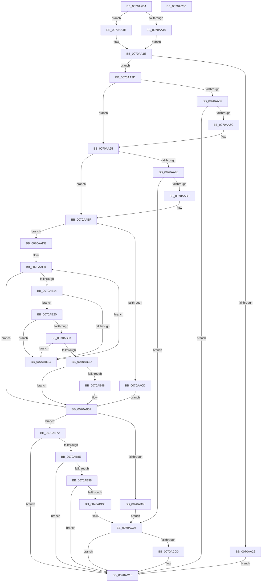

# HalpIrtAllocateIndex

- RVA: `0x0070A9D4`–`0x0070AC31` (길이 `605` bytes)
- VA: `0x000000014070A9D4`
- 실행 섹션: `PAGE`
- PDB 이름 있음: `예`; PDB Function 태그: `아니요`
- unwind 정보 RVA: `0x00086C3C`
- 디코드: `176`개 명령, `605/605` bytes 표시
- 미해석 바이트: `0` (있으면 어셈블리에 `.byte`로 보존)

> 이 문서는 커널 이미지의 기계어와 PDB 기호를 분석해 생성했습니다. 4번과 5번은 함수 원형과 자료형을 바이너리 사용 방식에서 추정한 C 해석이며 원본 소스 복구 결과는 아닙니다.

## 1. Dependencies

- 직접 호출 지점: **14**; 고유 호출 대상: **10**
- 직접 호출자로 확인된 함수: **2**
- RIP 상대 이미지 참조: **7**

### Outgoing calls
- `0x0070AA4D` → [HalpIrtAllocateDeviceAperture](HalpIrtAllocateDeviceAperture_function_0070A884.md) (function, `0x0070A884`)
- `0x0070AA7C` → [ExAcquireFastMutex](../../text/20/ExAcquireFastMutex_function_0020E5A0.md) (function, `0x0020E5A0`)
- `0x0070AA99` → [ExReleaseFastMutex](../../text/25/ExReleaseFastMutex_function_002519C0.md) (function, `0x002519C0`)
- `0x0070AAA1` → [HalpIrtExtendRemappingRange](HalpIrtExtendRemappingRange_function_0070AD40.md) (function, `0x0070AD40`)
- `0x0070AAB3` → [ExAcquireFastMutex](../../text/20/ExAcquireFastMutex_function_0020E5A0.md) (function, `0x0020E5A0`)
- `0x0070AAD5` → [RtlFindClearBitsAndSet](../../text/3E/RtlFindClearBitsAndSet_function_003E0CD0.md) (function, `0x003E0CD0`)
- `0x0070AB09` → [RtlFindNextForwardRunClear](../../text/3C/RtlFindNextForwardRunClear_function_003CF6A0.md) (function, `0x003CF6A0`)
- `0x0070AB50` → [RtlSetBits](../../text/3E/RtlSetBits_function_003E1610.md) (function, `0x003E1610`)
- `0x0070AB5E` → [ExReleaseFastMutex](../../text/25/ExReleaseFastMutex_function_002519C0.md) (function, `0x002519C0`)
- `0x0070ABD1` → [HalpIommuAllocateRemappingTableEntry](../../text/54/HalpIommuAllocateRemappingTableEntry_function_0054EB8C.md) (function, `0x0054EB8C`)
- `0x0070ABE3` → [ExAcquireFastMutex](../../text/20/ExAcquireFastMutex_function_0020E5A0.md) (function, `0x0020E5A0`)
- `0x0070ABF0` → [RtlClearBits](../../text/3E/RtlClearBits_function_003E1A90.md) (function, `0x003E1A90`)
- `0x0070ABFC` → [ExReleaseFastMutex](../../text/25/ExReleaseFastMutex_function_002519C0.md) (function, `0x002519C0`)
- `0x0070AC11` → [HalpIrtReleaseDeviceAperture](HalpIrtReleaseDeviceAperture_function_0070AF00.md) (function, `0x0070AF00`)

### Direct callers
- [HalpInterruptRemap](../../text/54/HalpInterruptRemap_function_00542AE4.md) at `0x00542C0B`
- [HalpInterruptRemap](../../text/54/HalpInterruptRemap_function_00542AE4.md) at `0x00542E99`
- [HalpInterruptRemapFixedLines](../../text/54/HalpInterruptRemapFixedLines_function_00544210.md) at `0x0054433A`

### Static image references
- `0x0070AA1E` → RVA `0x00F90970` (`.data`; read)
- `0x0070AA2D` → RVA `0x00F90960` (`.data`; read)
- `0x0070AA67` → RVA `0x00F90980` (`.data`; read)
- `0x0070AA73` → RVA `0x00F90720` (`.data`; read)
- `0x0070AA84` → RVA `0x00F90760` (`.data`; read)
- `0x0070AADE` → RVA `0x00F90968` (`.data`; read)
- `0x0070AAEB` → RVA `0x00F90744` (`.data`; read)

## 2. Other-region calls and transfers

- 다른 실행 섹션으로 향하는 call: **11**
  - `0x0070AA7C` → [ExAcquireFastMutex](../../text/20/ExAcquireFastMutex_function_0020E5A0.md) (`PAGE` → `.text`)
  - `0x0070AA99` → [ExReleaseFastMutex](../../text/25/ExReleaseFastMutex_function_002519C0.md) (`PAGE` → `.text`)
  - `0x0070AAB3` → [ExAcquireFastMutex](../../text/20/ExAcquireFastMutex_function_0020E5A0.md) (`PAGE` → `.text`)
  - `0x0070AAD5` → [RtlFindClearBitsAndSet](../../text/3E/RtlFindClearBitsAndSet_function_003E0CD0.md) (`PAGE` → `.text`)
  - `0x0070AB09` → [RtlFindNextForwardRunClear](../../text/3C/RtlFindNextForwardRunClear_function_003CF6A0.md) (`PAGE` → `.text`)
  - `0x0070AB50` → [RtlSetBits](../../text/3E/RtlSetBits_function_003E1610.md) (`PAGE` → `.text`)
  - `0x0070AB5E` → [ExReleaseFastMutex](../../text/25/ExReleaseFastMutex_function_002519C0.md) (`PAGE` → `.text`)
  - `0x0070ABD1` → [HalpIommuAllocateRemappingTableEntry](../../text/54/HalpIommuAllocateRemappingTableEntry_function_0054EB8C.md) (`PAGE` → `.text`)
  - `0x0070ABE3` → [ExAcquireFastMutex](../../text/20/ExAcquireFastMutex_function_0020E5A0.md) (`PAGE` → `.text`)
  - `0x0070ABF0` → [RtlClearBits](../../text/3E/RtlClearBits_function_003E1A90.md) (`PAGE` → `.text`)
  - `0x0070ABFC` → [ExReleaseFastMutex](../../text/25/ExReleaseFastMutex_function_002519C0.md) (`PAGE` → `.text`)
- 별도 외부 분기/꼬리 이동을 확인하지 못했습니다.

## 3. Assembly (complete function range)

```asm
0070A9D4  48 8B C4                        mov rax, rsp
0070A9D7  48 89 58 08                     mov qword ptr [rax + 8], rbx
0070A9DB  44 89 48 20                     mov dword ptr [rax + 0x20], r9d
0070A9DF  44 89 40 18                     mov dword ptr [rax + 0x18], r8d
0070A9E3  55                              push rbp
0070A9E4  56                              push rsi
0070A9E5  57                              push rdi
0070A9E6  41 54                           push r12
0070A9E8  41 55                           push r13
0070A9EA  41 56                           push r14
0070A9EC  41 57                           push r15
0070A9EE  48 83 EC 50                     sub rsp, 0x50
0070A9F2  33 ED                           xor ebp, ebp
0070A9F4  C6 44 24 40 00                  mov byte ptr [rsp + 0x40], 0
0070A9F9  89 68 BC                        mov dword ptr [rax - 0x44], ebp
0070A9FC  33 DB                           xor ebx, ebx
0070A9FE  48 8B 84 24 C0 00 00 00         mov rax, qword ptr [rsp + 0xc0]
0070AA06  45 8B D1                        mov r10d, r9d
0070AA09  45 8B D8                        mov r11d, r8d
0070AA0C  8B FA                           mov edi, edx
0070AA0E  4C 8B E9                        mov r13, rcx
0070AA11  48 85 C0                        test rax, rax
0070AA14  74 05                           je 0x14070aa1b
0070AA16  44 8B 20                        mov r12d, dword ptr [rax]
0070AA19  EB 03                           jmp 0x14070aa1e
0070AA1B  45 33 E4                        xor r12d, r12d
0070AA1E  39 1D 4C 5F 88 00               cmp dword ptr [rip + 0x885f4c], ebx
0070AA24  75 07                           jne 0x14070aa2d
0070AA26  21 19                           and dword ptr [rcx], ebx
0070AA28  E9 E9 01 00 00                  jmp 0x14070ac16
0070AA2D  8B 05 2D 5F 88 00               mov eax, dword ptr [rip + 0x885f2d]
0070AA33  A8 04                           test al, 4
0070AA35  74 2E                           je 0x14070aa65
0070AA37  48 8D 44 24 44                  lea rax, [rsp + 0x44]
0070AA3C  45 8B CC                        mov r9d, r12d
0070AA3F  44 8B C7                        mov r8d, edi
0070AA42  48 89 44 24 20                  mov qword ptr [rsp + 0x20], rax
0070AA47  41 8B D2                        mov edx, r10d
0070AA4A  41 8B CB                        mov ecx, r11d
0070AA4D  E8 32 FE FF FF                  call 0x14070a884
0070AA52  8B D8                           mov ebx, eax
0070AA54  85 C0                           test eax, eax
0070AA56  0F 88 BA 01 00 00               js 0x14070ac16
0070AA5C  8B 6C 24 44                     mov ebp, dword ptr [rsp + 0x44]
0070AA60  C6 44 24 40 01                  mov byte ptr [rsp + 0x40], 1
0070AA65  33 D2                           xor edx, edx
0070AA67  4C 8D 3D 12 5F 88 00            lea r15, [rip + 0x885f12]
0070AA6E  8B C5                           mov eax, ebp
0070AA70  49 8B CF                        mov rcx, r15
0070AA73  F7 35 A7 5C 88 00               div dword ptr [rip + 0x885ca7]
0070AA79  44 8B F0                        mov r14d, eax
0070AA7C  E8 1F 3B B0 FF                  call 0x14020e5a0
0070AA81  41 8B F6                        mov esi, r14d
0070AA84  48 8D 05 D5 5C 88 00            lea rax, [rip + 0x885cd5]
0070AA8B  48 03 F6                        add rsi, rsi
0070AA8E  48 83 7C F0 08 00               cmp qword ptr [rax + rsi*8 + 8], 0
0070AA94  75 29                           jne 0x14070aabf
0070AA96  49 8B CF                        mov rcx, r15
0070AA99  E8 22 6F B4 FF                  call 0x1402519c0
0070AA9E  41 8B CE                        mov ecx, r14d
0070AAA1  E8 9A 02 00 00                  call 0x14070ad40
0070AAA6  8B D8                           mov ebx, eax
0070AAA8  85 C0                           test eax, eax
0070AAAA  0F 88 56 01 00 00               js 0x14070ac06
0070AAB0  49 8B CF                        mov rcx, r15
0070AAB3  E8 E8 3A B0 FF                  call 0x14020e5a0
0070AAB8  48 8D 05 A1 5C 88 00            lea rax, [rip + 0x885ca1]
0070AABF  4C 8D 3C F0                     lea r15, [rax + rsi*8]
0070AAC3  8B 05 97 5E 88 00               mov eax, dword ptr [rip + 0x885e97]
0070AAC9  A8 01                           test al, 1
0070AACB  75 11                           jne 0x14070aade
0070AACD  45 33 C0                        xor r8d, r8d
0070AAD0  8B D7                           mov edx, edi
0070AAD2  49 8B CF                        mov rcx, r15
0070AAD5  E8 F6 61 CD FF                  call 0x1403e0cd0
0070AADA  8B F0                           mov esi, eax
0070AADC  EB 79                           jmp 0x14070ab57
0070AADE  8B 0D 84 5E 88 00               mov ecx, dword ptr [rip + 0x885e84]
0070AAE4  33 D2                           xor edx, edx
0070AAE6  8B C5                           mov eax, ebp
0070AAE8  0F AF C1                        imul eax, ecx
0070AAEB  F7 35 53 5C 88 00               div dword ptr [rip + 0x885c53]
0070AAF1  8D 41 FF                        lea eax, [rcx - 1]
0070AAF4  03 C2                           add eax, edx
0070AAF6  89 44 24 48                     mov dword ptr [rsp + 0x48], eax
0070AAFA  83 CE FF                        or esi, 0xffffffff
0070AAFD  4C 8D 44 24 44                  lea r8, [rsp + 0x44]
0070AB02  89 54 24 44                     mov dword ptr [rsp + 0x44], edx
0070AB06  49 8B CF                        mov rcx, r15
0070AB09  E8 92 4B CC FF                  call 0x1403cf6a0
0070AB0E  8B C8                           mov ecx, eax
0070AB10  85 C0                           test eax, eax
0070AB12  74 43                           je 0x14070ab57
0070AB14  8B 54 24 44                     mov edx, dword ptr [rsp + 0x44]
0070AB18  3B C7                           cmp eax, edi
0070AB1A  73 04                           jae 0x14070ab20
0070AB1C  03 D1                           add edx, ecx
0070AB1E  EB DD                           jmp 0x14070aafd
0070AB20  8D 5A FF                        lea ebx, [rdx - 1]
0070AB23  8B C7                           mov eax, edi
0070AB25  F7 D8                           neg eax
0070AB27  03 DF                           add ebx, edi
0070AB29  23 D8                           and ebx, eax
0070AB2B  8B C3                           mov eax, ebx
0070AB2D  2B C2                           sub eax, edx
0070AB2F  3B C1                           cmp eax, ecx
0070AB31  73 E9                           jae 0x14070ab1c
0070AB33  8B C2                           mov eax, edx
0070AB35  2B C3                           sub eax, ebx
0070AB37  03 C1                           add eax, ecx
0070AB39  3B C7                           cmp eax, edi
0070AB3B  72 DF                           jb 0x14070ab1c
0070AB3D  8D 47 FF                        lea eax, [rdi - 1]
0070AB40  03 C3                           add eax, ebx
0070AB42  3B 44 24 48                     cmp eax, dword ptr [rsp + 0x48]
0070AB46  77 0F                           ja 0x14070ab57
0070AB48  44 8B C7                        mov r8d, edi
0070AB4B  8B D3                           mov edx, ebx
0070AB4D  49 8B CF                        mov rcx, r15
0070AB50  E8 BB 6A CD FF                  call 0x1403e1610
0070AB55  8B F3                           mov esi, ebx
0070AB57  48 8D 0D 22 5E 88 00            lea rcx, [rip + 0x885e22]
0070AB5E  E8 5D 6E B4 FF                  call 0x1402519c0
0070AB63  83 FE FF                        cmp esi, -1
0070AB66  75 0A                           jne 0x14070ab72
0070AB68  BB 9A 00 00 C0                  mov ebx, 0xc000009a
0070AB6D  E9 94 00 00 00                  jmp 0x14070ac06
0070AB72  44 0F AF 35 CA 5B 88 00         imul r14d, dword ptr [rip + 0x885bca]
0070AB7A  33 DB                           xor ebx, ebx
0070AB7C  41 8D 0C 36                     lea ecx, [r14 + rsi]
0070AB80  41 89 4D 00                     mov dword ptr [r13], ecx
0070AB84  41 83 FC 03                     cmp r12d, 3
0070AB88  0F 85 88 00 00 00               jne 0x14070ac16
0070AB8E  8B 05 CC 5D 88 00               mov eax, dword ptr [rip + 0x885dcc]
0070AB94  A8 02                           test al, 2
0070AB96  74 7E                           je 0x14070ac16
0070AB98  8A 84 24 B8 00 00 00            mov al, byte ptr [rsp + 0xb8]
0070AB9F  8B D7                           mov edx, edi
0070ABA1  44 8B 8C 24 A8 00 00 00         mov r9d, dword ptr [rsp + 0xa8]
0070ABA9  44 8B 84 24 A0 00 00 00         mov r8d, dword ptr [rsp + 0xa0]
0070ABB1  88 44 24 30                     mov byte ptr [rsp + 0x30], al
0070ABB5  48 8B 84 24 B0 00 00 00         mov rax, qword ptr [rsp + 0xb0]
0070ABBD  48 89 44 24 28                  mov qword ptr [rsp + 0x28], rax
0070ABC2  48 8B 84 24 C0 00 00 00         mov rax, qword ptr [rsp + 0xc0]
0070ABCA  8B 40 38                        mov eax, dword ptr [rax + 0x38]
0070ABCD  89 44 24 20                     mov dword ptr [rsp + 0x20], eax
0070ABD1  E8 B6 3F E4 FF                  call 0x14054eb8c
0070ABD6  8B D8                           mov ebx, eax
0070ABD8  85 C0                           test eax, eax
0070ABDA  79 3A                           jns 0x14070ac16
0070ABDC  48 8D 0D 9D 5D 88 00            lea rcx, [rip + 0x885d9d]
0070ABE3  E8 B8 39 B0 FF                  call 0x14020e5a0
0070ABE8  44 8B C7                        mov r8d, edi
0070ABEB  8B D6                           mov edx, esi
0070ABED  49 8B CF                        mov rcx, r15
0070ABF0  E8 9B 6E CD FF                  call 0x1403e1a90
0070ABF5  48 8D 0D 84 5D 88 00            lea rcx, [rip + 0x885d84]
0070ABFC  E8 BF 6D B4 FF                  call 0x1402519c0
0070AC01  41 83 4D 00 FF                  or dword ptr [r13], 0xffffffff
0070AC06  80 7C 24 40 00                  cmp byte ptr [rsp + 0x40], 0
0070AC0B  74 09                           je 0x14070ac16
0070AC0D  8B D7                           mov edx, edi
0070AC0F  8B CD                           mov ecx, ebp
0070AC11  E8 EA 02 00 00                  call 0x14070af00
0070AC16  8B C3                           mov eax, ebx
0070AC18  48 8B 9C 24 90 00 00 00         mov rbx, qword ptr [rsp + 0x90]
0070AC20  48 83 C4 50                     add rsp, 0x50
0070AC24  41 5F                           pop r15
0070AC26  41 5E                           pop r14
0070AC28  41 5D                           pop r13
0070AC2A  41 5C                           pop r12
0070AC2C  5F                              pop rdi
0070AC2D  5E                              pop rsi
0070AC2E  5D                              pop rbp
0070AC2F  C3                              ret
0070AC30  CC                              int3
```

## 4. C-style interpretation (structured pseudocode)

```c
__int64 __fastcall HalpIrtAllocateIndex(__int64 a1, int a2, int a3, int a4, __int64 a5, unsigned __int8 a6, __int64 a7)
{
    __int64 result;
    __int64 v_r12;
    __int64 v_r14;
    __int64 v_rbp;
    __int64 v_rbx;
    __int64 v_rsi;
    __int64 v_rsp;
    unsigned int v_stack_m40;
    unsigned __int64 v_stack_m44;
    unsigned __int8 v_stack_m48;
    unsigned __int8 v_stack_m58;
    unsigned __int64 v_stack_m60;
    unsigned __int64 v_stack_m68;
    unsigned int v_stack_p18;
    unsigned int v_stack_p20;
    unsigned __int64 v_stack_p8;

    *(unsigned __int64 *)(v_rsp + 8) = v_rbx;
    *(unsigned int *)(v_rsp + 32) = a4;
    *(unsigned int *)(v_rsp + 24) = a3;
    v_rsp = (v_rsp) - (80);
    v_rbp = 0;
    v_stack_m48 = 0;
    *(unsigned int *)(v_rsp - 68) = 0;
    v_rbx = 0;
    if (a7 == 0) goto loc_0070AA1B;
    goto loc_0070AA1E;
loc_0070AA1B:
    v_r12 = 0;
loc_0070AA1E:
    if ((*(unsigned int *)(v_rip + 8937292)) != 0) goto loc_0070AA2D;
    goto loc_0070AC16;
loc_0070AA2D:
    if ((((unsigned __int8)((unsigned int)(*(unsigned int *)(v_rip + 8937261)))) & (4)) == 0) goto loc_0070AA65;
    v_stack_m68 = v_stack_m44;
    result = HalpIrtAllocateDeviceAperture((unsigned int)((unsigned int)((unsigned int)(a3))), (unsigned int)((unsigned int)((unsigned int)(a4))), (unsigned int)((unsigned int)((unsigned int)(a2))), 0);
    if (sign_flag) goto loc_0070AC16;
    v_stack_m48 = 1;
loc_0070AA65:
    a2 = 0;
    result = ExAcquireFastMutex(v_rip + 8937234, a2, (unsigned int)((unsigned int)((unsigned int)(a2))), 0);
    v_rsi = ((unsigned int)((unsigned int)((unsigned int)((unsigned int)((unsigned int)((unsigned int)((unsigned int)(v_stack_m44)))))))) + ((unsigned int)((unsigned int)((unsigned int)((unsigned int)((unsigned int)((unsigned int)((unsigned int)(v_stack_m44))))))));
    if ((*(unsigned __int64 *)(v_rip + 8936661 + v_rsi * 8 + 8)) != 0) goto loc_0070AABF;
    result = ExReleaseFastMutex(v_rip + 8937234, a2, (unsigned int)((unsigned int)((unsigned int)(a2))), 0);
    result = HalpIrtExtendRemappingRange((unsigned int)((unsigned int)((unsigned int)((unsigned int)((unsigned int)((unsigned int)((unsigned int)(v_stack_m44))))))), a2, (unsigned int)((unsigned int)((unsigned int)(a2))), 0);
    if (sign_flag) goto loc_0070AC06;
    result = ExAcquireFastMutex(v_rip + 8937234, a2, (unsigned int)((unsigned int)((unsigned int)(a2))), 0);
loc_0070AABF:
    if ((((unsigned __int8)((unsigned int)(*(unsigned int *)(v_rip + 8937111)))) & (1)) != 0) goto loc_0070AADE;
    a3 = 0;
    result = RtlFindClearBitsAndSet(v_rip + 8936609 + v_rsi * 8, (unsigned int)((unsigned int)((unsigned int)(a2))), a3, 0);
    goto loc_0070AB57;
loc_0070AADE:
    a2 = 0;
    result = (unsigned int)(((unsigned int)((unsigned int)((unsigned int)(v_stack_m44)))) * ((unsigned int)((unsigned int)(*(unsigned int *)(v_rip + 8937092)))));
    result = (unsigned int)(((unsigned int)(*(unsigned int *)(v_rip + 8937092)) - 1) + (0));
    v_stack_m40 = (unsigned int)(result);
    v_rsi = (unsigned int)(((unsigned int)((unsigned int)(result))) | (0xFFFFFFFFULL));
loc_0070AAFD:
    v_stack_m44 = 0;
    result = RtlFindNextForwardRunClear(v_rip + 8936609 + v_rsi * 8, a2, v_stack_m44, 0);
    if ((unsigned int)(result) == 0) goto loc_0070AB57;
    if (((unsigned int)(result)) >= ((unsigned int)((unsigned int)(a2)))) goto loc_0070AB20;
loc_0070AB1C:
    a2 = (unsigned int)(((unsigned int)(v_stack_m44)) + ((unsigned int)((unsigned int)((unsigned int)(result)))));
    goto loc_0070AAFD;
loc_0070AB20:
    result = (unsigned int)(-((unsigned int)((unsigned int)((unsigned int)(a2)))));
    v_rbx = (unsigned int)((a2 - 1) + ((unsigned int)((unsigned int)(a2))));
    v_rbx = (unsigned int)((v_rbx) & ((unsigned int)(result)));
    result = (unsigned int)(((unsigned int)((unsigned int)(v_rbx))) - (a2));
    if (((unsigned int)(result)) >= ((unsigned int)((unsigned int)((unsigned int)(result))))) goto loc_0070AB1C;
    result = (unsigned int)(((unsigned int)(a2)) - ((unsigned int)(v_rbx)));
    result = (unsigned int)((result) + ((unsigned int)((unsigned int)((unsigned int)(result)))));
    if (((unsigned int)(result)) < ((unsigned int)((unsigned int)(a2)))) goto loc_0070AB1C;
    result = (unsigned int)(((unsigned int)(a2) - 1) + ((unsigned int)(v_rbx)));
    if (((unsigned int)(result)) <= v_stack_m40) {
        a3 = (unsigned int)((unsigned int)(a2));
        a2 = (unsigned int)(v_rbx);
        a1 = v_rip + 8936609 + v_rsi * 8;
        result = RtlSetBits(a1, a2, a3, 0);
        v_rsi = (unsigned int)(v_rbx);
    }
    result = ExReleaseFastMutex(v_rip + 8936994, a2, a3, 0);
    if (((unsigned int)(v_rsi)) != -1) goto loc_0070AB72;
    goto loc_0070AC06;
loc_0070AB72:
    v_r14 = (unsigned int)(((unsigned int)((unsigned int)((unsigned int)((unsigned int)((unsigned int)(v_stack_m44)))))) * (*(unsigned int *)(v_rip + 8936394)));
    v_rbx = 0;
    *(unsigned int *)(a1) = (unsigned int)(v_r14 + v_rsi * 1);
    if (0 != 3) goto loc_0070AC16;
    if ((((unsigned __int8)((unsigned int)(*(unsigned int *)(v_rip + 8936908)))) & (2)) == 0) goto loc_0070AC16;
    v_stack_m58 = a6;
    v_stack_m60 = a5;
    v_stack_m68 = (unsigned int)((unsigned int)(*(unsigned int *)(a7 + 56)));
    result = HalpIommuAllocateRemappingTableEntry(v_r14 + v_rsi * 1, (unsigned int)((unsigned int)((unsigned int)(a2))), (unsigned int)(v_stack_p18), (unsigned int)(v_stack_p20));
    if (!sign_flag) goto loc_0070AC16;
    result = ExAcquireFastMutex(v_rip + 8936861, (unsigned int)((unsigned int)((unsigned int)(a2))), (unsigned int)(v_stack_p18), (unsigned int)(v_stack_p20));
    result = RtlClearBits(v_rip + 8936609 + v_rsi * 8, (unsigned int)((unsigned int)(v_rsi)), (unsigned int)((unsigned int)((unsigned int)(a2))), (unsigned int)(v_stack_p20));
    result = ExReleaseFastMutex(v_rip + 8936836, (unsigned int)((unsigned int)(v_rsi)), (unsigned int)((unsigned int)((unsigned int)(a2))), (unsigned int)(v_stack_p20));
loc_0070AC06:
    if (v_stack_m48 != 0) {
        a2 = (unsigned int)((unsigned int)(a2));
        a1 = (unsigned int)((unsigned int)(v_stack_m44));
        result = HalpIrtReleaseDeviceAperture(a1, a2, (unsigned int)((unsigned int)((unsigned int)(a2))), (unsigned int)(v_stack_p20));
    }
    v_rsp = (v_rsp) + (80);
    return (unsigned int)((unsigned int)((unsigned int)((unsigned int)(result))));
}
```

## 5. (Beta) C Style

```c
int64_t HalpIrtAllocateIndex(void *Arg1, void *Arg2, int32_t Arg3, int32_t Arg4, int64_t Arg5, uint8_t Arg6, void *Arg7)
{
    uint8_t *arg1 = (uint8_t *)Arg1;
    uint8_t *arg2 = (uint8_t *)Arg2;
    uint8_t *arg7 = (uint8_t *)Arg7;

    int64_t result;
    int64_t local_r12;
    int64_t local_r14;
    int64_t local_rbp;
    int64_t local_rbx;
    int64_t local_rsi;
    int64_t local_rsp;
    uint32_t v_stack_m40;
    uint64_t v_stack_m44;
    uint8_t v_stack_m48;
    uint8_t v_stack_m58;
    uint64_t v_stack_m60;
    uint64_t v_stack_m68;
    uint32_t v_stack_p18;
    uint32_t v_stack_p20;
    uint64_t v_stack_p8;

    *(uint64_t *)(local_rsp + 0x8) = local_rbx;
    *(uint32_t *)(local_rsp + 0x20) = Arg4;
    *(uint32_t *)(local_rsp + 0x18) = Arg3;
    local_rsp = (local_rsp) - (80);
    local_rbp = 0;
    v_stack_m48 = 0;
    *(uint32_t *)(local_rsp - 0x44) = 0;
    local_rbx = 0;
    if (Arg7 == NULL) goto loc_0070AA1B;
    goto loc_0070AA1E;
loc_0070AA1B:
    local_r12 = 0;
loc_0070AA1E:
    if ((*(uint32_t *)(v_rip + 0x885F4C)) != 0) goto loc_0070AA2D;
    goto loc_0070AC16;
loc_0070AA2D:
    if ((((uint8_t)((uint32_t)(*(uint32_t *)(v_rip + 0x885F2D)))) & (4)) == 0) goto loc_0070AA65;
    v_stack_m68 = v_stack_m44;
    result = HalpIrtAllocateDeviceAperture((uint32_t)((uint32_t)((uint32_t)(Arg3))), (uint32_t)((uint32_t)((uint32_t)(Arg4))), (uint32_t)((uint32_t)((uint32_t)(Arg2))), 0);
    if (sign_flag) goto loc_0070AC16;
    v_stack_m48 = 1;
loc_0070AA65:
    Arg2 = 0;
    result = ExAcquireFastMutex(v_rip + 8937234, Arg2, (uint32_t)((uint32_t)((uint32_t)(Arg2))), 0);
    local_rsi = ((uint32_t)((uint32_t)((uint32_t)((uint32_t)((uint32_t)((uint32_t)((uint32_t)(v_stack_m44)))))))) + ((uint32_t)((uint32_t)((uint32_t)((uint32_t)((uint32_t)((uint32_t)((uint32_t)(v_stack_m44))))))));
    if ((*(uint64_t *)(v_rip + 0x885CD5 + local_rsi * 8 + 0x8)) != 0) goto loc_0070AABF;
    result = ExReleaseFastMutex(v_rip + 8937234, Arg2, (uint32_t)((uint32_t)((uint32_t)(Arg2))), 0);
    result = HalpIrtExtendRemappingRange((uint32_t)((uint32_t)((uint32_t)((uint32_t)((uint32_t)((uint32_t)((uint32_t)(v_stack_m44))))))), Arg2, (uint32_t)((uint32_t)((uint32_t)(Arg2))), 0);
    if (sign_flag) goto loc_0070AC06;
    result = ExAcquireFastMutex(v_rip + 8937234, Arg2, (uint32_t)((uint32_t)((uint32_t)(Arg2))), 0);
loc_0070AABF:
    if ((((uint8_t)((uint32_t)(*(uint32_t *)(v_rip + 0x885E97)))) & (1)) != 0) goto loc_0070AADE;
    Arg3 = 0;
    result = RtlFindClearBitsAndSet(v_rip + 8936609 + local_rsi * 8, (uint32_t)((uint32_t)((uint32_t)(Arg2))), Arg3, 0);
    goto loc_0070AB57;
loc_0070AADE:
    Arg2 = 0;
    result = (uint32_t)(((uint32_t)((uint32_t)((uint32_t)(v_stack_m44)))) * ((uint32_t)((uint32_t)(*(uint32_t *)(v_rip + 0x885E84)))));
    result = (uint32_t)(((uint32_t)(*(uint32_t *)(v_rip + 0x885E84)) - 1) + (0));
    v_stack_m40 = (uint32_t)(result);
    local_rsi = (uint32_t)(((uint32_t)((uint32_t)(result))) | (0xFFFFFFFFULL));
loc_0070AAFD:
    v_stack_m44 = 0;
    result = RtlFindNextForwardRunClear(v_rip + 8936609 + local_rsi * 8, Arg2, v_stack_m44, 0);
    if ((uint32_t)(result) == 0) goto loc_0070AB57;
    if (((uint32_t)(result)) >= ((uint32_t)((uint32_t)(Arg2)))) goto loc_0070AB20;
loc_0070AB1C:
    Arg2 = (uint32_t)(((uint32_t)(v_stack_m44)) + ((uint32_t)((uint32_t)((uint32_t)(result)))));
    goto loc_0070AAFD;
loc_0070AB20:
    result = (uint32_t)(-((uint32_t)((uint32_t)((uint32_t)(Arg2)))));
    local_rbx = (uint32_t)((Arg2 - 1) + ((uint32_t)((uint32_t)(Arg2))));
    local_rbx = (uint32_t)((local_rbx) & ((uint32_t)(result)));
    result = (uint32_t)(((uint32_t)((uint32_t)(local_rbx))) - (Arg2));
    if (((uint32_t)(result)) >= ((uint32_t)((uint32_t)((uint32_t)(result))))) goto loc_0070AB1C;
    result = (uint32_t)(((uint32_t)(Arg2)) - ((uint32_t)(local_rbx)));
    result = (uint32_t)((result) + ((uint32_t)((uint32_t)((uint32_t)(result)))));
    if (((uint32_t)(result)) < ((uint32_t)((uint32_t)(Arg2)))) goto loc_0070AB1C;
    result = (uint32_t)(((uint32_t)(Arg2) - 1) + ((uint32_t)(local_rbx)));
    if (((uint32_t)(result)) <= v_stack_m40) {
        Arg3 = (uint32_t)((uint32_t)(Arg2));
        Arg2 = (uint32_t)(local_rbx);
        Arg1 = v_rip + 8936609 + local_rsi * 8;
        result = RtlSetBits(Arg1, Arg2, Arg3, 0);
        local_rsi = (uint32_t)(local_rbx);
    }
    result = ExReleaseFastMutex(v_rip + 8936994, Arg2, Arg3, 0);
    if (((uint32_t)(local_rsi)) != -1) goto loc_0070AB72;
    goto loc_0070AC06;
loc_0070AB72:
    local_r14 = (uint32_t)(((uint32_t)((uint32_t)((uint32_t)((uint32_t)((uint32_t)(v_stack_m44)))))) * (*(uint32_t *)(v_rip + 0x885BCA)));
    local_rbx = 0;
    *(uint32_t *)(arg1) = (uint32_t)(local_r14 + local_rsi * 1);
    if (0 != 3) goto loc_0070AC16;
    if ((((uint8_t)((uint32_t)(*(uint32_t *)(v_rip + 0x885DCC)))) & (2)) == 0) goto loc_0070AC16;
    v_stack_m58 = Arg6;
    v_stack_m60 = Arg5;
    v_stack_m68 = (uint32_t)((uint32_t)(*(uint32_t *)(arg7 + 0x38)));
    result = HalpIommuAllocateRemappingTableEntry(local_r14 + local_rsi * 1, (uint32_t)((uint32_t)((uint32_t)(Arg2))), (uint32_t)(v_stack_p18), (uint32_t)(v_stack_p20));
    if (!sign_flag) goto loc_0070AC16;
    result = ExAcquireFastMutex(v_rip + 8936861, (uint32_t)((uint32_t)((uint32_t)(Arg2))), (uint32_t)(v_stack_p18), (uint32_t)(v_stack_p20));
    result = RtlClearBits(v_rip + 8936609 + local_rsi * 8, (uint32_t)((uint32_t)(local_rsi)), (uint32_t)((uint32_t)((uint32_t)(Arg2))), (uint32_t)(v_stack_p20));
    result = ExReleaseFastMutex(v_rip + 8936836, (uint32_t)((uint32_t)(local_rsi)), (uint32_t)((uint32_t)((uint32_t)(Arg2))), (uint32_t)(v_stack_p20));
loc_0070AC06:
    if (v_stack_m48 != 0) {
        Arg2 = (uint32_t)((uint32_t)(Arg2));
        Arg1 = (uint32_t)((uint32_t)(v_stack_m44));
        result = HalpIrtReleaseDeviceAperture(Arg1, Arg2, (uint32_t)((uint32_t)((uint32_t)(Arg2))), (uint32_t)(v_stack_p20));
    }
    local_rsp = (local_rsp) + (80);
    return (uint32_t)((uint32_t)((uint32_t)((uint32_t)(result))));
}
```

### 관측된 메모리 오프셋

구조체 형식이 확인되지 않은 접근은 인자 기준의 오프셋으로만 기록했습니다.

| 기준 인자 | 오프셋 표현 | 폭 (bit) | 접근 |
|---|---:|---:|---|
| `Arg1` | `+ 0x0` | `32` | `R/W` |
| `Arg1` | `+ 0x0` | `32` | `W` |
| `Arg2` | `- 0x1` | `32` | `R` |
| `Arg7` | `+ 0x38` | `32` | `R` |

## 6. Execution-region graph

[열기: 2D/3D 그래프와 함수 탐색 컨트롤 패널](../../../control-panel.html?section=page&rva=0x0070A9D4&view=graph)

- 2D 그래프는 위에서 아래로 흐르고, 3D 그래프는 빈 공간을 드래그해 회전합니다. Shift+드래그는 이동, 휠은 확대·축소, 함수 노드 선택은 대상 보고서 이동입니다.

### Static fallback


