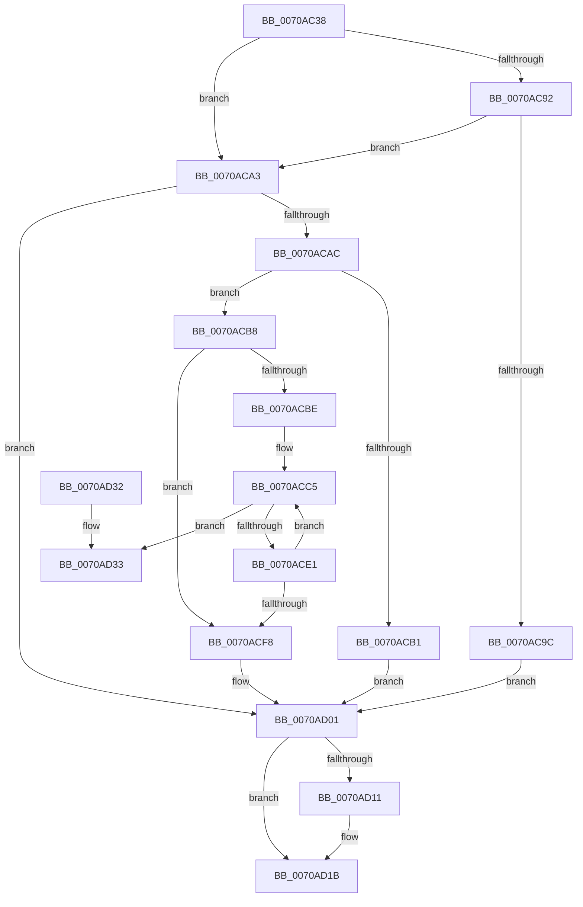

# HalpIrtExtendApertureRange

- RVA: `0x0070AC38`–`0x0070AD3A` (길이 `258` bytes)
- VA: `0x000000014070AC38`
- 실행 섹션: `PAGE`
- PDB 이름 있음: `예`; PDB Function 태그: `아니요`
- unwind 정보 RVA: `0x00069AD0`
- 디코드: `70`개 명령, `258/258` bytes 표시
- 미해석 바이트: `0` (있으면 어셈블리에 `.byte`로 보존)

> 이 문서는 커널 이미지의 기계어와 PDB 기호를 분석해 생성했습니다. 4번과 5번은 함수 원형과 자료형을 바이너리 사용 방식에서 추정한 C 해석이며 원본 소스 복구 결과는 아닙니다.

## 1. Dependencies

- 직접 호출 지점: **4**; 고유 호출 대상: **4**
- 직접 호출자로 확인된 함수: **1**
- RIP 상대 이미지 참조: **9**

### Outgoing calls
- `0x0070AC64` → [ExAllocatePool2](../../poolcode/B8/ExAllocatePool2_function_00B820F0.md) (function, `0x00B820F0`)
- `0x0070AC79` → [ExAcquireFastMutex](../../text/20/ExAcquireFastMutex_function_0020E5A0.md) (function, `0x0020E5A0`)
- `0x0070AD08` → [ExReleaseFastMutex](../../text/25/ExReleaseFastMutex_function_002519C0.md) (function, `0x002519C0`)
- `0x0070AD16` → [ExFreePoolWithTag](../../poolcode/B8/ExFreePoolWithTag_function_00B82870.md) (function, `0x00B82870`)

### Direct callers
- [HalpIrtAllocateDeviceAperture](HalpIrtAllocateDeviceAperture_function_0070A884.md) at `0x0070A928`

### Static image references
- `0x0070AC4C` → RVA `0x00F90720` (`.data`; read)
- `0x0070AC6C` → RVA `0x00F90980` (`.data`; read)
- `0x0070AC7E` → RVA `0x00F90748` (`.data`; read)
- `0x0070AC92` → RVA `0x00F90960` (`.data`; read)
- `0x0070ACA3` → RVA `0x00F90740` (`.data`; read)
- `0x0070ACBE` → RVA `0x00F90730` (`.data`; read)
- `0x0070ACD5` → RVA `0x00F90738` (`.data`; read)
- `0x0070ACED` → RVA `0x00F90738` (`.data`; write)
- `0x0070ACF8` → RVA `0x00F90748` (`.data`; write)

## 2. Other-region calls and transfers

- 다른 실행 섹션으로 향하는 call: **4**
  - `0x0070AC64` → [ExAllocatePool2](../../poolcode/B8/ExAllocatePool2_function_00B820F0.md) (`PAGE` → `POOLCODE`)
  - `0x0070AC79` → [ExAcquireFastMutex](../../text/20/ExAcquireFastMutex_function_0020E5A0.md) (`PAGE` → `.text`)
  - `0x0070AD08` → [ExReleaseFastMutex](../../text/25/ExReleaseFastMutex_function_002519C0.md) (`PAGE` → `.text`)
  - `0x0070AD16` → [ExFreePoolWithTag](../../poolcode/B8/ExFreePoolWithTag_function_00B82870.md) (`PAGE` → `POOLCODE`)
- 별도 외부 분기/꼬리 이동을 확인하지 못했습니다.

## 3. Assembly (complete function range)

```asm
0070AC38  48 89 5C 24 08                  mov qword ptr [rsp + 8], rbx
0070AC3D  48 89 6C 24 10                  mov qword ptr [rsp + 0x10], rbp
0070AC42  48 89 74 24 18                  mov qword ptr [rsp + 0x18], rsi
0070AC47  57                              push rdi
0070AC48  48 83 EC 20                     sub rsp, 0x20
0070AC4C  8B 2D CE 5A 88 00               mov ebp, dword ptr [rip + 0x885ace]
0070AC52  B9 00 01 00 00                  mov ecx, 0x100
0070AC57  8B D5                           mov edx, ebp
0070AC59  41 B8 48 61 6C 69               mov r8d, 0x696c6148
0070AC5F  C1 E2 05                        shl edx, 5
0070AC62  33 FF                           xor edi, edi
0070AC64  E8 87 74 47 00                  call 0x140b820f0
0070AC69  48 85 C0                        test rax, rax
0070AC6C  48 8D 0D 0D 5D 88 00            lea rcx, [rip + 0x885d0d]
0070AC73  48 8B F0                        mov rsi, rax
0070AC76  0F 95 C3                        setne bl
0070AC79  E8 22 39 B0 FF                  call 0x14020e5a0
0070AC7E  44 8B 0D C3 5A 88 00            mov r9d, dword ptr [rip + 0x885ac3]
0070AC85  45 8D 04 29                     lea r8d, [r9 + rbp]
0070AC89  44 3B 05 90 5A 88 00            cmp r8d, dword ptr [rip + 0x885a90]
0070AC90  76 11                           jbe 0x14070aca3
0070AC92  8B 05 C8 5C 88 00               mov eax, dword ptr [rip + 0x885cc8]
0070AC98  A8 08                           test al, 8
0070AC9A  75 07                           jne 0x14070aca3
0070AC9C  BF BB 00 00 C0                  mov edi, 0xc00000bb
0070ACA1  EB 5E                           jmp 0x14070ad01
0070ACA3  44 3B 05 96 5A 88 00            cmp r8d, dword ptr [rip + 0x885a96]
0070ACAA  77 55                           ja 0x14070ad01
0070ACAC  48 85 F6                        test rsi, rsi
0070ACAF  75 07                           jne 0x14070acb8
0070ACB1  BF 9A 00 00 C0                  mov edi, 0xc000009a
0070ACB6  EB 49                           jmp 0x14070ad01
0070ACB8  33 D2                           xor edx, edx
0070ACBA  85 ED                           test ebp, ebp
0070ACBC  74 3A                           je 0x14070acf8
0070ACBE  4C 8D 15 6B 5A 88 00            lea r10, [rip + 0x885a6b]
0070ACC5  41 8D 04 11                     lea eax, [r9 + rdx]
0070ACC9  8B CA                           mov ecx, edx
0070ACCB  48 C1 E1 05                     shl rcx, 5
0070ACCF  48 03 CE                        add rcx, rsi
0070ACD2  89 41 10                        mov dword ptr [rcx + 0x10], eax
0070ACD5  48 8B 05 5C 5A 88 00            mov rax, qword ptr [rip + 0x885a5c]
0070ACDC  4C 39 10                        cmp qword ptr [rax], r10
0070ACDF  75 52                           jne 0x14070ad33
0070ACE1  4C 89 11                        mov qword ptr [rcx], r10
0070ACE4  FF C2                           inc edx
0070ACE6  48 89 41 08                     mov qword ptr [rcx + 8], rax
0070ACEA  48 89 08                        mov qword ptr [rax], rcx
0070ACED  48 89 0D 44 5A 88 00            mov qword ptr [rip + 0x885a44], rcx
0070ACF4  3B D5                           cmp edx, ebp
0070ACF6  72 CD                           jb 0x14070acc5
0070ACF8  44 89 05 49 5A 88 00            mov dword ptr [rip + 0x885a49], r8d
0070ACFF  32 DB                           xor bl, bl
0070AD01  48 8D 0D 78 5C 88 00            lea rcx, [rip + 0x885c78]
0070AD08  E8 B3 6C B4 FF                  call 0x1402519c0
0070AD0D  84 DB                           test bl, bl
0070AD0F  74 0A                           je 0x14070ad1b
0070AD11  33 D2                           xor edx, edx
0070AD13  48 8B CE                        mov rcx, rsi
0070AD16  E8 55 7B 47 00                  call 0x140b82870
0070AD1B  48 8B 5C 24 30                  mov rbx, qword ptr [rsp + 0x30]
0070AD20  8B C7                           mov eax, edi
0070AD22  48 8B 6C 24 38                  mov rbp, qword ptr [rsp + 0x38]
0070AD27  48 8B 74 24 40                  mov rsi, qword ptr [rsp + 0x40]
0070AD2C  48 83 C4 20                     add rsp, 0x20
0070AD30  5F                              pop rdi
0070AD31  C3                              ret
0070AD32  CC                              int3
0070AD33  B9 03 00 00 00                  mov ecx, 3
0070AD38  CD 29                           int 0x29
```

## 4. C-style interpretation (structured pseudocode)

```c
__int64 __fastcall HalpIrtExtendApertureRange(void)
{
    __int64 result;
    __int64 v_rbx;
    __int64 v_rdi;
    __int64 v_rsp;
    unsigned __int64 v_stack_p10;
    unsigned __int64 v_stack_p18;
    unsigned __int64 v_stack_p8;

    v_stack_p8 = v_rbx;
    v_stack_p10 = v_rbp;
    v_stack_p18 = v_rsi;
    v_rsp = (v_rsp) - (32);
    a2 = (unsigned int)(((unsigned int)((unsigned int)((unsigned int)(*(unsigned int *)(v_rip + 8936142))))) << (5));
    v_rdi = 0;
    result = ExAllocatePool2(256, a2, (unsigned int)(0x696C6148ULL), a4);
    v_rbx = (result != 0) ? 1 : 0;
    result = ExAcquireFastMutex(v_rip + 8936717, a2, (unsigned int)(0x696C6148ULL), a4);
    if (((unsigned int)((unsigned int)(*(unsigned int *)(v_rip + 8936131)) + (unsigned int)(*(unsigned int *)(v_rip + 8936142)) * 1)) <= (*(unsigned int *)(v_rip + 8936080))) goto loc_0070ACA3;
    if ((((unsigned __int8)((unsigned int)(*(unsigned int *)(v_rip + 8936648)))) & (8)) != 0) goto loc_0070ACA3;
    goto loc_0070AD01;
loc_0070ACA3:
    if (((unsigned int)((unsigned int)(*(unsigned int *)(v_rip + 8936131)) + (unsigned int)(*(unsigned int *)(v_rip + 8936142)) * 1)) > (*(unsigned int *)(v_rip + 8936086))) goto loc_0070AD01;
    if (result != 0) goto loc_0070ACB8;
    goto loc_0070AD01;
loc_0070ACB8:
    a2 = 0;
    if ((unsigned int)((unsigned int)(*(unsigned int *)(v_rip + 8936142))) == 0) goto loc_0070ACF8;
loc_0070ACC5:
    a1 = (0) << (5);
    a1 = (a1) + (result);
    *(unsigned int *)(a1 + 16) = (unsigned int)((unsigned int)(*(unsigned int *)(v_rip + 8936131)) + a2 * 1);
    if ((*(unsigned __int64 *)(*(unsigned __int64 *)(v_rip + 8936028))) != (v_rip + 8936043)) goto loc_0070AD33;
    *(unsigned __int64 *)(a1) = v_rip + 8936043;
    a2 = (unsigned int)((a2) + 1);
    *(unsigned __int64 *)(a1 + 8) = *(unsigned __int64 *)(v_rip + 8936028);
    *(unsigned __int64 *)(*(unsigned __int64 *)(v_rip + 8936028)) = a1;
    *(unsigned __int64 *)(v_rip + 8936004) = a1;
    if (((unsigned int)(a2)) < ((unsigned int)((unsigned int)(*(unsigned int *)(v_rip + 8936142))))) goto loc_0070ACC5;
loc_0070ACF8:
    *(unsigned int *)(v_rip + 8936009) = (unsigned int)((unsigned int)(*(unsigned int *)(v_rip + 8936131)) + (unsigned int)(*(unsigned int *)(v_rip + 8936142)) * 1);
    v_rbx = 0;
loc_0070AD01:
    result = ExReleaseFastMutex(v_rip + 8936568, a2, (unsigned int)(*(unsigned int *)(v_rip + 8936131)) + (unsigned int)(*(unsigned int *)(v_rip + 8936142)) * 1, (unsigned int)(*(unsigned int *)(v_rip + 8936131)));
    if (0 != 0) {
        a2 = 0;
        a1 = result;
        result = ExFreePoolWithTag(a1, a2, (unsigned int)(*(unsigned int *)(v_rip + 8936131)) + (unsigned int)(*(unsigned int *)(v_rip + 8936142)) * 1, (unsigned int)(*(unsigned int *)(v_rip + 8936131)));
    }
    v_rsp = (v_rsp) + (32);
    return (unsigned int)((unsigned int)((unsigned int)(0xC000009AULL)));
loc_0070AD33:
    return (unsigned int)((unsigned int)((unsigned int)(0xC000009AULL)));
}
```

## 5. (Beta) C Style

```c
void HalpIrtExtendApertureRange(void)
{
    int64_t result;
    int64_t local_rbx;
    int64_t local_rdi;
    int64_t local_rsp;
    uint64_t v_stack_p10;
    uint64_t v_stack_p18;
    uint64_t v_stack_p8;

    v_stack_p8 = local_rbx;
    v_stack_p10 = local_rbp;
    v_stack_p18 = local_rsi;
    local_rsp = (local_rsp) - (32);
    a2 = (uint32_t)(((uint32_t)((uint32_t)((uint32_t)(*(uint32_t *)(v_rip + 0x885ACE))))) << (5));
    local_rdi = 0;
    result = ExAllocatePool2(256, a2, (uint32_t)(0x696C6148ULL), a4);
    local_rbx = (result != 0) ? 1 : 0;
    result = ExAcquireFastMutex(v_rip + 8936717, a2, (uint32_t)(0x696C6148ULL), a4);
    if (((uint32_t)((uint32_t)(*(uint32_t *)(v_rip + 0x885AC3)) + (uint32_t)(*(uint32_t *)(v_rip + 0x885ACE)) * 1)) <= (*(uint32_t *)(v_rip + 0x885A90))) goto loc_0070ACA3;
    if ((((uint8_t)((uint32_t)(*(uint32_t *)(v_rip + 0x885CC8)))) & (8)) != 0) goto loc_0070ACA3;
    goto loc_0070AD01;
loc_0070ACA3:
    if (((uint32_t)((uint32_t)(*(uint32_t *)(v_rip + 0x885AC3)) + (uint32_t)(*(uint32_t *)(v_rip + 0x885ACE)) * 1)) > (*(uint32_t *)(v_rip + 0x885A96))) goto loc_0070AD01;
    if (result != 0) goto loc_0070ACB8;
    goto loc_0070AD01;
loc_0070ACB8:
    a2 = 0;
    if ((uint32_t)((uint32_t)(*(uint32_t *)(v_rip + 0x885ACE))) == 0) goto loc_0070ACF8;
loc_0070ACC5:
    a1 = (0) << (5);
    a1 = (a1) + (result);
    *(uint32_t *)(a1 + 0x10) = (uint32_t)((uint32_t)(*(uint32_t *)(v_rip + 0x885AC3)) + a2 * 1);
    if ((*(uint64_t *)(*(uint64_t *)(v_rip + 0x885A5C))) != (v_rip + 8936043)) goto loc_0070AD33;
    *(uint64_t *)(a1) = v_rip + 8936043;
    a2 = (uint32_t)((a2) + 1);
    *(uint64_t *)(a1 + 0x8) = *(uint64_t *)(v_rip + 0x885A5C);
    *(uint64_t *)(*(uint64_t *)(v_rip + 0x885A5C)) = a1;
    *(uint64_t *)(v_rip + 0x885A44) = a1;
    if (((uint32_t)(a2)) < ((uint32_t)((uint32_t)(*(uint32_t *)(v_rip + 0x885ACE))))) goto loc_0070ACC5;
loc_0070ACF8:
    *(uint32_t *)(v_rip + 0x885A49) = (uint32_t)((uint32_t)(*(uint32_t *)(v_rip + 0x885AC3)) + (uint32_t)(*(uint32_t *)(v_rip + 0x885ACE)) * 1);
    local_rbx = 0;
loc_0070AD01:
    result = ExReleaseFastMutex(v_rip + 8936568, a2, (uint32_t)(*(uint32_t *)(v_rip + 0x885AC3)) + (uint32_t)(*(uint32_t *)(v_rip + 0x885ACE)) * 1, (uint32_t)(*(uint32_t *)(v_rip + 0x885AC3)));
    if (0 != 0) {
        a2 = 0;
        a1 = result;
        result = ExFreePoolWithTag(a1, a2, (uint32_t)(*(uint32_t *)(v_rip + 0x885AC3)) + (uint32_t)(*(uint32_t *)(v_rip + 0x885ACE)) * 1, (uint32_t)(*(uint32_t *)(v_rip + 0x885AC3)));
    }
    local_rsp = (local_rsp) + (32);
    return (uint32_t)((uint32_t)((uint32_t)(0xC000009AULL)));
loc_0070AD33:
    return (uint32_t)((uint32_t)((uint32_t)(0xC000009AULL)));
}
```

## 6. Execution-region graph

[열기: 2D/3D 그래프와 함수 탐색 컨트롤 패널](../../../control-panel.html?section=page&rva=0x0070AC38&view=graph)

- 2D 그래프는 위에서 아래로 흐르고, 3D 그래프는 빈 공간을 드래그해 회전합니다. Shift+드래그는 이동, 휠은 확대·축소, 함수 노드 선택은 대상 보고서 이동입니다.

### Static fallback


