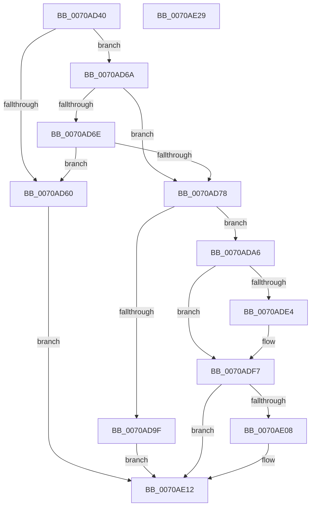

# HalpIrtExtendRemappingRange

- RVA: `0x0070AD40`–`0x0070AE2A` (길이 `234` bytes)
- VA: `0x000000014070AD40`
- 실행 섹션: `PAGE`
- PDB 이름 있음: `예`; PDB Function 태그: `아니요`
- unwind 정보 RVA: `0x00066400`
- 디코드: `62`개 명령, `234/234` bytes 표시
- 미해석 바이트: `0` (있으면 어셈블리에 `.byte`로 보존)

> 이 문서는 커널 이미지의 기계어와 PDB 기호를 분석해 생성했습니다. 4번과 5번은 함수 원형과 자료형을 바이너리 사용 방식에서 추정한 C 해석이며 원본 소스 복구 결과는 아닙니다.

## 1. Dependencies

- 직접 호출 지점: **5**; 고유 호출 대상: **5**
- 직접 호출자로 확인된 함수: **2**
- RIP 상대 이미지 참조: **5**

### Outgoing calls
- `0x0070AD92` → [ExAllocatePool2](../../poolcode/B8/ExAllocatePool2_function_00B820F0.md) (function, `0x00B820F0`)
- `0x0070ADBF` → [RtlClearAllBits](../../text/45/RtlClearAllBits_function_00450230.md) (function, `0x00450230`)
- `0x0070ADCB` → [ExAcquireFastMutex](../../text/20/ExAcquireFastMutex_function_0020E5A0.md) (function, `0x0020E5A0`)
- `0x0070ADFE` → [ExReleaseFastMutex](../../text/25/ExReleaseFastMutex_function_002519C0.md) (function, `0x002519C0`)
- `0x0070AE0D` → [ExFreePoolWithTag](../../poolcode/B8/ExFreePoolWithTag_function_00B82870.md) (function, `0x00B82870`)

### Direct callers
- [HalpInitializeInterruptRemappingBspLate](HalpInitializeInterruptRemappingBspLate_function_0070A708.md) at `0x0070A7C9`
- [HalpIrtAllocateIndex](HalpIrtAllocateIndex_function_0070A9D4.md) at `0x0070AAA1`

### Static image references
- `0x0070AD6E` → RVA `0x00F90960` (`.data`; read)
- `0x0070AD78` → RVA `0x00F90744` (`.data`; read)
- `0x0070ADC4` → RVA `0x00F90980` (`.data`; read)
- `0x0070ADD3` → RVA `0x00F90760` (`.data`; read)
- `0x0070ADE9` → RVA `0x00F9096C` (`.data`; read/write)

## 2. Other-region calls and transfers

- 다른 실행 섹션으로 향하는 call: **5**
  - `0x0070AD92` → [ExAllocatePool2](../../poolcode/B8/ExAllocatePool2_function_00B820F0.md) (`PAGE` → `POOLCODE`)
  - `0x0070ADBF` → [RtlClearAllBits](../../text/45/RtlClearAllBits_function_00450230.md) (`PAGE` → `.text`)
  - `0x0070ADCB` → [ExAcquireFastMutex](../../text/20/ExAcquireFastMutex_function_0020E5A0.md) (`PAGE` → `.text`)
  - `0x0070ADFE` → [ExReleaseFastMutex](../../text/25/ExReleaseFastMutex_function_002519C0.md) (`PAGE` → `.text`)
  - `0x0070AE0D` → [ExFreePoolWithTag](../../poolcode/B8/ExFreePoolWithTag_function_00B82870.md) (`PAGE` → `POOLCODE`)
- 별도 외부 분기/꼬리 이동을 확인하지 못했습니다.

## 3. Assembly (complete function range)

```asm
0070AD40  48 8B C4                        mov rax, rsp
0070AD43  48 89 58 08                     mov qword ptr [rax + 8], rbx
0070AD47  48 89 68 10                     mov qword ptr [rax + 0x10], rbp
0070AD4B  48 89 70 18                     mov qword ptr [rax + 0x18], rsi
0070AD4F  57                              push rdi
0070AD50  48 83 EC 30                     sub rsp, 0x30
0070AD54  33 DB                           xor ebx, ebx
0070AD56  8B F9                           mov edi, ecx
0070AD58  89 58 EC                        mov dword ptr [rax - 0x14], ebx
0070AD5B  83 F9 20                        cmp ecx, 0x20
0070AD5E  72 0A                           jb 0x14070ad6a
0070AD60  BB BB 00 00 C0                  mov ebx, 0xc00000bb
0070AD65  E9 A8 00 00 00                  jmp 0x14070ae12
0070AD6A  85 C9                           test ecx, ecx
0070AD6C  74 0A                           je 0x14070ad78
0070AD6E  8B 05 EC 5B 88 00               mov eax, dword ptr [rip + 0x885bec]
0070AD74  A8 08                           test al, 8
0070AD76  74 E8                           je 0x14070ad60
0070AD78  8B 15 C6 59 88 00               mov edx, dword ptr [rip + 0x8859c6]
0070AD7E  B9 00 01 00 00                  mov ecx, 0x100
0070AD83  83 C2 1F                        add edx, 0x1f
0070AD86  41 B8 48 61 6C 69               mov r8d, 0x696c6148
0070AD8C  C1 EA 05                        shr edx, 5
0070AD8F  C1 E2 02                        shl edx, 2
0070AD92  E8 59 73 47 00                  call 0x140b820f0
0070AD97  48 8B E8                        mov rbp, rax
0070AD9A  48 85 C0                        test rax, rax
0070AD9D  75 07                           jne 0x14070ada6
0070AD9F  BB 9A 00 00 C0                  mov ebx, 0xc000009a
0070ADA4  EB 6C                           jmp 0x14070ae12
0070ADA6  8B 05 98 59 88 00               mov eax, dword ptr [rip + 0x885998]
0070ADAC  48 8D 4C 24 20                  lea rcx, [rsp + 0x20]
0070ADB1  89 44 24 20                     mov dword ptr [rsp + 0x20], eax
0070ADB5  BE 01 00 00 00                  mov esi, 1
0070ADBA  48 89 6C 24 28                  mov qword ptr [rsp + 0x28], rbp
0070ADBF  E8 6C 54 D4 FF                  call 0x140450230
0070ADC4  48 8D 0D B5 5B 88 00            lea rcx, [rip + 0x885bb5]
0070ADCB  E8 D0 37 B0 FF                  call 0x14020e5a0
0070ADD0  48 8B C7                        mov rax, rdi
0070ADD3  48 8D 0D 86 59 88 00            lea rcx, [rip + 0x885986]
0070ADDA  48 03 C0                        add rax, rax
0070ADDD  48 39 5C C1 08                  cmp qword ptr [rcx + rax*8 + 8], rbx
0070ADE2  75 13                           jne 0x14070adf7
0070ADE4  0F 10 44 24 20                  movups xmm0, xmmword ptr [rsp + 0x20]
0070ADE9  01 35 7D 5B 88 00               add dword ptr [rip + 0x885b7d], esi
0070ADEF  40 8A F3                        mov sil, bl
0070ADF2  F3 0F 7F 04 C1                  movdqu xmmword ptr [rcx + rax*8], xmm0
0070ADF7  48 8D 0D 82 5B 88 00            lea rcx, [rip + 0x885b82]
0070ADFE  E8 BD 6B B4 FF                  call 0x1402519c0
0070AE03  40 84 F6                        test sil, sil
0070AE06  74 0A                           je 0x14070ae12
0070AE08  33 D2                           xor edx, edx
0070AE0A  48 8B CD                        mov rcx, rbp
0070AE0D  E8 5E 7A 47 00                  call 0x140b82870
0070AE12  48 8B 6C 24 48                  mov rbp, qword ptr [rsp + 0x48]
0070AE17  8B C3                           mov eax, ebx
0070AE19  48 8B 5C 24 40                  mov rbx, qword ptr [rsp + 0x40]
0070AE1E  48 8B 74 24 50                  mov rsi, qword ptr [rsp + 0x50]
0070AE23  48 83 C4 30                     add rsp, 0x30
0070AE27  5F                              pop rdi
0070AE28  C3                              ret
0070AE29  CC                              int3
```

## 4. C-style interpretation (structured pseudocode)

```c
__int64 __fastcall HalpIrtExtendRemappingRange(int a1)
{
    __int64 result;
    __int64 v_rbx;
    __int64 v_rsi;
    __int64 v_rsp;
    unsigned __int64 v_stack_m10;
    unsigned __int64 v_stack_m18;
    unsigned __int64 v_stack_p10;
    unsigned __int64 v_stack_p18;
    unsigned __int64 v_stack_p8;

    *(unsigned __int64 *)(v_rsp + 8) = v_rbx;
    *(unsigned __int64 *)(v_rsp + 16) = v_rbp;
    *(unsigned __int64 *)(v_rsp + 24) = v_rsi;
    v_rsp = (v_rsp) - (48);
    v_rbx = 0;
    *(unsigned int *)(v_rsp - 20) = 0;
    if (a1 < 32) goto loc_0070AD6A;
loc_0070AD60:
    goto loc_0070AE12;
loc_0070AD6A:
    if (a1 == 0) goto loc_0070AD78;
    if ((((unsigned __int8)((unsigned int)(*(unsigned int *)(v_rip + 8936428)))) & (8)) == 0) goto loc_0070AD60;
loc_0070AD78:
    a2 = (unsigned int)(((unsigned int)(*(unsigned int *)(v_rip + 8935878))) + (31));
    a2 = (unsigned int)((a2) >> (5));
    a2 = (unsigned int)((a2) << (2));
    result = ExAllocatePool2(256, a2, (unsigned int)(0x696C6148ULL), a4);
    if (result != 0) goto loc_0070ADA6;
    goto loc_0070AE12;
loc_0070ADA6:
    v_stack_m18 = (unsigned int)((unsigned int)(*(unsigned int *)(v_rip + 8935832)));
    v_stack_m10 = result;
    result = RtlClearAllBits(v_stack_m18, a2, (unsigned int)(0x696C6148ULL), a4);
    result = ExAcquireFastMutex(v_rip + 8936373, a2, (unsigned int)(0x696C6148ULL), a4);
    result = ((unsigned int)(a1)) + ((unsigned int)(a1));
    v_rsi = 1;
    if ((*(unsigned __int64 *)(v_rip + 8935814 + result * 8 + 8)) == ((unsigned int)(0xC000009AULL))) {
        v_rsi = (unsigned __int8)((unsigned int)(0xC000009AULL));
        *(unsigned __int64 *)(v_rip + 8935814 + result * 8) = v_xmm0;
    }
    result = ExReleaseFastMutex(v_rip + 8936322, a2, (unsigned int)(0x696C6148ULL), a4);
    if ((unsigned __int8)(v_rsi) != 0) {
        a2 = 0;
        a1 = result;
        result = ExFreePoolWithTag(a1, a2, (unsigned int)(0x696C6148ULL), a4);
    }
    v_rsp = (v_rsp) + (48);
    return (unsigned int)((unsigned int)((unsigned int)(0xC000009AULL)));
}
```

## 5. (Beta) C Style

```c
int64_t HalpIrtExtendRemappingRange(int32_t Arg1)
{
    int64_t result;
    int64_t local_rbx;
    int64_t local_rsi;
    int64_t local_rsp;
    uint64_t v_stack_m10;
    uint64_t v_stack_m18;
    uint64_t v_stack_p10;
    uint64_t v_stack_p18;
    uint64_t v_stack_p8;

    *(uint64_t *)(local_rsp + 0x8) = local_rbx;
    *(uint64_t *)(local_rsp + 0x10) = local_rbp;
    *(uint64_t *)(local_rsp + 0x18) = local_rsi;
    local_rsp = (local_rsp) - (48);
    local_rbx = 0;
    *(uint32_t *)(local_rsp - 0x14) = 0;
    if (Arg1 < 32) goto loc_0070AD6A;
loc_0070AD60:
    goto loc_0070AE12;
loc_0070AD6A:
    if (Arg1 == 0) goto loc_0070AD78;
    if ((((uint8_t)((uint32_t)(*(uint32_t *)(v_rip + 0x885BEC)))) & (8)) == 0) goto loc_0070AD60;
loc_0070AD78:
    a2 = (uint32_t)(((uint32_t)(*(uint32_t *)(v_rip + 0x8859C6))) + (31));
    a2 = (uint32_t)((a2) >> (5));
    a2 = (uint32_t)((a2) << (2));
    result = ExAllocatePool2(256, a2, (uint32_t)(0x696C6148ULL), a4);
    if (result != 0) goto loc_0070ADA6;
    goto loc_0070AE12;
loc_0070ADA6:
    v_stack_m18 = (uint32_t)((uint32_t)(*(uint32_t *)(v_rip + 0x885998)));
    v_stack_m10 = result;
    result = RtlClearAllBits(v_stack_m18, a2, (uint32_t)(0x696C6148ULL), a4);
    result = ExAcquireFastMutex(v_rip + 8936373, a2, (uint32_t)(0x696C6148ULL), a4);
    result = ((uint32_t)(Arg1)) + ((uint32_t)(Arg1));
    local_rsi = 1;
    if ((*(uint64_t *)(v_rip + 0x885986 + result * 8 + 0x8)) == ((uint32_t)(0xC000009AULL))) {
        local_rsi = (uint8_t)((uint32_t)(0xC000009AULL));
        *(uint64_t *)(v_rip + 0x885986 + result * 8) = v_xmm0;
    }
    result = ExReleaseFastMutex(v_rip + 8936322, a2, (uint32_t)(0x696C6148ULL), a4);
    if ((uint8_t)(local_rsi) != 0) {
        a2 = 0;
        Arg1 = result;
        result = ExFreePoolWithTag(Arg1, a2, (uint32_t)(0x696C6148ULL), a4);
    }
    local_rsp = (local_rsp) + (48);
    return (uint32_t)((uint32_t)((uint32_t)(0xC000009AULL)));
}
```

## 6. Execution-region graph

[열기: 2D/3D 그래프와 함수 탐색 컨트롤 패널](../../../control-panel.html?section=page&rva=0x0070AD40&view=graph)

- 2D 그래프는 위에서 아래로 흐르고, 3D 그래프는 빈 공간을 드래그해 회전합니다. Shift+드래그는 이동, 휠은 확대·축소, 함수 노드 선택은 대상 보고서 이동입니다.

### Static fallback


