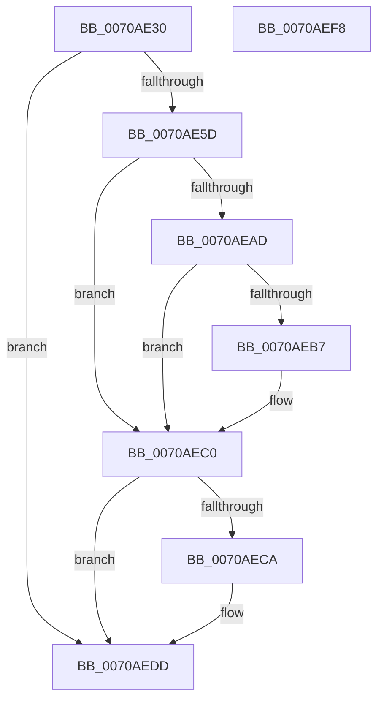

# HalpIrtFreeIndex

- RVA: `0x0070AE30`–`0x0070AEF9` (길이 `201` bytes)
- VA: `0x000000014070AE30`
- 실행 섹션: `PAGE`
- PDB 이름 있음: `예`; PDB Function 태그: `아니요`
- unwind 정보 RVA: `0x0005E6B4`
- 디코드: `56`개 명령, `201/201` bytes 표시
- 미해석 바이트: `0` (있으면 어셈블리에 `.byte`로 보존)

> 이 문서는 커널 이미지의 기계어와 PDB 기호를 분석해 생성했습니다. 4번과 5번은 함수 원형과 자료형을 바이너리 사용 방식에서 추정한 C 해석이며 원본 소스 복구 결과는 아닙니다.

## 1. Dependencies

- 직접 호출 지점: **5**; 고유 호출 대상: **5**
- 직접 호출자로 확인된 함수: **2**
- RIP 상대 이미지 참조: **6**

### Outgoing calls
- `0x0070AE7C` → [ExAcquireFastMutex](../../text/20/ExAcquireFastMutex_function_0020E5A0.md) (function, `0x0020E5A0`)
- `0x0070AE96` → [RtlClearBits](../../text/3E/RtlClearBits_function_003E1A90.md) (function, `0x003E1A90`)
- `0x0070AEA2` → [ExReleaseFastMutex](../../text/25/ExReleaseFastMutex_function_002519C0.md) (function, `0x002519C0`)
- `0x0070AEBB` → [HalpIommuFreeRemappingTableEntry](../../text/54/HalpIommuFreeRemappingTableEntry_function_0054F690.md) (function, `0x0054F690`)
- `0x0070AED8` → [HalpIrtReleaseDeviceAperture](HalpIrtReleaseDeviceAperture_function_0070AF00.md) (function, `0x0070AF00`)

### Direct callers
- [HalpInterruptRemap](../../text/54/HalpInterruptRemap_function_00542AE4.md) at `0x00542C4D`
- [HalpInterruptUnmap](HalpInterruptUnmap_function_00707408.md) at `0x007074F5`
- [HalpInterruptUnmap](HalpInterruptUnmap_function_00707408.md) at `0x00707607`

### Static image references
- `0x0070AE49` → RVA `0x00F90970` (`.data`; read)
- `0x0070AE61` → RVA `0x00F90744` (`.data`; read)
- `0x0070AE73` → RVA `0x00F90980` (`.data`; read)
- `0x0070AE81` → RVA `0x00F90760` (`.data`; read)
- `0x0070AEAD` → RVA `0x00F90960` (`.data`; read)
- `0x0070AECE` → RVA `0x00F90968` (`.data`; read)

## 2. Other-region calls and transfers

- 다른 실행 섹션으로 향하는 call: **4**
  - `0x0070AE7C` → [ExAcquireFastMutex](../../text/20/ExAcquireFastMutex_function_0020E5A0.md) (`PAGE` → `.text`)
  - `0x0070AE96` → [RtlClearBits](../../text/3E/RtlClearBits_function_003E1A90.md) (`PAGE` → `.text`)
  - `0x0070AEA2` → [ExReleaseFastMutex](../../text/25/ExReleaseFastMutex_function_002519C0.md) (`PAGE` → `.text`)
  - `0x0070AEBB` → [HalpIommuFreeRemappingTableEntry](../../text/54/HalpIommuFreeRemappingTableEntry_function_0054F690.md) (`PAGE` → `.text`)
- 별도 외부 분기/꼬리 이동을 확인하지 못했습니다.

## 3. Assembly (complete function range)

```asm
0070AE30  48 8B C4                        mov rax, rsp
0070AE33  48 89 58 08                     mov qword ptr [rax + 8], rbx
0070AE37  48 89 68 10                     mov qword ptr [rax + 0x10], rbp
0070AE3B  48 89 70 18                     mov qword ptr [rax + 0x18], rsi
0070AE3F  48 89 78 20                     mov qword ptr [rax + 0x20], rdi
0070AE43  41 56                           push r14
0070AE45  48 83 EC 20                     sub rsp, 0x20
0070AE49  83 3D 20 5B 88 00 00            cmp dword ptr [rip + 0x885b20], 0
0070AE50  45 8B F0                        mov r14d, r8d
0070AE53  8B EA                           mov ebp, edx
0070AE55  8B F1                           mov esi, ecx
0070AE57  0F 84 80 00 00 00               je 0x14070aedd
0070AE5D  33 D2                           xor edx, edx
0070AE5F  8B C1                           mov eax, ecx
0070AE61  F7 35 DD 58 88 00               div dword ptr [rip + 0x8858dd]
0070AE67  33 D2                           xor edx, edx
0070AE69  8B D8                           mov ebx, eax
0070AE6B  8B C1                           mov eax, ecx
0070AE6D  F7 35 D1 58 88 00               div dword ptr [rip + 0x8858d1]
0070AE73  48 8D 0D 06 5B 88 00            lea rcx, [rip + 0x885b06]
0070AE7A  8B FA                           mov edi, edx
0070AE7C  E8 1F 37 B0 FF                  call 0x14020e5a0
0070AE81  48 8D 05 D8 58 88 00            lea rax, [rip + 0x8858d8]
0070AE88  8B CB                           mov ecx, ebx
0070AE8A  48 C1 E1 04                     shl rcx, 4
0070AE8E  44 8B C5                        mov r8d, ebp
0070AE91  48 03 C8                        add rcx, rax
0070AE94  8B D7                           mov edx, edi
0070AE96  E8 F5 6B CD FF                  call 0x1403e1a90
0070AE9B  48 8D 0D DE 5A 88 00            lea rcx, [rip + 0x885ade]
0070AEA2  E8 19 6B B4 FF                  call 0x1402519c0
0070AEA7  41 83 FE 03                     cmp r14d, 3
0070AEAB  75 13                           jne 0x14070aec0
0070AEAD  8B 05 AD 5A 88 00               mov eax, dword ptr [rip + 0x885aad]
0070AEB3  A8 02                           test al, 2
0070AEB5  74 09                           je 0x14070aec0
0070AEB7  8B D5                           mov edx, ebp
0070AEB9  8B CE                           mov ecx, esi
0070AEBB  E8 D0 47 E4 FF                  call 0x14054f690
0070AEC0  8B 05 9A 5A 88 00               mov eax, dword ptr [rip + 0x885a9a]
0070AEC6  A8 04                           test al, 4
0070AEC8  74 13                           je 0x14070aedd
0070AECA  33 D2                           xor edx, edx
0070AECC  8B C6                           mov eax, esi
0070AECE  F7 35 94 5A 88 00               div dword ptr [rip + 0x885a94]
0070AED4  8B D5                           mov edx, ebp
0070AED6  8B C8                           mov ecx, eax
0070AED8  E8 23 00 00 00                  call 0x14070af00
0070AEDD  48 8B 5C 24 30                  mov rbx, qword ptr [rsp + 0x30]
0070AEE2  48 8B 6C 24 38                  mov rbp, qword ptr [rsp + 0x38]
0070AEE7  48 8B 74 24 40                  mov rsi, qword ptr [rsp + 0x40]
0070AEEC  48 8B 7C 24 48                  mov rdi, qword ptr [rsp + 0x48]
0070AEF1  48 83 C4 20                     add rsp, 0x20
0070AEF5  41 5E                           pop r14
0070AEF7  C3                              ret
0070AEF8  CC                              int3
```

## 4. C-style interpretation (structured pseudocode)

```c
__int64 __fastcall HalpIrtFreeIndex(int a1, int a2, int a3)
{
    __int64 result;
    __int64 v_rsp;
    unsigned __int64 v_stack_p10;
    unsigned __int64 v_stack_p18;
    unsigned __int64 v_stack_p20;
    unsigned __int64 v_stack_p8;

    *(unsigned __int64 *)(v_rsp + 8) = v_rbx;
    *(unsigned __int64 *)(v_rsp + 16) = v_rbp;
    *(unsigned __int64 *)(v_rsp + 24) = v_rsi;
    *(unsigned __int64 *)(v_rsp + 32) = v_rdi;
    v_rsp = (v_rsp) - (32);
    if ((*(unsigned int *)(v_rip + 8936224)) == 0) goto loc_0070AEDD;
    a2 = 0;
    a2 = 0;
    result = ExAcquireFastMutex(v_rip + 8936198, a2, a3, a4);
    a1 = ((unsigned int)((unsigned int)((unsigned int)((unsigned int)((unsigned int)(a1)))))) << (4);
    a1 = (a1) + (v_rip + 8935640);
    result = RtlClearBits(a1, 0, (unsigned int)((unsigned int)((unsigned int)(a2))), a4);
    result = ExReleaseFastMutex(v_rip + 8936158, 0, (unsigned int)((unsigned int)((unsigned int)(a2))), a4);
    if (((unsigned int)((unsigned int)(a3))) != 3) goto loc_0070AEC0;
    result = (unsigned int)(*(unsigned int *)(v_rip + 8936109));
    if ((((unsigned __int8)((unsigned int)(*(unsigned int *)(v_rip + 8936109)))) & (2)) != 0) {
        a2 = (unsigned int)((unsigned int)(a2));
        a1 = (unsigned int)((unsigned int)(a1));
        result = HalpIommuFreeRemappingTableEntry(a1, a2, (unsigned int)((unsigned int)((unsigned int)(a2))), a4);
    }
    result = (unsigned int)(*(unsigned int *)(v_rip + 8936090));
    if ((((unsigned __int8)((unsigned int)(*(unsigned int *)(v_rip + 8936090)))) & (4)) != 0) {
        a2 = 0;
        result = (unsigned int)((unsigned int)(a1));
        a2 = (unsigned int)((unsigned int)(a2));
        a1 = (unsigned int)(result);
        result = HalpIrtReleaseDeviceAperture(a1, a2, (unsigned int)((unsigned int)((unsigned int)(a2))), a4);
    }
    v_rsp = (v_rsp) + (32);
    return result;
}
```

## 5. (Beta) C Style

```c
int64_t HalpIrtFreeIndex(int32_t Arg1, int32_t Arg2, int32_t Arg3)
{
    int64_t result;
    int64_t local_rsp;
    uint64_t v_stack_p10;
    uint64_t v_stack_p18;
    uint64_t v_stack_p20;
    uint64_t v_stack_p8;

    *(uint64_t *)(local_rsp + 0x8) = local_rbx;
    *(uint64_t *)(local_rsp + 0x10) = local_rbp;
    *(uint64_t *)(local_rsp + 0x18) = local_rsi;
    *(uint64_t *)(local_rsp + 0x20) = local_rdi;
    local_rsp = (local_rsp) - (32);
    if ((*(uint32_t *)(v_rip + 0x885B20)) == 0) goto loc_0070AEDD;
    Arg2 = 0;
    Arg2 = 0;
    result = ExAcquireFastMutex(v_rip + 8936198, Arg2, Arg3, a4);
    Arg1 = ((uint32_t)((uint32_t)((uint32_t)((uint32_t)((uint32_t)(Arg1)))))) << (4);
    Arg1 = (Arg1) + (v_rip + 8935640);
    result = RtlClearBits(Arg1, 0, (uint32_t)((uint32_t)((uint32_t)(Arg2))), a4);
    result = ExReleaseFastMutex(v_rip + 8936158, 0, (uint32_t)((uint32_t)((uint32_t)(Arg2))), a4);
    if (((uint32_t)((uint32_t)(Arg3))) != 3) goto loc_0070AEC0;
    result = (uint32_t)(*(uint32_t *)(v_rip + 0x885AAD));
    if ((((uint8_t)((uint32_t)(*(uint32_t *)(v_rip + 0x885AAD)))) & (2)) != 0) {
        Arg2 = (uint32_t)((uint32_t)(Arg2));
        Arg1 = (uint32_t)((uint32_t)(Arg1));
        result = HalpIommuFreeRemappingTableEntry(Arg1, Arg2, (uint32_t)((uint32_t)((uint32_t)(Arg2))), a4);
    }
    result = (uint32_t)(*(uint32_t *)(v_rip + 0x885A9A));
    if ((((uint8_t)((uint32_t)(*(uint32_t *)(v_rip + 0x885A9A)))) & (4)) != 0) {
        Arg2 = 0;
        result = (uint32_t)((uint32_t)(Arg1));
        Arg2 = (uint32_t)((uint32_t)(Arg2));
        Arg1 = (uint32_t)(result);
        result = HalpIrtReleaseDeviceAperture(Arg1, Arg2, (uint32_t)((uint32_t)((uint32_t)(Arg2))), a4);
    }
    local_rsp = (local_rsp) + (32);
    return result;
}
```

## 6. Execution-region graph

[열기: 2D/3D 그래프와 함수 탐색 컨트롤 패널](../../../control-panel.html?section=page&rva=0x0070AE30&view=graph)

- 2D 그래프는 위에서 아래로 흐르고, 3D 그래프는 빈 공간을 드래그해 회전합니다. Shift+드래그는 이동, 휠은 확대·축소, 함수 노드 선택은 대상 보고서 이동입니다.

### Static fallback


