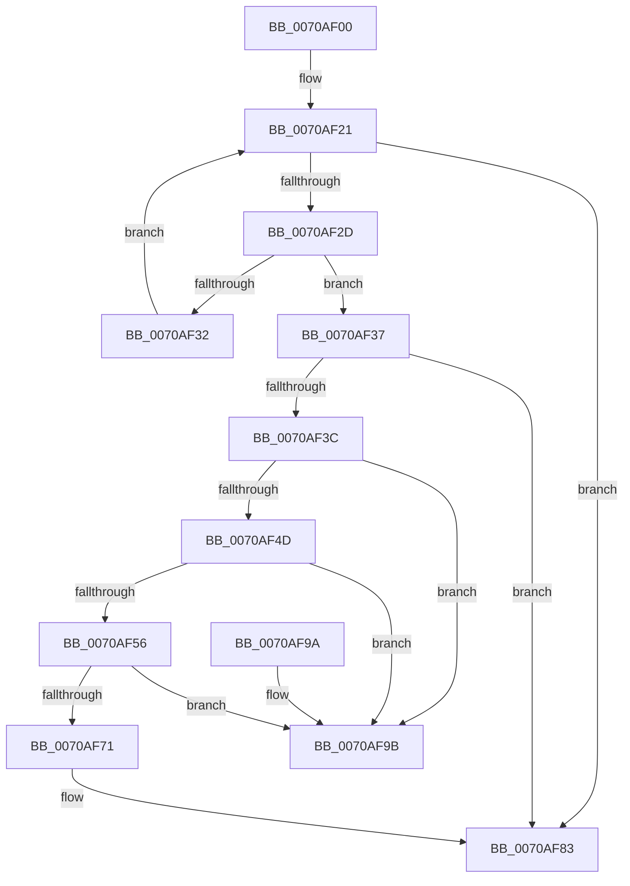

# HalpIrtReleaseDeviceAperture

- RVA: `0x0070AF00`–`0x0070AFA2` (길이 `162` bytes)
- VA: `0x000000014070AF00`
- 실행 섹션: `PAGE`
- PDB 이름 있음: `예`; PDB Function 태그: `아니요`
- unwind 정보 RVA: `0x0006CF28`
- 디코드: `44`개 명령, `162/162` bytes 표시
- 미해석 바이트: `0` (있으면 어셈블리에 `.byte`로 보존)

> 이 문서는 커널 이미지의 기계어와 PDB 기호를 분석해 생성했습니다. 4번과 5번은 함수 원형과 자료형을 바이너리 사용 방식에서 추정한 C 해석이며 원본 소스 복구 결과는 아닙니다.

## 1. Dependencies

- 직접 호출 지점: **2**; 고유 호출 대상: **2**
- 직접 호출자로 확인된 함수: **2**
- RIP 상대 이미지 참조: **4**

### Outgoing calls
- `0x0070AF15` → [ExAcquireFastMutex](../../text/20/ExAcquireFastMutex_function_0020E5A0.md) (function, `0x0020E5A0`)
- `0x0070AF8A` → [ExReleaseFastMutex](../../text/25/ExReleaseFastMutex_function_002519C0.md) (function, `0x002519C0`)

### Direct callers
- [HalpIrtAllocateIndex](HalpIrtAllocateIndex_function_0070A9D4.md) at `0x0070AC11`
- [HalpIrtFreeIndex](HalpIrtFreeIndex_function_0070AE30.md) at `0x0070AED8`

### Static image references
- `0x0070AF0E` → RVA `0x00F90980` (`.data`; read)
- `0x0070AF1A` → RVA `0x00F90710` (`.data`; read)
- `0x0070AF5D` → RVA `0x00F90730` (`.data`; read)
- `0x0070AF7C` → RVA `0x00F90730` (`.data`; write)

## 2. Other-region calls and transfers

- 다른 실행 섹션으로 향하는 call: **2**
  - `0x0070AF15` → [ExAcquireFastMutex](../../text/20/ExAcquireFastMutex_function_0020E5A0.md) (`PAGE` → `.text`)
  - `0x0070AF8A` → [ExReleaseFastMutex](../../text/25/ExReleaseFastMutex_function_002519C0.md) (`PAGE` → `.text`)
- 별도 외부 분기/꼬리 이동을 확인하지 못했습니다.

## 3. Assembly (complete function range)

```asm
0070AF00  48 89 5C 24 08                  mov qword ptr [rsp + 8], rbx
0070AF05  57                              push rdi
0070AF06  48 83 EC 20                     sub rsp, 0x20
0070AF0A  8B D9                           mov ebx, ecx
0070AF0C  8B FA                           mov edi, edx
0070AF0E  48 8D 0D 6B 5A 88 00            lea rcx, [rip + 0x885a6b]
0070AF15  E8 86 36 B0 FF                  call 0x14020e5a0
0070AF1A  48 8B 05 EF 57 88 00            mov rax, qword ptr [rip + 0x8857ef]
0070AF21  48 8D 0D E8 57 88 00            lea rcx, [rip + 0x8857e8]
0070AF28  48 3B C1                        cmp rax, rcx
0070AF2B  74 56                           je 0x14070af83
0070AF2D  39 58 10                        cmp dword ptr [rax + 0x10], ebx
0070AF30  74 05                           je 0x14070af37
0070AF32  48 8B 00                        mov rax, qword ptr [rax]
0070AF35  EB EA                           jmp 0x14070af21
0070AF37  29 78 14                        sub dword ptr [rax + 0x14], edi
0070AF3A  75 47                           jne 0x14070af83
0070AF3C  83 60 18 00                     and dword ptr [rax + 0x18], 0
0070AF40  83 60 1C 00                     and dword ptr [rax + 0x1c], 0
0070AF44  48 8B 08                        mov rcx, qword ptr [rax]
0070AF47  48 39 41 08                     cmp qword ptr [rcx + 8], rax
0070AF4B  75 4E                           jne 0x14070af9b
0070AF4D  48 8B 50 08                     mov rdx, qword ptr [rax + 8]
0070AF51  48 39 02                        cmp qword ptr [rdx], rax
0070AF54  75 45                           jne 0x14070af9b
0070AF56  48 89 0A                        mov qword ptr [rdx], rcx
0070AF59  48 89 51 08                     mov qword ptr [rcx + 8], rdx
0070AF5D  48 8D 15 CC 57 88 00            lea rdx, [rip + 0x8857cc]
0070AF64  48 8B 0D C5 57 88 00            mov rcx, qword ptr [rip + 0x8857c5]
0070AF6B  48 39 51 08                     cmp qword ptr [rcx + 8], rdx
0070AF6F  75 2A                           jne 0x14070af9b
0070AF71  48 89 08                        mov qword ptr [rax], rcx
0070AF74  48 89 50 08                     mov qword ptr [rax + 8], rdx
0070AF78  48 89 41 08                     mov qword ptr [rcx + 8], rax
0070AF7C  48 89 05 AD 57 88 00            mov qword ptr [rip + 0x8857ad], rax
0070AF83  48 8D 0D F6 59 88 00            lea rcx, [rip + 0x8859f6]
0070AF8A  E8 31 6A B4 FF                  call 0x1402519c0
0070AF8F  48 8B 5C 24 30                  mov rbx, qword ptr [rsp + 0x30]
0070AF94  48 83 C4 20                     add rsp, 0x20
0070AF98  5F                              pop rdi
0070AF99  C3                              ret
0070AF9A  CC                              int3
0070AF9B  B9 03 00 00 00                  mov ecx, 3
0070AFA0  CD 29                           int 0x29
```

## 4. C-style interpretation (structured pseudocode)

```c
__int64 __fastcall HalpIrtReleaseDeviceAperture(int a1, int a2)
{
    __int64 result;
    __int64 v_rsp;
    unsigned __int64 v_stack_p8;

    v_stack_p8 = v_rbx;
    v_rsp = (v_rsp) - (32);
    result = ExAcquireFastMutex(v_rip + 8936043, a2, a3, a4);
loc_0070AF21:
    if ((*(unsigned __int64 *)(v_rip + 8935407)) == (v_rip + 8935400)) goto loc_0070AF83;
    if ((*(unsigned int *)(*(unsigned __int64 *)(v_rip + 8935407) + 16)) == ((unsigned int)((unsigned int)(a1)))) goto loc_0070AF37;
    goto loc_0070AF21;
loc_0070AF37:
    if ((*(unsigned int *)(*(unsigned __int64 *)(v_rip + 8935407) + 16)) != ((unsigned int)((unsigned int)(a1)))) goto loc_0070AF83;
    if ((*(unsigned __int64 *)(*(unsigned __int64 *)(*(unsigned __int64 *)(*(unsigned __int64 *)(v_rip + 8935407))) + 8)) != (*(unsigned __int64 *)(*(unsigned __int64 *)(v_rip + 8935407)))) goto loc_0070AF9B;
    if ((*(unsigned __int64 *)(*(unsigned __int64 *)(*(unsigned __int64 *)(*(unsigned __int64 *)(v_rip + 8935407)) + 8))) != (*(unsigned __int64 *)(*(unsigned __int64 *)(v_rip + 8935407)))) goto loc_0070AF9B;
    *(unsigned __int64 *)(*(unsigned __int64 *)(*(unsigned __int64 *)(*(unsigned __int64 *)(v_rip + 8935407)) + 8)) = *(unsigned __int64 *)(*(unsigned __int64 *)(*(unsigned __int64 *)(v_rip + 8935407)));
    *(unsigned __int64 *)(*(unsigned __int64 *)(*(unsigned __int64 *)(*(unsigned __int64 *)(v_rip + 8935407))) + 8) = *(unsigned __int64 *)(*(unsigned __int64 *)(*(unsigned __int64 *)(v_rip + 8935407)) + 8);
    if ((*(unsigned __int64 *)(*(unsigned __int64 *)(v_rip + 8935365) + 8)) != (v_rip + 8935372)) goto loc_0070AF9B;
    *(unsigned __int64 *)(*(unsigned __int64 *)(*(unsigned __int64 *)(v_rip + 8935407))) = *(unsigned __int64 *)(v_rip + 8935365);
    *(unsigned __int64 *)(*(unsigned __int64 *)(*(unsigned __int64 *)(v_rip + 8935407)) + 8) = v_rip + 8935372;
    *(unsigned __int64 *)(*(unsigned __int64 *)(v_rip + 8935365) + 8) = *(unsigned __int64 *)(*(unsigned __int64 *)(v_rip + 8935407));
    *(unsigned __int64 *)(v_rip + 8935341) = *(unsigned __int64 *)(*(unsigned __int64 *)(v_rip + 8935407));
loc_0070AF83:
    result = ExReleaseFastMutex(v_rip + 8935926, v_rip + 8935372, a3, a4);
    v_rsp = (v_rsp) + (32);
    return result;
loc_0070AF9B:
    return result;
}
```

## 5. (Beta) C Style

```c
int64_t HalpIrtReleaseDeviceAperture(int32_t Arg1, int32_t Arg2)
{
    int64_t result;
    int64_t local_rsp;
    uint64_t v_stack_p8;

    v_stack_p8 = local_rbx;
    local_rsp = (local_rsp) - (32);
    result = ExAcquireFastMutex(v_rip + 8936043, Arg2, a3, a4);
loc_0070AF21:
    if ((*(uint64_t *)(v_rip + 0x8857EF)) == (v_rip + 8935400)) goto loc_0070AF83;
    if ((*(uint32_t *)(*(uint64_t *)(v_rip + 0x8857EF) + 0x10)) == ((uint32_t)((uint32_t)(Arg1)))) goto loc_0070AF37;
    goto loc_0070AF21;
loc_0070AF37:
    if ((*(uint32_t *)(*(uint64_t *)(v_rip + 0x8857EF) + 0x10)) != ((uint32_t)((uint32_t)(Arg1)))) goto loc_0070AF83;
    if ((*(uint64_t *)(*(uint64_t *)(*(uint64_t *)(*(uint64_t *)(v_rip + 0x8857EF))) + 0x8)) != (*(uint64_t *)(*(uint64_t *)(v_rip + 0x8857EF)))) goto loc_0070AF9B;
    if ((*(uint64_t *)(*(uint64_t *)(*(uint64_t *)(*(uint64_t *)(v_rip + 0x8857EF)) + 0x8))) != (*(uint64_t *)(*(uint64_t *)(v_rip + 0x8857EF)))) goto loc_0070AF9B;
    *(uint64_t *)(*(uint64_t *)(*(uint64_t *)(*(uint64_t *)(v_rip + 0x8857EF)) + 0x8)) = *(uint64_t *)(*(uint64_t *)(*(uint64_t *)(v_rip + 0x8857EF)));
    *(uint64_t *)(*(uint64_t *)(*(uint64_t *)(*(uint64_t *)(v_rip + 0x8857EF))) + 0x8) = *(uint64_t *)(*(uint64_t *)(*(uint64_t *)(v_rip + 0x8857EF)) + 0x8);
    if ((*(uint64_t *)(*(uint64_t *)(v_rip + 0x8857C5) + 0x8)) != (v_rip + 8935372)) goto loc_0070AF9B;
    *(uint64_t *)(*(uint64_t *)(*(uint64_t *)(v_rip + 0x8857EF))) = *(uint64_t *)(v_rip + 0x8857C5);
    *(uint64_t *)(*(uint64_t *)(*(uint64_t *)(v_rip + 0x8857EF)) + 0x8) = v_rip + 8935372;
    *(uint64_t *)(*(uint64_t *)(v_rip + 0x8857C5) + 0x8) = *(uint64_t *)(*(uint64_t *)(v_rip + 0x8857EF));
    *(uint64_t *)(v_rip + 0x8857AD) = *(uint64_t *)(*(uint64_t *)(v_rip + 0x8857EF));
loc_0070AF83:
    result = ExReleaseFastMutex(v_rip + 8935926, v_rip + 8935372, a3, a4);
    local_rsp = (local_rsp) + (32);
    return result;
loc_0070AF9B:
    return result;
}
```

## 6. Execution-region graph

[열기: 2D/3D 그래프와 함수 탐색 컨트롤 패널](../../../control-panel.html?section=page&rva=0x0070AF00&view=graph)

- 2D 그래프는 위에서 아래로 흐르고, 3D 그래프는 빈 공간을 드래그해 회전합니다. Shift+드래그는 이동, 휠은 확대·축소, 함수 노드 선택은 대상 보고서 이동입니다.

### Static fallback


