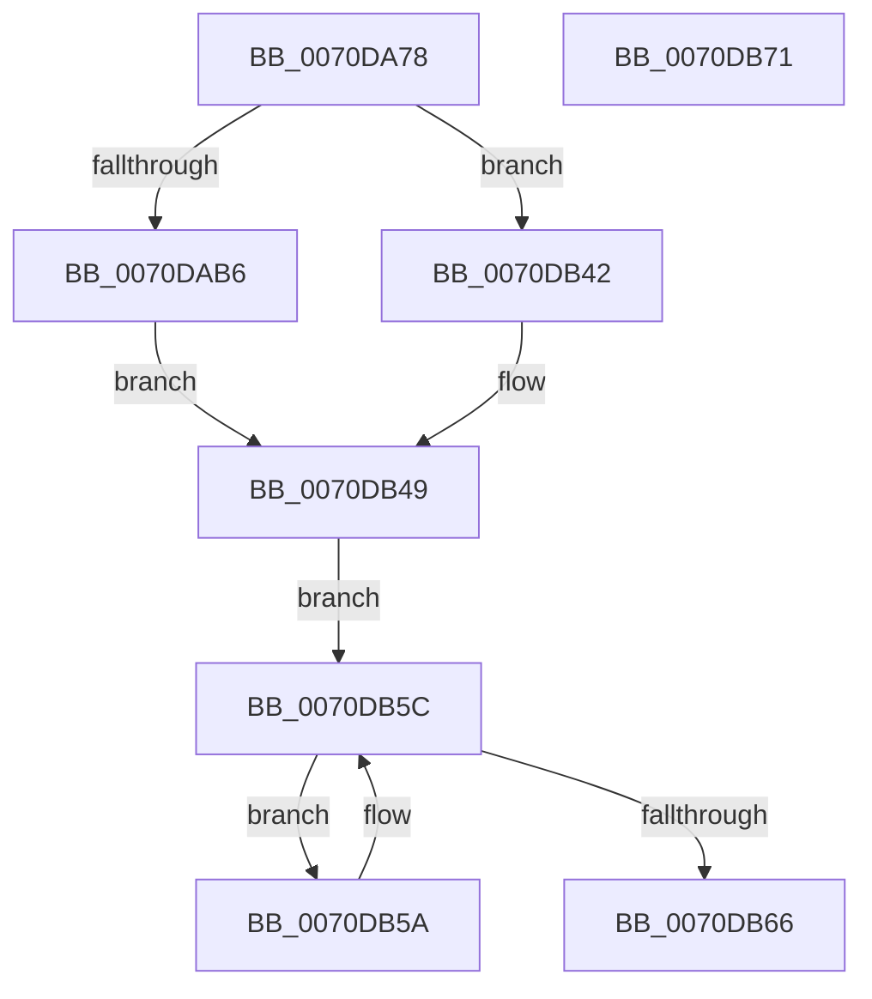

# HalpLbrConfigurationWorker

- RVA: `0x0070DA78`–`0x0070DB72` (길이 `250` bytes)
- VA: `0x000000014070DA78`
- 실행 섹션: `PAGE`
- PDB 이름 있음: `예`; PDB Function 태그: `아니요`
- unwind 정보 RVA: `0x0005CAAC`
- 디코드: `70`개 명령, `250/250` bytes 표시
- 미해석 바이트: `0` (있으면 어셈블리에 `.byte`로 보존)

> 이 문서는 커널 이미지의 기계어와 PDB 기호를 분석해 생성했습니다. 4번과 5번은 함수 원형과 자료형을 바이너리 사용 방식에서 추정한 C 해석이며 원본 소스 복구 결과는 아닙니다.

## 1. Dependencies

- 직접 호출 지점: **2**; 고유 호출 대상: **2**
- 직접 호출자로 확인된 함수: **3**
- RIP 상대 이미지 참조: **6**

### Outgoing calls
- `0x0070DA8C` → [KeQueryActiveProcessorCountEx](../../text/24/KeQueryActiveProcessorCountEx_function_00249EF0.md) (function, `0x00249EF0`)
- `0x0070DB53` → [KeIpiGenericCall](../../text/47/KeIpiGenericCall_function_00471720.md) (function, `0x00471720`)

### Direct callers
- [HalpLbrConfigureRecording](HalpLbrConfigureRecording_function_0070DB80.md) at `0x0070DB98`
- [HalpLbrStartRecording](HalpLbrStartRecording_function_0070DBC0.md) at `0x0070DC9D`
- [HalpLbrStopRecording](HalpLbrStopRecording_function_0070DCD0.md) at `0x0070DD02`

### Static image references
- `0x0070DA94` → RVA `0x00F8F994` (`.data`; write)
- `0x0070DAA9` → RVA `0x00F8F9A0` (`.data`; read)
- `0x0070DB3A` → RVA `0x00F8F990` (`.data`; write)
- `0x0070DB42` → RVA `0x00F8F984` (`.data`; write)
- `0x0070DB4C` → RVA `0x0056B400` (`HalpLbrConfigureProcessor`; read)
- `0x0070DB5C` → RVA `0x00F8F994` (`.data`; read)

## 2. Other-region calls and transfers

- 다른 실행 섹션으로 향하는 call: **2**
  - `0x0070DA8C` → [KeQueryActiveProcessorCountEx](../../text/24/KeQueryActiveProcessorCountEx_function_00249EF0.md) (`PAGE` → `.text`)
  - `0x0070DB53` → [KeIpiGenericCall](../../text/47/KeIpiGenericCall_function_00471720.md) (`PAGE` → `.text`)
- 별도 외부 분기/꼬리 이동을 확인하지 못했습니다.

## 3. Assembly (complete function range)

```asm
0070DA78  48 89 5C 24 08                  mov qword ptr [rsp + 8], rbx
0070DA7D  57                              push rdi
0070DA7E  48 83 EC 20                     sub rsp, 0x20
0070DA82  8B D9                           mov ebx, ecx
0070DA84  0F B6 FA                        movzx edi, dl
0070DA87  B9 FF FF 00 00                  mov ecx, 0xffff
0070DA8C  E8 5F C4 B3 FF                  call 0x140249ef0
0070DA91  44 8B C3                        mov r8d, ebx
0070DA94  89 05 FA 1E 88 00               mov dword ptr [rip + 0x881efa], eax
0070DA9A  41 81 C8 C4 01 00 00            or r8d, 0x1c4
0070DAA1  0F BA E3 09                     bt ebx, 9
0070DAA5  44 0F 43 C3                     cmovae r8d, ebx
0070DAA9  83 3D F0 1E 88 00 02            cmp dword ptr [rip + 0x881ef0], 2
0070DAB0  0F 85 8C 00 00 00               jne 0x14070db42
0070DAB6  41 8B C0                        mov eax, r8d
0070DAB9  F7 D0                           not eax
0070DABB  83 E0 01                        and eax, 1
0070DABE  8D 0C 45 0C 00 7F 00            lea ecx, [rax*2 + 0x7f000c]
0070DAC5  8B D1                           mov edx, ecx
0070DAC7  83 E2 FB                        and edx, 0xfffffffb
0070DACA  41 F6 C0 02                     test r8b, 2
0070DACE  0F 44 D1                        cmove edx, ecx
0070DAD1  8B CA                           mov ecx, edx
0070DAD3  0F BA F1 10                     btr ecx, 0x10
0070DAD7  41 F6 C0 04                     test r8b, 4
0070DADB  0F 44 CA                        cmove ecx, edx
0070DADE  8B D1                           mov edx, ecx
0070DAE0  0F BA F2 13                     btr edx, 0x13
0070DAE4  41 F6 C0 08                     test r8b, 8
0070DAE8  0F 44 D1                        cmove edx, ecx
0070DAEB  8B CA                           mov ecx, edx
0070DAED  0F BA F1 14                     btr ecx, 0x14
0070DAF1  41 F6 C0 10                     test r8b, 0x10
0070DAF5  0F 44 CA                        cmove ecx, edx
0070DAF8  8B D1                           mov edx, ecx
0070DAFA  0F BA F2 15                     btr edx, 0x15
0070DAFE  41 F6 C0 20                     test r8b, 0x20
0070DB02  0F 44 D1                        cmove edx, ecx
0070DB05  8B CA                           mov ecx, edx
0070DB07  0F BA F1 12                     btr ecx, 0x12
0070DB0B  41 F6 C0 40                     test r8b, 0x40
0070DB0F  0F 44 CA                        cmove ecx, edx
0070DB12  8B D1                           mov edx, ecx
0070DB14  0F BA F2 11                     btr edx, 0x11
0070DB18  41 F6 C0 80                     test r8b, 0x80
0070DB1C  0F 44 D1                        cmove edx, ecx
0070DB1F  8B CA                           mov ecx, edx
0070DB21  0F BA F1 16                     btr ecx, 0x16
0070DB25  41 0F BA E0 08                  bt r8d, 8
0070DB2A  0F 43 CA                        cmovae ecx, edx
0070DB2D  8B C1                           mov eax, ecx
0070DB2F  83 E0 F7                        and eax, 0xfffffff7
0070DB32  41 0F BA E0 09                  bt r8d, 9
0070DB37  0F 42 C1                        cmovb eax, ecx
0070DB3A  89 05 50 1E 88 00               mov dword ptr [rip + 0x881e50], eax
0070DB40  EB 07                           jmp 0x14070db49
0070DB42  44 89 05 3B 1E 88 00            mov dword ptr [rip + 0x881e3b], r8d
0070DB49  48 8B D7                        mov rdx, rdi
0070DB4C  48 8D 0D AD D8 E5 FF            lea rcx, [rip - 0x1a2753]
0070DB53  E8 C8 3B D6 FF                  call 0x140471720
0070DB58  EB 02                           jmp 0x14070db5c
0070DB5A  F3 90                           pause
0070DB5C  8B 05 32 1E 88 00               mov eax, dword ptr [rip + 0x881e32]
0070DB62  85 C0                           test eax, eax
0070DB64  7F F4                           jg 0x14070db5a
0070DB66  48 8B 5C 24 30                  mov rbx, qword ptr [rsp + 0x30]
0070DB6B  48 83 C4 20                     add rsp, 0x20
0070DB6F  5F                              pop rdi
0070DB70  C3                              ret
0070DB71  CC                              int3
```

## 4. C-style interpretation (structured pseudocode)

```c
__int64 __fastcall HalpLbrConfigurationWorker(int a1, unsigned __int8 a2)
{
    __int64 result;
    __int64 v_rsp;
    unsigned __int64 v_stack_p8;

    v_stack_p8 = v_rbx;
    v_rsp = (v_rsp) - (32);
    result = KeQueryActiveProcessorCountEx((unsigned int)(0xFFFFULL), a2, a3, a4);
    *(unsigned int *)(v_rip + 8920826) = (unsigned int)(result);
    a3 = (unsigned int)(((unsigned int)((unsigned int)((unsigned int)(a1)))) | (452));
    if (condition_is_above_or_equal) { a3 = (unsigned int)((unsigned int)(a1)); }
    if ((*(unsigned int *)(v_rip + 8920816)) != 2) goto loc_0070DB42;
    result = (unsigned int)(~((unsigned int)((unsigned int)(a3))));
    result = (unsigned int)((result) & (1));
    a2 = (unsigned int)(((unsigned int)((unsigned int)(result * 2 + 8323084))) & (0xFFFFFFFBULL));
    if ((((unsigned __int8)(a3)) & (2)) == 0) { a2 = (unsigned int)(result * 2 + 8323084); }
    a1 = (unsigned int)(a2);
    if ((((unsigned __int8)(a3)) & (4)) == 0) { a1 = a2; }
    a2 = (unsigned int)(a1);
    if ((((unsigned __int8)(a3)) & (8)) == 0) { a2 = a1; }
    a1 = (unsigned int)(a2);
    if ((((unsigned __int8)(a3)) & (16)) == 0) { a1 = a2; }
    a2 = (unsigned int)(a1);
    if ((((unsigned __int8)(a3)) & (32)) == 0) { a2 = a1; }
    a1 = (unsigned int)(a2);
    if ((((unsigned __int8)(a3)) & (64)) == 0) { a1 = a2; }
    a2 = (unsigned int)(a1);
    if ((((unsigned __int8)(a3)) & (128)) == 0) { a2 = a1; }
    a1 = (unsigned int)(a2);
    if (condition_is_above_or_equal) { a1 = a2; }
    result = (unsigned int)(((unsigned int)(a1)) & (0xFFFFFFF7ULL));
    if (condition_is_below) { result = a1; }
    *(unsigned int *)(v_rip + 8920656) = (unsigned int)(result);
    goto loc_0070DB49;
loc_0070DB42:
    *(unsigned int *)(v_rip + 8920635) = (unsigned int)(a3);
loc_0070DB49:
    result = KeIpiGenericCall(v_rip - 1714003, a2, a3, a4);
    goto loc_0070DB5C;
loc_0070DB5A:
loc_0070DB5C:
    if (condition_is_greater) goto loc_0070DB5A;
    v_rsp = (v_rsp) + (32);
    return (unsigned int)(*(unsigned int *)(v_rip + 8920626));
}
```

## 5. (Beta) C Style

```c
int64_t HalpLbrConfigurationWorker(int32_t Arg1, uint8_t Arg2)
{
    int64_t result;
    int64_t local_rsp;
    uint64_t v_stack_p8;

    v_stack_p8 = local_rbx;
    local_rsp = (local_rsp) - (32);
    result = KeQueryActiveProcessorCountEx((uint32_t)(0xFFFFULL), Arg2, a3, a4);
    *(uint32_t *)(v_rip + 0x881EFA) = (uint32_t)(result);
    a3 = (uint32_t)(((uint32_t)((uint32_t)((uint32_t)(Arg1)))) | (452));
    if (condition_is_above_or_equal) { a3 = (uint32_t)((uint32_t)(Arg1)); }
    if ((*(uint32_t *)(v_rip + 0x881EF0)) != 2) goto loc_0070DB42;
    result = (uint32_t)(~((uint32_t)((uint32_t)(a3))));
    result = (uint32_t)((result) & (1));
    Arg2 = (uint32_t)(((uint32_t)((uint32_t)(result * 2 + 8323084))) & (0xFFFFFFFBULL));
    if ((((uint8_t)(a3)) & (2)) == 0) { Arg2 = (uint32_t)(result * 2 + 8323084); }
    Arg1 = (uint32_t)(Arg2);
    if ((((uint8_t)(a3)) & (4)) == 0) { Arg1 = Arg2; }
    Arg2 = (uint32_t)(Arg1);
    if ((((uint8_t)(a3)) & (8)) == 0) { Arg2 = Arg1; }
    Arg1 = (uint32_t)(Arg2);
    if ((((uint8_t)(a3)) & (16)) == 0) { Arg1 = Arg2; }
    Arg2 = (uint32_t)(Arg1);
    if ((((uint8_t)(a3)) & (32)) == 0) { Arg2 = Arg1; }
    Arg1 = (uint32_t)(Arg2);
    if ((((uint8_t)(a3)) & (64)) == 0) { Arg1 = Arg2; }
    Arg2 = (uint32_t)(Arg1);
    if ((((uint8_t)(a3)) & (128)) == 0) { Arg2 = Arg1; }
    Arg1 = (uint32_t)(Arg2);
    if (condition_is_above_or_equal) { Arg1 = Arg2; }
    result = (uint32_t)(((uint32_t)(Arg1)) & (0xFFFFFFF7ULL));
    if (condition_is_below) { result = Arg1; }
    *(uint32_t *)(v_rip + 0x881E50) = (uint32_t)(result);
    goto loc_0070DB49;
loc_0070DB42:
    *(uint32_t *)(v_rip + 0x881E3B) = (uint32_t)(a3);
loc_0070DB49:
    result = KeIpiGenericCall(v_rip - 1714003, Arg2, a3, a4);
    goto loc_0070DB5C;
loc_0070DB5A:
loc_0070DB5C:
    if (condition_is_greater) goto loc_0070DB5A;
    local_rsp = (local_rsp) + (32);
    return (uint32_t)(*(uint32_t *)(v_rip + 0x881E32));
}
```

## 6. Execution-region graph

[열기: 2D/3D 그래프와 함수 탐색 컨트롤 패널](../../../control-panel.html?section=page&rva=0x0070DA78&view=graph)

- 2D 그래프는 위에서 아래로 흐르고, 3D 그래프는 빈 공간을 드래그해 회전합니다. Shift+드래그는 이동, 휠은 확대·축소, 함수 노드 선택은 대상 보고서 이동입니다.

### Static fallback


