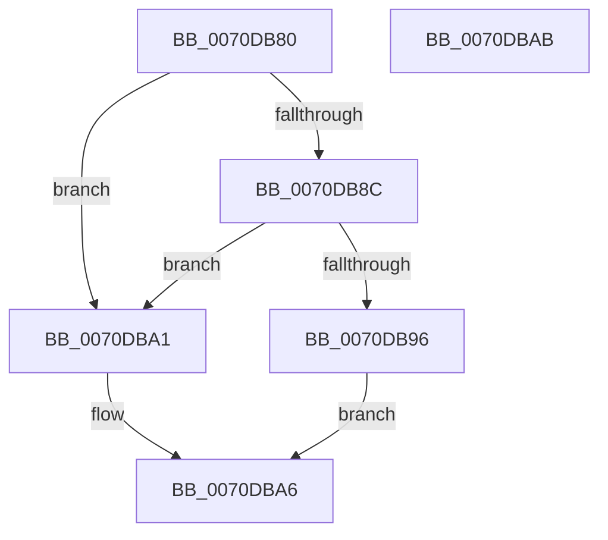

# HalpLbrConfigureRecording

- RVA: `0x0070DB80`–`0x0070DBAC` (길이 `44` bytes)
- VA: `0x000000014070DB80`
- 실행 섹션: `PAGE`
- PDB 이름 있음: `예`; PDB Function 태그: `아니요`
- unwind 정보 RVA: `0x0005C788`
- 디코드: `14`개 명령, `44/44` bytes 표시
- 미해석 바이트: `0` (있으면 어셈블리에 `.byte`로 보존)

> 이 문서는 커널 이미지의 기계어와 PDB 기호를 분석해 생성했습니다. 4번과 5번은 함수 원형과 자료형을 바이너리 사용 방식에서 추정한 C 해석이며 원본 소스 복구 결과는 아닙니다.

## 1. Dependencies

- 직접 호출 지점: **1**; 고유 호출 대상: **1**
- 직접 호출자로 확인된 함수: **0**
- RIP 상대 이미지 참조: **2**

### Outgoing calls
- `0x0070DB98` → [HalpLbrConfigurationWorker](HalpLbrConfigurationWorker_function_0070DA78.md) (function, `0x0070DA78`)

### Direct callers
- 이 함수 시작 RVA로 연결되는 직접 call은 확인되지 않았습니다. 간접 호출은 완전히 역산할 수 없습니다.

### Static image references
- `0x0070DB84` → RVA `0x00F8F988` (`.data`; read)
- `0x0070DB8C` → RVA `0x00F8F98C` (`.data`; read)

## 2. Other-region calls and transfers

- 다른 실행 섹션으로 향하는 call: **0**
- 별도 외부 분기/꼬리 이동을 확인하지 못했습니다.

## 3. Assembly (complete function range)

```asm
0070DB80  48 83 EC 28                     sub rsp, 0x28
0070DB84  3B 15 FE 1D 88 00               cmp edx, dword ptr [rip + 0x881dfe]
0070DB8A  75 15                           jne 0x14070dba1
0070DB8C  8B 05 FA 1D 88 00               mov eax, dword ptr [rip + 0x881dfa]
0070DB92  85 C0                           test eax, eax
0070DB94  74 0B                           je 0x14070dba1
0070DB96  B2 01                           mov dl, 1
0070DB98  E8 DB FE FF FF                  call 0x14070da78
0070DB9D  33 C0                           xor eax, eax
0070DB9F  EB 05                           jmp 0x14070dba6
0070DBA1  B8 0D 00 00 C0                  mov eax, 0xc000000d
0070DBA6  48 83 C4 28                     add rsp, 0x28
0070DBAA  C3                              ret
0070DBAB  CC                              int3
```

## 4. C-style interpretation (structured pseudocode)

```c
__int64 __fastcall HalpLbrConfigureRecording(__int64 a1, int a2)
{
    __int64 result;
    __int64 v_rsp;

    v_rsp = (v_rsp) - (40);
    if (a2 != (*(unsigned int *)(v_rip + 8920574))) goto loc_0070DBA1;
    if ((unsigned int)((unsigned int)(*(unsigned int *)(v_rip + 8920570))) == 0) goto loc_0070DBA1;
    result = HalpLbrConfigurationWorker(a1, 1, a3, a4);
    result = 0;
    goto loc_0070DBA6;
loc_0070DBA1:
loc_0070DBA6:
    v_rsp = (v_rsp) + (40);
    return (unsigned int)(0xC000000DULL);
}
```

## 5. (Beta) C Style

```c
int64_t HalpLbrConfigureRecording(int64_t Arg1, int32_t Arg2)
{
    int64_t result;
    int64_t local_rsp;

    local_rsp = (local_rsp) - (40);
    if (Arg2 != (*(uint32_t *)(v_rip + 0x881DFE))) goto loc_0070DBA1;
    if ((uint32_t)((uint32_t)(*(uint32_t *)(v_rip + 0x881DFA))) == 0) goto loc_0070DBA1;
    result = HalpLbrConfigurationWorker(Arg1, 1, a3, a4);
    result = 0;
    goto loc_0070DBA6;
loc_0070DBA1:
loc_0070DBA6:
    local_rsp = (local_rsp) + (40);
    return (uint32_t)(0xC000000DULL);
}
```

## 6. Execution-region graph

[열기: 2D/3D 그래프와 함수 탐색 컨트롤 패널](../../../control-panel.html?section=page&rva=0x0070DB80&view=graph)

- 2D 그래프는 위에서 아래로 흐르고, 3D 그래프는 빈 공간을 드래그해 회전합니다. Shift+드래그는 이동, 휠은 확대·축소, 함수 노드 선택은 대상 보고서 이동입니다.

### Static fallback


