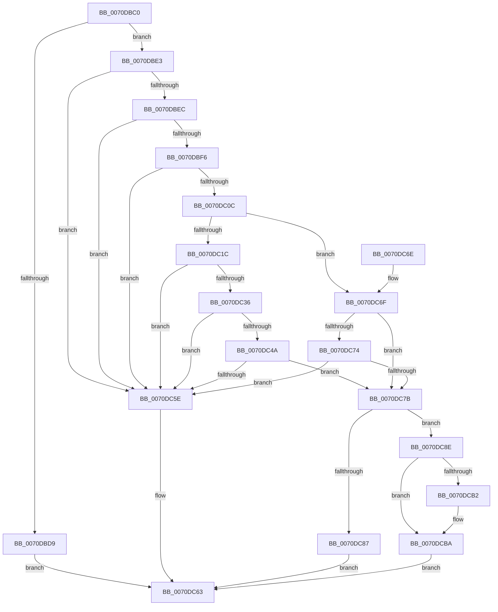

# HalpLbrStartRecording

- RVA: `0x0070DBC0`–`0x0070DCC6` (길이 `262` bytes)
- VA: `0x000000014070DBC0`
- 실행 섹션: `PAGE`
- PDB 이름 있음: `예`; PDB Function 태그: `아니요`
- unwind 정보 RVA: `0x000BA3D0`
- 디코드: `73`개 명령, `262/262` bytes 표시
- 미해석 바이트: `0` (있으면 어셈블리에 `.byte`로 보존)

> 이 문서는 커널 이미지의 기계어와 PDB 기호를 분석해 생성했습니다. 4번과 5번은 함수 원형과 자료형을 바이너리 사용 방식에서 추정한 C 해석이며 원본 소스 복구 결과는 아닙니다.

## 1. Dependencies

- 직접 호출 지점: **1**; 고유 호출 대상: **1**
- 직접 호출자로 확인된 함수: **0**
- RIP 상대 이미지 참조: **8**

### Outgoing calls
- `0x0070DC9D` → [HalpLbrConfigurationWorker](HalpLbrConfigurationWorker_function_0070DA78.md) (function, `0x0070DA78`)

### Direct callers
- 이 함수 시작 RVA로 연결되는 직접 call은 확인되지 않았습니다. 간접 호출은 완전히 역산할 수 없습니다.

### Static image references
- `0x0070DBCA` → RVA `0x00F8F998` (`.data`; read)
- `0x0070DC0C` → RVA `0x00F8F9A0` (`.data`; read)
- `0x0070DC1C` → RVA `0x00F8F9A4` (`.data`; read)
- `0x0070DC7D` → RVA `0x00F8F98C` (`.data`; read)
- `0x0070DC8E` → RVA `0x00F475C0` (`.data`; read/write)
- `0x0070DCA2` → RVA `0x00F8F988` (`.data`; read)
- `0x0070DCAA` → RVA `0x00F8F988` (`.data`; write)
- `0x0070DCBA` → RVA `0x00F8F99C` (`.data`; write)

## 2. Other-region calls and transfers

- 다른 실행 섹션으로 향하는 call: **0**
- 별도 외부 분기/꼬리 이동을 확인하지 못했습니다.

## 3. Assembly (complete function range)

```asm
0070DBC0  48 89 5C 24 08                  mov qword ptr [rsp + 8], rbx
0070DBC5  57                              push rdi
0070DBC6  48 83 EC 20                     sub rsp, 0x20
0070DBCA  83 3D C7 1D 88 00 00            cmp dword ptr [rip + 0x881dc7], 0
0070DBD1  48 8B DA                        mov rbx, rdx
0070DBD4  44 8B C1                        mov r8d, ecx
0070DBD7  75 0A                           jne 0x14070dbe3
0070DBD9  B8 BB 00 00 C0                  mov eax, 0xc00000bb
0070DBDE  E9 80 00 00 00                  jmp 0x14070dc63
0070DBE3  41 F7 C0 00 F8 FF FF            test r8d, 0xfffff800
0070DBEA  75 72                           jne 0x14070dc5e
0070DBEC  41 8B C0                        mov eax, r8d
0070DBEF  83 E0 03                        and eax, 3
0070DBF2  3C 03                           cmp al, 3
0070DBF4  74 68                           je 0x14070dc5e
0070DBF6  41 F7 C0 FC FD FF FF            test r8d, 0xfffffdfc
0070DBFD  0F 95 C1                        setne cl
0070DC00  41 0F BA E0 09                  bt r8d, 9
0070DC05  0F 92 C0                        setb al
0070DC08  84 C8                           test al, cl
0070DC0A  75 52                           jne 0x14070dc5e
0070DC0C  8B 05 8E 1D 88 00               mov eax, dword ptr [rip + 0x881d8e]
0070DC12  BF 01 00 00 00                  mov edi, 1
0070DC17  83 F8 02                        cmp eax, 2
0070DC1A  75 53                           jne 0x14070dc6f
0070DC1C  8B 15 82 1D 88 00               mov edx, dword ptr [rip + 0x881d82]
0070DC22  41 F7 C0 FC FF FF FF            test r8d, 0xfffffffc
0070DC29  0F 95 C1                        setne cl
0070DC2C  40 84 D7                        test dil, dl
0070DC2F  0F 94 C0                        sete al
0070DC32  84 C8                           test al, cl
0070DC34  75 28                           jne 0x14070dc5e
0070DC36  41 F7 C0 03 FE FF FF            test r8d, 0xfffffe03
0070DC3D  0F 95 C1                        setne cl
0070DC40  F6 C2 02                        test dl, 2
0070DC43  0F 94 C0                        sete al
0070DC46  84 C8                           test al, cl
0070DC48  75 14                           jne 0x14070dc5e
0070DC4A  41 F7 C0 FF FD FF FF            test r8d, 0xfffffdff
0070DC51  0F 95 C1                        setne cl
0070DC54  F6 C2 04                        test dl, 4
0070DC57  0F 94 C0                        sete al
0070DC5A  84 C8                           test al, cl
0070DC5C  74 1D                           je 0x14070dc7b
0070DC5E  B8 0D 00 00 C0                  mov eax, 0xc000000d
0070DC63  48 8B 5C 24 30                  mov rbx, qword ptr [rsp + 0x30]
0070DC68  48 83 C4 20                     add rsp, 0x20
0070DC6C  5F                              pop rdi
0070DC6D  C3                              ret
0070DC6E  CC                              int3
0070DC6F  83 F8 03                        cmp eax, 3
0070DC72  75 07                           jne 0x14070dc7b
0070DC74  41 0F BA E0 09                  bt r8d, 9
0070DC79  72 E3                           jb 0x14070dc5e
0070DC7B  33 C0                           xor eax, eax
0070DC7D  F0 0F B1 3D 07 1D 88 00         lock cmpxchg dword ptr [rip + 0x881d07], edi
0070DC85  74 07                           je 0x14070dc8e
0070DC87  B8 08 07 00 C0                  mov eax, 0xc0000708
0070DC8C  EB D5                           jmp 0x14070dc63
0070DC8E  F0 0F BA 2D 29 99 83 00 01      lock bts dword ptr [rip + 0x839929], 1
0070DC97  40 8A D7                        mov dl, dil
0070DC9A  41 8B C8                        mov ecx, r8d
0070DC9D  E8 D6 FD FF FF                  call 0x14070da78
0070DCA2  8B 05 E0 1C 88 00               mov eax, dword ptr [rip + 0x881ce0]
0070DCA8  03 C7                           add eax, edi
0070DCAA  89 05 D8 1C 88 00               mov dword ptr [rip + 0x881cd8], eax
0070DCB0  75 08                           jne 0x14070dcba
0070DCB2  8B C7                           mov eax, edi
0070DCB4  89 05 CE 1C 88 00               mov dword ptr [rip + 0x881cce], eax
0070DCBA  89 3D DC 1C 88 00               mov dword ptr [rip + 0x881cdc], edi
0070DCC0  89 03                           mov dword ptr [rbx], eax
0070DCC2  33 C0                           xor eax, eax
0070DCC4  EB 9D                           jmp 0x14070dc63
```

## 4. C-style interpretation (structured pseudocode)

```c
__int64 __fastcall HalpLbrStartRecording(int a1, __int64 a2)
{
    __int64 result;
    __int64 v_rsp;
    unsigned __int64 v_stack_p8;

    v_stack_p8 = v_rbx;
    v_rsp = (v_rsp) - (32);
    if ((*(unsigned int *)(v_rip + 8920519)) != 0) goto loc_0070DBE3;
    goto loc_0070DC63;
loc_0070DBE3:
    if ((((unsigned int)((unsigned int)(a1))) & (0xFFFFF800ULL)) != 0) goto loc_0070DC5E;
    result = (unsigned int)(((unsigned int)((unsigned int)((unsigned int)(a1)))) & (3));
    if (((unsigned __int8)(result)) == 3) goto loc_0070DC5E;
    a1 = ((((unsigned int)((unsigned int)(a1))) & (0xFFFFFDFCULL)) != 0) ? 1 : 0;
    result = (condition_is_below) ? 1 : 0;
    if ((((unsigned __int8)(result)) & ((unsigned __int8)(a1))) != 0) goto loc_0070DC5E;
    if (((unsigned int)((unsigned int)(*(unsigned int *)(v_rip + 8920462)))) != 2) goto loc_0070DC6F;
    a1 = ((((unsigned int)((unsigned int)(a1))) & (0xFFFFFFFCULL)) != 0) ? 1 : 0;
    result = (((1) & ((unsigned __int8)((unsigned int)(*(unsigned int *)(v_rip + 8920450))))) == 0) ? 1 : 0;
    if ((((unsigned __int8)(result)) & ((unsigned __int8)(a1))) != 0) goto loc_0070DC5E;
    a1 = ((((unsigned int)((unsigned int)(a1))) & (0xFFFFFE03ULL)) != 0) ? 1 : 0;
    result = ((((unsigned __int8)((unsigned int)(*(unsigned int *)(v_rip + 8920450)))) & (2)) == 0) ? 1 : 0;
    if ((((unsigned __int8)(result)) & ((unsigned __int8)(a1))) != 0) goto loc_0070DC5E;
    a1 = ((((unsigned int)((unsigned int)(a1))) & (0xFFFFFDFFULL)) != 0) ? 1 : 0;
    result = ((((unsigned __int8)((unsigned int)(*(unsigned int *)(v_rip + 8920450)))) & (4)) == 0) ? 1 : 0;
    if ((((unsigned __int8)(result)) & ((unsigned __int8)(a1))) == 0) goto loc_0070DC7B;
loc_0070DC5E:
loc_0070DC63:
    v_rsp = (v_rsp) + (32);
    return (unsigned int)(0xC000000DULL);
loc_0070DC6F:
    if (((unsigned int)((unsigned int)(0xC000000DULL))) != 3) goto loc_0070DC7B;
    if (((unsigned int)((unsigned int)(0xC000000DULL))) < 3) goto loc_0070DC5E;
loc_0070DC7B:
    result = 0;
    if (condition_is_equal) goto loc_0070DC8E;
    goto loc_0070DC63;
loc_0070DC8E:
    result = HalpLbrConfigurationWorker((unsigned int)((unsigned int)((unsigned int)(a1))), 1, (unsigned int)(a1), a4);
    result = (unsigned int)(((unsigned int)(*(unsigned int *)(v_rip + 8920288))) + (1));
    *(unsigned int *)(v_rip + 8920280) = (unsigned int)(result);
    if (!(condition_is_not_equal)) {
        result = 1;
        *(unsigned int *)(v_rip + 8920270) = (unsigned int)(result);
    }
    *(unsigned int *)(v_rip + 8920284) = 1;
    *(unsigned int *)(v_stack_p8) = (unsigned int)(result);
    result = 0;
    goto loc_0070DC63;
}
```

## 5. (Beta) C Style

```c
int64_t HalpLbrStartRecording(int32_t Arg1, void *Arg2)
{
    uint8_t *arg2 = (uint8_t *)Arg2;

    int64_t result;
    int64_t local_rsp;
    uint64_t v_stack_p8;

    v_stack_p8 = local_rbx;
    local_rsp = (local_rsp) - (32);
    if ((*(uint32_t *)(v_rip + 0x881DC7)) != 0) goto loc_0070DBE3;
    goto loc_0070DC63;
loc_0070DBE3:
    if ((((uint32_t)((uint32_t)(Arg1))) & (0xFFFFF800ULL)) != 0) goto loc_0070DC5E;
    result = (uint32_t)(((uint32_t)((uint32_t)((uint32_t)(Arg1)))) & (3));
    if (((uint8_t)(result)) == 3) goto loc_0070DC5E;
    Arg1 = ((((uint32_t)((uint32_t)(Arg1))) & (0xFFFFFDFCULL)) != 0) ? 1 : 0;
    result = (condition_is_below) ? 1 : 0;
    if ((((uint8_t)(result)) & ((uint8_t)(Arg1))) != 0) goto loc_0070DC5E;
    if (((uint32_t)((uint32_t)(*(uint32_t *)(v_rip + 0x881D8E)))) != 2) goto loc_0070DC6F;
    Arg1 = ((((uint32_t)((uint32_t)(Arg1))) & (0xFFFFFFFCULL)) != 0) ? 1 : 0;
    result = (((1) & ((uint8_t)((uint32_t)(*(uint32_t *)(v_rip + 0x881D82))))) == 0) ? 1 : 0;
    if ((((uint8_t)(result)) & ((uint8_t)(Arg1))) != 0) goto loc_0070DC5E;
    Arg1 = ((((uint32_t)((uint32_t)(Arg1))) & (0xFFFFFE03ULL)) != 0) ? 1 : 0;
    result = ((((uint8_t)((uint32_t)(*(uint32_t *)(v_rip + 0x881D82)))) & (2)) == 0) ? 1 : 0;
    if ((((uint8_t)(result)) & ((uint8_t)(Arg1))) != 0) goto loc_0070DC5E;
    Arg1 = ((((uint32_t)((uint32_t)(Arg1))) & (0xFFFFFDFFULL)) != 0) ? 1 : 0;
    result = ((((uint8_t)((uint32_t)(*(uint32_t *)(v_rip + 0x881D82)))) & (4)) == 0) ? 1 : 0;
    if ((((uint8_t)(result)) & ((uint8_t)(Arg1))) == 0) goto loc_0070DC7B;
loc_0070DC5E:
loc_0070DC63:
    local_rsp = (local_rsp) + (32);
    return (uint32_t)(0xC000000DULL);
loc_0070DC6F:
    if (((uint32_t)((uint32_t)(0xC000000DULL))) != 3) goto loc_0070DC7B;
    if (((uint32_t)((uint32_t)(0xC000000DULL))) < 3) goto loc_0070DC5E;
loc_0070DC7B:
    result = 0;
    if (condition_is_equal) goto loc_0070DC8E;
    goto loc_0070DC63;
loc_0070DC8E:
    result = HalpLbrConfigurationWorker((uint32_t)((uint32_t)((uint32_t)(Arg1))), 1, (uint32_t)(Arg1), a4);
    result = (uint32_t)(((uint32_t)(*(uint32_t *)(v_rip + 0x881CE0))) + (1));
    *(uint32_t *)(v_rip + 0x881CD8) = (uint32_t)(result);
    if (!(condition_is_not_equal)) {
        result = 1;
        *(uint32_t *)(v_rip + 0x881CCE) = (uint32_t)(result);
    }
    *(uint32_t *)(v_rip + 0x881CDC) = 1;
    *(uint32_t *)(v_stack_p8) = (uint32_t)(result);
    result = 0;
    goto loc_0070DC63;
}
```

### 관측된 메모리 오프셋

구조체 형식이 확인되지 않은 접근은 인자 기준의 오프셋으로만 기록했습니다.

| 기준 인자 | 오프셋 표현 | 폭 (bit) | 접근 |
|---|---:|---:|---|
| `Arg2` | `+ 0x0` | `32` | `W` |

## 6. Execution-region graph

[열기: 2D/3D 그래프와 함수 탐색 컨트롤 패널](../../../control-panel.html?section=page&rva=0x0070DBC0&view=graph)

- 2D 그래프는 위에서 아래로 흐르고, 3D 그래프는 빈 공간을 드래그해 회전합니다. Shift+드래그는 이동, 휠은 확대·축소, 함수 노드 선택은 대상 보고서 이동입니다.

### Static fallback


