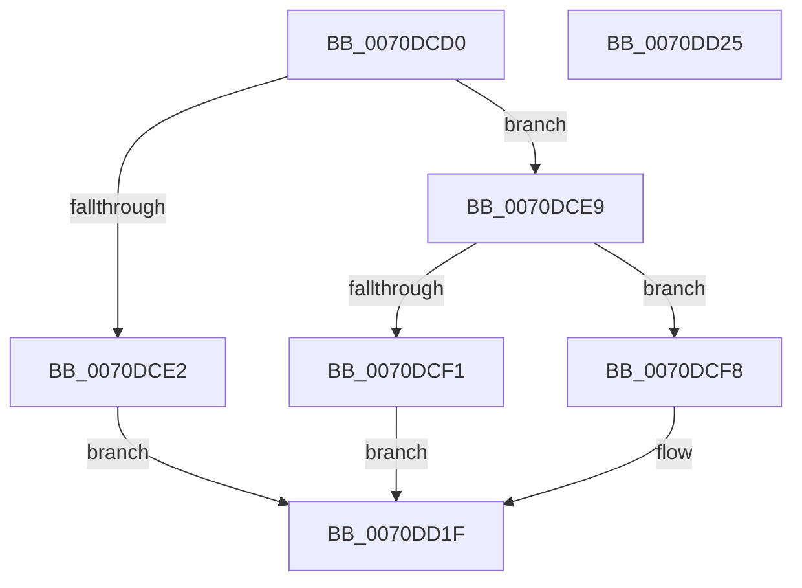

# HalpLbrStopRecording

- RVA: `0x0070DCD0`–`0x0070DD26` (길이 `86` bytes)
- VA: `0x000000014070DCD0`
- 실행 섹션: `PAGE`
- PDB 이름 있음: `예`; PDB Function 태그: `아니요`
- unwind 정보 RVA: `0x0005CF00`
- 디코드: `24`개 명령, `86/86` bytes 표시
- 미해석 바이트: `0` (있으면 어셈블리에 `.byte`로 보존)

> 이 문서는 커널 이미지의 기계어와 PDB 기호를 분석해 생성했습니다. 4번과 5번은 함수 원형과 자료형을 바이너리 사용 방식에서 추정한 C 해석이며 원본 소스 복구 결과는 아닙니다.

## 1. Dependencies

- 직접 호출 지점: **1**; 고유 호출 대상: **1**
- 직접 호출자로 확인된 함수: **0**
- RIP 상대 이미지 참조: **4**

### Outgoing calls
- `0x0070DD02` → [HalpLbrConfigurationWorker](HalpLbrConfigurationWorker_function_0070DA78.md) (function, `0x0070DA78`)

### Direct callers
- 이 함수 시작 RVA로 연결되는 직접 call은 확인되지 않았습니다. 간접 호출은 완전히 역산할 수 없습니다.

### Static image references
- `0x0070DCD6` → RVA `0x00F8F98C` (`.data`; read)
- `0x0070DCE9` → RVA `0x00F8F988` (`.data`; read)
- `0x0070DCFA` → RVA `0x00F8F99C` (`.data`; write)
- `0x0070DD07` → RVA `0x00F475C0` (`.data`; read/write)

## 2. Other-region calls and transfers

- 다른 실행 섹션으로 향하는 call: **0**
- 별도 외부 분기/꼬리 이동을 확인하지 못했습니다.

## 3. Assembly (complete function range)

```asm
0070DCD0  40 53                           push rbx
0070DCD2  48 83 EC 20                     sub rsp, 0x20
0070DCD6  8B 05 B0 1C 88 00               mov eax, dword ptr [rip + 0x881cb0]
0070DCDC  33 DB                           xor ebx, ebx
0070DCDE  85 C0                           test eax, eax
0070DCE0  75 07                           jne 0x14070dce9
0070DCE2  B8 22 01 00 00                  mov eax, 0x122
0070DCE7  EB 36                           jmp 0x14070dd1f
0070DCE9  3B 0D 99 1C 88 00               cmp ecx, dword ptr [rip + 0x881c99]
0070DCEF  74 07                           je 0x14070dcf8
0070DCF1  B8 08 00 00 C0                  mov eax, 0xc0000008
0070DCF6  EB 27                           jmp 0x14070dd1f
0070DCF8  33 D2                           xor edx, edx
0070DCFA  89 1D 9C 1C 88 00               mov dword ptr [rip + 0x881c9c], ebx
0070DD00  33 C9                           xor ecx, ecx
0070DD02  E8 71 FD FF FF                  call 0x14070da78
0070DD07  F0 0F BA 35 B0 98 83 00 01      lock btr dword ptr [rip + 0x8398b0], 1
0070DD10  B8 01 00 00 00                  mov eax, 1
0070DD15  F0 0F B1 1D 6F 1C 88 00         lock cmpxchg dword ptr [rip + 0x881c6f], ebx
0070DD1D  33 C0                           xor eax, eax
0070DD1F  48 83 C4 20                     add rsp, 0x20
0070DD23  5B                              pop rbx
0070DD24  C3                              ret
0070DD25  CC                              int3
```

## 4. C-style interpretation (structured pseudocode)

```c
__int64 __fastcall HalpLbrStopRecording(int a1, int a2)
{
    __int64 result;
    __int64 v_rbx;
    __int64 v_rsp;

    v_rsp = (v_rsp) - (32);
    v_rbx = 0;
    if ((unsigned int)((unsigned int)(*(unsigned int *)(v_rip + 8920240))) != 0) goto loc_0070DCE9;
    goto loc_0070DD1F;
loc_0070DCE9:
    if (a1 == (*(unsigned int *)(v_rip + 8920217))) goto loc_0070DCF8;
    goto loc_0070DD1F;
loc_0070DCF8:
    a2 = 0;
    *(unsigned int *)(v_rip + 8920220) = 0;
    a1 = 0;
    result = HalpLbrConfigurationWorker(a1, a2, a3, a4);
    result = 0;
loc_0070DD1F:
    v_rsp = (v_rsp) + (32);
    return result;
}
```

## 5. (Beta) C Style

```c
int64_t HalpLbrStopRecording(int32_t Arg1, int32_t Arg2)
{
    int64_t result;
    int64_t local_rbx;
    int64_t local_rsp;

    local_rsp = (local_rsp) - (32);
    local_rbx = 0;
    if ((uint32_t)((uint32_t)(*(uint32_t *)(v_rip + 0x881CB0))) != 0) goto loc_0070DCE9;
    goto loc_0070DD1F;
loc_0070DCE9:
    if (Arg1 == (*(uint32_t *)(v_rip + 0x881C99))) goto loc_0070DCF8;
    goto loc_0070DD1F;
loc_0070DCF8:
    Arg2 = 0;
    *(uint32_t *)(v_rip + 0x881C9C) = 0;
    Arg1 = 0;
    result = HalpLbrConfigurationWorker(Arg1, Arg2, a3, a4);
    result = 0;
loc_0070DD1F:
    local_rsp = (local_rsp) + (32);
    return result;
}
```

## 6. Execution-region graph

[열기: 2D/3D 그래프와 함수 탐색 컨트롤 패널](../../../control-panel.html?section=page&rva=0x0070DCD0&view=graph)

- 2D 그래프는 위에서 아래로 흐르고, 3D 그래프는 빈 공간을 드래그해 회전합니다. Shift+드래그는 이동, 휠은 확대·축소, 함수 노드 선택은 대상 보고서 이동입니다.

### Static fallback


