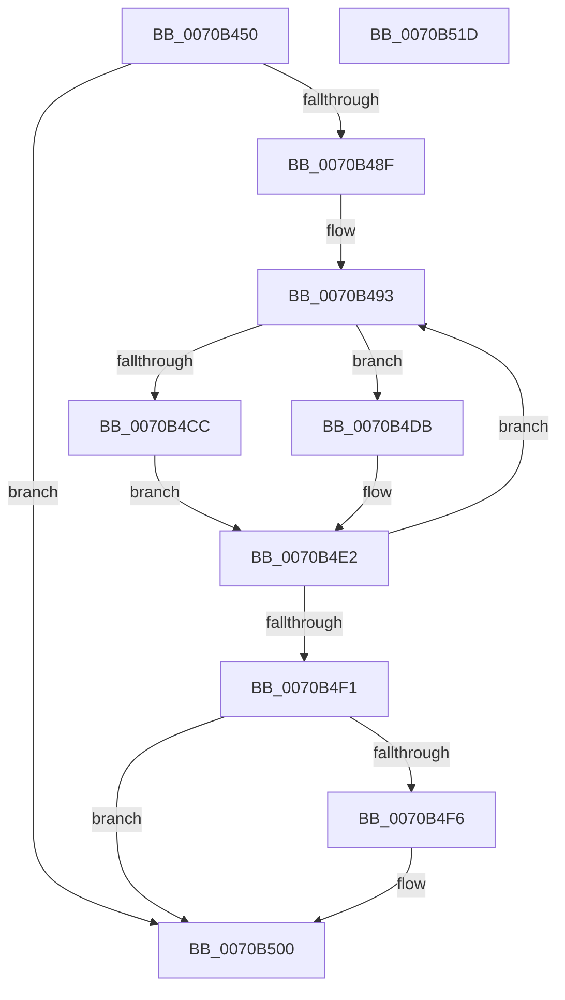

# HalpLoadMicrocodeSerialized

- RVA: `0x0070B450`–`0x0070B51E` (길이 `206` bytes)
- VA: `0x000000014070B450`
- 실행 섹션: `PAGE`
- PDB 이름 있음: `예`; PDB Function 태그: `아니요`
- unwind 정보 RVA: `0x000C47B4`
- 디코드: `56`개 명령, `206/206` bytes 표시
- 미해석 바이트: `0` (있으면 어셈블리에 `.byte`로 보존)

> 이 문서는 커널 이미지의 기계어와 PDB 기호를 분석해 생성했습니다. 4번과 5번은 함수 원형과 자료형을 바이너리 사용 방식에서 추정한 C 해석이며 원본 소스 복구 결과는 아닙니다.

## 1. Dependencies

- 직접 호출 지점: **6**; 고유 호출 대상: **5**
- 직접 호출자로 확인된 함수: **1**
- RIP 상대 이미지 참조: **2**

### Outgoing calls
- `0x0070B483` → [KeQueryActiveProcessorCountEx](../../text/24/KeQueryActiveProcessorCountEx_function_00249EF0.md) (function, `0x00249EF0`)
- `0x0070B4D1` → [KeSetSystemGroupAffinityThread](../../text/39/KeSetSystemGroupAffinityThread_function_00399140.md) (function, `0x00399140`)
- `0x0070B4DD` → [KeSetSystemGroupAffinityThread](../../text/39/KeSetSystemGroupAffinityThread_function_00399140.md) (function, `0x00399140`)
- `0x0070B4E2` → [HalpMcUpdateMicrocode](../../text/4D/HalpMcUpdateMicrocode_function_004DB3FC.md) (function, `0x004DB3FC`)
- `0x0070B4FB` → [KeRevertToUserGroupAffinityThread](../../text/39/KeRevertToUserGroupAffinityThread_function_00398EC0.md) (function, `0x00398EC0`)
- `0x0070B508` → [_security_check_cookie](../../text/6A/_security_check_cookie_function_006AC640.md) (function, `0x006AC640`)

### Direct callers
- [HalpLoadMicrocode](HalpLoadMicrocode_function_0070B200.md) at `0x0070B3DE`

### Static image references
- `0x0070B45F` → RVA `0x00E0A740` (`.data`; read)
- `0x0070B493` → RVA `0x00F231B0` (`.data`; read)

## 2. Other-region calls and transfers

- 다른 실행 섹션으로 향하는 call: **6**
  - `0x0070B483` → [KeQueryActiveProcessorCountEx](../../text/24/KeQueryActiveProcessorCountEx_function_00249EF0.md) (`PAGE` → `.text`)
  - `0x0070B4D1` → [KeSetSystemGroupAffinityThread](../../text/39/KeSetSystemGroupAffinityThread_function_00399140.md) (`PAGE` → `.text`)
  - `0x0070B4DD` → [KeSetSystemGroupAffinityThread](../../text/39/KeSetSystemGroupAffinityThread_function_00399140.md) (`PAGE` → `.text`)
  - `0x0070B4E2` → [HalpMcUpdateMicrocode](../../text/4D/HalpMcUpdateMicrocode_function_004DB3FC.md) (`PAGE` → `.text`)
  - `0x0070B4FB` → [KeRevertToUserGroupAffinityThread](../../text/39/KeRevertToUserGroupAffinityThread_function_00398EC0.md) (`PAGE` → `.text`)
  - `0x0070B508` → [_security_check_cookie](../../text/6A/_security_check_cookie_function_006AC640.md) (`PAGE` → `.text`)
- 별도 외부 분기/꼬리 이동을 확인하지 못했습니다.

## 3. Assembly (complete function range)

```asm
0070B450  48 89 5C 24 08                  mov qword ptr [rsp + 8], rbx
0070B455  48 89 74 24 10                  mov qword ptr [rsp + 0x10], rsi
0070B45A  57                              push rdi
0070B45B  48 83 EC 50                     sub rsp, 0x50
0070B45F  48 8B 05 DA F2 6F 00            mov rax, qword ptr [rip + 0x6ff2da]
0070B466  48 33 C4                        xor rax, rsp
0070B469  48 89 44 24 40                  mov qword ptr [rsp + 0x40], rax
0070B46E  0F 57 C0                        xorps xmm0, xmm0
0070B471  0F 57 C9                        xorps xmm1, xmm1
0070B474  B9 FF FF 00 00                  mov ecx, 0xffff
0070B479  0F 11 44 24 20                  movups xmmword ptr [rsp + 0x20], xmm0
0070B47E  0F 11 4C 24 30                  movups xmmword ptr [rsp + 0x30], xmm1
0070B483  E8 68 EA B3 FF                  call 0x140249ef0
0070B488  40 32 FF                        xor dil, dil
0070B48B  85 C0                           test eax, eax
0070B48D  74 71                           je 0x14070b500
0070B48F  33 DB                           xor ebx, ebx
0070B491  8B F0                           mov esi, eax
0070B493  48 8B 05 16 7D 81 00            mov rax, qword ptr [rip + 0x817d16]
0070B49A  8B 0C 03                        mov ecx, dword ptr [rbx + rax]
0070B49D  33 C0                           xor eax, eax
0070B49F  89 44 24 2A                     mov dword ptr [rsp + 0x2a], eax
0070B4A3  66 89 44 24 2E                  mov word ptr [rsp + 0x2e], ax
0070B4A8  8B C1                           mov eax, ecx
0070B4AA  C1 E8 06                        shr eax, 6
0070B4AD  83 E1 3F                        and ecx, 0x3f
0070B4B0  66 89 44 24 28                  mov word ptr [rsp + 0x28], ax
0070B4B5  B8 01 00 00 00                  mov eax, 1
0070B4BA  48 D3 E0                        shl rax, cl
0070B4BD  48 8D 4C 24 20                  lea rcx, [rsp + 0x20]
0070B4C2  48 89 44 24 20                  mov qword ptr [rsp + 0x20], rax
0070B4C7  40 84 FF                        test dil, dil
0070B4CA  75 0F                           jne 0x14070b4db
0070B4CC  48 8D 54 24 30                  lea rdx, [rsp + 0x30]
0070B4D1  E8 6A DC C8 FF                  call 0x140399140
0070B4D6  40 B7 01                        mov dil, 1
0070B4D9  EB 07                           jmp 0x14070b4e2
0070B4DB  33 D2                           xor edx, edx
0070B4DD  E8 5E DC C8 FF                  call 0x140399140
0070B4E2  E8 15 FF DC FF                  call 0x1404db3fc
0070B4E7  48 83 C3 04                     add rbx, 4
0070B4EB  48 83 EE 01                     sub rsi, 1
0070B4EF  75 A2                           jne 0x14070b493
0070B4F1  40 84 FF                        test dil, dil
0070B4F4  74 0A                           je 0x14070b500
0070B4F6  48 8D 4C 24 30                  lea rcx, [rsp + 0x30]
0070B4FB  E8 C0 D9 C8 FF                  call 0x140398ec0
0070B500  48 8B 4C 24 40                  mov rcx, qword ptr [rsp + 0x40]
0070B505  48 33 CC                        xor rcx, rsp
0070B508  E8 33 11 FA FF                  call 0x1406ac640
0070B50D  48 8B 5C 24 60                  mov rbx, qword ptr [rsp + 0x60]
0070B512  48 8B 74 24 68                  mov rsi, qword ptr [rsp + 0x68]
0070B517  48 83 C4 50                     add rsp, 0x50
0070B51B  5F                              pop rdi
0070B51C  C3                              ret
0070B51D  CC                              int3
```

## 4. C-style interpretation (structured pseudocode)

```c
__int64 __fastcall HalpLoadMicrocodeSerialized(void)
{
    __int64 result;
    __int64 v_rbx;
    __int64 v_rdi;
    __int64 v_rsi;
    __int64 v_rsp;
    unsigned __int64 v_stack_m18;
    unsigned __int64 v_stack_m28;
    unsigned __int16 v_stack_m2A;
    unsigned int v_stack_m2E;
    unsigned __int16 v_stack_m30;
    unsigned __int64 v_stack_m38;
    unsigned __int64 v_stack_p10;
    unsigned __int64 v_stack_p8;

    v_stack_p8 = v_rbx;
    v_stack_p10 = v_rsi;
    v_rsp = (v_rsp) - (80);
    result = (*(unsigned __int64 *)(v_rip + 7336666)) ^ (v_rsp);
    v_stack_m18 = result;
    v_stack_m38 = v_xmm0;
    v_stack_m28 = v_xmm1;
    result = KeQueryActiveProcessorCountEx((unsigned int)(0xFFFFULL), a2, a3, a4);
    v_rdi = 0;
    if ((unsigned int)(result) == 0) goto loc_0070B500;
    v_rbx = 0;
loc_0070B493:
    result = 0;
    v_stack_m2E = 0;
    v_stack_m2A = 0;
    result = (unsigned int)(((unsigned int)((unsigned int)((unsigned int)(*(unsigned int *)(v_rbx + *(unsigned __int64 *)(v_rip + 8486166) * 1))))) >> (6));
    a1 = (unsigned int)(((unsigned int)(*(unsigned int *)(v_rbx + *(unsigned __int64 *)(v_rip + 8486166) * 1))) & (63));
    v_stack_m30 = (unsigned __int16)(result);
    result = (1) << ((unsigned __int8)(a1));
    v_stack_m38 = result;
    if (0 != 0) goto loc_0070B4DB;
    result = KeSetSystemGroupAffinityThread(v_stack_m38, v_stack_m28, a3, a4);
    goto loc_0070B4E2;
loc_0070B4DB:
    a2 = 0;
    result = KeSetSystemGroupAffinityThread(v_stack_m38, a2, a3, a4);
loc_0070B4E2:
    result = HalpMcUpdateMicrocode(v_stack_m38, a2, a3, a4);
    v_rbx = (v_rbx) + (4);
    v_rsi = ((unsigned int)((unsigned int)(result))) - (1);
    if (condition_is_not_equal) goto loc_0070B493;
    if (1 != 0) {
        a1 = v_stack_m28;
        result = KeRevertToUserGroupAffinityThread(a1, a2, a3, a4);
    }
    a1 = (v_stack_m18) ^ (v_rsp);
    result = _security_check_cookie(a1, a2, a3, a4);
    v_rsp = (v_rsp) + (80);
    return result;
}
```

## 5. (Beta) C Style

```c
void HalpLoadMicrocodeSerialized(void)
{
    int64_t result;
    int64_t local_rbx;
    int64_t local_rdi;
    int64_t local_rsi;
    int64_t local_rsp;
    uint64_t v_stack_m18;
    uint64_t v_stack_m28;
    uint16_t v_stack_m2A;
    uint32_t v_stack_m2E;
    uint16_t v_stack_m30;
    uint64_t v_stack_m38;
    uint64_t v_stack_p10;
    uint64_t v_stack_p8;

    v_stack_p8 = local_rbx;
    v_stack_p10 = local_rsi;
    local_rsp = (local_rsp) - (80);
    result = (*(uint64_t *)(v_rip + 0x6FF2DA)) ^ (local_rsp);
    v_stack_m18 = result;
    v_stack_m38 = v_xmm0;
    v_stack_m28 = v_xmm1;
    result = KeQueryActiveProcessorCountEx((uint32_t)(0xFFFFULL), a2, a3, a4);
    local_rdi = 0;
    if ((uint32_t)(result) == 0) goto loc_0070B500;
    local_rbx = 0;
loc_0070B493:
    result = 0;
    v_stack_m2E = 0;
    v_stack_m2A = 0;
    result = (uint32_t)(((uint32_t)((uint32_t)((uint32_t)(*(uint32_t *)(local_rbx + *(uint64_t *)(v_rip + 0x817D16) * 1))))) >> (6));
    a1 = (uint32_t)(((uint32_t)(*(uint32_t *)(local_rbx + *(uint64_t *)(v_rip + 0x817D16) * 1))) & (63));
    v_stack_m30 = (uint16_t)(result);
    result = (1) << ((uint8_t)(a1));
    v_stack_m38 = result;
    if (0 != 0) goto loc_0070B4DB;
    result = KeSetSystemGroupAffinityThread(v_stack_m38, v_stack_m28, a3, a4);
    goto loc_0070B4E2;
loc_0070B4DB:
    a2 = 0;
    result = KeSetSystemGroupAffinityThread(v_stack_m38, a2, a3, a4);
loc_0070B4E2:
    result = HalpMcUpdateMicrocode(v_stack_m38, a2, a3, a4);
    local_rbx = (local_rbx) + (4);
    local_rsi = ((uint32_t)((uint32_t)(result))) - (1);
    if (condition_is_not_equal) goto loc_0070B493;
    if (1 != 0) {
        a1 = v_stack_m28;
        result = KeRevertToUserGroupAffinityThread(a1, a2, a3, a4);
    }
    a1 = (v_stack_m18) ^ (local_rsp);
    result = _security_check_cookie(a1, a2, a3, a4);
    local_rsp = (local_rsp) + (80);
    return result;
}
```

## 6. Execution-region graph

[열기: 2D/3D 그래프와 함수 탐색 컨트롤 패널](../../../control-panel.html?section=page&rva=0x0070B450&view=graph)

- 2D 그래프는 위에서 아래로 흐르고, 3D 그래프는 빈 공간을 드래그해 회전합니다. Shift+드래그는 이동, 휠은 확대·축소, 함수 노드 선택은 대상 보고서 이동입니다.

### Static fallback


