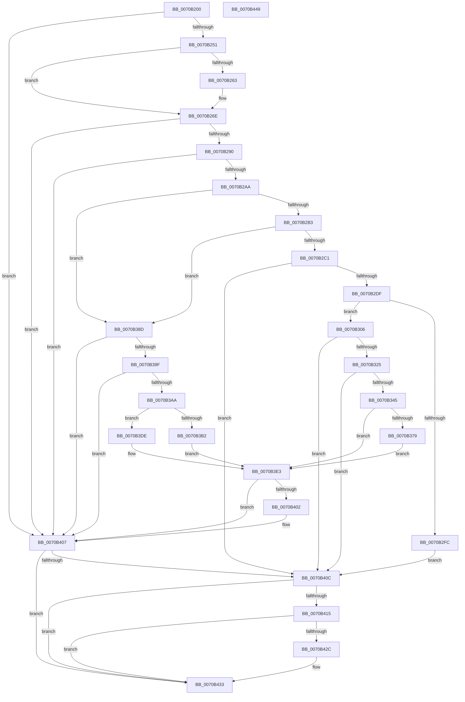

# HalpLoadMicrocode

- RVA: `0x0070B200`–`0x0070B44A` (길이 `586` bytes)
- VA: `0x000000014070B200`
- 실행 섹션: `PAGE`
- PDB 이름 있음: `예`; PDB Function 태그: `아니요`
- unwind 정보 RVA: `0x000C480C`
- 디코드: `153`개 명령, `586/586` bytes 표시
- 미해석 바이트: `0` (있으면 어셈블리에 `.byte`로 보존)

> 이 문서는 커널 이미지의 기계어와 PDB 기호를 분석해 생성했습니다. 4번과 5번은 함수 원형과 자료형을 바이너리 사용 방식에서 추정한 C 해석이며 원본 소스 복구 결과는 아닙니다.

## 1. Dependencies

- 직접 호출 지점: **24**; 고유 호출 대상: **21**
- 직접 호출자로 확인된 함수: **0**
- RIP 상대 이미지 참조: **8**

### Outgoing calls
- `0x0070B23A` → [HalpIsMicrosoftCompatibleHvLoaded](../../text/4A/HalpIsMicrosoftCompatibleHvLoaded_function_004AFAAC.md) (function, `0x004AFAAC`)
- `0x0070B242` → [HalpMcPatchConfiguration](../../text/55/HalpMcPatchConfiguration_function_0055B184.md) (function, `0x0055B184`)
- `0x0070B255` → [HalpMcGetLoadConfiguration](../../text/55/HalpMcGetLoadConfiguration_function_0055AF34.md) (function, `0x0055AF34`)
- `0x0070B263` → [HalpMcParallelLoadSupported](../../text/55/HalpMcParallelLoadSupported_function_0055B14C.md) (function, `0x0055B14C`)
- `0x0070B26E` → [HalpMcGetRollbackRequest](../../text/55/HalpMcGetRollbackRequest_function_0055AFEC.md) (function, `0x0055AFEC`)
- `0x0070B281` → [PrExtControlOperations](../../text/66/PrExtControlOperations_function_00666A6C.md) (function, `0x00666A6C`)
- `0x0070B29B` → [HalpGetMicrocodePatchRecord](../../text/55/HalpGetMicrocodePatchRecord_function_0055AA8C.md) (function, `0x0055AA8C`)
- `0x0070B2CD` → [PrExtGetRecordDataLength](../../text/66/PrExtGetRecordDataLength_function_00666D90.md) (function, `0x00666D90`)
- `0x0070B2EE` → [ExAllocatePool2](../../poolcode/B8/ExAllocatePool2_function_00B820F0.md) (function, `0x00B820F0`)
- `0x0070B316` → [PrExtExportRecordData](../../text/66/PrExtExportRecordData_function_00666B94.md) (function, `0x00666B94`)
- `0x0070B336` → [guard_dispatch_icall](../../text/6B/guard_dispatch_icall_function_006BAAD0.md) (function, `0x006BAAD0`)
- `0x0070B34E` → [ExFreePoolWithTag](../../poolcode/B8/ExFreePoolWithTag_function_00B82870.md) (function, `0x00B82870`)
- `0x0070B368` → [PrExtControlOperations](../../text/66/PrExtControlOperations_function_00666A6C.md) (function, `0x00666A6C`)
- `0x0070B37D` → [guard_dispatch_icall](../../text/6B/guard_dispatch_icall_function_006BAAD0.md) (function, `0x006BAAD0`)
- `0x0070B386` → [PrExtLogLatencyTime](../../text/66/PrExtLogLatencyTime_function_00666DB4.md) (function, `0x00666DB4`)
- `0x0070B394` → [HalpMcExportAndChargeNeededData](HalpMcExportAndChargeNeededData_function_0070B524.md) (function, `0x0070B524`)
- `0x0070B39F` → [HalpMcUpdateLock](../../text/4C/HalpMcUpdateLock_function_004C6214.md) (function, `0x004C6214`)
- `0x0070B3B7` → [KeQueryActiveProcessorCountEx](../../text/24/KeQueryActiveProcessorCountEx_function_00249EF0.md) (function, `0x00249EF0`)
- `0x0070B3D7` → [KeIpiGenericCall](../../text/47/KeIpiGenericCall_function_00471720.md) (function, `0x00471720`)
- `0x0070B3DE` → [HalpLoadMicrocodeSerialized](HalpLoadMicrocodeSerialized_function_0070B450.md) (function, `0x0070B450`)
- `0x0070B3E3` → [HalpMcUpdatePostUpdate](../../text/4D/HalpMcUpdatePostUpdate_function_004D6670.md) (function, `0x004D6670`)
- `0x0070B3F6` → [PrExtControlOperations](../../text/66/PrExtControlOperations_function_00666A6C.md) (function, `0x00666A6C`)
- `0x0070B402` → [HalpMcUpdateUnlock](../../text/4B/HalpMcUpdateUnlock_function_004B81D8.md) (function, `0x004B81D8`)
- `0x0070B421` → [PoDisableSleepStates](../75/PoDisableSleepStates_function_00757EE0.md) (function, `0x00757EE0`)

### Direct callers
- 이 함수 시작 RVA로 연결되는 직접 call은 확인되지 않았습니다. 간접 호출은 완전히 역산할 수 없습니다.

### Static image references
- `0x0070B2B3` → RVA `0x00FC1E50` (`.data`; read)
- `0x0070B36D` → RVA `0x00FC1E58` (`.data`; read)
- `0x0070B3BC` → RVA `0x00F90534` (`.data`; write)
- `0x0070B3C2` → RVA `0x0055B0B0` (`HalpMcLoadMicrocodeWorker`; read)
- `0x0070B3C9` → RVA `0x00F90534` (`.data`; read)
- `0x0070B3D1` → RVA `0x00F90538` (`.data`; write)
- `0x0070B40C` → RVA `0x00F90540` (`.data`; read)
- `0x0070B42C` → RVA `0x00F90540` (`.data`; write)

## 2. Other-region calls and transfers

- 다른 실행 섹션으로 향하는 call: **21**
  - `0x0070B23A` → [HalpIsMicrosoftCompatibleHvLoaded](../../text/4A/HalpIsMicrosoftCompatibleHvLoaded_function_004AFAAC.md) (`PAGE` → `.text`)
  - `0x0070B242` → [HalpMcPatchConfiguration](../../text/55/HalpMcPatchConfiguration_function_0055B184.md) (`PAGE` → `.text`)
  - `0x0070B255` → [HalpMcGetLoadConfiguration](../../text/55/HalpMcGetLoadConfiguration_function_0055AF34.md) (`PAGE` → `.text`)
  - `0x0070B263` → [HalpMcParallelLoadSupported](../../text/55/HalpMcParallelLoadSupported_function_0055B14C.md) (`PAGE` → `.text`)
  - `0x0070B26E` → [HalpMcGetRollbackRequest](../../text/55/HalpMcGetRollbackRequest_function_0055AFEC.md) (`PAGE` → `.text`)
  - `0x0070B281` → [PrExtControlOperations](../../text/66/PrExtControlOperations_function_00666A6C.md) (`PAGE` → `.text`)
  - `0x0070B29B` → [HalpGetMicrocodePatchRecord](../../text/55/HalpGetMicrocodePatchRecord_function_0055AA8C.md) (`PAGE` → `.text`)
  - `0x0070B2CD` → [PrExtGetRecordDataLength](../../text/66/PrExtGetRecordDataLength_function_00666D90.md) (`PAGE` → `.text`)
  - `0x0070B2EE` → [ExAllocatePool2](../../poolcode/B8/ExAllocatePool2_function_00B820F0.md) (`PAGE` → `POOLCODE`)
  - `0x0070B316` → [PrExtExportRecordData](../../text/66/PrExtExportRecordData_function_00666B94.md) (`PAGE` → `.text`)
  - `0x0070B336` → [guard_dispatch_icall](../../text/6B/guard_dispatch_icall_function_006BAAD0.md) (`PAGE` → `.text`)
  - `0x0070B34E` → [ExFreePoolWithTag](../../poolcode/B8/ExFreePoolWithTag_function_00B82870.md) (`PAGE` → `POOLCODE`)
  - `0x0070B368` → [PrExtControlOperations](../../text/66/PrExtControlOperations_function_00666A6C.md) (`PAGE` → `.text`)
  - `0x0070B37D` → [guard_dispatch_icall](../../text/6B/guard_dispatch_icall_function_006BAAD0.md) (`PAGE` → `.text`)
  - `0x0070B386` → [PrExtLogLatencyTime](../../text/66/PrExtLogLatencyTime_function_00666DB4.md) (`PAGE` → `.text`)
  - `0x0070B39F` → [HalpMcUpdateLock](../../text/4C/HalpMcUpdateLock_function_004C6214.md) (`PAGE` → `.text`)
  - `0x0070B3B7` → [KeQueryActiveProcessorCountEx](../../text/24/KeQueryActiveProcessorCountEx_function_00249EF0.md) (`PAGE` → `.text`)
  - `0x0070B3D7` → [KeIpiGenericCall](../../text/47/KeIpiGenericCall_function_00471720.md) (`PAGE` → `.text`)
  - `0x0070B3E3` → [HalpMcUpdatePostUpdate](../../text/4D/HalpMcUpdatePostUpdate_function_004D6670.md) (`PAGE` → `.text`)
  - `0x0070B3F6` → [PrExtControlOperations](../../text/66/PrExtControlOperations_function_00666A6C.md) (`PAGE` → `.text`)
  - `0x0070B402` → [HalpMcUpdateUnlock](../../text/4B/HalpMcUpdateUnlock_function_004B81D8.md) (`PAGE` → `.text`)
- 별도 외부 분기/꼬리 이동을 확인하지 못했습니다.

## 3. Assembly (complete function range)

```asm
0070B200  48 89 5C 24 08                  mov qword ptr [rsp + 8], rbx
0070B205  55                              push rbp
0070B206  56                              push rsi
0070B207  57                              push rdi
0070B208  41 54                           push r12
0070B20A  41 57                           push r15
0070B20C  48 8B EC                        mov rbp, rsp
0070B20F  48 83 EC 50                     sub rsp, 0x50
0070B213  48 83 65 F0 00                  and qword ptr [rbp - 0x10], 0
0070B218  45 32 E4                        xor r12b, r12b
0070B21B  48 83 65 E8 00                  and qword ptr [rbp - 0x18], 0
0070B220  4C 8B F9                        mov r15, rcx
0070B223  48 83 65 E0 00                  and qword ptr [rbp - 0x20], 0
0070B228  83 65 40 00                     and dword ptr [rbp + 0x40], 0
0070B22C  48 83 65 48 00                  and qword ptr [rbp + 0x48], 0
0070B231  48 83 65 F8 00                  and qword ptr [rbp - 8], 0
0070B236  44 88 65 38                     mov byte ptr [rbp + 0x38], r12b
0070B23A  E8 6D 48 DA FF                  call 0x1404afaac
0070B23F  40 8A F0                        mov sil, al
0070B242  E8 3D FF E4 FF                  call 0x14055b184
0070B247  8B D8                           mov ebx, eax
0070B249  85 C0                           test eax, eax
0070B24B  0F 88 B6 01 00 00               js 0x14070b407
0070B251  48 8D 4D 38                     lea rcx, [rbp + 0x38]
0070B255  E8 DA FC E4 FF                  call 0x14055af34
0070B25A  40 8A 7D 38                     mov dil, byte ptr [rbp + 0x38]
0070B25E  40 84 FF                        test dil, dil
0070B261  74 0B                           je 0x14070b26e
0070B263  E8 E4 FE E4 FF                  call 0x14055b14c
0070B268  40 8A F8                        mov dil, al
0070B26B  88 45 38                        mov byte ptr [rbp + 0x38], al
0070B26E  E8 79 FD E4 FF                  call 0x14055afec
0070B273  49 8B 57 30                     mov rdx, qword ptr [r15 + 0x30]
0070B277  B8 08 00 00 00                  mov eax, 8
0070B27C  44 8B C0                        mov r8d, eax
0070B27F  8B C8                           mov ecx, eax
0070B281  E8 E6 B7 F5 FF                  call 0x140666a6c
0070B286  8B D8                           mov ebx, eax
0070B288  85 C0                           test eax, eax
0070B28A  0F 88 77 01 00 00               js 0x14070b407
0070B290  4C 8D 45 E0                     lea r8, [rbp - 0x20]
0070B294  49 8B CF                        mov rcx, r15
0070B297  48 8D 55 E8                     lea rdx, [rbp - 0x18]
0070B29B  E8 EC F7 E4 FF                  call 0x14055aa8c
0070B2A0  8B D8                           mov ebx, eax
0070B2A2  85 C0                           test eax, eax
0070B2A4  0F 88 5D 01 00 00               js 0x14070b407
0070B2AA  40 84 F6                        test sil, sil
0070B2AD  0F 84 DA 00 00 00               je 0x14070b38d
0070B2B3  48 83 3D 95 6B 8B 00 00         cmp qword ptr [rip + 0x8b6b95], 0
0070B2BB  0F 84 CC 00 00 00               je 0x14070b38d
0070B2C1  48 8B 55 E0                     mov rdx, qword ptr [rbp - 0x20]
0070B2C5  4C 8D 45 48                     lea r8, [rbp + 0x48]
0070B2C9  48 8B 4D E8                     mov rcx, qword ptr [rbp - 0x18]
0070B2CD  E8 BE BA F5 FF                  call 0x140666d90
0070B2D2  8B D8                           mov ebx, eax
0070B2D4  3D 3E 00 00 C0                  cmp eax, 0xc000003e
0070B2D9  0F 84 2D 01 00 00               je 0x14070b40c
0070B2DF  48 8B 55 48                     mov rdx, qword ptr [rbp + 0x48]
0070B2E3  41 B8 48 61 6C 63               mov r8d, 0x636c6148
0070B2E9  B9 40 00 00 00                  mov ecx, 0x40
0070B2EE  E8 FD 6D 47 00                  call 0x140b820f0
0070B2F3  48 89 45 38                     mov qword ptr [rbp + 0x38], rax
0070B2F7  48 85 C0                        test rax, rax
0070B2FA  75 0A                           jne 0x14070b306
0070B2FC  BB A0 00 00 C0                  mov ebx, 0xc00000a0
0070B301  E9 06 01 00 00                  jmp 0x14070b40c
0070B306  4C 8B 45 48                     mov r8, qword ptr [rbp + 0x48]
0070B30A  4C 8D 4D 38                     lea r9, [rbp + 0x38]
0070B30E  48 8B 55 E0                     mov rdx, qword ptr [rbp - 0x20]
0070B312  48 8B 4D E8                     mov rcx, qword ptr [rbp - 0x18]
0070B316  E8 79 B8 F5 FF                  call 0x140666b94
0070B31B  8B D8                           mov ebx, eax
0070B31D  85 C0                           test eax, eax
0070B31F  0F 88 E7 00 00 00               js 0x14070b40c
0070B325  48 8B 05 24 6B 8B 00            mov rax, qword ptr [rip + 0x8b6b24]
0070B32C  44 8A C7                        mov r8b, dil
0070B32F  8B 55 48                        mov edx, dword ptr [rbp + 0x48]
0070B332  48 8B 4D 38                     mov rcx, qword ptr [rbp + 0x38]
0070B336  E8 95 F7 FA FF                  call 0x1406baad0
0070B33B  8B D8                           mov ebx, eax
0070B33D  85 C0                           test eax, eax
0070B33F  0F 88 C7 00 00 00               js 0x14070b40c
0070B345  48 8B 4D 38                     mov rcx, qword ptr [rbp + 0x38]
0070B349  BA 48 61 6C 63                  mov edx, 0x636c6148
0070B34E  E8 1D 75 47 00                  call 0x140b82870
0070B353  41 B8 04 00 00 00               mov r8d, 4
0070B359  C7 45 40 03 00 00 00            mov dword ptr [rbp + 0x40], 3
0070B360  48 8D 55 40                     lea rdx, [rbp + 0x40]
0070B364  41 8D 48 06                     lea ecx, [r8 + 6]
0070B368  E8 FF B6 F5 FF                  call 0x140666a6c
0070B36D  48 8B 05 E4 6A 8B 00            mov rax, qword ptr [rip + 0x8b6ae4]
0070B374  48 85 C0                        test rax, rax
0070B377  74 6A                           je 0x14070b3e3
0070B379  48 8D 4D F0                     lea rcx, [rbp - 0x10]
0070B37D  E8 4E F7 FA FF                  call 0x1406baad0
0070B382  48 8B 4D F0                     mov rcx, qword ptr [rbp - 0x10]
0070B386  E8 29 BA F5 FF                  call 0x140666db4
0070B38B  EB 56                           jmp 0x14070b3e3
0070B38D  8B 55 E0                        mov edx, dword ptr [rbp - 0x20]
0070B390  48 8B 4D E8                     mov rcx, qword ptr [rbp - 0x18]
0070B394  E8 8B 01 00 00                  call 0x14070b524
0070B399  8B D8                           mov ebx, eax
0070B39B  85 C0                           test eax, eax
0070B39D  78 68                           js 0x14070b407
0070B39F  E8 70 AE DB FF                  call 0x1404c6214
0070B3A4  8B D8                           mov ebx, eax
0070B3A6  85 C0                           test eax, eax
0070B3A8  78 5D                           js 0x14070b407
0070B3AA  41 B4 01                        mov r12b, 1
0070B3AD  40 84 FF                        test dil, dil
0070B3B0  74 2C                           je 0x14070b3de
0070B3B2  B9 FF FF 00 00                  mov ecx, 0xffff
0070B3B7  E8 34 EB B3 FF                  call 0x140249ef0
0070B3BC  89 05 72 51 88 00               mov dword ptr [rip + 0x885172], eax
0070B3C2  48 8D 0D E7 FC E4 FF            lea rcx, [rip - 0x1b0319]
0070B3C9  8B 05 65 51 88 00               mov eax, dword ptr [rip + 0x885165]
0070B3CF  33 D2                           xor edx, edx
0070B3D1  89 05 61 51 88 00               mov dword ptr [rip + 0x885161], eax
0070B3D7  E8 44 63 D6 FF                  call 0x140471720
0070B3DC  EB 05                           jmp 0x14070b3e3
0070B3DE  E8 6D 00 00 00                  call 0x14070b450
0070B3E3  E8 88 B2 DC FF                  call 0x1404d6670
0070B3E8  49 8B 57 30                     mov rdx, qword ptr [r15 + 0x30]
0070B3EC  41 B8 08 00 00 00               mov r8d, 8
0070B3F2  41 8D 48 01                     lea ecx, [r8 + 1]
0070B3F6  E8 71 B6 F5 FF                  call 0x140666a6c
0070B3FB  8B D8                           mov ebx, eax
0070B3FD  45 84 E4                        test r12b, r12b
0070B400  74 05                           je 0x14070b407
0070B402  E8 D1 CD DA FF                  call 0x1404b81d8
0070B407  40 84 F6                        test sil, sil
0070B40A  74 27                           je 0x14070b433
0070B40C  80 3D 2D 51 88 00 00            cmp byte ptr [rip + 0x88512d], 0
0070B413  75 1E                           jne 0x14070b433
0070B415  BA 0E 00 00 00                  mov edx, 0xe
0070B41A  4C 8D 45 F8                     lea r8, [rbp - 8]
0070B41E  8D 4A F3                        lea ecx, [rdx - 0xd]
0070B421  E8 BA CA 04 00                  call 0x140757ee0
0070B426  8B D8                           mov ebx, eax
0070B428  85 C0                           test eax, eax
0070B42A  78 07                           js 0x14070b433
0070B42C  C6 05 0D 51 88 00 01            mov byte ptr [rip + 0x88510d], 1
0070B433  8B C3                           mov eax, ebx
0070B435  48 8B 9C 24 80 00 00 00         mov rbx, qword ptr [rsp + 0x80]
0070B43D  48 83 C4 50                     add rsp, 0x50
0070B441  41 5F                           pop r15
0070B443  41 5C                           pop r12
0070B445  5F                              pop rdi
0070B446  5E                              pop rsi
0070B447  5D                              pop rbp
0070B448  C3                              ret
0070B449  CC                              int3
```

## 4. C-style interpretation (structured pseudocode)

```c
__int64 __fastcall HalpLoadMicrocode(__int64 a1)
{
    __int64 result;
    __int64 v_r12;
    __int64 v_rdi;
    __int64 v_rsp;
    unsigned __int64 v_stack_m30;
    unsigned __int64 v_stack_m38;
    unsigned __int64 v_stack_m40;
    unsigned __int64 v_stack_m48;
    unsigned __int8 v_stack_p10;
    unsigned int v_stack_p18;
    unsigned __int64 v_stack_p20;
    unsigned __int64 v_stack_p8;

    v_stack_p8 = v_rbx;
    v_rsp = (v_rsp) - (80);
    v_r12 = 0;
    v_stack_p10 = 0;
    result = HalpIsMicrosoftCompatibleHvLoaded(a1, a2, a3, a4);
    result = HalpMcPatchConfiguration(a1, a2, a3, a4);
    if (sign_flag) goto loc_0070B407;
    result = HalpMcGetLoadConfiguration(v_stack_p10, a2, a3, a4);
    v_rdi = v_stack_p10;
    if ((unsigned __int8)(v_stack_p10) != 0) {
        result = HalpMcParallelLoadSupported(v_stack_p10, a2, a3, a4);
        v_rdi = (unsigned __int8)(result);
        v_stack_p10 = (unsigned __int8)(result);
    }
    result = HalpMcGetRollbackRequest(v_stack_p10, a2, a3, a4);
    result = PrExtControlOperations(8, *(unsigned __int64 *)(a1 + 48), 8, a4);
    if (sign_flag) goto loc_0070B407;
    result = HalpGetMicrocodePatchRecord(a1, v_stack_m40, v_stack_m48, a4);
    if (sign_flag) goto loc_0070B407;
    if ((unsigned __int8)((unsigned __int8)(result)) == 0) goto loc_0070B38D;
    if ((*(unsigned __int64 *)(v_rip + 9137045)) == 0) goto loc_0070B38D;
    result = PrExtGetRecordDataLength(v_stack_m40, v_stack_m48, v_stack_p20, a4);
    if (((unsigned int)(result)) == 0xC000003EULL) goto loc_0070B40C;
    result = ExAllocatePool2(64, v_stack_p20, (unsigned int)(0x636C6148ULL), a4);
    v_stack_p10 = result;
    if (result != 0) goto loc_0070B306;
    goto loc_0070B40C;
loc_0070B306:
    result = PrExtExportRecordData(v_stack_m40, v_stack_m48, v_stack_p20, v_stack_p10);
    if (sign_flag) goto loc_0070B40C;
    result = guard_dispatch_icall(v_stack_p10, (unsigned int)(v_stack_p20), (unsigned __int8)(v_rdi), v_stack_p10);
    if (sign_flag) goto loc_0070B40C;
    result = ExFreePoolWithTag(v_stack_p10, (unsigned int)(0x636C6148ULL), (unsigned __int8)(v_rdi), v_stack_p10);
    v_stack_p18 = 3;
    result = PrExtControlOperations(4 + 6, v_stack_p18, 4, v_stack_p10);
    if (*(unsigned __int64 *)(v_rip + 9136868) == 0) goto loc_0070B3E3;
    result = guard_dispatch_icall(v_stack_m38, v_stack_p18, 4, v_stack_p10);
    result = PrExtLogLatencyTime(v_stack_m38, v_stack_p18, 4, v_stack_p10);
    goto loc_0070B3E3;
loc_0070B38D:
    result = HalpMcExportAndChargeNeededData(v_stack_m40, (unsigned int)(v_stack_m48), 4, v_stack_p10);
    if (sign_flag) goto loc_0070B407;
    result = HalpMcUpdateLock(v_stack_m40, (unsigned int)(v_stack_m48), 4, v_stack_p10);
    if (sign_flag) goto loc_0070B407;
    if ((unsigned __int8)(v_rdi) == 0) goto loc_0070B3DE;
    result = KeQueryActiveProcessorCountEx((unsigned int)(0xFFFFULL), (unsigned int)(v_stack_m48), 4, v_stack_p10);
    *(unsigned int *)(v_rip + 8933746) = (unsigned int)(result);
    a2 = 0;
    *(unsigned int *)(v_rip + 8933729) = (unsigned int)((unsigned int)(*(unsigned int *)(v_rip + 8933733)));
    result = KeIpiGenericCall(v_rip - 1770265, a2, 4, v_stack_p10);
    goto loc_0070B3E3;
loc_0070B3DE:
    result = HalpLoadMicrocodeSerialized(v_rip - 1770265, a2, 4, v_stack_p10);
loc_0070B3E3:
    result = HalpMcUpdatePostUpdate(v_rip - 1770265, a2, 4, v_stack_p10);
    result = PrExtControlOperations(8 + 1, *(unsigned __int64 *)(a1 + 48), 8, v_stack_p10);
    if (1 != 0) {
        result = HalpMcUpdateUnlock(8 + 1, *(unsigned __int64 *)(a1 + 48), 8, v_stack_p10);
    }
    if ((unsigned __int8)((unsigned __int8)(result)) == 0) goto loc_0070B433;
loc_0070B40C:
    if ((*(unsigned __int8 *)(v_rip + 8933677)) != 0) goto loc_0070B433;
    result = PoDisableSleepStates(14 - 13, 14, v_stack_m30, v_stack_p10);
    if (!(sign_flag)) {
        *(unsigned __int8 *)(v_rip + 8933645) = 1;
    }
    v_rsp = (v_rsp) + (80);
    return (unsigned int)((unsigned int)((unsigned int)((unsigned int)(result))));
}
```

## 5. (Beta) C Style

```c
int64_t HalpLoadMicrocode(void *Arg1)
{
    uint8_t *arg1 = (uint8_t *)Arg1;

    int64_t result;
    int64_t local_r12;
    int64_t local_rdi;
    int64_t local_rsp;
    uint64_t v_stack_m30;
    uint64_t v_stack_m38;
    uint64_t v_stack_m40;
    uint64_t v_stack_m48;
    uint8_t v_stack_p10;
    uint32_t v_stack_p18;
    uint64_t v_stack_p20;
    uint64_t v_stack_p8;

    v_stack_p8 = local_rbx;
    local_rsp = (local_rsp) - (80);
    local_r12 = 0;
    v_stack_p10 = 0;
    result = HalpIsMicrosoftCompatibleHvLoaded(Arg1, a2, a3, a4);
    result = HalpMcPatchConfiguration(Arg1, a2, a3, a4);
    if (sign_flag) goto loc_0070B407;
    result = HalpMcGetLoadConfiguration(v_stack_p10, a2, a3, a4);
    local_rdi = v_stack_p10;
    if ((uint8_t)(v_stack_p10) != 0) {
        result = HalpMcParallelLoadSupported(v_stack_p10, a2, a3, a4);
        local_rdi = (uint8_t)(result);
        v_stack_p10 = (uint8_t)(result);
    }
    result = HalpMcGetRollbackRequest(v_stack_p10, a2, a3, a4);
    result = PrExtControlOperations(8, *(uint64_t *)(arg1 + 0x30), 8, a4);
    if (sign_flag) goto loc_0070B407;
    result = HalpGetMicrocodePatchRecord(Arg1, v_stack_m40, v_stack_m48, a4);
    if (sign_flag) goto loc_0070B407;
    if ((uint8_t)((uint8_t)(result)) == 0) goto loc_0070B38D;
    if ((*(uint64_t *)(v_rip + 0x8B6B95)) == 0) goto loc_0070B38D;
    result = PrExtGetRecordDataLength(v_stack_m40, v_stack_m48, v_stack_p20, a4);
    if (((uint32_t)(result)) == 0xC000003EULL) goto loc_0070B40C;
    result = ExAllocatePool2(64, v_stack_p20, (uint32_t)(0x636C6148ULL), a4);
    v_stack_p10 = result;
    if (result != 0) goto loc_0070B306;
    goto loc_0070B40C;
loc_0070B306:
    result = PrExtExportRecordData(v_stack_m40, v_stack_m48, v_stack_p20, v_stack_p10);
    if (sign_flag) goto loc_0070B40C;
    result = guard_dispatch_icall(v_stack_p10, (uint32_t)(v_stack_p20), (uint8_t)(local_rdi), v_stack_p10);
    if (sign_flag) goto loc_0070B40C;
    result = ExFreePoolWithTag(v_stack_p10, (uint32_t)(0x636C6148ULL), (uint8_t)(local_rdi), v_stack_p10);
    v_stack_p18 = 3;
    result = PrExtControlOperations(4 + 6, v_stack_p18, 4, v_stack_p10);
    if (*(uint64_t *)(v_rip + 0x8B6AE4) == 0) goto loc_0070B3E3;
    result = guard_dispatch_icall(v_stack_m38, v_stack_p18, 4, v_stack_p10);
    result = PrExtLogLatencyTime(v_stack_m38, v_stack_p18, 4, v_stack_p10);
    goto loc_0070B3E3;
loc_0070B38D:
    result = HalpMcExportAndChargeNeededData(v_stack_m40, (uint32_t)(v_stack_m48), 4, v_stack_p10);
    if (sign_flag) goto loc_0070B407;
    result = HalpMcUpdateLock(v_stack_m40, (uint32_t)(v_stack_m48), 4, v_stack_p10);
    if (sign_flag) goto loc_0070B407;
    if ((uint8_t)(local_rdi) == 0) goto loc_0070B3DE;
    result = KeQueryActiveProcessorCountEx((uint32_t)(0xFFFFULL), (uint32_t)(v_stack_m48), 4, v_stack_p10);
    *(uint32_t *)(v_rip + 0x885172) = (uint32_t)(result);
    a2 = 0;
    *(uint32_t *)(v_rip + 0x885161) = (uint32_t)((uint32_t)(*(uint32_t *)(v_rip + 0x885165)));
    result = KeIpiGenericCall(v_rip - 1770265, a2, 4, v_stack_p10);
    goto loc_0070B3E3;
loc_0070B3DE:
    result = HalpLoadMicrocodeSerialized(v_rip - 1770265, a2, 4, v_stack_p10);
loc_0070B3E3:
    result = HalpMcUpdatePostUpdate(v_rip - 1770265, a2, 4, v_stack_p10);
    result = PrExtControlOperations(8 + 1, *(uint64_t *)(arg1 + 0x30), 8, v_stack_p10);
    if (1 != 0) {
        result = HalpMcUpdateUnlock(8 + 1, *(uint64_t *)(arg1 + 0x30), 8, v_stack_p10);
    }
    if ((uint8_t)((uint8_t)(result)) == 0) goto loc_0070B433;
loc_0070B40C:
    if ((*(uint8_t *)(v_rip + 0x88512D)) != 0) goto loc_0070B433;
    result = PoDisableSleepStates(14 - 13, 14, v_stack_m30, v_stack_p10);
    if (!(sign_flag)) {
        *(uint8_t *)(v_rip + 0x88510D) = 1;
    }
    local_rsp = (local_rsp) + (80);
    return (uint32_t)((uint32_t)((uint32_t)((uint32_t)(result))));
}
```

### 관측된 메모리 오프셋

구조체 형식이 확인되지 않은 접근은 인자 기준의 오프셋으로만 기록했습니다.

| 기준 인자 | 오프셋 표현 | 폭 (bit) | 접근 |
|---|---:|---:|---|
| `Arg1` | `+ 0x30` | `64` | `R` |

## 6. Execution-region graph

[열기: 2D/3D 그래프와 함수 탐색 컨트롤 패널](../../../control-panel.html?section=page&rva=0x0070B200&view=graph)

- 2D 그래프는 위에서 아래로 흐르고, 3D 그래프는 빈 공간을 드래그해 회전합니다. Shift+드래그는 이동, 휠은 확대·축소, 함수 노드 선택은 대상 보고서 이동입니다.

### Static fallback


