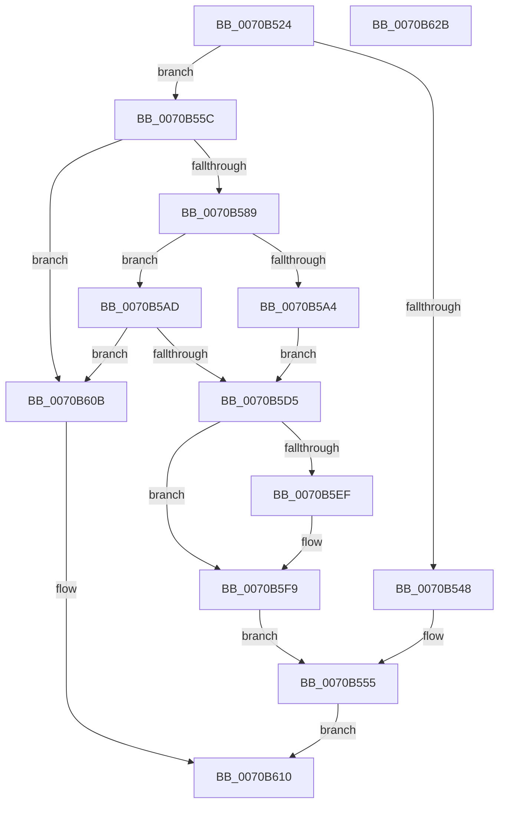

# HalpMcExportAndChargeNeededData

- RVA: `0x0070B524`–`0x0070B62C` (길이 `264` bytes)
- VA: `0x000000014070B524`
- 실행 섹션: `PAGE`
- PDB 이름 있음: `예`; PDB Function 태그: `아니요`
- unwind 정보 RVA: `0x0005E6B4`
- 디코드: `67`개 명령, `264/264` bytes 표시
- 미해석 바이트: `0` (있으면 어셈블리에 `.byte`로 보존)

> 이 문서는 커널 이미지의 기계어와 PDB 기호를 분석해 생성했습니다. 4번과 5번은 함수 원형과 자료형을 바이너리 사용 방식에서 추정한 C 해석이며 원본 소스 복구 결과는 아닙니다.

## 1. Dependencies

- 직접 호출 지점: **7**; 고유 호출 대상: **5**
- 직접 호출자로 확인된 함수: **2**
- RIP 상대 이미지 참조: **6**

### Outgoing calls
- `0x0070B578` → [ExAllocatePool2](../../poolcode/B8/ExAllocatePool2_function_00B820F0.md) (function, `0x00B820F0`)
- `0x0070B591` → [memset](../../text/6C/memset_function_006C6C40.md) (function, `0x006C6C40`)
- `0x0070B59B` → [MmObtainChargesToLockPagedPool](../7F/MmObtainChargesToLockPagedPool_function_007FE390.md) (function, `0x007FE390`)
- `0x0070B5B5` → [ExFreePoolWithTag](../../poolcode/B8/ExFreePoolWithTag_function_00B82870.md) (function, `0x00B82870`)
- `0x0070B5C8` → [ExAllocatePool2](../../poolcode/B8/ExAllocatePool2_function_00B820F0.md) (function, `0x00B820F0`)
- `0x0070B5DE` → [memcpy](../../text/6C/memcpy_function_006C6840.md) (function, `0x006C6840`)
- `0x0070B5F4` → [ExFreePoolWithTag](../../poolcode/B8/ExFreePoolWithTag_function_00B82870.md) (function, `0x00B82870`)

### Direct callers
- [HalpMcUpdateInitializeBSP](../../text/55/HalpMcUpdateInitializeBSP_function_0055B22C.md) at `0x0055B2BA`
- [HalpLoadMicrocode](HalpLoadMicrocode_function_0070B200.md) at `0x0070B394`

### Static image references
- `0x0070B548` → RVA `0x00FC19F8` (`.data`; read/write)
- `0x0070B54F` → RVA `0x00FC19F0` (`.data`; read/write)
- `0x0070B5A4` → RVA `0x00F90532` (`.data`; write)
- `0x0070B5E3` → RVA `0x00FC19F8` (`.data`; read)
- `0x0070B5F9` → RVA `0x00FC19F8` (`.data`; write)
- `0x0070B600` → RVA `0x00FC19F0` (`.data`; write)

## 2. Other-region calls and transfers

- 다른 실행 섹션으로 향하는 call: **6**
  - `0x0070B578` → [ExAllocatePool2](../../poolcode/B8/ExAllocatePool2_function_00B820F0.md) (`PAGE` → `POOLCODE`)
  - `0x0070B591` → [memset](../../text/6C/memset_function_006C6C40.md) (`PAGE` → `.text`)
  - `0x0070B5B5` → [ExFreePoolWithTag](../../poolcode/B8/ExFreePoolWithTag_function_00B82870.md) (`PAGE` → `POOLCODE`)
  - `0x0070B5C8` → [ExAllocatePool2](../../poolcode/B8/ExAllocatePool2_function_00B820F0.md) (`PAGE` → `POOLCODE`)
  - `0x0070B5DE` → [memcpy](../../text/6C/memcpy_function_006C6840.md) (`PAGE` → `.text`)
  - `0x0070B5F4` → [ExFreePoolWithTag](../../poolcode/B8/ExFreePoolWithTag_function_00B82870.md) (`PAGE` → `POOLCODE`)
- 별도 외부 분기/꼬리 이동을 확인하지 못했습니다.

## 3. Assembly (complete function range)

```asm
0070B524  48 8B C4                        mov rax, rsp
0070B527  48 89 58 08                     mov qword ptr [rax + 8], rbx
0070B52B  48 89 68 10                     mov qword ptr [rax + 0x10], rbp
0070B52F  48 89 70 18                     mov qword ptr [rax + 0x18], rsi
0070B533  48 89 78 20                     mov qword ptr [rax + 0x20], rdi
0070B537  41 56                           push r14
0070B539  48 83 EC 20                     sub rsp, 0x20
0070B53D  44 8B F2                        mov r14d, edx
0070B540  48 8B F1                        mov rsi, rcx
0070B543  48 85 C9                        test rcx, rcx
0070B546  75 14                           jne 0x14070b55c
0070B548  48 21 0D A9 64 8B 00            and qword ptr [rip + 0x8b64a9], rcx
0070B54F  21 0D 9B 64 8B 00               and dword ptr [rip + 0x8b649b], ecx
0070B555  33 C0                           xor eax, eax
0070B557  E9 B4 00 00 00                  jmp 0x14070b610
0070B55C  41 8D BE FF 0F 00 00            lea edi, [r14 + 0xfff]
0070B563  41 B8 48 61 6C 63               mov r8d, 0x636c6148
0070B569  81 E7 00 F0 FF FF               and edi, 0xfffff000
0070B56F  B9 00 01 00 00                  mov ecx, 0x100
0070B574  8B D7                           mov edx, edi
0070B576  8B EF                           mov ebp, edi
0070B578  E8 73 6B 47 00                  call 0x140b820f0
0070B57D  48 8B D8                        mov rbx, rax
0070B580  48 85 C0                        test rax, rax
0070B583  0F 84 82 00 00 00               je 0x14070b60b
0070B589  44 8B C5                        mov r8d, ebp
0070B58C  33 D2                           xor edx, edx
0070B58E  48 8B C8                        mov rcx, rax
0070B591  E8 AA B6 FB FF                  call 0x1406c6c40
0070B596  8B D5                           mov edx, ebp
0070B598  48 8B CB                        mov rcx, rbx
0070B59B  E8 F0 2D 0F 00                  call 0x1407fe390
0070B5A0  85 C0                           test eax, eax
0070B5A2  74 09                           je 0x14070b5ad
0070B5A4  C6 05 87 4F 88 00 01            mov byte ptr [rip + 0x884f87], 1
0070B5AB  EB 28                           jmp 0x14070b5d5
0070B5AD  BA 48 61 6C 63                  mov edx, 0x636c6148
0070B5B2  48 8B CB                        mov rcx, rbx
0070B5B5  E8 B6 72 47 00                  call 0x140b82870
0070B5BA  41 B8 48 61 6C 63               mov r8d, 0x636c6148
0070B5C0  48 8B D5                        mov rdx, rbp
0070B5C3  B9 40 00 00 00                  mov ecx, 0x40
0070B5C8  E8 23 6B 47 00                  call 0x140b820f0
0070B5CD  48 8B D8                        mov rbx, rax
0070B5D0  48 85 C0                        test rax, rax
0070B5D3  74 36                           je 0x14070b60b
0070B5D5  4D 8B C6                        mov r8, r14
0070B5D8  48 8B D6                        mov rdx, rsi
0070B5DB  48 8B CB                        mov rcx, rbx
0070B5DE  E8 5D B2 FB FF                  call 0x1406c6840
0070B5E3  48 8B 0D 0E 64 8B 00            mov rcx, qword ptr [rip + 0x8b640e]
0070B5EA  48 85 C9                        test rcx, rcx
0070B5ED  74 0A                           je 0x14070b5f9
0070B5EF  BA 48 61 6C 63                  mov edx, 0x636c6148
0070B5F4  E8 77 72 47 00                  call 0x140b82870
0070B5F9  48 89 1D F8 63 8B 00            mov qword ptr [rip + 0x8b63f8], rbx
0070B600  89 3D EA 63 8B 00               mov dword ptr [rip + 0x8b63ea], edi
0070B606  E9 4A FF FF FF                  jmp 0x14070b555
0070B60B  B8 17 00 00 C0                  mov eax, 0xc0000017
0070B610  48 8B 5C 24 30                  mov rbx, qword ptr [rsp + 0x30]
0070B615  48 8B 6C 24 38                  mov rbp, qword ptr [rsp + 0x38]
0070B61A  48 8B 74 24 40                  mov rsi, qword ptr [rsp + 0x40]
0070B61F  48 8B 7C 24 48                  mov rdi, qword ptr [rsp + 0x48]
0070B624  48 83 C4 20                     add rsp, 0x20
0070B628  41 5E                           pop r14
0070B62A  C3                              ret
0070B62B  CC                              int3
```

## 4. C-style interpretation (structured pseudocode)

```c
__int64 __fastcall HalpMcExportAndChargeNeededData(__int64 a1, int a2)
{
    __int64 result;
    __int64 v_rdi;
    __int64 v_rsp;
    unsigned __int64 v_stack_p10;
    unsigned __int64 v_stack_p18;
    unsigned __int64 v_stack_p20;
    unsigned __int64 v_stack_p8;

    *(unsigned __int64 *)(v_rsp + 8) = v_rbx;
    *(unsigned __int64 *)(v_rsp + 16) = v_rbp;
    *(unsigned __int64 *)(v_rsp + 24) = v_rsi;
    *(unsigned __int64 *)(v_rsp + 32) = v_rdi;
    v_rsp = (v_rsp) - (32);
    if (a1 != 0) goto loc_0070B55C;
loc_0070B555:
    result = 0;
    goto loc_0070B610;
loc_0070B55C:
    v_rdi = (unsigned int)(((unsigned int)(a2) + 4095) & (0xFFFFF000ULL));
    result = ExAllocatePool2(256, (unsigned int)((unsigned int)(v_rdi)), (unsigned int)(0x636C6148ULL), a4);
    if (result == 0) goto loc_0070B60B;
    a2 = 0;
    result = memset(result, a2, (unsigned int)((unsigned int)((unsigned int)((unsigned int)(v_rdi)))), a4);
    result = MmObtainChargesToLockPagedPool(result, (unsigned int)((unsigned int)((unsigned int)((unsigned int)(v_rdi)))), (unsigned int)((unsigned int)((unsigned int)((unsigned int)(v_rdi)))), a4);
    if ((unsigned int)(result) == 0) goto loc_0070B5AD;
    *(unsigned __int8 *)(v_rip + 8933255) = 1;
    goto loc_0070B5D5;
loc_0070B5AD:
    result = ExFreePoolWithTag(result, (unsigned int)(0x636C6148ULL), (unsigned int)((unsigned int)((unsigned int)((unsigned int)(v_rdi)))), a4);
    result = ExAllocatePool2(64, (unsigned int)((unsigned int)(v_rdi)), (unsigned int)(0x636C6148ULL), a4);
    if (result == 0) goto loc_0070B60B;
loc_0070B5D5:
    result = memcpy(result, a1, (unsigned int)(a2), a4);
    if (*(unsigned __int64 *)(v_rip + 9135118) != 0) {
        a2 = 0x636C6148ULL;
        result = ExFreePoolWithTag(*(unsigned __int64 *)(v_rip + 9135118), a2, (unsigned int)(a2), a4);
    }
    *(unsigned __int64 *)(v_rip + 9135096) = result;
    *(unsigned int *)(v_rip + 9135082) = (unsigned int)(v_rdi);
    goto loc_0070B555;
loc_0070B60B:
loc_0070B610:
    v_rsp = (v_rsp) + (32);
    return (unsigned int)(0xC0000017ULL);
}
```

## 5. (Beta) C Style

```c
int64_t HalpMcExportAndChargeNeededData(int64_t Arg1, void *Arg2)
{
    uint8_t *arg2 = (uint8_t *)Arg2;

    int64_t result;
    int64_t local_rdi;
    int64_t local_rsp;
    uint64_t v_stack_p10;
    uint64_t v_stack_p18;
    uint64_t v_stack_p20;
    uint64_t v_stack_p8;

    *(uint64_t *)(local_rsp + 0x8) = local_rbx;
    *(uint64_t *)(local_rsp + 0x10) = local_rbp;
    *(uint64_t *)(local_rsp + 0x18) = local_rsi;
    *(uint64_t *)(local_rsp + 0x20) = local_rdi;
    local_rsp = (local_rsp) - (32);
    if (Arg1 != 0) goto loc_0070B55C;
loc_0070B555:
    result = 0;
    goto loc_0070B610;
loc_0070B55C:
    local_rdi = (uint32_t)(((uint32_t)(Arg2) + 4095) & (0xFFFFF000ULL));
    result = ExAllocatePool2(256, (uint32_t)((uint32_t)(local_rdi)), (uint32_t)(0x636C6148ULL), a4);
    if (result == 0) goto loc_0070B60B;
    Arg2 = 0;
    result = memset(result, Arg2, (uint32_t)((uint32_t)((uint32_t)((uint32_t)(local_rdi)))), a4);
    result = MmObtainChargesToLockPagedPool(result, (uint32_t)((uint32_t)((uint32_t)((uint32_t)(local_rdi)))), (uint32_t)((uint32_t)((uint32_t)((uint32_t)(local_rdi)))), a4);
    if ((uint32_t)(result) == 0) goto loc_0070B5AD;
    *(uint8_t *)(v_rip + 0x884F87) = 1;
    goto loc_0070B5D5;
loc_0070B5AD:
    result = ExFreePoolWithTag(result, (uint32_t)(0x636C6148ULL), (uint32_t)((uint32_t)((uint32_t)((uint32_t)(local_rdi)))), a4);
    result = ExAllocatePool2(64, (uint32_t)((uint32_t)(local_rdi)), (uint32_t)(0x636C6148ULL), a4);
    if (result == 0) goto loc_0070B60B;
loc_0070B5D5:
    result = memcpy(result, Arg1, (uint32_t)(Arg2), a4);
    if (*(uint64_t *)(v_rip + 0x8B640E) != 0) {
        Arg2 = 0x636C6148ULL;
        result = ExFreePoolWithTag(*(uint64_t *)(v_rip + 0x8B640E), Arg2, (uint32_t)(Arg2), a4);
    }
    *(uint64_t *)(v_rip + 0x8B63F8) = result;
    *(uint32_t *)(v_rip + 0x8B63EA) = (uint32_t)(local_rdi);
    goto loc_0070B555;
loc_0070B60B:
loc_0070B610:
    local_rsp = (local_rsp) + (32);
    return (uint32_t)(0xC0000017ULL);
}
```

### 관측된 메모리 오프셋

구조체 형식이 확인되지 않은 접근은 인자 기준의 오프셋으로만 기록했습니다.

| 기준 인자 | 오프셋 표현 | 폭 (bit) | 접근 |
|---|---:|---:|---|
| `Arg2` | `+ 0xFFF` | `32` | `R` |

## 6. Execution-region graph

[열기: 2D/3D 그래프와 함수 탐색 컨트롤 패널](../../../control-panel.html?section=page&rva=0x0070B524&view=graph)

- 2D 그래프는 위에서 아래로 흐르고, 3D 그래프는 빈 공간을 드래그해 회전합니다. Shift+드래그는 이동, 휠은 확대·축소, 함수 노드 선택은 대상 보고서 이동입니다.

### Static fallback


