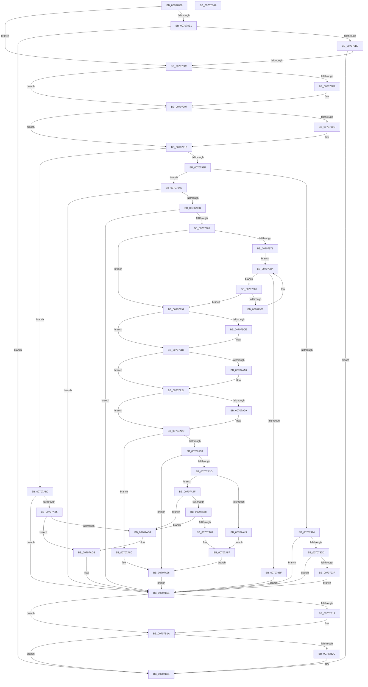

# HalpNotifyActorIfPmuAvailable

- RVA: `0x00707880`–`0x00707B4B` (길이 `715` bytes)
- VA: `0x0000000140707880`
- 실행 섹션: `PAGE`
- PDB 이름 있음: `예`; PDB Function 태그: `아니요`
- unwind 정보 RVA: `0x00060300`
- 디코드: `173`개 명령, `715/715` bytes 표시
- 미해석 바이트: `0` (있으면 어셈블리에 `.byte`로 보존)

> 이 문서는 커널 이미지의 기계어와 PDB 기호를 분석해 생성했습니다. 4번과 5번은 함수 원형과 자료형을 바이너리 사용 방식에서 추정한 C 해석이며 원본 소스 복구 결과는 아닙니다.

## 1. Dependencies

- 직접 호출 지점: **19**; 고유 호출 대상: **13**
- 직접 호출자로 확인된 함수: **5**
- RIP 상대 이미지 참조: **16**

### Outgoing calls
- `0x007078E9` → [KeAbPreAcquire](../../text/21/KeAbPreAcquire_function_00210230.md) (function, `0x00210230`)
- `0x00707902` → [ExfAcquirePushLockExclusiveEx](../../text/20/ExfAcquirePushLockExclusiveEx_function_0020FC90.md) (function, `0x0020FC90`)
- `0x0070792D` → [PsGetCurrentThreadId](../../text/43/PsGetCurrentThreadId_function_00439680.md) (function, `0x00439680`)
- `0x0070794E` → [HalpAcquirePmuAccessRequest](../../text/54/HalpAcquirePmuAccessRequest_function_00546CE0.md) (function, `0x00546CE0`)
- `0x0070799E` → [PsGetCurrentThreadId](../../text/43/PsGetCurrentThreadId_function_00439680.md) (function, `0x00439680`)
- `0x007079B7` → [ExAcquireRundownProtection](../../text/21/ExAcquireRundownProtection_function_00216620.md) (function, `0x00216620`)
- `0x007079D1` → [ExfTryToWakePushLock](../../text/26/ExfTryToWakePushLock_function_00265DD0.md) (function, `0x00265DD0`)
- `0x007079D9` → [KeAbPostRelease](../../text/2E/KeAbPostRelease_function_002E1600.md) (function, `0x002E1600`)
- `0x007079DE` → [KeLeaveCriticalRegion](../../text/25/KeLeaveCriticalRegion_function_0025D8B0.md) (function, `0x0025D8B0`)
- `0x007079E8` → [HalpPmuArbiterNotifyActor](HalpPmuArbiterNotifyActor_function_00707B54.md) (function, `0x00707B54`)
- `0x00707A06` → [KeAbPreAcquire](../../text/21/KeAbPreAcquire_function_00210230.md) (function, `0x00210230`)
- `0x00707A1F` → [ExfAcquirePushLockExclusiveEx](../../text/20/ExfAcquirePushLockExclusiveEx_function_0020FC90.md) (function, `0x0020FC90`)
- `0x00707A71` → [KeQueryPerformanceCounter](../../text/37/KeQueryPerformanceCounter_function_0037E7E0.md) (function, `0x0037E7E0`)
- `0x00707AA9` → [ExReleaseRundownProtection](../../text/34/ExReleaseRundownProtection_function_00349E80.md) (function, `0x00349E80`)
- `0x00707ABC` → [HalpPmuArbiterUpdateActiveActorTime](HalpPmuArbiterUpdateActiveActorTime_function_00707DB4.md) (function, `0x00707DB4`)
- `0x00707B15` → [ExfTryToWakePushLock](../../text/26/ExfTryToWakePushLock_function_00265DD0.md) (function, `0x00265DD0`)
- `0x00707B1D` → [KeAbPostRelease](../../text/2E/KeAbPostRelease_function_002E1600.md) (function, `0x002E1600`)
- `0x00707B22` → [KeLeaveCriticalRegion](../../text/25/KeLeaveCriticalRegion_function_0025D8B0.md) (function, `0x0025D8B0`)
- `0x00707B2C` → [HalpReleasePmuAccessRequest](../../text/54/HalpReleasePmuAccessRequest_function_005477A0.md) (function, `0x005477A0`)

### Direct callers
- [HalpFreePmcCounterSet](../../text/54/HalpFreePmcCounterSet_function_00547310.md) at `0x00547437`
- [HalFreeHardwareCounters](HalFreeHardwareCounters_function_007071E0.md) at `0x00707247`
- [HalFreeHardwareCounters](HalFreeHardwareCounters_function_007071E0.md) at `0x0070728B`
- [HalpPmuArbiterPeriodicWorkItem](HalpPmuArbiterPeriodicWorkItem_function_00707B90.md) at `0x00707CB0`
- [HalpRegisterPmuNotification](HalpRegisterPmuNotification_function_0070C38C.md) at `0x0070C5A1`
- [HalpUnregisterPmuNotification](../AC/HalpUnregisterPmuNotification_function_00ACAB7C.md) at `0x00ACAD97`

### Static image references
- `0x00707898` → RVA `0x00FC2B4C` (`.data`; read)
- `0x007078A4` → RVA `0x00FC2B50` (`.data`; read)
- `0x007078CE` → RVA `0x00FC2B40` (`.data`; read)
- `0x00707932` → RVA `0x00FC2BA0` (`.data`; read)
- `0x0070793F` → RVA `0x00FC2B50` (`.data`; write)
- `0x00707971` → RVA `0x00FC2B58` (`.data`; read)
- `0x007079A3` → RVA `0x00FC2BA0` (`.data`; write)
- `0x007079B1` → RVA `0x00FC2BA8` (`.data`; write)
- `0x007079BF` → RVA `0x00FC2B40` (`.data`; read/write)
- `0x00707A6A` → RVA `0x00FC2BB0` (`.data`; write)
- `0x00707A76` → RVA `0x00FC2BB8` (`.data`; write)
- `0x00707A96` → RVA `0x00FC2BA8` (`.data`; read/write)
- `0x00707AA1` → RVA `0x00FC2BA0` (`.data`; read/write)
- `0x00707AB5` → RVA `0x00FC2BB0` (`.data`; read)
- `0x00707AC1` → RVA `0x00FC2B60` (`.data`; read)
- `0x00707AE8` → RVA `0x00FC2B60` (`.data`; write)

## 2. Other-region calls and transfers

- 다른 실행 섹션으로 향하는 call: **17**
  - `0x007078E9` → [KeAbPreAcquire](../../text/21/KeAbPreAcquire_function_00210230.md) (`PAGE` → `.text`)
  - `0x00707902` → [ExfAcquirePushLockExclusiveEx](../../text/20/ExfAcquirePushLockExclusiveEx_function_0020FC90.md) (`PAGE` → `.text`)
  - `0x0070792D` → [PsGetCurrentThreadId](../../text/43/PsGetCurrentThreadId_function_00439680.md) (`PAGE` → `.text`)
  - `0x0070794E` → [HalpAcquirePmuAccessRequest](../../text/54/HalpAcquirePmuAccessRequest_function_00546CE0.md) (`PAGE` → `.text`)
  - `0x0070799E` → [PsGetCurrentThreadId](../../text/43/PsGetCurrentThreadId_function_00439680.md) (`PAGE` → `.text`)
  - `0x007079B7` → [ExAcquireRundownProtection](../../text/21/ExAcquireRundownProtection_function_00216620.md) (`PAGE` → `.text`)
  - `0x007079D1` → [ExfTryToWakePushLock](../../text/26/ExfTryToWakePushLock_function_00265DD0.md) (`PAGE` → `.text`)
  - `0x007079D9` → [KeAbPostRelease](../../text/2E/KeAbPostRelease_function_002E1600.md) (`PAGE` → `.text`)
  - `0x007079DE` → [KeLeaveCriticalRegion](../../text/25/KeLeaveCriticalRegion_function_0025D8B0.md) (`PAGE` → `.text`)
  - `0x00707A06` → [KeAbPreAcquire](../../text/21/KeAbPreAcquire_function_00210230.md) (`PAGE` → `.text`)
  - `0x00707A1F` → [ExfAcquirePushLockExclusiveEx](../../text/20/ExfAcquirePushLockExclusiveEx_function_0020FC90.md) (`PAGE` → `.text`)
  - `0x00707A71` → [KeQueryPerformanceCounter](../../text/37/KeQueryPerformanceCounter_function_0037E7E0.md) (`PAGE` → `.text`)
  - `0x00707AA9` → [ExReleaseRundownProtection](../../text/34/ExReleaseRundownProtection_function_00349E80.md) (`PAGE` → `.text`)
  - `0x00707B15` → [ExfTryToWakePushLock](../../text/26/ExfTryToWakePushLock_function_00265DD0.md) (`PAGE` → `.text`)
  - `0x00707B1D` → [KeAbPostRelease](../../text/2E/KeAbPostRelease_function_002E1600.md) (`PAGE` → `.text`)
  - `0x00707B22` → [KeLeaveCriticalRegion](../../text/25/KeLeaveCriticalRegion_function_0025D8B0.md) (`PAGE` → `.text`)
  - `0x00707B2C` → [HalpReleasePmuAccessRequest](../../text/54/HalpReleasePmuAccessRequest_function_005477A0.md) (`PAGE` → `.text`)
- 별도 외부 분기/꼬리 이동을 확인하지 못했습니다.

## 3. Assembly (complete function range)

```asm
00707880  48 89 5C 24 08                  mov qword ptr [rsp + 8], rbx
00707885  48 89 6C 24 10                  mov qword ptr [rsp + 0x10], rbp
0070788A  48 89 74 24 18                  mov qword ptr [rsp + 0x18], rsi
0070788F  57                              push rdi
00707890  41 56                           push r14
00707892  41 57                           push r15
00707894  48 83 EC 20                     sub rsp, 0x20
00707898  8B 05 AE B2 8B 00               mov eax, dword ptr [rip + 0x8bb2ae]
0070789E  45 32 FF                        xor r15b, r15b
007078A1  48 8B F9                        mov rdi, rcx
007078A4  8B 0D A6 B2 8B 00               mov ecx, dword ptr [rip + 0x8bb2a6]
007078AA  44 8A F2                        mov r14b, dl
007078AD  84 D2                           test dl, dl
007078AF  75 14                           jne 0x1407078c5
007078B1  85 C0                           test eax, eax
007078B3  0F 85 78 02 00 00               jne 0x140707b31
007078B9  8D 41 FD                        lea eax, [rcx - 3]
007078BC  83 F8 01                        cmp eax, 1
007078BF  0F 87 6C 02 00 00               ja 0x140707b31
007078C5  65 48 8B 04 25 88 01 00 00      mov rax, qword ptr gs:[0x188]
007078CE  48 8D 35 6B B2 8B 00            lea rsi, [rip + 0x8bb26b]
007078D5  48 83 CB FF                     or rbx, 0xffffffffffffffff
007078D9  45 33 C0                        xor r8d, r8d
007078DC  33 D2                           xor edx, edx
007078DE  48 8B CE                        mov rcx, rsi
007078E1  66 01 98 E4 01 00 00            add word ptr [rax + 0x1e4], bx
007078E8  90                              nop
007078E9  E8 42 89 B0 FF                  call 0x140210230
007078EE  F0 48 0F BA 2E 00               lock bts qword ptr [rsi], 0
007078F4  48 8B E8                        mov rbp, rax
007078F7  73 0E                           jae 0x140707907
007078F9  4C 8B C6                        mov r8, rsi
007078FC  48 8B D0                        mov rdx, rax
007078FF  48 8B CE                        mov rcx, rsi
00707902  E8 89 83 B0 FF                  call 0x14020fc90
00707907  48 85 ED                        test rbp, rbp
0070790A  74 04                           je 0x140707910
0070790C  C6 45 0A 01                     mov byte ptr [rbp + 0xa], 1
00707910  8B 0D 3A B2 8B 00               mov ecx, dword ptr [rip + 0x8bb23a]
00707916  83 E9 02                        sub ecx, 2
00707919  0F 84 91 01 00 00               je 0x140707ab0
0070791F  83 E9 01                        sub ecx, 1
00707922  74 2A                           je 0x14070794e
00707924  83 F9 01                        cmp ecx, 1
00707927  0F 85 D4 01 00 00               jne 0x140707b01
0070792D  E8 4E 1D D3 FF                  call 0x140439680
00707932  48 39 05 67 B2 8B 00            cmp qword ptr [rip + 0x8bb267], rax
00707939  0F 85 C2 01 00 00               jne 0x140707b01
0070793F  C7 05 07 B2 8B 00 05 00 00 00   mov dword ptr [rip + 0x8bb207], 5
00707949  E9 B3 01 00 00                  jmp 0x140707b01
0070794E  E8 8D F3 E3 FF                  call 0x140546ce0
00707953  85 C0                           test eax, eax
00707955  0F 88 A6 01 00 00               js 0x140707b01
0070795B  8B 05 EB B1 8B 00               mov eax, dword ptr [rip + 0x8bb1eb]
00707961  85 C0                           test eax, eax
00707963  0F 85 98 01 00 00               jne 0x140707b01
00707969  41 B7 01                        mov r15b, 1
0070796C  48 85 FF                        test rdi, rdi
0070796F  75 23                           jne 0x140707994
00707971  48 8B 3D E0 B1 8B 00            mov rdi, qword ptr [rip + 0x8bb1e0]
00707978  48 8D 05 D9 B1 8B 00            lea rax, [rip + 0x8bb1d9]
0070797F  EB 09                           jmp 0x14070798a
00707981  80 7F 38 00                     cmp byte ptr [rdi + 0x38], 0
00707985  74 0D                           je 0x140707994
00707987  48 8B 3F                        mov rdi, qword ptr [rdi]
0070798A  48 3B F8                        cmp rdi, rax
0070798D  75 F2                           jne 0x140707981
0070798F  E9 6D 01 00 00                  jmp 0x140707b01
00707994  C7 05 B2 B1 8B 00 04 00 00 00   mov dword ptr [rip + 0x8bb1b2], 4
0070799E  E8 DD 1C D3 FF                  call 0x140439680
007079A3  48 89 05 F6 B1 8B 00            mov qword ptr [rip + 0x8bb1f6], rax
007079AA  48 8D 4F 30                     lea rcx, [rdi + 0x30]
007079AE  8B 47 20                        mov eax, dword ptr [rdi + 0x20]
007079B1  89 05 F1 B1 8B 00               mov dword ptr [rip + 0x8bb1f1], eax
007079B7  E8 64 EC B0 FF                  call 0x140216620
007079BC  48 8B C3                        mov rax, rbx
007079BF  F0 48 0F C1 05 78 B1 8B 00      lock xadd qword ptr [rip + 0x8bb178], rax
007079C8  24 06                           and al, 6
007079CA  3C 02                           cmp al, 2
007079CC  75 08                           jne 0x1407079d6
007079CE  48 8B CE                        mov rcx, rsi
007079D1  E8 FA E3 B5 FF                  call 0x140265dd0
007079D6  48 8B CE                        mov rcx, rsi
007079D9  E8 22 9C BD FF                  call 0x1402e1600
007079DE  E8 CD 5E B5 FF                  call 0x14025d8b0
007079E3  33 D2                           xor edx, edx
007079E5  48 8B CF                        mov rcx, rdi
007079E8  E8 67 01 00 00                  call 0x140707b54
007079ED  65 48 8B 04 25 88 01 00 00      mov rax, qword ptr gs:[0x188]
007079F6  45 33 C0                        xor r8d, r8d
007079F9  33 D2                           xor edx, edx
007079FB  48 8B CE                        mov rcx, rsi
007079FE  66 01 98 E4 01 00 00            add word ptr [rax + 0x1e4], bx
00707A05  90                              nop
00707A06  E8 25 88 B0 FF                  call 0x140210230
00707A0B  F0 48 0F BA 2E 00               lock bts qword ptr [rsi], 0
00707A11  48 8B E8                        mov rbp, rax
00707A14  73 0E                           jae 0x140707a24
00707A16  4C 8B C6                        mov r8, rsi
00707A19  48 8B D0                        mov rdx, rax
00707A1C  48 8B CE                        mov rcx, rsi
00707A1F  E8 6C 82 B0 FF                  call 0x14020fc90
00707A24  48 85 ED                        test rbp, rbp
00707A27  74 04                           je 0x140707a2d
00707A29  44 88 7D 0A                     mov byte ptr [rbp + 0xa], r15b
00707A2D  8B 0D 1D B1 8B 00               mov ecx, dword ptr [rip + 0x8bb11d]
00707A33  83 E9 04                        sub ecx, 4
00707A36  74 54                           je 0x140707a8c
00707A38  83 F9 01                        cmp ecx, 1
00707A3B  75 59                           jne 0x140707a96
00707A3D  80 7F 38 00                     cmp byte ptr [rdi + 0x38], 0
00707A41  74 0C                           je 0x140707a4f
00707A43  C7 05 03 B1 8B 00 03 00 00 00   mov dword ptr [rip + 0x8bb103], 3
00707A4D  EB 38                           jmp 0x140707a87
00707A4F  48 8B 0F                        mov rcx, qword ptr [rdi]
00707A52  48 39 79 08                     cmp qword ptr [rcx + 8], rdi
00707A56  75 7C                           jne 0x140707ad4
00707A58  48 8B 47 08                     mov rax, qword ptr [rdi + 8]
00707A5C  48 39 38                        cmp qword ptr [rax], rdi
00707A5F  75 73                           jne 0x140707ad4
00707A61  48 89 08                        mov qword ptr [rax], rcx
00707A64  48 89 41 08                     mov qword ptr [rcx + 8], rax
00707A68  33 C9                           xor ecx, ecx
00707A6A  48 89 3D 3F B1 8B 00            mov qword ptr [rip + 0x8bb13f], rdi
00707A71  E8 6A 6D C7 FF                  call 0x14037e7e0
00707A76  48 89 05 3B B1 8B 00            mov qword ptr [rip + 0x8bb13b], rax
00707A7D  C7 05 C9 B0 8B 00 02 00 00 00   mov dword ptr [rip + 0x8bb0c9], 2
00707A87  45 32 FF                        xor r15b, r15b
00707A8A  EB 0A                           jmp 0x140707a96
00707A8C  C7 05 BA B0 8B 00 03 00 00 00   mov dword ptr [rip + 0x8bb0ba], 3
00707A96  83 25 0B B1 8B 00 00            and dword ptr [rip + 0x8bb10b], 0
00707A9D  48 8D 4F 30                     lea rcx, [rdi + 0x30]
00707AA1  48 83 25 F7 B0 8B 00 00         and qword ptr [rip + 0x8bb0f7], 0
00707AA9  E8 D2 23 C4 FF                  call 0x140349e80
00707AAE  EB 51                           jmp 0x140707b01
00707AB0  45 84 F6                        test r14b, r14b
00707AB3  74 4C                           je 0x140707b01
00707AB5  48 8B 3D F4 B0 8B 00            mov rdi, qword ptr [rip + 0x8bb0f4]
00707ABC  E8 F3 02 00 00                  call 0x140707db4
00707AC1  48 8B 0D 98 B0 8B 00            mov rcx, qword ptr [rip + 0x8bb098]
00707AC8  48 8D 05 89 B0 8B 00            lea rax, [rip + 0x8bb089]
00707ACF  48 39 01                        cmp qword ptr [rcx], rax
00707AD2  74 07                           je 0x140707adb
00707AD4  B9 03 00 00 00                  mov ecx, 3
00707AD9  CD 29                           int 0x29
00707ADB  48 89 07                        mov qword ptr [rdi], rax
00707ADE  0F 57 C0                        xorps xmm0, xmm0
00707AE1  48 89 4F 08                     mov qword ptr [rdi + 8], rcx
00707AE5  48 89 39                        mov qword ptr [rcx], rdi
00707AE8  48 89 3D 71 B0 8B 00            mov qword ptr [rip + 0x8bb071], rdi
00707AEF  F3 0F 7F 05 B9 B0 8B 00         movdqu xmmword ptr [rip + 0x8bb0b9], xmm0
00707AF7  C7 05 4F B0 8B 00 03 00 00 00   mov dword ptr [rip + 0x8bb04f], 3
00707B01  F0 48 0F C1 1D 36 B0 8B 00      lock xadd qword ptr [rip + 0x8bb036], rbx
00707B0A  80 E3 06                        and bl, 6
00707B0D  80 FB 02                        cmp bl, 2
00707B10  75 08                           jne 0x140707b1a
00707B12  48 8B CE                        mov rcx, rsi
00707B15  E8 B6 E2 B5 FF                  call 0x140265dd0
00707B1A  48 8B CE                        mov rcx, rsi
00707B1D  E8 DE 9A BD FF                  call 0x1402e1600
00707B22  E8 89 5D B5 FF                  call 0x14025d8b0
00707B27  45 84 FF                        test r15b, r15b
00707B2A  74 05                           je 0x140707b31
00707B2C  E8 6F FC E3 FF                  call 0x1405477a0
00707B31  48 8B 5C 24 40                  mov rbx, qword ptr [rsp + 0x40]
00707B36  48 8B 6C 24 48                  mov rbp, qword ptr [rsp + 0x48]
00707B3B  48 8B 74 24 50                  mov rsi, qword ptr [rsp + 0x50]
00707B40  48 83 C4 20                     add rsp, 0x20
00707B44  41 5F                           pop r15
00707B46  41 5E                           pop r14
00707B48  5F                              pop rdi
00707B49  C3                              ret
00707B4A  CC                              int3
```

## 4. C-style interpretation (structured pseudocode)

```c
__int64 __fastcall HalpNotifyActorIfPmuAvailable(__int64 a1, int a2, int a3)
{
    __int64 result;
    __int64 v_r15;
    __int64 v_rbx;
    __int64 v_rsp;
    unsigned __int64 v_stack_p10;
    unsigned __int64 v_stack_p18;
    unsigned __int64 v_stack_p8;

    v_stack_p8 = v_rbx;
    v_stack_p10 = v_rbp;
    v_stack_p18 = v_rsi;
    v_rsp = (v_rsp) - (32);
    v_r15 = 0;
    if ((unsigned __int8)(a2) != 0) goto loc_007078C5;
    if ((unsigned int)((unsigned int)(*(unsigned int *)(v_rip + 9155246))) != 0) goto loc_00707B31;
    if (((unsigned int)((unsigned int)(*(unsigned int *)(v_rip + 9155238)) - 3)) > 1) goto loc_00707B31;
loc_007078C5:
    v_rbx = (v_rbx) | (-1);
    a3 = 0;
    a2 = 0;
    result = KeAbPreAcquire(v_rip + 9155179, a2, a3, a4);
    if (!(condition_is_above_or_equal)) {
        a3 = v_rip + 9155179;
        a2 = result;
        a1 = v_rip + 9155179;
        result = ExfAcquirePushLockExclusiveEx(a1, a2, a3, a4);
    }
    if (result != 0) {
        *(unsigned __int8 *)(result + 10) = 1;
    }
    a1 = (unsigned int)(((unsigned int)(*(unsigned int *)(v_rip + 9155130))) - (2));
    if (condition_is_equal) goto loc_00707AB0;
    a1 = (unsigned int)((a1) - (1));
    if (condition_is_equal) goto loc_0070794E;
    if (((unsigned int)(a1)) != 1) goto loc_00707B01;
    result = PsGetCurrentThreadId(a1, a2, a3, a4);
    if ((*(unsigned __int64 *)(v_rip + 9155175)) != result) goto loc_00707B01;
    *(unsigned int *)(v_rip + 9155079) = 5;
    goto loc_00707B01;
loc_0070794E:
    result = HalpAcquirePmuAccessRequest(a1, a2, a3, a4);
    if (sign_flag) goto loc_00707B01;
    if ((unsigned int)((unsigned int)(*(unsigned int *)(v_rip + 9155051))) != 0) goto loc_00707B01;
    if (a1 != 0) goto loc_00707994;
    goto loc_0070798A;
loc_00707981:
    if ((*(unsigned __int8 *)(*(unsigned __int64 *)(v_rip + 9155040) + 56)) == 0) goto loc_00707994;
loc_0070798A:
    if ((*(unsigned __int64 *)(*(unsigned __int64 *)(v_rip + 9155040))) != (v_rip + 9155033)) goto loc_00707981;
    goto loc_00707B01;
loc_00707994:
    *(unsigned int *)(v_rip + 9154994) = 4;
    result = PsGetCurrentThreadId(a1, a2, a3, a4);
    *(unsigned __int64 *)(v_rip + 9155062) = result;
    *(unsigned int *)(v_rip + 9155057) = (unsigned int)((unsigned int)(*(unsigned int *)(*(unsigned __int64 *)(*(unsigned __int64 *)(v_rip + 9155040)) + 32)));
    result = ExAcquireRundownProtection(*(unsigned __int64 *)(*(unsigned __int64 *)(v_rip + 9155040)) + 48, a2, a3, a4);
    result = (unsigned __int8)((v_rbx) & (6));
    if (((unsigned __int8)(result)) == 2) {
        a1 = v_rip + 9155179;
        result = ExfTryToWakePushLock(a1, a2, a3, a4);
    }
    result = KeAbPostRelease(v_rip + 9155179, a2, a3, a4);
    result = KeLeaveCriticalRegion(v_rip + 9155179, a2, a3, a4);
    a2 = 0;
    result = HalpPmuArbiterNotifyActor(*(unsigned __int64 *)(*(unsigned __int64 *)(v_rip + 9155040)), a2, a3, a4);
    a3 = 0;
    a2 = 0;
    result = KeAbPreAcquire(v_rip + 9155179, a2, a3, a4);
    if (!(condition_is_above_or_equal)) {
        a3 = v_rip + 9155179;
        a2 = result;
        a1 = v_rip + 9155179;
        result = ExfAcquirePushLockExclusiveEx(a1, a2, a3, a4);
    }
    if (result != 0) {
        *(unsigned __int8 *)(result + 10) = 1;
    }
    a1 = (unsigned int)(((unsigned int)(*(unsigned int *)(v_rip + 9154845))) - (4));
    if (condition_is_equal) goto loc_00707A8C;
    if (((unsigned int)(a1)) != 1) goto loc_00707A96;
    if ((*(unsigned __int8 *)(*(unsigned __int64 *)(*(unsigned __int64 *)(v_rip + 9155040)) + 56)) == 0) goto loc_00707A4F;
    *(unsigned int *)(v_rip + 9154819) = 3;
    goto loc_00707A87;
loc_00707A4F:
    if ((*(unsigned __int64 *)(*(unsigned __int64 *)(*(unsigned __int64 *)(*(unsigned __int64 *)(v_rip + 9155040))) + 8)) != (*(unsigned __int64 *)(*(unsigned __int64 *)(v_rip + 9155040)))) goto loc_00707AD4;
    if ((*(unsigned __int64 *)(*(unsigned __int64 *)(*(unsigned __int64 *)(*(unsigned __int64 *)(v_rip + 9155040)) + 8))) != (*(unsigned __int64 *)(*(unsigned __int64 *)(v_rip + 9155040)))) goto loc_00707AD4;
    *(unsigned __int64 *)(*(unsigned __int64 *)(*(unsigned __int64 *)(*(unsigned __int64 *)(v_rip + 9155040)) + 8)) = *(unsigned __int64 *)(*(unsigned __int64 *)(*(unsigned __int64 *)(v_rip + 9155040)));
    *(unsigned __int64 *)(*(unsigned __int64 *)(*(unsigned __int64 *)(*(unsigned __int64 *)(v_rip + 9155040))) + 8) = *(unsigned __int64 *)(*(unsigned __int64 *)(*(unsigned __int64 *)(v_rip + 9155040)) + 8);
    a1 = 0;
    *(unsigned __int64 *)(v_rip + 9154879) = *(unsigned __int64 *)(*(unsigned __int64 *)(v_rip + 9155040));
    result = KeQueryPerformanceCounter(a1, a2, a3, a4);
    *(unsigned __int64 *)(v_rip + 9154875) = result;
    *(unsigned int *)(v_rip + 9154761) = 2;
loc_00707A87:
    v_r15 = 0;
    goto loc_00707A96;
loc_00707A8C:
    *(unsigned int *)(v_rip + 9154746) = 3;
loc_00707A96:
    result = ExReleaseRundownProtection(*(unsigned __int64 *)(*(unsigned __int64 *)(v_rip + 9155040)) + 48, a2, a3, a4);
    goto loc_00707B01;
loc_00707AB0:
    if ((unsigned __int8)((unsigned __int8)(a2)) == 0) goto loc_00707B01;
    result = HalpPmuArbiterUpdateActiveActorTime(*(unsigned __int64 *)(*(unsigned __int64 *)(v_rip + 9155040)) + 48, a2, a3, a4);
    if ((*(unsigned __int64 *)(*(unsigned __int64 *)(v_rip + 9154712))) != (v_rip + 9154697)) {
        a1 = 3;
    }
    *(unsigned __int64 *)(*(unsigned __int64 *)(v_rip + 9154804)) = v_rip + 9154697;
    *(unsigned __int64 *)(*(unsigned __int64 *)(v_rip + 9154804) + 8) = a1;
    *(unsigned __int64 *)(a1) = *(unsigned __int64 *)(v_rip + 9154804);
    *(unsigned __int64 *)(v_rip + 9154673) = *(unsigned __int64 *)(v_rip + 9154804);
    *(unsigned __int64 *)(v_rip + 9154745) = v_xmm0;
    *(unsigned int *)(v_rip + 9154639) = 3;
loc_00707B01:
    v_rbx = (unsigned __int8)((v_rbx) & (6));
    result = v_rip + 9154697;
    if (((unsigned __int8)(v_rbx)) == 2) {
        a1 = v_rip + 9155179;
        result = ExfTryToWakePushLock(a1, a2, a3, a4);
    }
    result = KeAbPostRelease(v_rip + 9155179, a2, a3, a4);
    result = KeLeaveCriticalRegion(v_rip + 9155179, a2, a3, a4);
    if (0 != 0) {
        result = HalpReleasePmuAccessRequest(v_rip + 9155179, a2, a3, a4);
    }
    v_rsp = (v_rsp) + (32);
    return result;
}
```

## 5. (Beta) C Style

```c
int64_t HalpNotifyActorIfPmuAvailable(int64_t Arg1, int32_t Arg2, int32_t Arg3)
{
    int64_t result;
    int64_t local_r15;
    int64_t local_rbx;
    int64_t local_rsp;
    uint64_t v_stack_p10;
    uint64_t v_stack_p18;
    uint64_t v_stack_p8;

    v_stack_p8 = local_rbx;
    v_stack_p10 = local_rbp;
    v_stack_p18 = local_rsi;
    local_rsp = (local_rsp) - (32);
    local_r15 = 0;
    if ((uint8_t)(Arg2) != 0) goto loc_007078C5;
    if ((uint32_t)((uint32_t)(*(uint32_t *)(v_rip + 0x8BB2AE))) != 0) goto loc_00707B31;
    if (((uint32_t)((uint32_t)(*(uint32_t *)(v_rip + 0x8BB2A6)) - 3)) > 1) goto loc_00707B31;
loc_007078C5:
    local_rbx = (local_rbx) | (-1);
    Arg3 = 0;
    Arg2 = 0;
    result = KeAbPreAcquire(v_rip + 9155179, Arg2, Arg3, a4);
    if (!(condition_is_above_or_equal)) {
        Arg3 = v_rip + 9155179;
        Arg2 = result;
        Arg1 = v_rip + 9155179;
        result = ExfAcquirePushLockExclusiveEx(Arg1, Arg2, Arg3, a4);
    }
    if (result != 0) {
        *(uint8_t *)(result + 0xA) = 1;
    }
    Arg1 = (uint32_t)(((uint32_t)(*(uint32_t *)(v_rip + 0x8BB23A))) - (2));
    if (condition_is_equal) goto loc_00707AB0;
    Arg1 = (uint32_t)((Arg1) - (1));
    if (condition_is_equal) goto loc_0070794E;
    if (((uint32_t)(Arg1)) != 1) goto loc_00707B01;
    result = PsGetCurrentThreadId(Arg1, Arg2, Arg3, a4);
    if ((*(uint64_t *)(v_rip + 0x8BB267)) != result) goto loc_00707B01;
    *(uint32_t *)(v_rip + 0x8BB207) = 5;
    goto loc_00707B01;
loc_0070794E:
    result = HalpAcquirePmuAccessRequest(Arg1, Arg2, Arg3, a4);
    if (sign_flag) goto loc_00707B01;
    if ((uint32_t)((uint32_t)(*(uint32_t *)(v_rip + 0x8BB1EB))) != 0) goto loc_00707B01;
    if (Arg1 != 0) goto loc_00707994;
    goto loc_0070798A;
loc_00707981:
    if ((*(uint8_t *)(*(uint64_t *)(v_rip + 0x8BB1E0) + 0x38)) == 0) goto loc_00707994;
loc_0070798A:
    if ((*(uint64_t *)(*(uint64_t *)(v_rip + 0x8BB1E0))) != (v_rip + 9155033)) goto loc_00707981;
    goto loc_00707B01;
loc_00707994:
    *(uint32_t *)(v_rip + 0x8BB1B2) = 4;
    result = PsGetCurrentThreadId(Arg1, Arg2, Arg3, a4);
    *(uint64_t *)(v_rip + 0x8BB1F6) = result;
    *(uint32_t *)(v_rip + 0x8BB1F1) = (uint32_t)((uint32_t)(*(uint32_t *)(*(uint64_t *)(*(uint64_t *)(v_rip + 0x8BB1E0)) + 0x20)));
    result = ExAcquireRundownProtection(*(uint64_t *)(*(uint64_t *)(v_rip + 0x8BB1E0)) + 48, Arg2, Arg3, a4);
    result = (uint8_t)((local_rbx) & (6));
    if (((uint8_t)(result)) == 2) {
        Arg1 = v_rip + 9155179;
        result = ExfTryToWakePushLock(Arg1, Arg2, Arg3, a4);
    }
    result = KeAbPostRelease(v_rip + 9155179, Arg2, Arg3, a4);
    result = KeLeaveCriticalRegion(v_rip + 9155179, Arg2, Arg3, a4);
    Arg2 = 0;
    result = HalpPmuArbiterNotifyActor(*(uint64_t *)(*(uint64_t *)(v_rip + 0x8BB1E0)), Arg2, Arg3, a4);
    Arg3 = 0;
    Arg2 = 0;
    result = KeAbPreAcquire(v_rip + 9155179, Arg2, Arg3, a4);
    if (!(condition_is_above_or_equal)) {
        Arg3 = v_rip + 9155179;
        Arg2 = result;
        Arg1 = v_rip + 9155179;
        result = ExfAcquirePushLockExclusiveEx(Arg1, Arg2, Arg3, a4);
    }
    if (result != 0) {
        *(uint8_t *)(result + 0xA) = 1;
    }
    Arg1 = (uint32_t)(((uint32_t)(*(uint32_t *)(v_rip + 0x8BB11D))) - (4));
    if (condition_is_equal) goto loc_00707A8C;
    if (((uint32_t)(Arg1)) != 1) goto loc_00707A96;
    if ((*(uint8_t *)(*(uint64_t *)(*(uint64_t *)(v_rip + 0x8BB1E0)) + 0x38)) == 0) goto loc_00707A4F;
    *(uint32_t *)(v_rip + 0x8BB103) = 3;
    goto loc_00707A87;
loc_00707A4F:
    if ((*(uint64_t *)(*(uint64_t *)(*(uint64_t *)(*(uint64_t *)(v_rip + 0x8BB1E0))) + 0x8)) != (*(uint64_t *)(*(uint64_t *)(v_rip + 0x8BB1E0)))) goto loc_00707AD4;
    if ((*(uint64_t *)(*(uint64_t *)(*(uint64_t *)(*(uint64_t *)(v_rip + 0x8BB1E0)) + 0x8))) != (*(uint64_t *)(*(uint64_t *)(v_rip + 0x8BB1E0)))) goto loc_00707AD4;
    *(uint64_t *)(*(uint64_t *)(*(uint64_t *)(*(uint64_t *)(v_rip + 0x8BB1E0)) + 0x8)) = *(uint64_t *)(*(uint64_t *)(*(uint64_t *)(v_rip + 0x8BB1E0)));
    *(uint64_t *)(*(uint64_t *)(*(uint64_t *)(*(uint64_t *)(v_rip + 0x8BB1E0))) + 0x8) = *(uint64_t *)(*(uint64_t *)(*(uint64_t *)(v_rip + 0x8BB1E0)) + 0x8);
    Arg1 = 0;
    *(uint64_t *)(v_rip + 0x8BB13F) = *(uint64_t *)(*(uint64_t *)(v_rip + 0x8BB1E0));
    result = KeQueryPerformanceCounter(Arg1, Arg2, Arg3, a4);
    *(uint64_t *)(v_rip + 0x8BB13B) = result;
    *(uint32_t *)(v_rip + 0x8BB0C9) = 2;
loc_00707A87:
    local_r15 = 0;
    goto loc_00707A96;
loc_00707A8C:
    *(uint32_t *)(v_rip + 0x8BB0BA) = 3;
loc_00707A96:
    result = ExReleaseRundownProtection(*(uint64_t *)(*(uint64_t *)(v_rip + 0x8BB1E0)) + 48, Arg2, Arg3, a4);
    goto loc_00707B01;
loc_00707AB0:
    if ((uint8_t)((uint8_t)(Arg2)) == 0) goto loc_00707B01;
    result = HalpPmuArbiterUpdateActiveActorTime(*(uint64_t *)(*(uint64_t *)(v_rip + 0x8BB1E0)) + 48, Arg2, Arg3, a4);
    if ((*(uint64_t *)(*(uint64_t *)(v_rip + 0x8BB098))) != (v_rip + 9154697)) {
        Arg1 = 3;
    }
    *(uint64_t *)(*(uint64_t *)(v_rip + 0x8BB0F4)) = v_rip + 9154697;
    *(uint64_t *)(*(uint64_t *)(v_rip + 0x8BB0F4) + 0x8) = Arg1;
    *(uint64_t *)(Arg1) = *(uint64_t *)(v_rip + 0x8BB0F4);
    *(uint64_t *)(v_rip + 0x8BB071) = *(uint64_t *)(v_rip + 0x8BB0F4);
    *(uint64_t *)(v_rip + 0x8BB0B9) = v_xmm0;
    *(uint32_t *)(v_rip + 0x8BB04F) = 3;
loc_00707B01:
    local_rbx = (uint8_t)((local_rbx) & (6));
    result = v_rip + 9154697;
    if (((uint8_t)(local_rbx)) == 2) {
        Arg1 = v_rip + 9155179;
        result = ExfTryToWakePushLock(Arg1, Arg2, Arg3, a4);
    }
    result = KeAbPostRelease(v_rip + 9155179, Arg2, Arg3, a4);
    result = KeLeaveCriticalRegion(v_rip + 9155179, Arg2, Arg3, a4);
    if (0 != 0) {
        result = HalpReleasePmuAccessRequest(v_rip + 9155179, Arg2, Arg3, a4);
    }
    local_rsp = (local_rsp) + (32);
    return result;
}
```

## 6. Execution-region graph

[열기: 2D/3D 그래프와 함수 탐색 컨트롤 패널](../../../control-panel.html?section=page&rva=0x00707880&view=graph)

- 2D 그래프는 위에서 아래로 흐르고, 3D 그래프는 빈 공간을 드래그해 회전합니다. Shift+드래그는 이동, 휠은 확대·축소, 함수 노드 선택은 대상 보고서 이동입니다.

### Static fallback


