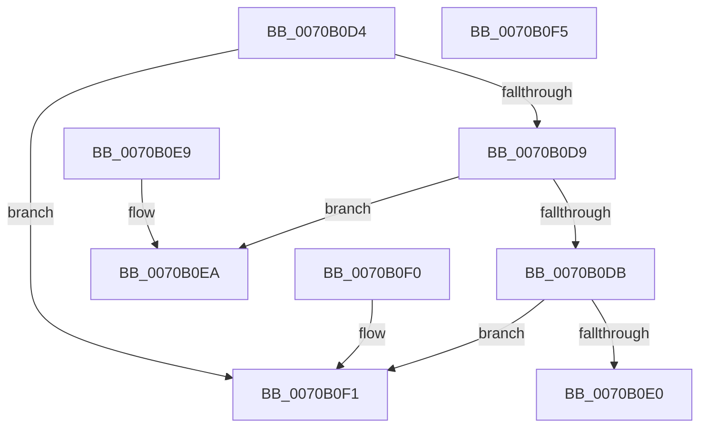

# HalpNumaCompareMemorySideCacheNodeAndLevel

- RVA: `0x0070B0D4`–`0x0070B0F6` (길이 `34` bytes)
- VA: `0x000000014070B0D4`
- 실행 섹션: `PAGE`
- PDB 이름 있음: `예`; PDB Function 태그: `아니요`
- unwind 정보 RVA: `0x000DB714`
- 디코드: `16`개 명령, `34/34` bytes 표시
- 미해석 바이트: `0` (있으면 어셈블리에 `.byte`로 보존)

> 이 문서는 커널 이미지의 기계어와 PDB 기호를 분석해 생성했습니다. 4번과 5번은 함수 원형과 자료형을 바이너리 사용 방식에서 추정한 C 해석이며 원본 소스 복구 결과는 아닙니다.

## 1. Dependencies

- 직접 호출 지점: **0**; 고유 호출 대상: **0**
- 직접 호출자로 확인된 함수: **2**
- RIP 상대 이미지 참조: **0**

### Outgoing calls
- 직접 디코드된 call 명령이 없습니다.

### Direct callers
- [HalpNumaQueryMemorySideCacheInfo](HalpNumaQueryMemorySideCacheInfo_function_0070B100.md) at `0x0070B16F`
- [HalpNumaCompareMemorySideCacheEntries](../../init/C2/HalpNumaCompareMemorySideCacheEntries_function_00C22030.md) at `0x00C22040`

### Static image references
- 디코드된 RIP-relative 메모리 참조가 없습니다.

## 2. Other-region calls and transfers

- 다른 실행 섹션으로 향하는 call: **0**
- 별도 외부 분기/꼬리 이동을 확인하지 못했습니다.

## 3. Assembly (complete function range)

```asm
0070B0D4  41 3B C8                        cmp ecx, r8d
0070B0D7  72 18                           jb 0x14070b0f1
0070B0D9  77 0F                           ja 0x14070b0ea
0070B0DB  41 3B D1                        cmp edx, r9d
0070B0DE  7C 11                           jl 0x14070b0f1
0070B0E0  33 C0                           xor eax, eax
0070B0E2  41 3B D1                        cmp edx, r9d
0070B0E5  0F 9F C0                        setg al
0070B0E8  C3                              ret
0070B0E9  CC                              int3
0070B0EA  B8 01 00 00 00                  mov eax, 1
0070B0EF  C3                              ret
0070B0F0  CC                              int3
0070B0F1  83 C8 FF                        or eax, 0xffffffff
0070B0F4  C3                              ret
0070B0F5  CC                              int3
```

## 4. C-style interpretation (structured pseudocode)

```c
__int64 __fastcall HalpNumaCompareMemorySideCacheNodeAndLevel(int a1, int a2, int a3, int a4)
{
    __int64 result;

    if (a1 < a3) goto loc_0070B0F1;
    if (a1 > a3) goto loc_0070B0EA;
    if (a2 < a4) goto loc_0070B0F1;
    result = 0;
    result = (a2 > a4) ? 1 : 0;
    return result;
loc_0070B0EA:
    return 1;
loc_0070B0F1:
    result = (unsigned int)((1) | (0xFFFFFFFFULL));
    return result;
}
```

## 5. (Beta) C Style

```c
int64_t HalpNumaCompareMemorySideCacheNodeAndLevel(int32_t Arg1, int32_t Arg2, int32_t Arg3, int32_t Arg4)
{
    int64_t result;

    if (Arg1 < Arg3) goto loc_0070B0F1;
    if (Arg1 > Arg3) goto loc_0070B0EA;
    if (Arg2 < Arg4) goto loc_0070B0F1;
    result = 0;
    result = (Arg2 > Arg4) ? 1 : 0;
    return result;
loc_0070B0EA:
    return 1;
loc_0070B0F1:
    result = (uint32_t)((1) | (0xFFFFFFFFULL));
    return result;
}
```

## 6. Execution-region graph

[열기: 2D/3D 그래프와 함수 탐색 컨트롤 패널](../../../control-panel.html?section=page&rva=0x0070B0D4&view=graph)

- 2D 그래프는 위에서 아래로 흐르고, 3D 그래프는 빈 공간을 드래그해 회전합니다. Shift+드래그는 이동, 휠은 확대·축소, 함수 노드 선택은 대상 보고서 이동입니다.

### Static fallback


