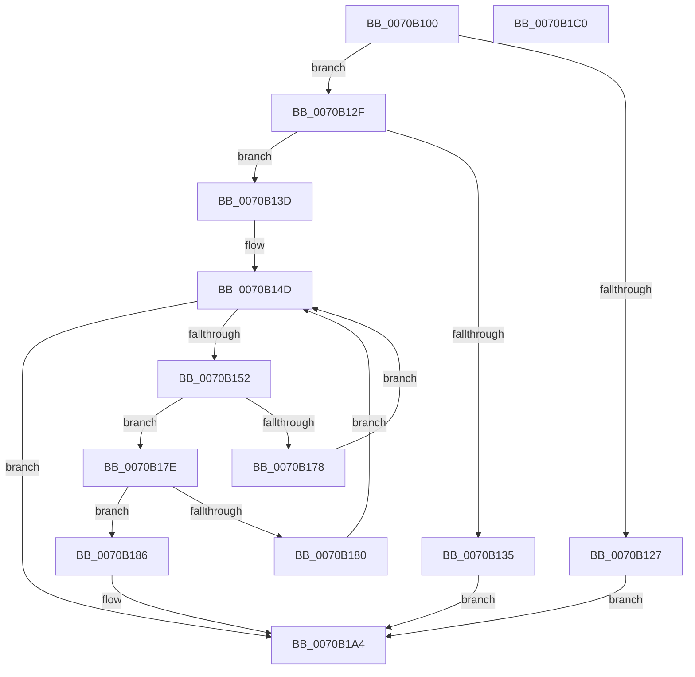

# HalpNumaQueryMemorySideCacheInfo

- RVA: `0x0070B100`–`0x0070B1C1` (길이 `193` bytes)
- VA: `0x000000014070B100`
- 실행 섹션: `PAGE`
- PDB 이름 있음: `예`; PDB Function 태그: `아니요`
- unwind 정보 RVA: `0x00060300`
- 디코드: `56`개 명령, `193/193` bytes 표시
- 미해석 바이트: `0` (있으면 어셈블리에 `.byte`로 보존)

> 이 문서는 커널 이미지의 기계어와 PDB 기호를 분석해 생성했습니다. 4번과 5번은 함수 원형과 자료형을 바이너리 사용 방식에서 추정한 C 해석이며 원본 소스 복구 결과는 아닙니다.

## 1. Dependencies

- 직접 호출 지점: **1**; 고유 호출 대상: **1**
- 직접 호출자로 확인된 함수: **0**
- RIP 상대 이미지 참조: **1**

### Outgoing calls
- `0x0070B16F` → [HalpNumaCompareMemorySideCacheNodeAndLevel](HalpNumaCompareMemorySideCacheNodeAndLevel_function_0070B0D4.md) (function, `0x0070B0D4`)

### Direct callers
- 이 함수 시작 RVA로 연결되는 직접 call은 확인되지 않았습니다. 간접 호출은 완전히 역산할 수 없습니다.

### Static image references
- `0x0070B118` → RVA `0x00F90640` (`.data`; read)

## 2. Other-region calls and transfers

- 다른 실행 섹션으로 향하는 call: **0**
- 별도 외부 분기/꼬리 이동을 확인하지 못했습니다.

## 3. Assembly (complete function range)

```asm
0070B100  48 89 5C 24 08                  mov qword ptr [rsp + 8], rbx
0070B105  48 89 6C 24 10                  mov qword ptr [rsp + 0x10], rbp
0070B10A  48 89 74 24 18                  mov qword ptr [rsp + 0x18], rsi
0070B10F  57                              push rdi
0070B110  41 56                           push r14
0070B112  41 57                           push r15
0070B114  48 83 EC 20                     sub rsp, 0x20
0070B118  4C 8B 3D 21 55 88 00            mov r15, qword ptr [rip + 0x885521]
0070B11F  49 8B F0                        mov rsi, r8
0070B122  4D 85 FF                        test r15, r15
0070B125  75 08                           jne 0x14070b12f
0070B127  41 BA 48 01 00 C0               mov r10d, 0xc0000148
0070B12D  EB 75                           jmp 0x14070b1a4
0070B12F  41 83 F9 28                     cmp r9d, 0x28
0070B133  74 08                           je 0x14070b13d
0070B135  41 BA 0D 00 00 C0               mov r10d, 0xc000000d
0070B13B  EB 67                           jmp 0x14070b1a4
0070B13D  45 8B 5F 08                     mov r11d, dword ptr [r15 + 8]
0070B141  45 33 F6                        xor r14d, r14d
0070B144  41 FF CB                        dec r11d
0070B147  41 BA 25 02 00 C0               mov r10d, 0xc0000225
0070B14D  45 3B F3                        cmp r14d, r11d
0070B150  7F 52                           jg 0x14070b1a4
0070B152  41 8B 7F 14                     mov edi, dword ptr [r15 + 0x14]
0070B156  43 8D 2C 1E                     lea ebp, [r14 + r11]
0070B15A  49 03 FF                        add rdi, r15
0070B15D  D1 FD                           sar ebp, 1
0070B15F  48 63 C5                        movsxd rax, ebp
0070B162  48 8D 1C 80                     lea rbx, [rax + rax*4]
0070B166  44 8B 4C DF 14                  mov r9d, dword ptr [rdi + rbx*8 + 0x14]
0070B16B  44 8B 04 DF                     mov r8d, dword ptr [rdi + rbx*8]
0070B16F  E8 60 FF FF FF                  call 0x14070b0d4
0070B174  85 C0                           test eax, eax
0070B176  79 06                           jns 0x14070b17e
0070B178  44 8D 5D FF                     lea r11d, [rbp - 1]
0070B17C  EB CF                           jmp 0x14070b14d
0070B17E  7E 06                           jle 0x14070b186
0070B180  44 8D 75 01                     lea r14d, [rbp + 1]
0070B184  EB C7                           jmp 0x14070b14d
0070B186  0F 10 04 DF                     movups xmm0, xmmword ptr [rdi + rbx*8]
0070B18A  45 33 D2                        xor r10d, r10d
0070B18D  0F 11 06                        movups xmmword ptr [rsi], xmm0
0070B190  0F 10 4C DF 10                  movups xmm1, xmmword ptr [rdi + rbx*8 + 0x10]
0070B195  0F 11 4E 10                     movups xmmword ptr [rsi + 0x10], xmm1
0070B199  F2 0F 10 44 DF 20               movsd xmm0, qword ptr [rdi + rbx*8 + 0x20]
0070B19F  F2 0F 11 46 20                  movsd qword ptr [rsi + 0x20], xmm0
0070B1A4  48 8B 5C 24 40                  mov rbx, qword ptr [rsp + 0x40]
0070B1A9  41 8B C2                        mov eax, r10d
0070B1AC  48 8B 6C 24 48                  mov rbp, qword ptr [rsp + 0x48]
0070B1B1  48 8B 74 24 50                  mov rsi, qword ptr [rsp + 0x50]
0070B1B6  48 83 C4 20                     add rsp, 0x20
0070B1BA  41 5F                           pop r15
0070B1BC  41 5E                           pop r14
0070B1BE  5F                              pop rdi
0070B1BF  C3                              ret
0070B1C0  CC                              int3
```

## 4. C-style interpretation (structured pseudocode)

```c
__int64 __fastcall HalpNumaQueryMemorySideCacheInfo(__int64 a1, __int64 a2, __int64 a3, int a4)
{
    __int64 result;
    __int64 v_r10;
    __int64 v_r11;
    __int64 v_r14;
    __int64 v_rbp;
    __int64 v_rdi;
    __int64 v_rsp;
    unsigned __int64 v_stack_p10;
    unsigned __int64 v_stack_p18;
    unsigned __int64 v_stack_p8;

    v_stack_p8 = v_rbx;
    v_stack_p10 = v_rbp;
    v_stack_p18 = v_rsi;
    v_rsp = (v_rsp) - (32);
    if (*(unsigned __int64 *)(v_rip + 8934689) != 0) goto loc_0070B12F;
    goto loc_0070B1A4;
loc_0070B12F:
    if (a4 == 40) goto loc_0070B13D;
    goto loc_0070B1A4;
loc_0070B13D:
    v_r14 = 0;
    v_r11 = (unsigned int)(((unsigned int)(*(unsigned int *)(*(unsigned __int64 *)(v_rip + 8934689) + 8))) - 1);
loc_0070B14D:
    if (0 > ((unsigned int)(v_r11))) goto loc_0070B1A4;
    v_rdi = ((unsigned int)(*(unsigned int *)(*(unsigned __int64 *)(v_rip + 8934689) + 20))) + (*(unsigned __int64 *)(v_rip + 8934689));
    v_rbp = (unsigned int)((v_r14 + v_r11 * 1) >> (1));
    result = HalpNumaCompareMemorySideCacheNodeAndLevel(a1, a2, (unsigned int)(*(unsigned int *)(v_rdi + (int)((unsigned int)(v_rbp)) + (int)((unsigned int)(v_rbp)) * 4 * 8)), (unsigned int)(*(unsigned int *)(v_rdi + (int)((unsigned int)(v_rbp)) + (int)((unsigned int)(v_rbp)) * 4 * 8 + 20)));
    if (!sign_flag) goto loc_0070B17E;
    goto loc_0070B14D;
loc_0070B17E:
    if (condition_is_less_or_equal) goto loc_0070B186;
    goto loc_0070B14D;
loc_0070B186:
    v_r10 = 0;
    *(unsigned __int64 *)(a3) = v_xmm0;
    *(unsigned __int64 *)(a3 + 16) = v_xmm1;
    *(unsigned __int64 *)(a3 + 32) = v_xmm0;
loc_0070B1A4:
    v_rsp = (v_rsp) + (32);
    return 0;
}
```

## 5. (Beta) C Style

```c
int64_t HalpNumaQueryMemorySideCacheInfo(int64_t Arg1, int64_t Arg2, void *Arg3, int32_t Arg4)
{
    uint8_t *arg3 = (uint8_t *)Arg3;

    int64_t result;
    int64_t local_r10;
    int64_t local_r11;
    int64_t local_r14;
    int64_t local_rbp;
    int64_t local_rdi;
    int64_t local_rsp;
    uint64_t v_stack_p10;
    uint64_t v_stack_p18;
    uint64_t v_stack_p8;

    v_stack_p8 = local_rbx;
    v_stack_p10 = local_rbp;
    v_stack_p18 = local_rsi;
    local_rsp = (local_rsp) - (32);
    if (*(uint64_t *)(v_rip + 0x885521) != 0) goto loc_0070B12F;
    goto loc_0070B1A4;
loc_0070B12F:
    if (Arg4 == 40) goto loc_0070B13D;
    goto loc_0070B1A4;
loc_0070B13D:
    local_r14 = 0;
    local_r11 = (uint32_t)(((uint32_t)(*(uint32_t *)(*(uint64_t *)(v_rip + 0x885521) + 0x8))) - 1);
loc_0070B14D:
    if (0 > ((uint32_t)(local_r11))) goto loc_0070B1A4;
    local_rdi = ((uint32_t)(*(uint32_t *)(*(uint64_t *)(v_rip + 0x885521) + 0x14))) + (*(uint64_t *)(v_rip + 0x885521));
    local_rbp = (uint32_t)((local_r14 + local_r11 * 1) >> (1));
    result = HalpNumaCompareMemorySideCacheNodeAndLevel(Arg1, Arg2, (uint32_t)(*(uint32_t *)(local_rdi + (int32_t)((uint32_t)(local_rbp)) + (int32_t)((uint32_t)(local_rbp)) * 4 * 8)), (uint32_t)(*(uint32_t *)(local_rdi + (int32_t)((uint32_t)(local_rbp)) + (int32_t)((uint32_t)(local_rbp)) * 4 * 8 + 0x14)));
    if (!sign_flag) goto loc_0070B17E;
    goto loc_0070B14D;
loc_0070B17E:
    if (condition_is_less_or_equal) goto loc_0070B186;
    goto loc_0070B14D;
loc_0070B186:
    local_r10 = 0;
    *(uint64_t *)(arg3) = v_xmm0;
    *(uint64_t *)(arg3 + 0x10) = v_xmm1;
    *(uint64_t *)(arg3 + 0x20) = v_xmm0;
loc_0070B1A4:
    local_rsp = (local_rsp) + (32);
    return 0;
}
```

### 관측된 메모리 오프셋

구조체 형식이 확인되지 않은 접근은 인자 기준의 오프셋으로만 기록했습니다.

| 기준 인자 | 오프셋 표현 | 폭 (bit) | 접근 |
|---|---:|---:|---|
| `Arg3` | `+ 0x0` | `128` | `R` |
| `Arg3` | `+ 0x10` | `128` | `R` |
| `Arg3` | `+ 0x20` | `64` | `W` |

## 6. Execution-region graph

[열기: 2D/3D 그래프와 함수 탐색 컨트롤 패널](../../../control-panel.html?section=page&rva=0x0070B100&view=graph)

- 2D 그래프는 위에서 아래로 흐르고, 3D 그래프는 빈 공간을 드래그해 회전합니다. Shift+드래그는 이동, 휠은 확대·축소, 함수 노드 선택은 대상 보고서 이동입니다.

### Static fallback


