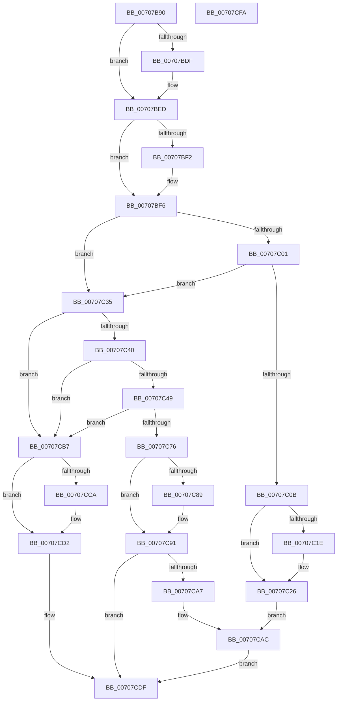

# HalpPmuArbiterPeriodicWorkItem

- RVA: `0x00707B90`–`0x00707CFB` (길이 `363` bytes)
- VA: `0x0000000140707B90`
- 실행 섹션: `PAGE`
- PDB 이름 있음: `예`; PDB Function 태그: `아니요`
- unwind 정보 RVA: `0x000B6A1C`
- 디코드: `92`개 명령, `363/363` bytes 표시
- 미해석 바이트: `0` (있으면 어셈블리에 `.byte`로 보존)

> 이 문서는 커널 이미지의 기계어와 PDB 기호를 분석해 생성했습니다. 4번과 5번은 함수 원형과 자료형을 바이너리 사용 방식에서 추정한 C 해석이며 원본 소스 복구 결과는 아닙니다.

## 1. Dependencies

- 직접 호출 지점: **15**; 고유 호출 대상: **9**
- 직접 호출자로 확인된 함수: **0**
- RIP 상대 이미지 참조: **8**

### Outgoing calls
- `0x00707BCE` → [KeAbPreAcquire](../../text/21/KeAbPreAcquire_function_00210230.md) (function, `0x00210230`)
- `0x00707BE8` → [ExfAcquirePushLockExclusiveEx](../../text/20/ExfAcquirePushLockExclusiveEx_function_0020FC90.md) (function, `0x0020FC90`)
- `0x00707C21` → [ExfTryToWakePushLock](../../text/26/ExfTryToWakePushLock_function_00265DD0.md) (function, `0x00265DD0`)
- `0x00707C29` → [KeAbPostRelease](../../text/2E/KeAbPostRelease_function_002E1600.md) (function, `0x002E1600`)
- `0x00707C2E` → [KeLeaveCriticalRegion](../../text/25/KeLeaveCriticalRegion_function_0025D8B0.md) (function, `0x0025D8B0`)
- `0x00707C55` → [KeQueryPerformanceCounter](../../text/37/KeQueryPerformanceCounter_function_0037E7E0.md) (function, `0x0037E7E0`)
- `0x00707C8C` → [ExfTryToWakePushLock](../../text/26/ExfTryToWakePushLock_function_00265DD0.md) (function, `0x00265DD0`)
- `0x00707C94` → [KeAbPostRelease](../../text/2E/KeAbPostRelease_function_002E1600.md) (function, `0x002E1600`)
- `0x00707C99` → [KeLeaveCriticalRegion](../../text/25/KeLeaveCriticalRegion_function_0025D8B0.md) (function, `0x0025D8B0`)
- `0x00707C9E` → [HalpRequestPmuAccess](../AD/HalpRequestPmuAccess_function_00ADB340.md) (function, `0x00ADB340`)
- `0x00707CA7` → [HalpReleasePmuAccessRequest](../../text/54/HalpReleasePmuAccessRequest_function_005477A0.md) (function, `0x005477A0`)
- `0x00707CB0` → [HalpNotifyActorIfPmuAvailable](HalpNotifyActorIfPmuAvailable_function_00707880.md) (function, `0x00707880`)
- `0x00707CCD` → [ExfTryToWakePushLock](../../text/26/ExfTryToWakePushLock_function_00265DD0.md) (function, `0x00265DD0`)
- `0x00707CD5` → [KeAbPostRelease](../../text/2E/KeAbPostRelease_function_002E1600.md) (function, `0x002E1600`)
- `0x00707CDA` → [KeLeaveCriticalRegion](../../text/25/KeLeaveCriticalRegion_function_0025D8B0.md) (function, `0x0025D8B0`)

### Direct callers
- 이 함수 시작 RVA로 연결되는 직접 call은 확인되지 않았습니다. 간접 호출은 완전히 역산할 수 없습니다.

### Static image references
- `0x00707BA6` → RVA `0x00FC2B40` (`.data`; read)
- `0x00707BF6` → RVA `0x00FC2B50` (`.data`; read)
- `0x00707C01` → RVA `0x00FC2B4C` (`.data`; read)
- `0x00707C0B` → RVA `0x00FC2B40` (`.data`; read/write)
- `0x00707C40` → RVA `0x00FC2B68` (`.data`; read)
- `0x00707C49` → RVA `0x00FC2BB8` (`.data`; read)
- `0x00707C5A` → RVA `0x00FC2BC0` (`.data`; read)
- `0x00707CDF` → RVA `0x00FC2B98` (`.data`; read/write)

## 2. Other-region calls and transfers

- 다른 실행 섹션으로 향하는 call: **13**
  - `0x00707BCE` → [KeAbPreAcquire](../../text/21/KeAbPreAcquire_function_00210230.md) (`PAGE` → `.text`)
  - `0x00707BE8` → [ExfAcquirePushLockExclusiveEx](../../text/20/ExfAcquirePushLockExclusiveEx_function_0020FC90.md) (`PAGE` → `.text`)
  - `0x00707C21` → [ExfTryToWakePushLock](../../text/26/ExfTryToWakePushLock_function_00265DD0.md) (`PAGE` → `.text`)
  - `0x00707C29` → [KeAbPostRelease](../../text/2E/KeAbPostRelease_function_002E1600.md) (`PAGE` → `.text`)
  - `0x00707C2E` → [KeLeaveCriticalRegion](../../text/25/KeLeaveCriticalRegion_function_0025D8B0.md) (`PAGE` → `.text`)
  - `0x00707C55` → [KeQueryPerformanceCounter](../../text/37/KeQueryPerformanceCounter_function_0037E7E0.md) (`PAGE` → `.text`)
  - `0x00707C8C` → [ExfTryToWakePushLock](../../text/26/ExfTryToWakePushLock_function_00265DD0.md) (`PAGE` → `.text`)
  - `0x00707C94` → [KeAbPostRelease](../../text/2E/KeAbPostRelease_function_002E1600.md) (`PAGE` → `.text`)
  - `0x00707C99` → [KeLeaveCriticalRegion](../../text/25/KeLeaveCriticalRegion_function_0025D8B0.md) (`PAGE` → `.text`)
  - `0x00707CA7` → [HalpReleasePmuAccessRequest](../../text/54/HalpReleasePmuAccessRequest_function_005477A0.md) (`PAGE` → `.text`)
  - `0x00707CCD` → [ExfTryToWakePushLock](../../text/26/ExfTryToWakePushLock_function_00265DD0.md) (`PAGE` → `.text`)
  - `0x00707CD5` → [KeAbPostRelease](../../text/2E/KeAbPostRelease_function_002E1600.md) (`PAGE` → `.text`)
  - `0x00707CDA` → [KeLeaveCriticalRegion](../../text/25/KeLeaveCriticalRegion_function_0025D8B0.md) (`PAGE` → `.text`)
- 별도 외부 분기/꼬리 이동을 확인하지 못했습니다.

## 3. Assembly (complete function range)

```asm
00707B90  48 8B C4                        mov rax, rsp
00707B93  48 89 58 08                     mov qword ptr [rax + 8], rbx
00707B97  48 89 68 18                     mov qword ptr [rax + 0x18], rbp
00707B9B  48 89 70 20                     mov qword ptr [rax + 0x20], rsi
00707B9F  57                              push rdi
00707BA0  48 83 EC 20                     sub rsp, 0x20
00707BA4  33 F6                           xor esi, esi
00707BA6  48 8D 2D 93 AF 8B 00            lea rbp, [rip + 0x8baf93]
00707BAD  48 89 70 10                     mov qword ptr [rax + 0x10], rsi
00707BB1  48 83 CF FF                     or rdi, 0xffffffffffffffff
00707BB5  65 48 8B 04 25 88 01 00 00      mov rax, qword ptr gs:[0x188]
00707BBE  45 33 C0                        xor r8d, r8d
00707BC1  33 D2                           xor edx, edx
00707BC3  48 8B CD                        mov rcx, rbp
00707BC6  66 01 B8 E4 01 00 00            add word ptr [rax + 0x1e4], di
00707BCD  90                              nop
00707BCE  E8 5D 86 B0 FF                  call 0x140210230
00707BD3  F0 48 0F BA 6D 00 00            lock bts qword ptr [rbp], 0
00707BDA  48 8B D8                        mov rbx, rax
00707BDD  73 0E                           jae 0x140707bed
00707BDF  4C 8B C5                        mov r8, rbp
00707BE2  48 8B D0                        mov rdx, rax
00707BE5  48 8B CD                        mov rcx, rbp
00707BE8  E8 A3 80 B0 FF                  call 0x14020fc90
00707BED  48 85 DB                        test rbx, rbx
00707BF0  74 04                           je 0x140707bf6
00707BF2  C6 43 0A 01                     mov byte ptr [rbx + 0xa], 1
00707BF6  8B 05 54 AF 8B 00               mov eax, dword ptr [rip + 0x8baf54]
00707BFC  83 F8 03                        cmp eax, 3
00707BFF  75 34                           jne 0x140707c35
00707C01  8B 05 45 AF 8B 00               mov eax, dword ptr [rip + 0x8baf45]
00707C07  85 C0                           test eax, eax
00707C09  75 2A                           jne 0x140707c35
00707C0B  F0 48 0F C1 3D 2C AF 8B 00      lock xadd qword ptr [rip + 0x8baf2c], rdi
00707C14  40 80 E7 06                     and dil, 6
00707C18  40 80 FF 02                     cmp dil, 2
00707C1C  75 08                           jne 0x140707c26
00707C1E  48 8B CD                        mov rcx, rbp
00707C21  E8 AA E1 B5 FF                  call 0x140265dd0
00707C26  48 8B CD                        mov rcx, rbp
00707C29  E8 D2 99 BD FF                  call 0x1402e1600
00707C2E  E8 7D 5C B5 FF                  call 0x14025d8b0
00707C33  EB 77                           jmp 0x140707cac
00707C35  8B 05 15 AF 8B 00               mov eax, dword ptr [rip + 0x8baf15]
00707C3B  83 F8 02                        cmp eax, 2
00707C3E  75 77                           jne 0x140707cb7
00707C40  83 3D 21 AF 8B 00 01            cmp dword ptr [rip + 0x8baf21], 1
00707C47  76 6E                           jbe 0x140707cb7
00707C49  48 8B 1D 68 AF 8B 00            mov rbx, qword ptr [rip + 0x8baf68]
00707C50  48 8D 4C 24 38                  lea rcx, [rsp + 0x38]
00707C55  E8 86 6B C7 FF                  call 0x14037e7e0
00707C5A  8B 0D 60 AF 8B 00               mov ecx, dword ptr [rip + 0x8baf60]
00707C60  48 2B C3                        sub rax, rbx
00707C63  48 69 C0 E8 03 00 00            imul rax, rax, 0x3e8
00707C6A  48 99                           cqo
00707C6C  48 F7 7C 24 38                  idiv qword ptr [rsp + 0x38]
00707C71  48 3B C1                        cmp rax, rcx
00707C74  7C 41                           jl 0x140707cb7
00707C76  F0 48 0F C1 3D C1 AE 8B 00      lock xadd qword ptr [rip + 0x8baec1], rdi
00707C7F  40 80 E7 06                     and dil, 6
00707C83  40 80 FF 02                     cmp dil, 2
00707C87  75 08                           jne 0x140707c91
00707C89  48 8B CD                        mov rcx, rbp
00707C8C  E8 3F E1 B5 FF                  call 0x140265dd0
00707C91  48 8B CD                        mov rcx, rbp
00707C94  E8 67 99 BD FF                  call 0x1402e1600
00707C99  E8 12 5C B5 FF                  call 0x14025d8b0
00707C9E  E8 9D 36 3D 00                  call 0x140adb340
00707CA3  85 C0                           test eax, eax
00707CA5  78 38                           js 0x140707cdf
00707CA7  E8 F4 FA E3 FF                  call 0x1405477a0
00707CAC  33 D2                           xor edx, edx
00707CAE  33 C9                           xor ecx, ecx
00707CB0  E8 CB FB FF FF                  call 0x140707880
00707CB5  EB 28                           jmp 0x140707cdf
00707CB7  F0 48 0F C1 3D 80 AE 8B 00      lock xadd qword ptr [rip + 0x8bae80], rdi
00707CC0  40 80 E7 06                     and dil, 6
00707CC4  40 80 FF 02                     cmp dil, 2
00707CC8  75 08                           jne 0x140707cd2
00707CCA  48 8B CD                        mov rcx, rbp
00707CCD  E8 FE E0 B5 FF                  call 0x140265dd0
00707CD2  48 8B CD                        mov rcx, rbp
00707CD5  E8 26 99 BD FF                  call 0x1402e1600
00707CDA  E8 D1 5B B5 FF                  call 0x14025d8b0
00707CDF  87 35 B3 AE 8B 00               xchg dword ptr [rip + 0x8baeb3], esi
00707CE5  48 8B 74 24 48                  mov rsi, qword ptr [rsp + 0x48]
00707CEA  48 8B 5C 24 30                  mov rbx, qword ptr [rsp + 0x30]
00707CEF  48 8B 6C 24 40                  mov rbp, qword ptr [rsp + 0x40]
00707CF4  48 83 C4 20                     add rsp, 0x20
00707CF8  5F                              pop rdi
00707CF9  C3                              ret
00707CFA  CC                              int3
```

## 4. C-style interpretation (structured pseudocode)

```c
__int64 __fastcall HalpPmuArbiterPeriodicWorkItem(__int64 a1, int a2, int a3)
{
    __int64 result;
    __int64 v_rdi;
    __int64 v_rsi;
    __int64 v_rsp;
    unsigned __int64 v_stack_p10;
    unsigned __int64 v_stack_p18;
    unsigned __int64 v_stack_p20;
    unsigned __int64 v_stack_p8;

    *(unsigned __int64 *)(v_rsp + 8) = v_rbx;
    *(unsigned __int64 *)(v_rsp + 24) = v_rbp;
    *(unsigned __int64 *)(v_rsp + 32) = v_rsi;
    v_rsp = (v_rsp) - (32);
    v_rsi = 0;
    *(unsigned __int64 *)(v_rsp + 16) = 0;
    v_rdi = (v_rdi) | (-1);
    a3 = 0;
    a2 = 0;
    result = KeAbPreAcquire(v_rip + 9154451, a2, a3, a4);
    if (!(condition_is_above_or_equal)) {
        a3 = v_rip + 9154451;
        a2 = result;
        a1 = v_rip + 9154451;
        result = ExfAcquirePushLockExclusiveEx(a1, a2, a3, a4);
    }
    if (result != 0) {
        *(unsigned __int8 *)(result + 10) = 1;
    }
    if (((unsigned int)((unsigned int)(*(unsigned int *)(v_rip + 9154388)))) != 3) goto loc_00707C35;
    if ((unsigned int)((unsigned int)(*(unsigned int *)(v_rip + 9154373))) != 0) goto loc_00707C35;
    v_rdi = (unsigned __int8)((v_rdi) & (6));
    result = (unsigned int)(*(unsigned int *)(v_rip + 9154373));
    if (((unsigned __int8)(v_rdi)) == 2) {
        a1 = v_rip + 9154451;
        result = ExfTryToWakePushLock(a1, a2, a3, a4);
    }
    result = KeAbPostRelease(v_rip + 9154451, a2, a3, a4);
    result = KeLeaveCriticalRegion(v_rip + 9154451, a2, a3, a4);
    goto loc_00707CAC;
loc_00707C35:
    if (((unsigned int)((unsigned int)(*(unsigned int *)(v_rip + 9154325)))) != 2) goto loc_00707CB7;
    if ((*(unsigned int *)(v_rip + 9154337)) <= 1) goto loc_00707CB7;
    result = KeQueryPerformanceCounter(v_stack_p10, a2, a3, a4);
    result = (result) - (*(unsigned __int64 *)(v_rip + 9154408));
    result = (result) * (result);
    if (result < ((unsigned int)(*(unsigned int *)(v_rip + 9154400)))) goto loc_00707CB7;
    v_rdi = (unsigned __int8)((v_rdi) & (6));
    if (((unsigned __int8)(v_rdi)) == 2) {
        a1 = v_rip + 9154451;
        result = ExfTryToWakePushLock(a1, a2, a3, a4);
    }
    result = KeAbPostRelease(v_rip + 9154451, a2, a3, a4);
    result = KeLeaveCriticalRegion(v_rip + 9154451, a2, a3, a4);
    result = HalpRequestPmuAccess(v_rip + 9154451, a2, a3, a4);
    if (sign_flag) goto loc_00707CDF;
    result = HalpReleasePmuAccessRequest(v_rip + 9154451, a2, a3, a4);
loc_00707CAC:
    a2 = 0;
    a1 = 0;
    result = HalpNotifyActorIfPmuAvailable(a1, a2, a3, a4);
    goto loc_00707CDF;
loc_00707CB7:
    v_rdi = (unsigned __int8)((v_rdi) & (6));
    if (((unsigned __int8)(v_rdi)) == 2) {
        a1 = v_rip + 9154451;
        result = ExfTryToWakePushLock(a1, a2, a3, a4);
    }
    result = KeAbPostRelease(v_rip + 9154451, a2, a3, a4);
    result = KeLeaveCriticalRegion(v_rip + 9154451, a2, a3, a4);
loc_00707CDF:
    v_rsp = (v_rsp) + (32);
    return result;
}
```

## 5. (Beta) C Style

```c
int64_t HalpPmuArbiterPeriodicWorkItem(int64_t Arg1, int32_t Arg2, int32_t Arg3)
{
    int64_t result;
    int64_t local_rdi;
    int64_t local_rsi;
    int64_t local_rsp;
    uint64_t v_stack_p10;
    uint64_t v_stack_p18;
    uint64_t v_stack_p20;
    uint64_t v_stack_p8;

    *(uint64_t *)(local_rsp + 0x8) = local_rbx;
    *(uint64_t *)(local_rsp + 0x18) = local_rbp;
    *(uint64_t *)(local_rsp + 0x20) = local_rsi;
    local_rsp = (local_rsp) - (32);
    local_rsi = 0;
    *(uint64_t *)(local_rsp + 0x10) = 0;
    local_rdi = (local_rdi) | (-1);
    Arg3 = 0;
    Arg2 = 0;
    result = KeAbPreAcquire(v_rip + 9154451, Arg2, Arg3, a4);
    if (!(condition_is_above_or_equal)) {
        Arg3 = v_rip + 9154451;
        Arg2 = result;
        Arg1 = v_rip + 9154451;
        result = ExfAcquirePushLockExclusiveEx(Arg1, Arg2, Arg3, a4);
    }
    if (result != 0) {
        *(uint8_t *)(result + 0xA) = 1;
    }
    if (((uint32_t)((uint32_t)(*(uint32_t *)(v_rip + 0x8BAF54)))) != 3) goto loc_00707C35;
    if ((uint32_t)((uint32_t)(*(uint32_t *)(v_rip + 0x8BAF45))) != 0) goto loc_00707C35;
    local_rdi = (uint8_t)((local_rdi) & (6));
    result = (uint32_t)(*(uint32_t *)(v_rip + 0x8BAF45));
    if (((uint8_t)(local_rdi)) == 2) {
        Arg1 = v_rip + 9154451;
        result = ExfTryToWakePushLock(Arg1, Arg2, Arg3, a4);
    }
    result = KeAbPostRelease(v_rip + 9154451, Arg2, Arg3, a4);
    result = KeLeaveCriticalRegion(v_rip + 9154451, Arg2, Arg3, a4);
    goto loc_00707CAC;
loc_00707C35:
    if (((uint32_t)((uint32_t)(*(uint32_t *)(v_rip + 0x8BAF15)))) != 2) goto loc_00707CB7;
    if ((*(uint32_t *)(v_rip + 0x8BAF21)) <= 1) goto loc_00707CB7;
    result = KeQueryPerformanceCounter(v_stack_p10, Arg2, Arg3, a4);
    result = (result) - (*(uint64_t *)(v_rip + 0x8BAF68));
    result = (result) * (result);
    if (result < ((uint32_t)(*(uint32_t *)(v_rip + 0x8BAF60)))) goto loc_00707CB7;
    local_rdi = (uint8_t)((local_rdi) & (6));
    if (((uint8_t)(local_rdi)) == 2) {
        Arg1 = v_rip + 9154451;
        result = ExfTryToWakePushLock(Arg1, Arg2, Arg3, a4);
    }
    result = KeAbPostRelease(v_rip + 9154451, Arg2, Arg3, a4);
    result = KeLeaveCriticalRegion(v_rip + 9154451, Arg2, Arg3, a4);
    result = HalpRequestPmuAccess(v_rip + 9154451, Arg2, Arg3, a4);
    if (sign_flag) goto loc_00707CDF;
    result = HalpReleasePmuAccessRequest(v_rip + 9154451, Arg2, Arg3, a4);
loc_00707CAC:
    Arg2 = 0;
    Arg1 = 0;
    result = HalpNotifyActorIfPmuAvailable(Arg1, Arg2, Arg3, a4);
    goto loc_00707CDF;
loc_00707CB7:
    local_rdi = (uint8_t)((local_rdi) & (6));
    if (((uint8_t)(local_rdi)) == 2) {
        Arg1 = v_rip + 9154451;
        result = ExfTryToWakePushLock(Arg1, Arg2, Arg3, a4);
    }
    result = KeAbPostRelease(v_rip + 9154451, Arg2, Arg3, a4);
    result = KeLeaveCriticalRegion(v_rip + 9154451, Arg2, Arg3, a4);
loc_00707CDF:
    local_rsp = (local_rsp) + (32);
    return result;
}
```

## 6. Execution-region graph

[열기: 2D/3D 그래프와 함수 탐색 컨트롤 패널](../../../control-panel.html?section=page&rva=0x00707B90&view=graph)

- 2D 그래프는 위에서 아래로 흐르고, 3D 그래프는 빈 공간을 드래그해 회전합니다. Shift+드래그는 이동, 휠은 확대·축소, 함수 노드 선택은 대상 보고서 이동입니다.

### Static fallback


