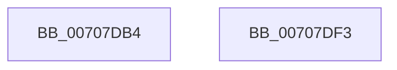

# HalpPmuArbiterUpdateActiveActorTime

- RVA: `0x00707DB4`–`0x00707DF4` (길이 `64` bytes)
- VA: `0x0000000140707DB4`
- 실행 섹션: `PAGE`
- PDB 이름 있음: `예`; PDB Function 태그: `아니요`
- unwind 정보 RVA: `0x0005CF00`
- 디코드: `16`개 명령, `64/64` bytes 표시
- 미해석 바이트: `0` (있으면 어셈블리에 `.byte`로 보존)

> 이 문서는 커널 이미지의 기계어와 PDB 기호를 분석해 생성했습니다. 4번과 5번은 함수 원형과 자료형을 바이너리 사용 방식에서 추정한 C 해석이며 원본 소스 복구 결과는 아닙니다.

## 1. Dependencies

- 직접 호출 지점: **1**; 고유 호출 대상: **1**
- 직접 호출자로 확인된 함수: **2**
- RIP 상대 이미지 참조: **2**

### Outgoing calls
- `0x00707DCC` → [KeQueryPerformanceCounter](../../text/37/KeQueryPerformanceCounter_function_0037E7E0.md) (function, `0x0037E7E0`)

### Direct callers
- [HalpNotifyActorIfPmuAvailable](HalpNotifyActorIfPmuAvailable_function_00707880.md) at `0x00707ABC`
- [HalpRequestPmuAccess](../AD/HalpRequestPmuAccess_function_00ADB340.md) at `0x00ADB4B7`

### Static image references
- `0x00707DC5` → RVA `0x00FC2BB8` (`.data`; read)
- `0x00707DD1` → RVA `0x00FC2BB0` (`.data`; read)

## 2. Other-region calls and transfers

- 다른 실행 섹션으로 향하는 call: **1**
  - `0x00707DCC` → [KeQueryPerformanceCounter](../../text/37/KeQueryPerformanceCounter_function_0037E7E0.md) (`PAGE` → `.text`)
- 별도 외부 분기/꼬리 이동을 확인하지 못했습니다.

## 3. Assembly (complete function range)

```asm
00707DB4  40 53                           push rbx
00707DB6  48 83 EC 20                     sub rsp, 0x20
00707DBA  48 83 64 24 30 00               and qword ptr [rsp + 0x30], 0
00707DC0  48 8D 4C 24 30                  lea rcx, [rsp + 0x30]
00707DC5  48 8B 1D EC AD 8B 00            mov rbx, qword ptr [rip + 0x8badec]
00707DCC  E8 0F 6A C7 FF                  call 0x14037e7e0
00707DD1  48 8B 0D D8 AD 8B 00            mov rcx, qword ptr [rip + 0x8badd8]
00707DD8  48 2B C3                        sub rax, rbx
00707DDB  48 69 C0 E8 03 00 00            imul rax, rax, 0x3e8
00707DE2  48 99                           cqo
00707DE4  48 F7 7C 24 30                  idiv qword ptr [rsp + 0x30]
00707DE9  48 01 41 28                     add qword ptr [rcx + 0x28], rax
00707DED  48 83 C4 20                     add rsp, 0x20
00707DF1  5B                              pop rbx
00707DF2  C3                              ret
00707DF3  CC                              int3
```

## 4. C-style interpretation (structured pseudocode)

```c
__int64 __fastcall HalpPmuArbiterUpdateActiveActorTime(void)
{
    __int64 result;
    __int64 v_rsp;
    unsigned __int64 v_stack_p8;

    v_rsp = (v_rsp) - (32);
    result = KeQueryPerformanceCounter(v_stack_p8, a2, a3, a4);
    result = (result) - (*(unsigned __int64 *)(v_rip + 9154028));
    result = (result) * (result);
    v_rsp = (v_rsp) + (32);
    return result;
}
```

## 5. (Beta) C Style

```c
void HalpPmuArbiterUpdateActiveActorTime(void)
{
    int64_t result;
    int64_t local_rsp;
    uint64_t v_stack_p8;

    local_rsp = (local_rsp) - (32);
    result = KeQueryPerformanceCounter(v_stack_p8, a2, a3, a4);
    result = (result) - (*(uint64_t *)(v_rip + 0x8BADEC));
    result = (result) * (result);
    local_rsp = (local_rsp) + (32);
    return result;
}
```

## 6. Execution-region graph

[열기: 2D/3D 그래프와 함수 탐색 컨트롤 패널](../../../control-panel.html?section=page&rva=0x00707DB4&view=graph)

- 2D 그래프는 위에서 아래로 흐르고, 3D 그래프는 빈 공간을 드래그해 회전합니다. Shift+드래그는 이동, 휠은 확대·축소, 함수 노드 선택은 대상 보고서 이동입니다.

### Static fallback


