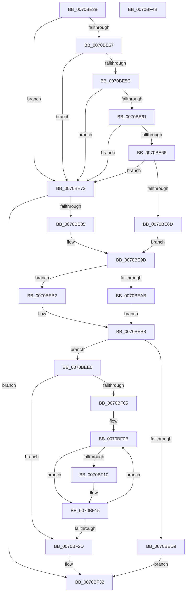

# HalpQueryAcpiResourceRequirements

- RVA: `0x0070BE28`–`0x0070BF4C` (길이 `292` bytes)
- VA: `0x000000014070BE28`
- 실행 섹션: `PAGE`
- PDB 이름 있음: `예`; PDB Function 태그: `아니요`
- unwind 정보 RVA: `0x00084C9C`
- 디코드: `92`개 명령, `292/292` bytes 표시
- 미해석 바이트: `0` (있으면 어셈블리에 `.byte`로 보존)

> 이 문서는 커널 이미지의 기계어와 PDB 기호를 분석해 생성했습니다. 4번과 5번은 함수 원형과 자료형을 바이너리 사용 방식에서 추정한 C 해석이며 원본 소스 복구 결과는 아닙니다.

## 1. Dependencies

- 직접 호출 지점: **4**; 고유 호출 대상: **4**
- 직접 호출자로 확인된 함수: **2**
- RIP 상대 이미지 참조: **1**

### Outgoing calls
- `0x0070BE4D` → [HalpInterruptModel](../../text/4A/HalpInterruptModel_function_004ACA38.md) (function, `0x004ACA38`)
- `0x0070BE78` → [HalpInterruptGetIrtInfo](HalpInterruptGetIrtInfo_function_00707784.md) (function, `0x00707784`)
- `0x0070BE8C` → [HalQueryMaximumProcessorCount](../../text/4A/HalQueryMaximumProcessorCount_function_004AC9A0.md) (function, `0x004AC9A0`)
- `0x0070BECF` → [ExAllocatePool2](../../poolcode/B8/ExAllocatePool2_function_00B820F0.md) (function, `0x00B820F0`)

### Direct callers
- [HalpQueryResources](HalpQueryResources_function_007086B0.md) at `0x0070870F`
- [sub_00B46B8A](../B4/Unknown_function_00B46B8A.md) at `0x00B46C58`

### Static image references
- `0x0070BE9D` → RVA `0x00E10424` (`.data`; read)

## 2. Other-region calls and transfers

- 다른 실행 섹션으로 향하는 call: **3**
  - `0x0070BE4D` → [HalpInterruptModel](../../text/4A/HalpInterruptModel_function_004ACA38.md) (`PAGE` → `.text`)
  - `0x0070BE8C` → [HalQueryMaximumProcessorCount](../../text/4A/HalQueryMaximumProcessorCount_function_004AC9A0.md) (`PAGE` → `.text`)
  - `0x0070BECF` → [ExAllocatePool2](../../poolcode/B8/ExAllocatePool2_function_00B820F0.md) (`PAGE` → `POOLCODE`)
- 별도 외부 분기/꼬리 이동을 확인하지 못했습니다.

## 3. Assembly (complete function range)

```asm
0070BE28  4C 8B DC                        mov r11, rsp
0070BE2B  49 89 5B 08                     mov qword ptr [r11 + 8], rbx
0070BE2F  49 89 6B 10                     mov qword ptr [r11 + 0x10], rbp
0070BE33  49 89 73 18                     mov qword ptr [r11 + 0x18], rsi
0070BE37  57                              push rdi
0070BE38  41 56                           push r14
0070BE3A  41 57                           push r15
0070BE3C  48 83 EC 30                     sub rsp, 0x30
0070BE40  33 C0                           xor eax, eax
0070BE42  4C 8B F9                        mov r15, rcx
0070BE45  49 89 43 D8                     mov qword ptr [r11 - 0x28], rax
0070BE49  89 44 24 28                     mov dword ptr [rsp + 0x28], eax
0070BE4D  E8 E6 0B DA FF                  call 0x1404aca38
0070BE52  83 E8 01                        sub eax, 1
0070BE55  74 1C                           je 0x14070be73
0070BE57  83 E8 01                        sub eax, 1
0070BE5A  74 17                           je 0x14070be73
0070BE5C  83 E8 01                        sub eax, 1
0070BE5F  74 12                           je 0x14070be73
0070BE61  83 E8 01                        sub eax, 1
0070BE64  74 0D                           je 0x14070be73
0070BE66  3D FC 0F 00 00                  cmp eax, 0xffc
0070BE6B  74 06                           je 0x14070be73
0070BE6D  33 DB                           xor ebx, ebx
0070BE6F  33 ED                           xor ebp, ebp
0070BE71  EB 2A                           jmp 0x14070be9d
0070BE73  48 8D 4C 24 20                  lea rcx, [rsp + 0x20]
0070BE78  E8 07 B9 FF FF                  call 0x140707784
0070BE7D  85 C0                           test eax, eax
0070BE7F  0F 88 AD 00 00 00               js 0x14070bf32
0070BE85  BB CD 00 00 00                  mov ebx, 0xcd
0070BE8A  8B EB                           mov ebp, ebx
0070BE8C  E8 0F 0B DA FF                  call 0x1404ac9a0
0070BE91  8B C8                           mov ecx, eax
0070BE93  33 D2                           xor edx, edx
0070BE95  8B 44 24 24                     mov eax, dword ptr [rsp + 0x24]
0070BE99  F7 F1                           div ecx
0070BE9B  2B D8                           sub ebx, eax
0070BE9D  80 3D 80 45 70 00 00            cmp byte ptr [rip + 0x704580], 0
0070BEA4  B9 00 01 00 00                  mov ecx, 0x100
0070BEA9  74 07                           je 0x14070beb2
0070BEAB  44 8B F5                        mov r14d, ebp
0070BEAE  8B F1                           mov esi, ecx
0070BEB0  EB 06                           jmp 0x14070beb8
0070BEB2  41 83 CE FF                     or r14d, 0xffffffff
0070BEB6  33 F6                           xor esi, esi
0070BEB8  8B FE                           mov edi, esi
0070BEBA  41 B8 48 61 6C 41               mov r8d, 0x416c6148
0070BEC0  2B FB                           sub edi, ebx
0070BEC2  03 FD                           add edi, ebp
0070BEC4  8D 6F FF                        lea ebp, [rdi - 1]
0070BEC7  C1 E5 05                        shl ebp, 5
0070BECA  83 C5 48                        add ebp, 0x48
0070BECD  8B D5                           mov edx, ebp
0070BECF  E8 1C 62 47 00                  call 0x140b820f0
0070BED4  48 85 C0                        test rax, rax
0070BED7  75 07                           jne 0x14070bee0
0070BED9  B8 9A 00 00 C0                  mov eax, 0xc000009a
0070BEDE  EB 52                           jmp 0x14070bf32
0070BEE0  83 48 08 FF                     or dword ptr [rax + 8], 0xffffffff
0070BEE4  41 B8 01 00 00 00               mov r8d, 1
0070BEEA  89 28                           mov dword ptr [rax], ebp
0070BEEC  44 89 40 1C                     mov dword ptr [rax + 0x1c], r8d
0070BEF0  C7 40 04 0F 00 00 00            mov dword ptr [rax + 4], 0xf
0070BEF7  C7 40 20 01 00 01 00            mov dword ptr [rax + 0x20], 0x10001
0070BEFE  89 78 24                        mov dword ptr [rax + 0x24], edi
0070BF01  85 FF                           test edi, edi
0070BF03  74 28                           je 0x14070bf2d
0070BF05  48 8D 48 2A                     lea rcx, [rax + 0x2a]
0070BF09  8B D7                           mov edx, edi
0070BF0B  41 3B DE                        cmp ebx, r14d
0070BF0E  72 05                           jb 0x14070bf15
0070BF10  3B DE                           cmp ebx, esi
0070BF12  0F 42 DE                        cmovb ebx, esi
0070BF15  89 59 06                        mov dword ptr [rcx + 6], ebx
0070BF18  89 59 0A                        mov dword ptr [rcx + 0xa], ebx
0070BF1B  41 03 D8                        add ebx, r8d
0070BF1E  66 C7 41 FF 02 01               mov word ptr [rcx - 1], 0x102
0070BF24  48 83 C1 20                     add rcx, 0x20
0070BF28  49 2B D0                        sub rdx, r8
0070BF2B  75 DE                           jne 0x14070bf0b
0070BF2D  49 89 07                        mov qword ptr [r15], rax
0070BF30  33 C0                           xor eax, eax
0070BF32  48 8B 5C 24 50                  mov rbx, qword ptr [rsp + 0x50]
0070BF37  48 8B 6C 24 58                  mov rbp, qword ptr [rsp + 0x58]
0070BF3C  48 8B 74 24 60                  mov rsi, qword ptr [rsp + 0x60]
0070BF41  48 83 C4 30                     add rsp, 0x30
0070BF45  41 5F                           pop r15
0070BF47  41 5E                           pop r14
0070BF49  5F                              pop rdi
0070BF4A  C3                              ret
0070BF4B  CC                              int3
```

## 4. C-style interpretation (structured pseudocode)

```c
__int64 __fastcall HalpQueryAcpiResourceRequirements(__int64 a1, int a2)
{
    __int64 result;
    __int64 v_r14;
    __int64 v_rbp;
    __int64 v_rbx;
    __int64 v_rdi;
    __int64 v_rsi;
    __int64 v_rsp;
    unsigned int v_stack_m20;
    unsigned int v_stack_m24;
    unsigned __int64 v_stack_m28;
    unsigned __int64 v_stack_p10;
    unsigned __int64 v_stack_p18;
    unsigned __int64 v_stack_p8;

    *(unsigned __int64 *)(v_rsp + 8) = v_rbx;
    *(unsigned __int64 *)(v_rsp + 16) = v_rbp;
    *(unsigned __int64 *)(v_rsp + 24) = v_rsi;
    v_rsp = (v_rsp) - (48);
    result = 0;
    *(unsigned __int64 *)(v_rsp - 40) = 0;
    v_stack_m20 = 0;
    result = HalpInterruptModel(a1, a2, a3, a4);
    result = (unsigned int)((result) - (1));
    if (condition_is_equal) goto loc_0070BE73;
    result = (unsigned int)((result) - (1));
    if (condition_is_equal) goto loc_0070BE73;
    result = (unsigned int)((result) - (1));
    if (condition_is_equal) goto loc_0070BE73;
    result = (unsigned int)((result) - (1));
    if (condition_is_equal) goto loc_0070BE73;
    if (((unsigned int)(result)) == 0xFFCULL) goto loc_0070BE73;
    v_rbx = 0;
    v_rbp = 0;
    goto loc_0070BE9D;
loc_0070BE73:
    result = HalpInterruptGetIrtInfo(v_stack_m28, a2, a3, a4);
    if (sign_flag) goto loc_0070BF32;
    result = HalQueryMaximumProcessorCount(v_stack_m28, a2, a3, a4);
    a2 = 0;
    v_rbx = (unsigned int)((205) - ((unsigned int)((unsigned int)(v_stack_m24))));
loc_0070BE9D:
    if ((*(unsigned __int8 *)(v_rip + 7357824)) == 0) goto loc_0070BEB2;
    goto loc_0070BEB8;
loc_0070BEB2:
    v_r14 = (unsigned int)((205) | (0xFFFFFFFFULL));
    v_rsi = 0;
loc_0070BEB8:
    v_rdi = (unsigned int)((0) - ((unsigned int)(v_rbx)));
    v_rdi = (unsigned int)((v_rdi) + (205));
    v_rbp = (unsigned int)((v_rdi - 1) << (5));
    v_rbp = (unsigned int)((v_rbp) + (72));
    result = ExAllocatePool2(256, (unsigned int)((unsigned int)(v_rbp)), (unsigned int)(0x416C6148ULL), a4);
    if (result != 0) goto loc_0070BEE0;
    goto loc_0070BF32;
loc_0070BEE0:
    *(unsigned int *)((unsigned int)(0xC000009AULL)) = (unsigned int)(v_rbp);
    *(unsigned int *)((unsigned int)(0xC000009AULL) + 28) = 1;
    *(unsigned int *)((unsigned int)(0xC000009AULL) + 4) = 15;
    *(unsigned int *)((unsigned int)(0xC000009AULL) + 32) = 0x10001ULL;
    *(unsigned int *)((unsigned int)(0xC000009AULL) + 36) = (unsigned int)(v_rdi);
    if ((unsigned int)(v_rdi) == 0) goto loc_0070BF2D;
loc_0070BF0B:
    if (((unsigned int)(v_rbx)) >= ((unsigned int)(v_r14))) {
        if (((unsigned int)(v_rbx)) < 0) { v_rbx = 0; }
    }
    *(unsigned int *)((unsigned int)(0xC000009AULL) + 42 + 6) = (unsigned int)(v_rbx);
    *(unsigned int *)((unsigned int)(0xC000009AULL) + 42 + 10) = (unsigned int)(v_rbx);
    v_rbx = (unsigned int)((v_rbx) + (1));
    *(unsigned __int16 *)((unsigned int)(0xC000009AULL) + 42 - 1) = 258;
    a1 = ((unsigned int)(0xC000009AULL) + 42) + (32);
    a2 = ((unsigned int)((unsigned int)(v_rdi))) - (1);
    if (condition_is_not_equal) goto loc_0070BF0B;
loc_0070BF2D:
    *(unsigned __int64 *)(a1) = (unsigned int)(0xC000009AULL);
    result = 0;
loc_0070BF32:
    v_rsp = (v_rsp) + (48);
    return result;
}
```

## 5. (Beta) C Style

```c
int64_t HalpQueryAcpiResourceRequirements(void *Arg1, int32_t Arg2)
{
    uint8_t *arg1 = (uint8_t *)Arg1;

    int64_t result;
    int64_t local_r14;
    int64_t local_rbp;
    int64_t local_rbx;
    int64_t local_rdi;
    int64_t local_rsi;
    int64_t local_rsp;
    uint32_t v_stack_m20;
    uint32_t v_stack_m24;
    uint64_t v_stack_m28;
    uint64_t v_stack_p10;
    uint64_t v_stack_p18;
    uint64_t v_stack_p8;

    *(uint64_t *)(local_rsp + 0x8) = local_rbx;
    *(uint64_t *)(local_rsp + 0x10) = local_rbp;
    *(uint64_t *)(local_rsp + 0x18) = local_rsi;
    local_rsp = (local_rsp) - (48);
    result = 0;
    *(uint64_t *)(local_rsp - 0x28) = 0;
    v_stack_m20 = 0;
    result = HalpInterruptModel(Arg1, Arg2, a3, a4);
    result = (uint32_t)((result) - (1));
    if (condition_is_equal) goto loc_0070BE73;
    result = (uint32_t)((result) - (1));
    if (condition_is_equal) goto loc_0070BE73;
    result = (uint32_t)((result) - (1));
    if (condition_is_equal) goto loc_0070BE73;
    result = (uint32_t)((result) - (1));
    if (condition_is_equal) goto loc_0070BE73;
    if (((uint32_t)(result)) == 0xFFCULL) goto loc_0070BE73;
    local_rbx = 0;
    local_rbp = 0;
    goto loc_0070BE9D;
loc_0070BE73:
    result = HalpInterruptGetIrtInfo(v_stack_m28, Arg2, a3, a4);
    if (sign_flag) goto loc_0070BF32;
    result = HalQueryMaximumProcessorCount(v_stack_m28, Arg2, a3, a4);
    Arg2 = 0;
    local_rbx = (uint32_t)((205) - ((uint32_t)((uint32_t)(v_stack_m24))));
loc_0070BE9D:
    if ((*(uint8_t *)(v_rip + 0x704580)) == 0) goto loc_0070BEB2;
    goto loc_0070BEB8;
loc_0070BEB2:
    local_r14 = (uint32_t)((205) | (0xFFFFFFFFULL));
    local_rsi = 0;
loc_0070BEB8:
    local_rdi = (uint32_t)((0) - ((uint32_t)(local_rbx)));
    local_rdi = (uint32_t)((local_rdi) + (205));
    local_rbp = (uint32_t)((local_rdi - 1) << (5));
    local_rbp = (uint32_t)((local_rbp) + (72));
    result = ExAllocatePool2(256, (uint32_t)((uint32_t)(local_rbp)), (uint32_t)(0x416C6148ULL), a4);
    if (result != 0) goto loc_0070BEE0;
    goto loc_0070BF32;
loc_0070BEE0:
    *(uint32_t *)((uint32_t)(0xC000009AULL)) = (uint32_t)(local_rbp);
    *(uint32_t *)((uint32_t)(0xC000009AULL) + 0x1C) = 1;
    *(uint32_t *)((uint32_t)(0xC000009AULL) + 0x4) = 15;
    *(uint32_t *)((uint32_t)(0xC000009AULL) + 0x20) = 0x10001ULL;
    *(uint32_t *)((uint32_t)(0xC000009AULL) + 0x24) = (uint32_t)(local_rdi);
    if ((uint32_t)(local_rdi) == 0) goto loc_0070BF2D;
loc_0070BF0B:
    if (((uint32_t)(local_rbx)) >= ((uint32_t)(local_r14))) {
        if (((uint32_t)(local_rbx)) < 0) { local_rbx = 0; }
    }
    *(uint32_t *)((uint32_t)(0xC000009AULL) + 0x2A + 0x6) = (uint32_t)(local_rbx);
    *(uint32_t *)((uint32_t)(0xC000009AULL) + 0x2A + 0xA) = (uint32_t)(local_rbx);
    local_rbx = (uint32_t)((local_rbx) + (1));
    *(uint16_t *)((uint32_t)(0xC000009AULL) + 0x2A - 0x1) = 258;
    Arg1 = ((uint32_t)(0xC000009AULL) + 42) + (32);
    Arg2 = ((uint32_t)((uint32_t)(local_rdi))) - (1);
    if (condition_is_not_equal) goto loc_0070BF0B;
loc_0070BF2D:
    *(uint64_t *)(arg1) = (uint32_t)(0xC000009AULL);
    result = 0;
loc_0070BF32:
    local_rsp = (local_rsp) + (48);
    return result;
}
```

### 관측된 메모리 오프셋

구조체 형식이 확인되지 않은 접근은 인자 기준의 오프셋으로만 기록했습니다.

| 기준 인자 | 오프셋 표현 | 폭 (bit) | 접근 |
|---|---:|---:|---|
| `Arg1` | `+ 0x0` | `64` | `W` |

## 6. Execution-region graph

[열기: 2D/3D 그래프와 함수 탐색 컨트롤 패널](../../../control-panel.html?section=page&rva=0x0070BE28&view=graph)

- 2D 그래프는 위에서 아래로 흐르고, 3D 그래프는 빈 공간을 드래그해 회전합니다. Shift+드래그는 이동, 휠은 확대·축소, 함수 노드 선택은 대상 보고서 이동입니다.

### Static fallback


