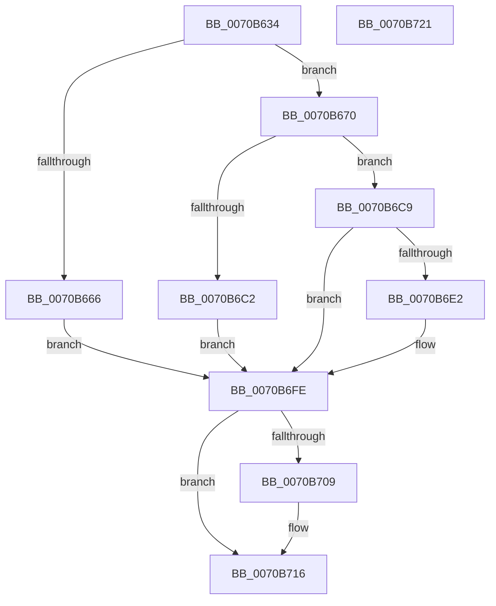

# HalpQueryAcpiWakeAlarmSystemPowerState

- RVA: `0x0070B634`–`0x0070B722` (길이 `238` bytes)
- VA: `0x000000014070B634`
- 실행 섹션: `PAGE`
- PDB 이름 있음: `예`; PDB Function 태그: `아니요`
- unwind 정보 RVA: `0x000C4844`
- 디코드: `58`개 명령, `238/238` bytes 표시
- 미해석 바이트: `0` (있으면 어셈블리에 `.byte`로 보존)

> 이 문서는 커널 이미지의 기계어와 PDB 기호를 분석해 생성했습니다. 4번과 5번은 함수 원형과 자료형을 바이너리 사용 방식에서 추정한 C 해석이며 원본 소스 복구 결과는 아닙니다.

## 1. Dependencies

- 직접 호출 지점: **6**; 고유 호출 대상: **6**
- 직접 호출자로 확인된 함수: **1**
- RIP 상대 이미지 참조: **0**

### Outgoing calls
- `0x0070B65D` → [HalpGetDynamicDevicePointer](../A9/HalpGetDynamicDevicePointer_function_00A983AC.md) (function, `0x00A983AC`)
- `0x0070B67A` → [KeInitializeEvent](../../text/40/KeInitializeEvent_function_0040DD10.md) (function, `0x0040DD10`)
- `0x0070B6B8` → [IoBuildDeviceIoControlRequest](../../text/20/IoBuildDeviceIoControlRequest_function_00204FD0.md) (function, `0x00204FD0`)
- `0x0070B6D4` → [IofCallDriver](../../text/29/IofCallDriver_function_0029B4B0.md) (function, `0x0029B4B0`)
- `0x0070B6F5` → [KeWaitForSingleObject](../../text/20/KeWaitForSingleObject_function_0020E6B0.md) (function, `0x0020E6B0`)
- `0x0070B711` → [ObfDereferenceObject](../../text/2F/ObfDereferenceObject_function_002F9350.md) (function, `0x002F9350`)

### Direct callers
- [sub_00B80AC2](../../pagelk/B8/Unknown_function_00B80AC2.md) at `0x00B80C12`

### Static image references
- 디코드된 RIP-relative 메모리 참조가 없습니다.

## 2. Other-region calls and transfers

- 다른 실행 섹션으로 향하는 call: **5**
  - `0x0070B67A` → [KeInitializeEvent](../../text/40/KeInitializeEvent_function_0040DD10.md) (`PAGE` → `.text`)
  - `0x0070B6B8` → [IoBuildDeviceIoControlRequest](../../text/20/IoBuildDeviceIoControlRequest_function_00204FD0.md) (`PAGE` → `.text`)
  - `0x0070B6D4` → [IofCallDriver](../../text/29/IofCallDriver_function_0029B4B0.md) (`PAGE` → `.text`)
  - `0x0070B6F5` → [KeWaitForSingleObject](../../text/20/KeWaitForSingleObject_function_0020E6B0.md) (`PAGE` → `.text`)
  - `0x0070B711` → [ObfDereferenceObject](../../text/2F/ObfDereferenceObject_function_002F9350.md) (`PAGE` → `.text`)
- 별도 외부 분기/꼬리 이동을 확인하지 못했습니다.

## 3. Assembly (complete function range)

```asm
0070B634  4C 8B DC                        mov r11, rsp
0070B637  53                              push rbx
0070B638  48 81 EC 80 00 00 00            sub rsp, 0x80
0070B63F  0F 57 C0                        xorps xmm0, xmm0
0070B642  49 8D 53 10                     lea rdx, [r11 + 0x10]
0070B646  33 C0                           xor eax, eax
0070B648  48 8B D9                        mov rbx, rcx
0070B64B  49 21 43 10                     and qword ptr [r11 + 0x10], rax
0070B64F  0F 11 44 24 60                  movups xmmword ptr [rsp + 0x60], xmm0
0070B654  49 89 43 E8                     mov qword ptr [r11 - 0x18], rax
0070B658  0F 11 44 24 50                  movups xmmword ptr [rsp + 0x50], xmm0
0070B65D  E8 4A CD 38 00                  call 0x140a983ac
0070B662  85 C0                           test eax, eax
0070B664  79 0A                           jns 0x14070b670
0070B666  BB 01 00 00 C0                  mov ebx, 0xc0000001
0070B66B  E9 8E 00 00 00                  jmp 0x14070b6fe
0070B670  45 33 C0                        xor r8d, r8d
0070B673  48 8D 4C 24 60                  lea rcx, [rsp + 0x60]
0070B678  33 D2                           xor edx, edx
0070B67A  E8 91 26 D0 FF                  call 0x14040dd10
0070B67F  48 8B 94 24 98 00 00 00         mov rdx, qword ptr [rsp + 0x98]
0070B687  48 8D 44 24 50                  lea rax, [rsp + 0x50]
0070B68C  48 89 44 24 40                  mov qword ptr [rsp + 0x40], rax
0070B691  45 33 C9                        xor r9d, r9d
0070B694  48 8D 44 24 60                  lea rax, [rsp + 0x60]
0070B699  45 33 C0                        xor r8d, r8d
0070B69C  48 89 44 24 38                  mov qword ptr [rsp + 0x38], rax
0070B6A1  B9 18 42 29 00                  mov ecx, 0x294218
0070B6A6  C6 44 24 30 00                  mov byte ptr [rsp + 0x30], 0
0070B6AB  C7 44 24 28 04 00 00 00         mov dword ptr [rsp + 0x28], 4
0070B6B3  48 89 5C 24 20                  mov qword ptr [rsp + 0x20], rbx
0070B6B8  E8 13 99 AF FF                  call 0x140204fd0
0070B6BD  48 85 C0                        test rax, rax
0070B6C0  75 07                           jne 0x14070b6c9
0070B6C2  BB 9A 00 00 C0                  mov ebx, 0xc000009a
0070B6C7  EB 35                           jmp 0x14070b6fe
0070B6C9  48 8B 8C 24 98 00 00 00         mov rcx, qword ptr [rsp + 0x98]
0070B6D1  48 8B D0                        mov rdx, rax
0070B6D4  E8 D7 FD B8 FF                  call 0x14029b4b0
0070B6D9  8B D8                           mov ebx, eax
0070B6DB  3D 03 01 00 00                  cmp eax, 0x103
0070B6E0  75 1C                           jne 0x14070b6fe
0070B6E2  48 83 64 24 20 00               and qword ptr [rsp + 0x20], 0
0070B6E8  48 8D 4C 24 60                  lea rcx, [rsp + 0x60]
0070B6ED  45 33 C9                        xor r9d, r9d
0070B6F0  45 33 C0                        xor r8d, r8d
0070B6F3  33 D2                           xor edx, edx
0070B6F5  E8 B6 2F B0 FF                  call 0x14020e6b0
0070B6FA  8B 5C 24 50                     mov ebx, dword ptr [rsp + 0x50]
0070B6FE  48 83 BC 24 98 00 00 00 00      cmp qword ptr [rsp + 0x98], 0
0070B707  74 0D                           je 0x14070b716
0070B709  48 8B 8C 24 98 00 00 00         mov rcx, qword ptr [rsp + 0x98]
0070B711  E8 3A DC BE FF                  call 0x1402f9350
0070B716  8B C3                           mov eax, ebx
0070B718  48 81 C4 80 00 00 00            add rsp, 0x80
0070B71F  5B                              pop rbx
0070B720  C3                              ret
0070B721  CC                              int3
```

## 4. C-style interpretation (structured pseudocode)

```c
__int64 __fastcall HalpQueryAcpiWakeAlarmSystemPowerState(__int64 a1, __int64 a2, int a3, int a4)
{
    __int64 result;
    __int64 v_rbx;
    __int64 v_rsp;
    unsigned __int64 v_stack_m28;
    unsigned __int64 v_stack_m38;
    unsigned __int64 v_stack_m48;
    unsigned __int64 v_stack_m50;
    unsigned __int8 v_stack_m58;
    unsigned int v_stack_m60;
    unsigned __int64 v_stack_m68;
    unsigned __int64 v_stack_p10;

    v_rsp = (v_rsp) - (128);
    result = 0;
    v_stack_m28 = v_xmm0;
    *(unsigned __int64 *)(v_rsp - 24) = 0;
    v_stack_m38 = v_xmm0;
    result = HalpGetDynamicDevicePointer(a1, v_rsp + 16, a3, a4);
    if (!sign_flag) goto loc_0070B670;
    goto loc_0070B6FE;
loc_0070B670:
    a3 = 0;
    a2 = 0;
    result = KeInitializeEvent(v_stack_m28, a2, a3, a4);
    v_stack_m48 = v_stack_m38;
    a4 = 0;
    a3 = 0;
    v_stack_m50 = v_stack_m28;
    v_stack_m58 = 0;
    v_stack_m60 = 4;
    v_stack_m68 = (unsigned int)(0xC0000001ULL);
    result = IoBuildDeviceIoControlRequest((unsigned int)(0x294218ULL), v_stack_p10, a3, a4);
    if (result != 0) goto loc_0070B6C9;
    goto loc_0070B6FE;
loc_0070B6C9:
    result = IofCallDriver(v_stack_p10, result, a3, a4);
    v_rbx = (unsigned int)((unsigned int)(result));
    if (((unsigned int)(result)) == 259) {
        a1 = v_stack_m28;
        a4 = 0;
        a3 = 0;
        a2 = 0;
        result = KeWaitForSingleObject(a1, a2, a3, a4);
        v_rbx = v_stack_m38;
    }
    if (v_stack_p10 != 0) {
        a1 = v_stack_p10;
        result = ObfDereferenceObject(a1, a2, a3, a4);
    }
    v_rsp = (v_rsp) + (128);
    return (unsigned int)((unsigned int)(v_rbx));
}
```

## 5. (Beta) C Style

```c
int64_t HalpQueryAcpiWakeAlarmSystemPowerState(int64_t Arg1, int64_t Arg2, int32_t Arg3, int32_t Arg4)
{
    int64_t result;
    int64_t local_rbx;
    int64_t local_rsp;
    uint64_t v_stack_m28;
    uint64_t v_stack_m38;
    uint64_t v_stack_m48;
    uint64_t v_stack_m50;
    uint8_t v_stack_m58;
    uint32_t v_stack_m60;
    uint64_t v_stack_m68;
    uint64_t v_stack_p10;

    local_rsp = (local_rsp) - (128);
    result = 0;
    v_stack_m28 = v_xmm0;
    *(uint64_t *)(local_rsp - 0x18) = 0;
    v_stack_m38 = v_xmm0;
    result = HalpGetDynamicDevicePointer(Arg1, local_rsp + 16, Arg3, Arg4);
    if (!sign_flag) goto loc_0070B670;
    goto loc_0070B6FE;
loc_0070B670:
    Arg3 = 0;
    Arg2 = 0;
    result = KeInitializeEvent(v_stack_m28, Arg2, Arg3, Arg4);
    v_stack_m48 = v_stack_m38;
    Arg4 = 0;
    Arg3 = 0;
    v_stack_m50 = v_stack_m28;
    v_stack_m58 = 0;
    v_stack_m60 = 4;
    v_stack_m68 = (uint32_t)(0xC0000001ULL);
    result = IoBuildDeviceIoControlRequest((uint32_t)(0x294218ULL), v_stack_p10, Arg3, Arg4);
    if (result != 0) goto loc_0070B6C9;
    goto loc_0070B6FE;
loc_0070B6C9:
    result = IofCallDriver(v_stack_p10, result, Arg3, Arg4);
    local_rbx = (uint32_t)((uint32_t)(result));
    if (((uint32_t)(result)) == 259) {
        Arg1 = v_stack_m28;
        Arg4 = 0;
        Arg3 = 0;
        Arg2 = 0;
        result = KeWaitForSingleObject(Arg1, Arg2, Arg3, Arg4);
        local_rbx = v_stack_m38;
    }
    if (v_stack_p10 != 0) {
        Arg1 = v_stack_p10;
        result = ObfDereferenceObject(Arg1, Arg2, Arg3, Arg4);
    }
    local_rsp = (local_rsp) + (128);
    return (uint32_t)((uint32_t)(local_rbx));
}
```

## 6. Execution-region graph

[열기: 2D/3D 그래프와 함수 탐색 컨트롤 패널](../../../control-panel.html?section=page&rva=0x0070B634&view=graph)

- 2D 그래프는 위에서 아래로 흐르고, 3D 그래프는 빈 공간을 드래그해 회전합니다. Shift+드래그는 이동, 휠은 확대·축소, 함수 노드 선택은 대상 보고서 이동입니다.

### Static fallback


