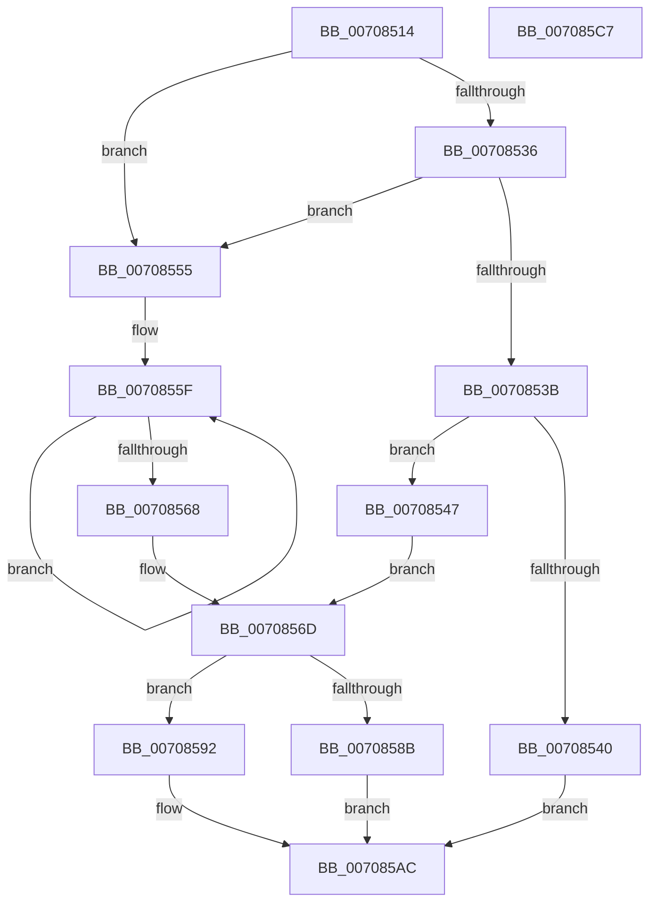

# HalpQueryIdFdo

- RVA: `0x00708514`–`0x007085C8` (길이 `180` bytes)
- VA: `0x0000000140708514`
- 실행 섹션: `PAGE`
- PDB 이름 있음: `예`; PDB Function 태그: `아니요`
- unwind 정보 RVA: `0x0005E6B4`
- 디코드: `53`개 명령, `180/180` bytes 표시
- 미해석 바이트: `0` (있으면 어셈블리에 `.byte`로 보존)

> 이 문서는 커널 이미지의 기계어와 PDB 기호를 분석해 생성했습니다. 4번과 5번은 함수 원형과 자료형을 바이너리 사용 방식에서 추정한 C 해석이며 원본 소스 복구 결과는 아닙니다.

## 1. Dependencies

- 직접 호출 지점: **2**; 고유 호출 대상: **2**
- 직접 호출자로 확인된 함수: **1**
- RIP 상대 이미지 참조: **2**

### Outgoing calls
- `0x0070857E` → [ExAllocatePool2](../../poolcode/B8/ExAllocatePool2_function_00B820F0.md) (function, `0x00B820F0`)
- `0x0070859B` → [memcpy](../../text/6C/memcpy_function_006C6840.md) (function, `0x006C6840`)

### Direct callers
- [HalpDispatchPnp](../A9/HalpDispatchPnp_function_00A912C0.md) at `0x00A9137D`

### Static image references
- `0x00708547` → RVA `0x000240C8` (`.rdata`; read)
- `0x00708555` → RVA `0x000240D0` (`.rdata`; read)

## 2. Other-region calls and transfers

- 다른 실행 섹션으로 향하는 call: **2**
  - `0x0070857E` → [ExAllocatePool2](../../poolcode/B8/ExAllocatePool2_function_00B820F0.md) (`PAGE` → `POOLCODE`)
  - `0x0070859B` → [memcpy](../../text/6C/memcpy_function_006C6840.md) (`PAGE` → `.text`)
- 별도 외부 분기/꼬리 이동을 확인하지 못했습니다.

## 3. Assembly (complete function range)

```asm
00708514  48 8B C4                        mov rax, rsp
00708517  48 89 58 08                     mov qword ptr [rax + 8], rbx
0070851B  48 89 68 10                     mov qword ptr [rax + 0x10], rbp
0070851F  48 89 70 18                     mov qword ptr [rax + 0x18], rsi
00708523  48 89 78 20                     mov qword ptr [rax + 0x20], rdi
00708527  41 56                           push r14
00708529  48 83 EC 20                     sub rsp, 0x20
0070852D  33 ED                           xor ebp, ebp
0070852F  4D 8B F0                        mov r14, r8
00708532  85 D2                           test edx, edx
00708534  74 1F                           je 0x140708555
00708536  83 EA 01                        sub edx, 1
00708539  74 1A                           je 0x140708555
0070853B  83 FA 02                        cmp edx, 2
0070853E  74 07                           je 0x140708547
00708540  B8 BB 00 00 C0                  mov eax, 0xc00000bb
00708545  EB 65                           jmp 0x1407085ac
00708547  48 8D 1D 7A BB 91 FF            lea rbx, [rip - 0x6e4486]
0070854E  B8 04 00 00 00                  mov eax, 4
00708553  EB 18                           jmp 0x14070856d
00708555  48 8D 1D 74 BB 91 FF            lea rbx, [rip - 0x6e448c]
0070855C  48 8B C3                        mov rax, rbx
0070855F  48 83 C0 02                     add rax, 2
00708563  66 39 28                        cmp word ptr [rax], bp
00708566  75 F7                           jne 0x14070855f
00708568  2B C3                           sub eax, ebx
0070856A  83 C0 02                        add eax, 2
0070856D  8B F8                           mov edi, eax
0070856F  B9 00 01 00 00                  mov ecx, 0x100
00708574  41 B8 48 61 6C 70               mov r8d, 0x706c6148
0070857A  48 8D 57 02                     lea rdx, [rdi + 2]
0070857E  E8 6D 9B 47 00                  call 0x140b820f0
00708583  48 8B F0                        mov rsi, rax
00708586  48 85 C0                        test rax, rax
00708589  75 07                           jne 0x140708592
0070858B  B8 9A 00 00 C0                  mov eax, 0xc000009a
00708590  EB 1A                           jmp 0x1407085ac
00708592  4C 8B C7                        mov r8, rdi
00708595  48 8B D3                        mov rdx, rbx
00708598  48 8B CE                        mov rcx, rsi
0070859B  E8 A0 E2 FB FF                  call 0x1406c6840
007085A0  48 D1 EF                        shr rdi, 1
007085A3  33 C0                           xor eax, eax
007085A5  66 89 2C 7E                     mov word ptr [rsi + rdi*2], bp
007085A9  49 89 36                        mov qword ptr [r14], rsi
007085AC  48 8B 5C 24 30                  mov rbx, qword ptr [rsp + 0x30]
007085B1  48 8B 6C 24 38                  mov rbp, qword ptr [rsp + 0x38]
007085B6  48 8B 74 24 40                  mov rsi, qword ptr [rsp + 0x40]
007085BB  48 8B 7C 24 48                  mov rdi, qword ptr [rsp + 0x48]
007085C0  48 83 C4 20                     add rsp, 0x20
007085C4  41 5E                           pop r14
007085C6  C3                              ret
007085C7  CC                              int3
```

## 4. C-style interpretation (structured pseudocode)

```c
__int64 __fastcall HalpQueryIdFdo(__int64 a1, int a2, __int64 a3)
{
    __int64 result;
    __int64 v_rbp;
    __int64 v_rdi;
    __int64 v_rsp;
    unsigned __int64 v_stack_p10;
    unsigned __int64 v_stack_p18;
    unsigned __int64 v_stack_p20;
    unsigned __int64 v_stack_p8;

    *(unsigned __int64 *)(v_rsp + 8) = v_rbx;
    *(unsigned __int64 *)(v_rsp + 16) = v_rbp;
    *(unsigned __int64 *)(v_rsp + 24) = v_rsi;
    *(unsigned __int64 *)(v_rsp + 32) = v_rdi;
    v_rsp = (v_rsp) - (32);
    v_rbp = 0;
    if (a2 == 0) goto loc_00708555;
    a2 = (unsigned int)((a2) - (1));
    if (condition_is_equal) goto loc_00708555;
    if (a2 == 2) goto loc_00708547;
    goto loc_007085AC;
loc_00708547:
    goto loc_0070856D;
loc_00708555:
loc_0070855F:
    result = (v_rip - 7226508) + (2);
    if ((*(unsigned __int16 *)(result)) != 0) goto loc_0070855F;
    result = (unsigned int)((result) - ((unsigned int)(v_rip - 7226508)));
    result = (unsigned int)((result) + (2));
loc_0070856D:
    result = ExAllocatePool2(256, (unsigned int)((unsigned int)(result)) + 2, (unsigned int)(0x706C6148ULL), a4);
    if (result != 0) goto loc_00708592;
    goto loc_007085AC;
loc_00708592:
    result = memcpy(result, v_rip - 7226508, (unsigned int)((unsigned int)(result)), a4);
    v_rdi = ((unsigned int)((unsigned int)(result))) >> (1);
    result = 0;
    *(unsigned __int16 *)(result + v_rdi * 2) = 0;
    *(unsigned __int64 *)(a3) = 0;
loc_007085AC:
    v_rsp = (v_rsp) + (32);
    return result;
}
```

## 5. (Beta) C Style

```c
int64_t HalpQueryIdFdo(int64_t Arg1, int32_t Arg2, void *Arg3)
{
    uint8_t *arg3 = (uint8_t *)Arg3;

    int64_t result;
    int64_t local_rbp;
    int64_t local_rdi;
    int64_t local_rsp;
    uint64_t v_stack_p10;
    uint64_t v_stack_p18;
    uint64_t v_stack_p20;
    uint64_t v_stack_p8;

    *(uint64_t *)(local_rsp + 0x8) = local_rbx;
    *(uint64_t *)(local_rsp + 0x10) = local_rbp;
    *(uint64_t *)(local_rsp + 0x18) = local_rsi;
    *(uint64_t *)(local_rsp + 0x20) = local_rdi;
    local_rsp = (local_rsp) - (32);
    local_rbp = 0;
    if (Arg2 == 0) goto loc_00708555;
    Arg2 = (uint32_t)((Arg2) - (1));
    if (condition_is_equal) goto loc_00708555;
    if (Arg2 == 2) goto loc_00708547;
    goto loc_007085AC;
loc_00708547:
    goto loc_0070856D;
loc_00708555:
loc_0070855F:
    result = (v_rip - 7226508) + (2);
    if ((*(uint16_t *)(result)) != 0) goto loc_0070855F;
    result = (uint32_t)((result) - ((uint32_t)(v_rip - 7226508)));
    result = (uint32_t)((result) + (2));
loc_0070856D:
    result = ExAllocatePool2(256, (uint32_t)((uint32_t)(result)) + 2, (uint32_t)(0x706C6148ULL), a4);
    if (result != 0) goto loc_00708592;
    goto loc_007085AC;
loc_00708592:
    result = memcpy(result, v_rip - 7226508, (uint32_t)((uint32_t)(result)), a4);
    local_rdi = ((uint32_t)((uint32_t)(result))) >> (1);
    result = 0;
    *(uint16_t *)(result + local_rdi * 2) = 0;
    *(uint64_t *)(arg3) = 0;
loc_007085AC:
    local_rsp = (local_rsp) + (32);
    return result;
}
```

### 관측된 메모리 오프셋

구조체 형식이 확인되지 않은 접근은 인자 기준의 오프셋으로만 기록했습니다.

| 기준 인자 | 오프셋 표현 | 폭 (bit) | 접근 |
|---|---:|---:|---|
| `Arg3` | `+ 0x0` | `64` | `W` |

## 6. Execution-region graph

[열기: 2D/3D 그래프와 함수 탐색 컨트롤 패널](../../../control-panel.html?section=page&rva=0x00708514&view=graph)

- 2D 그래프는 위에서 아래로 흐르고, 3D 그래프는 빈 공간을 드래그해 회전합니다. Shift+드래그는 이동, 휠은 확대·축소, 함수 노드 선택은 대상 보고서 이동입니다.

### Static fallback


