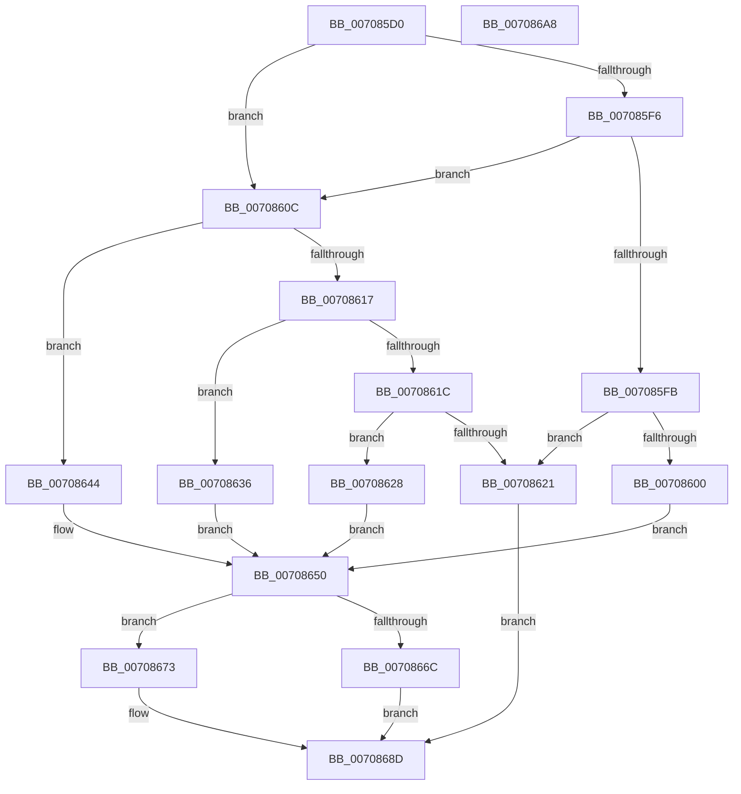

# HalpQueryIdPdo

- RVA: `0x007085D0`–`0x007086A9` (길이 `217` bytes)
- VA: `0x00000001407085D0`
- 실행 섹션: `PAGE`
- PDB 이름 있음: `예`; PDB Function 태그: `아니요`
- unwind 정보 RVA: `0x0005E6B4`
- 디코드: `61`개 명령, `217/217` bytes 표시
- 미해석 바이트: `0` (있으면 어셈블리에 `.byte`로 보존)

> 이 문서는 커널 이미지의 기계어와 PDB 기호를 분석해 생성했습니다. 4번과 5번은 함수 원형과 자료형을 바이너리 사용 방식에서 추정한 C 해석이며 원본 소스 복구 결과는 아닙니다.

## 1. Dependencies

- 직접 호출 지점: **2**; 고유 호출 대상: **2**
- 직접 호출자로 확인된 함수: **1**
- RIP 상대 이미지 참조: **4**

### Outgoing calls
- `0x0070865F` → [ExAllocatePool2](../../poolcode/B8/ExAllocatePool2_function_00B820F0.md) (function, `0x00B820F0`)
- `0x0070867C` → [memcpy](../../text/6C/memcpy_function_006C6840.md) (function, `0x006C6840`)

### Direct callers
- [sub_00B46B8A](../B4/Unknown_function_00B46B8A.md) at `0x00B46C31`

### Static image references
- `0x00708600` → RVA `0x000240C8` (`.rdata`; read)
- `0x00708628` → RVA `0x00024108` (`.rdata`; read)
- `0x00708636` → RVA `0x00024048` (`.rdata`; read)
- `0x00708644` → RVA `0x00023FE0` (`.rdata`; read)

## 2. Other-region calls and transfers

- 다른 실행 섹션으로 향하는 call: **2**
  - `0x0070865F` → [ExAllocatePool2](../../poolcode/B8/ExAllocatePool2_function_00B820F0.md) (`PAGE` → `POOLCODE`)
  - `0x0070867C` → [memcpy](../../text/6C/memcpy_function_006C6840.md) (`PAGE` → `.text`)
- 별도 외부 분기/꼬리 이동을 확인하지 못했습니다.

## 3. Assembly (complete function range)

```asm
007085D0  48 8B C4                        mov rax, rsp
007085D3  48 89 58 08                     mov qword ptr [rax + 8], rbx
007085D7  48 89 68 10                     mov qword ptr [rax + 0x10], rbp
007085DB  48 89 70 18                     mov qword ptr [rax + 0x18], rsi
007085DF  48 89 78 20                     mov qword ptr [rax + 0x20], rdi
007085E3  41 56                           push r14
007085E5  48 83 EC 20                     sub rsp, 0x20
007085E9  48 8B 49 40                     mov rcx, qword ptr [rcx + 0x40]
007085ED  33 ED                           xor ebp, ebp
007085EF  4D 8B F0                        mov r14, r8
007085F2  85 D2                           test edx, edx
007085F4  74 16                           je 0x14070860c
007085F6  83 EA 01                        sub edx, 1
007085F9  74 11                           je 0x14070860c
007085FB  83 FA 02                        cmp edx, 2
007085FE  75 21                           jne 0x140708621
00708600  48 8D 3D C1 BA 91 FF            lea rdi, [rip - 0x6e453f]
00708607  8D 5D 04                        lea ebx, [rbp + 4]
0070860A  EB 44                           jmp 0x140708650
0070860C  8B 49 20                        mov ecx, dword ptr [rcx + 0x20]
0070860F  81 E9 81 00 00 00               sub ecx, 0x81
00708615  74 2D                           je 0x140708644
00708617  83 E9 02                        sub ecx, 2
0070861A  74 1A                           je 0x140708636
0070861C  83 F9 01                        cmp ecx, 1
0070861F  74 07                           je 0x140708628
00708621  B8 BB 00 00 C0                  mov eax, 0xc00000bb
00708626  EB 65                           jmp 0x14070868d
00708628  48 8D 3D D9 BA 91 FF            lea rdi, [rip - 0x6e4527]
0070862F  BB 1A 00 00 00                  mov ebx, 0x1a
00708634  EB 1A                           jmp 0x140708650
00708636  48 8D 3D 0B BA 91 FF            lea rdi, [rip - 0x6e45f5]
0070863D  BB 1C 00 00 00                  mov ebx, 0x1c
00708642  EB 0C                           jmp 0x140708650
00708644  48 8D 3D 95 B9 91 FF            lea rdi, [rip - 0x6e466b]
0070864B  BB 34 00 00 00                  mov ebx, 0x34
00708650  48 8D 53 02                     lea rdx, [rbx + 2]
00708654  B9 00 01 00 00                  mov ecx, 0x100
00708659  41 B8 48 61 6C 70               mov r8d, 0x706c6148
0070865F  E8 8C 9A 47 00                  call 0x140b820f0
00708664  48 8B F0                        mov rsi, rax
00708667  48 85 C0                        test rax, rax
0070866A  75 07                           jne 0x140708673
0070866C  B8 9A 00 00 C0                  mov eax, 0xc000009a
00708671  EB 1A                           jmp 0x14070868d
00708673  4C 8B C3                        mov r8, rbx
00708676  48 8B D7                        mov rdx, rdi
00708679  48 8B CE                        mov rcx, rsi
0070867C  E8 BF E1 FB FF                  call 0x1406c6840
00708681  48 D1 EB                        shr rbx, 1
00708684  33 C0                           xor eax, eax
00708686  66 89 2C 5E                     mov word ptr [rsi + rbx*2], bp
0070868A  49 89 36                        mov qword ptr [r14], rsi
0070868D  48 8B 5C 24 30                  mov rbx, qword ptr [rsp + 0x30]
00708692  48 8B 6C 24 38                  mov rbp, qword ptr [rsp + 0x38]
00708697  48 8B 74 24 40                  mov rsi, qword ptr [rsp + 0x40]
0070869C  48 8B 7C 24 48                  mov rdi, qword ptr [rsp + 0x48]
007086A1  48 83 C4 20                     add rsp, 0x20
007086A5  41 5E                           pop r14
007086A7  C3                              ret
007086A8  CC                              int3
```

## 4. C-style interpretation (structured pseudocode)

```c
__int64 __fastcall HalpQueryIdPdo(__int64 a1, int a2, __int64 a3)
{
    __int64 result;
    __int64 v_rbp;
    __int64 v_rbx;
    __int64 v_rsp;
    unsigned __int64 v_stack_p10;
    unsigned __int64 v_stack_p18;
    unsigned __int64 v_stack_p20;
    unsigned __int64 v_stack_p8;

    *(unsigned __int64 *)(v_rsp + 8) = v_rbx;
    *(unsigned __int64 *)(v_rsp + 16) = v_rbp;
    *(unsigned __int64 *)(v_rsp + 24) = v_rsi;
    *(unsigned __int64 *)(v_rsp + 32) = v_rdi;
    v_rsp = (v_rsp) - (32);
    v_rbp = 0;
    if (a2 == 0) goto loc_0070860C;
    a2 = (unsigned int)((a2) - (1));
    if (condition_is_equal) goto loc_0070860C;
    if (a2 != 2) goto loc_00708621;
    goto loc_00708650;
loc_0070860C:
    a1 = (unsigned int)(((unsigned int)(*(unsigned int *)(*(unsigned __int64 *)(a1 + 64) + 32))) - (129));
    if (condition_is_equal) goto loc_00708644;
    a1 = (unsigned int)((a1) - (2));
    if (condition_is_equal) goto loc_00708636;
    if (((unsigned int)(a1)) == 1) goto loc_00708628;
loc_00708621:
    goto loc_0070868D;
loc_00708628:
    goto loc_00708650;
loc_00708636:
    goto loc_00708650;
loc_00708644:
loc_00708650:
    result = ExAllocatePool2(256, 52 + 2, (unsigned int)(0x706C6148ULL), a4);
    if (result != 0) goto loc_00708673;
    goto loc_0070868D;
loc_00708673:
    result = memcpy(result, v_rip - 7226987, 52, a4);
    v_rbx = (52) >> (1);
    result = 0;
    *(unsigned __int16 *)(result + v_rbx * 2) = 0;
    *(unsigned __int64 *)(a3) = 0;
loc_0070868D:
    v_rsp = (v_rsp) + (32);
    return result;
}
```

## 5. (Beta) C Style

```c
int64_t HalpQueryIdPdo(void *Arg1, int32_t Arg2, void *Arg3)
{
    uint8_t *arg1 = (uint8_t *)Arg1;
    uint8_t *arg3 = (uint8_t *)Arg3;

    int64_t result;
    int64_t local_rbp;
    int64_t local_rbx;
    int64_t local_rsp;
    uint64_t v_stack_p10;
    uint64_t v_stack_p18;
    uint64_t v_stack_p20;
    uint64_t v_stack_p8;

    *(uint64_t *)(local_rsp + 0x8) = local_rbx;
    *(uint64_t *)(local_rsp + 0x10) = local_rbp;
    *(uint64_t *)(local_rsp + 0x18) = local_rsi;
    *(uint64_t *)(local_rsp + 0x20) = local_rdi;
    local_rsp = (local_rsp) - (32);
    local_rbp = 0;
    if (Arg2 == 0) goto loc_0070860C;
    Arg2 = (uint32_t)((Arg2) - (1));
    if (condition_is_equal) goto loc_0070860C;
    if (Arg2 != 2) goto loc_00708621;
    goto loc_00708650;
loc_0070860C:
    Arg1 = (uint32_t)(((uint32_t)(*(uint32_t *)(*(uint64_t *)(arg1 + 0x40) + 0x20))) - (129));
    if (condition_is_equal) goto loc_00708644;
    Arg1 = (uint32_t)((Arg1) - (2));
    if (condition_is_equal) goto loc_00708636;
    if (((uint32_t)(Arg1)) == 1) goto loc_00708628;
loc_00708621:
    goto loc_0070868D;
loc_00708628:
    goto loc_00708650;
loc_00708636:
    goto loc_00708650;
loc_00708644:
loc_00708650:
    result = ExAllocatePool2(256, 52 + 2, (uint32_t)(0x706C6148ULL), a4);
    if (result != 0) goto loc_00708673;
    goto loc_0070868D;
loc_00708673:
    result = memcpy(result, v_rip - 7226987, 52, a4);
    local_rbx = (52) >> (1);
    result = 0;
    *(uint16_t *)(result + local_rbx * 2) = 0;
    *(uint64_t *)(arg3) = 0;
loc_0070868D:
    local_rsp = (local_rsp) + (32);
    return result;
}
```

### 관측된 메모리 오프셋

구조체 형식이 확인되지 않은 접근은 인자 기준의 오프셋으로만 기록했습니다.

| 기준 인자 | 오프셋 표현 | 폭 (bit) | 접근 |
|---|---:|---:|---|
| `Arg1` | `+ 0x40` | `64` | `R` |
| `Arg3` | `+ 0x0` | `64` | `W` |

## 6. Execution-region graph

[열기: 2D/3D 그래프와 함수 탐색 컨트롤 패널](../../../control-panel.html?section=page&rva=0x007085D0&view=graph)

- 2D 그래프는 위에서 아래로 흐르고, 3D 그래프는 빈 공간을 드래그해 회전합니다. Shift+드래그는 이동, 휠은 확대·축소, 함수 노드 선택은 대상 보고서 이동입니다.

### Static fallback


