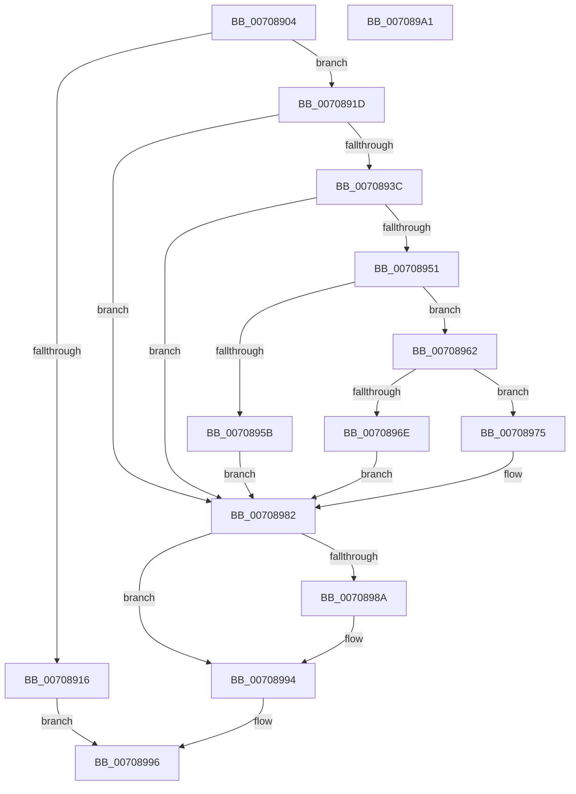

# HalpQueryIommuReservedRegionInformation

- RVA: `0x00708904`–`0x007089A2` (길이 `158` bytes)
- VA: `0x0000000140708904`
- 실행 섹션: `PAGE`
- PDB 이름 있음: `예`; PDB Function 태그: `아니요`
- unwind 정보 RVA: `0x00085760`
- 디코드: `45`개 명령, `158/158` bytes 표시
- 미해석 바이트: `0` (있으면 어셈블리에 `.byte`로 보존)

> 이 문서는 커널 이미지의 기계어와 PDB 기호를 분석해 생성했습니다. 4번과 5번은 함수 원형과 자료형을 바이너리 사용 방식에서 추정한 C 해석이며 원본 소스 복구 결과는 아닙니다.

## 1. Dependencies

- 직접 호출 지점: **4**; 고유 호출 대상: **4**
- 직접 호출자로 확인된 함수: **1**
- RIP 상대 이미지 참조: **0**

### Outgoing calls
- `0x00708931` → [HalpIommuGetDeviceId](../../text/55/HalpIommuGetDeviceId_function_005536C0.md) (function, `0x005536C0`)
- `0x00708946` → [HalpIommuLocateFromDevice](HalpIommuLocateFromDevice_function_00708830.md) (function, `0x00708830`)
- `0x0070897A` → [guard_dispatch_icall](../../text/6B/guard_dispatch_icall_function_006BAAD0.md) (function, `0x006BAAD0`)
- `0x0070898F` → [HalpIommuFreeDeviceId](../../text/55/HalpIommuFreeDeviceId_function_00553640.md) (function, `0x00553640`)

### Direct callers
- [sub_00B80AC2](../../pagelk/B8/Unknown_function_00B80AC2.md) at `0x00B80C3E`

### Static image references
- 디코드된 RIP-relative 메모리 참조가 없습니다.

## 2. Other-region calls and transfers

- 다른 실행 섹션으로 향하는 call: **3**
  - `0x00708931` → [HalpIommuGetDeviceId](../../text/55/HalpIommuGetDeviceId_function_005536C0.md) (`PAGE` → `.text`)
  - `0x0070897A` → [guard_dispatch_icall](../../text/6B/guard_dispatch_icall_function_006BAAD0.md) (`PAGE` → `.text`)
  - `0x0070898F` → [HalpIommuFreeDeviceId](../../text/55/HalpIommuFreeDeviceId_function_00553640.md) (`PAGE` → `.text`)
- 별도 외부 분기/꼬리 이동을 확인하지 못했습니다.

## 3. Assembly (complete function range)

```asm
00708904  48 89 5C 24 08                  mov qword ptr [rsp + 8], rbx
00708909  56                              push rsi
0070890A  48 83 EC 20                     sub rsp, 0x20
0070890E  48 8B F1                        mov rsi, rcx
00708911  83 FA 10                        cmp edx, 0x10
00708914  73 07                           jae 0x14070891d
00708916  B8 0D 00 00 C0                  mov eax, 0xc000000d
0070891B  EB 79                           jmp 0x140708996
0070891D  48 8B 09                        mov rcx, qword ptr [rcx]
00708920  48 8D 54 24 40                  lea rdx, [rsp + 0x40]
00708925  48 83 64 24 40 00               and qword ptr [rsp + 0x40], 0
0070892B  48 83 64 24 48 00               and qword ptr [rsp + 0x48], 0
00708931  E8 8A AD E4 FF                  call 0x1405536c0
00708936  8B D8                           mov ebx, eax
00708938  85 C0                           test eax, eax
0070893A  78 46                           js 0x140708982
0070893C  48 8B 4C 24 40                  mov rcx, qword ptr [rsp + 0x40]
00708941  48 8D 54 24 48                  lea rdx, [rsp + 0x48]
00708946  E8 E5 FE FF FF                  call 0x140708830
0070894B  8B D8                           mov ebx, eax
0070894D  85 C0                           test eax, eax
0070894F  78 31                           js 0x140708982
00708951  48 8B 44 24 48                  mov rax, qword ptr [rsp + 0x48]
00708956  48 85 C0                        test rax, rax
00708959  75 07                           jne 0x140708962
0070895B  BB 0E 00 00 C0                  mov ebx, 0xc000000e
00708960  EB 20                           jmp 0x140708982
00708962  48 8B 80 38 01 00 00            mov rax, qword ptr [rax + 0x138]
00708969  48 85 C0                        test rax, rax
0070896C  75 07                           jne 0x140708975
0070896E  BB E5 00 00 C0                  mov ebx, 0xc00000e5
00708973  EB 0D                           jmp 0x140708982
00708975  48 8B 4C 24 40                  mov rcx, qword ptr [rsp + 0x40]
0070897A  E8 51 21 FB FF                  call 0x1406baad0
0070897F  88 46 08                        mov byte ptr [rsi + 8], al
00708982  48 83 7C 24 40 00               cmp qword ptr [rsp + 0x40], 0
00708988  74 0A                           je 0x140708994
0070898A  48 8B 4C 24 40                  mov rcx, qword ptr [rsp + 0x40]
0070898F  E8 AC AC E4 FF                  call 0x140553640
00708994  8B C3                           mov eax, ebx
00708996  48 8B 5C 24 30                  mov rbx, qword ptr [rsp + 0x30]
0070899B  48 83 C4 20                     add rsp, 0x20
0070899F  5E                              pop rsi
007089A0  C3                              ret
007089A1  CC                              int3
```

## 4. C-style interpretation (structured pseudocode)

```c
__int64 __fastcall HalpQueryIommuReservedRegionInformation(__int64 a1, int a2)
{
    __int64 result;
    __int64 v_rsp;
    unsigned __int64 v_stack_p18;
    unsigned __int64 v_stack_p20;
    unsigned __int64 v_stack_p8;

    v_stack_p8 = v_rbx;
    v_rsp = (v_rsp) - (32);
    if (a2 >= 16) goto loc_0070891D;
    goto loc_00708996;
loc_0070891D:
    result = HalpIommuGetDeviceId(*(unsigned __int64 *)(a1), v_stack_p18, a3, a4);
    if (sign_flag) goto loc_00708982;
    result = HalpIommuLocateFromDevice(v_stack_p18, v_stack_p20, a3, a4);
    if (sign_flag) goto loc_00708982;
    if (v_stack_p20 != 0) goto loc_00708962;
    goto loc_00708982;
loc_00708962:
    if (*(unsigned __int64 *)(v_stack_p20 + 312) != 0) goto loc_00708975;
    goto loc_00708982;
loc_00708975:
    result = guard_dispatch_icall(v_stack_p18, v_stack_p20, a3, a4);
    *(unsigned __int8 *)(a1 + 8) = (unsigned __int8)(result);
loc_00708982:
    if (v_stack_p18 != 0) {
        a1 = v_stack_p18;
        result = HalpIommuFreeDeviceId(a1, v_stack_p20, a3, a4);
    }
loc_00708996:
    v_rsp = (v_rsp) + (32);
    return (unsigned int)((unsigned int)((unsigned int)(0xC00000E5ULL)));
}
```

## 5. (Beta) C Style

```c
int64_t HalpQueryIommuReservedRegionInformation(void *Arg1, int32_t Arg2)
{
    uint8_t *arg1 = (uint8_t *)Arg1;

    int64_t result;
    int64_t local_rsp;
    uint64_t v_stack_p18;
    uint64_t v_stack_p20;
    uint64_t v_stack_p8;

    v_stack_p8 = local_rbx;
    local_rsp = (local_rsp) - (32);
    if (Arg2 >= 16) goto loc_0070891D;
    goto loc_00708996;
loc_0070891D:
    result = HalpIommuGetDeviceId(*(uint64_t *)(arg1), v_stack_p18, a3, a4);
    if (sign_flag) goto loc_00708982;
    result = HalpIommuLocateFromDevice(v_stack_p18, v_stack_p20, a3, a4);
    if (sign_flag) goto loc_00708982;
    if (v_stack_p20 != 0) goto loc_00708962;
    goto loc_00708982;
loc_00708962:
    if (*(uint64_t *)(v_stack_p20 + 0x138) != 0) goto loc_00708975;
    goto loc_00708982;
loc_00708975:
    result = guard_dispatch_icall(v_stack_p18, v_stack_p20, a3, a4);
    *(uint8_t *)(arg1 + 0x8) = (uint8_t)(result);
loc_00708982:
    if (v_stack_p18 != 0) {
        Arg1 = v_stack_p18;
        result = HalpIommuFreeDeviceId(Arg1, v_stack_p20, a3, a4);
    }
loc_00708996:
    local_rsp = (local_rsp) + (32);
    return (uint32_t)((uint32_t)((uint32_t)(0xC00000E5ULL)));
}
```

### 관측된 메모리 오프셋

구조체 형식이 확인되지 않은 접근은 인자 기준의 오프셋으로만 기록했습니다.

| 기준 인자 | 오프셋 표현 | 폭 (bit) | 접근 |
|---|---:|---:|---|
| `Arg1` | `+ 0x0` | `64` | `R` |
| `Arg1` | `+ 0x8` | `8` | `W` |

## 6. Execution-region graph

[열기: 2D/3D 그래프와 함수 탐색 컨트롤 패널](../../../control-panel.html?section=page&rva=0x00708904&view=graph)

- 2D 그래프는 위에서 아래로 흐르고, 3D 그래프는 빈 공간을 드래그해 회전합니다. Shift+드래그는 이동, 휠은 확대·축소, 함수 노드 선택은 대상 보고서 이동입니다.

### Static fallback


