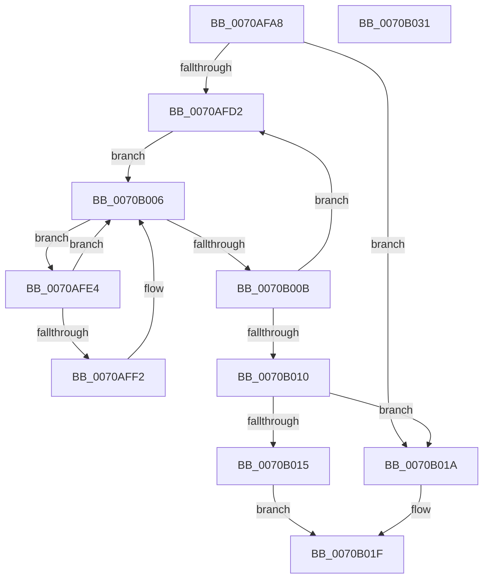

# HalpQueryMaximumGsiv

- RVA: `0x0070AFA8`–`0x0070B032` (길이 `138` bytes)
- VA: `0x000000014070AFA8`
- 실행 섹션: `PAGE`
- PDB 이름 있음: `예`; PDB Function 태그: `아니요`
- unwind 정보 RVA: `0x00069588`
- 디코드: `42`개 명령, `138/138` bytes 표시
- 미해석 바이트: `0` (있으면 어셈블리에 `.byte`로 보존)

> 이 문서는 커널 이미지의 기계어와 PDB 기호를 분석해 생성했습니다. 4번과 5번은 함수 원형과 자료형을 바이너리 사용 방식에서 추정한 C 해석이며 원본 소스 복구 결과는 아닙니다.

## 1. Dependencies

- 직접 호출 지점: **0**; 고유 호출 대상: **0**
- 직접 호출자로 확인된 함수: **1**
- RIP 상대 이미지 참조: **1**

### Outgoing calls
- 직접 디코드된 call 명령이 없습니다.

### Direct callers
- [HalpInitializeSecondaryInterruptServices](../../init/C2/HalpInitializeSecondaryInterruptServices_function_00C21814.md) at `0x00C218A8`

### Static image references
- `0x0070AFB7` → RVA `0x00FC38F0` (`.data`; read)

## 2. Other-region calls and transfers

- 다른 실행 섹션으로 향하는 call: **0**
- 별도 외부 분기/꼬리 이동을 확인하지 못했습니다.

## 3. Assembly (complete function range)

```asm
0070AFA8  48 89 5C 24 08                  mov qword ptr [rsp + 8], rbx
0070AFAD  48 89 74 24 10                  mov qword ptr [rsp + 0x10], rsi
0070AFB2  48 89 7C 24 18                  mov qword ptr [rsp + 0x18], rdi
0070AFB7  4C 8B 05 32 89 8B 00            mov r8, qword ptr [rip + 0x8b8932]
0070AFBE  48 8D 35 2B 89 8B 00            lea rsi, [rip + 0x8b892b]
0070AFC5  33 D2                           xor edx, edx
0070AFC7  48 8B F9                        mov rdi, rcx
0070AFCA  44 8B D2                        mov r10d, edx
0070AFCD  4C 3B C6                        cmp r8, rsi
0070AFD0  74 48                           je 0x14070b01a
0070AFD2  4D 8B D8                        mov r11, r8
0070AFD5  4D 8B 00                        mov r8, qword ptr [r8]
0070AFD8  49 81 C3 08 01 00 00            add r11, 0x108
0070AFDF  4D 8B 0B                        mov r9, qword ptr [r11]
0070AFE2  EB 22                           jmp 0x14070b006
0070AFE4  49 8D 09                        lea rcx, [r9]
0070AFE7  4D 8B 09                        mov r9, qword ptr [r9]
0070AFEA  8B 59 1C                        mov ebx, dword ptr [rcx + 0x1c]
0070AFED  83 FB FF                        cmp ebx, -1
0070AFF0  74 14                           je 0x14070b006
0070AFF2  8B 41 14                        mov eax, dword ptr [rcx + 0x14]
0070AFF5  8B 49 18                        mov ecx, dword ptr [rcx + 0x18]
0070AFF8  2B C8                           sub ecx, eax
0070AFFA  8D 41 FF                        lea eax, [rcx - 1]
0070AFFD  03 C3                           add eax, ebx
0070AFFF  41 3B C2                        cmp eax, r10d
0070B002  44 0F 47 D0                     cmova r10d, eax
0070B006  4D 3B CB                        cmp r9, r11
0070B009  75 D9                           jne 0x14070afe4
0070B00B  4C 3B C6                        cmp r8, rsi
0070B00E  75 C2                           jne 0x14070afd2
0070B010  45 85 D2                        test r10d, r10d
0070B013  74 05                           je 0x14070b01a
0070B015  44 89 17                        mov dword ptr [rdi], r10d
0070B018  EB 05                           jmp 0x14070b01f
0070B01A  BA 01 00 00 C0                  mov edx, 0xc0000001
0070B01F  48 8B 5C 24 08                  mov rbx, qword ptr [rsp + 8]
0070B024  8B C2                           mov eax, edx
0070B026  48 8B 74 24 10                  mov rsi, qword ptr [rsp + 0x10]
0070B02B  48 8B 7C 24 18                  mov rdi, qword ptr [rsp + 0x18]
0070B030  C3                              ret
0070B031  CC                              int3
```

## 4. C-style interpretation (structured pseudocode)

```c
__int64 __fastcall HalpQueryMaximumGsiv(__int64 a1, int a2)
{
    __int64 result;
    __int64 v_r10;
    __int64 v_r11;
    unsigned __int64 v_stack_p10;
    unsigned __int64 v_stack_p18;
    unsigned __int64 v_stack_p8;

    v_stack_p8 = v_rbx;
    v_stack_p10 = v_rsi;
    v_stack_p18 = v_rdi;
    a2 = 0;
    if ((*(unsigned __int64 *)(v_rip + 9144626)) == (v_rip + 9144619)) goto loc_0070B01A;
loc_0070AFD2:
    v_r11 = (*(unsigned __int64 *)(v_rip + 9144626)) + (264);
    goto loc_0070B006;
loc_0070AFE4:
    v_r10 = 0;
    if (((unsigned int)((unsigned int)(*(unsigned int *)(*(unsigned __int64 *)(v_r11) + 28)))) != -1) {
        result = *(unsigned int *)(*(unsigned __int64 *)(v_r11) + 20);
        a1 = *(unsigned int *)(*(unsigned __int64 *)(v_r11) + 24);
        a1 = (unsigned int)((a1) - ((unsigned int)(result)));
        result = a1 - 1;
        result = (unsigned int)((result) + ((unsigned int)((unsigned int)(*(unsigned int *)(*(unsigned __int64 *)(v_r11) + 28)))));
        v_r10 = 0;
        if (((unsigned int)(result)) > 0) { v_r10 = (unsigned int)(result); }
    }
    if ((*(unsigned __int64 *)(*(unsigned __int64 *)(v_r11))) != v_r11) goto loc_0070AFE4;
    if ((*(unsigned __int64 *)(*(unsigned __int64 *)(v_rip + 9144626))) != (v_rip + 9144619)) goto loc_0070AFD2;
    if ((unsigned int)(v_r10) == 0) goto loc_0070B01A;
    *(unsigned int *)(a1) = (unsigned int)(v_r10);
    goto loc_0070B01F;
loc_0070B01A:
loc_0070B01F:
    return (unsigned int)((unsigned int)((unsigned int)(0xC0000001ULL)));
}
```

## 5. (Beta) C Style

```c
int64_t HalpQueryMaximumGsiv(void *Arg1, int32_t Arg2)
{
    uint8_t *arg1 = (uint8_t *)Arg1;

    int64_t result;
    int64_t local_r10;
    int64_t local_r11;
    uint64_t v_stack_p10;
    uint64_t v_stack_p18;
    uint64_t v_stack_p8;

    v_stack_p8 = local_rbx;
    v_stack_p10 = local_rsi;
    v_stack_p18 = local_rdi;
    Arg2 = 0;
    if ((*(uint64_t *)(v_rip + 0x8B8932)) == (v_rip + 9144619)) goto loc_0070B01A;
loc_0070AFD2:
    local_r11 = (*(uint64_t *)(v_rip + 0x8B8932)) + (264);
    goto loc_0070B006;
loc_0070AFE4:
    local_r10 = 0;
    if (((uint32_t)((uint32_t)(*(uint32_t *)(*(uint64_t *)(local_r11) + 0x1C)))) != -1) {
        result = *(uint32_t *)(*(uint64_t *)(local_r11) + 0x14);
        Arg1 = *(uint32_t *)(*(uint64_t *)(local_r11) + 0x18);
        Arg1 = (uint32_t)((Arg1) - ((uint32_t)(result)));
        result = Arg1 - 1;
        result = (uint32_t)((result) + ((uint32_t)((uint32_t)(*(uint32_t *)(*(uint64_t *)(local_r11) + 0x1C)))));
        local_r10 = 0;
        if (((uint32_t)(result)) > 0) { local_r10 = (uint32_t)(result); }
    }
    if ((*(uint64_t *)(*(uint64_t *)(local_r11))) != local_r11) goto loc_0070AFE4;
    if ((*(uint64_t *)(*(uint64_t *)(v_rip + 0x8B8932))) != (v_rip + 9144619)) goto loc_0070AFD2;
    if ((uint32_t)(local_r10) == 0) goto loc_0070B01A;
    *(uint32_t *)(arg1) = (uint32_t)(local_r10);
    goto loc_0070B01F;
loc_0070B01A:
loc_0070B01F:
    return (uint32_t)((uint32_t)((uint32_t)(0xC0000001ULL)));
}
```

### 관측된 메모리 오프셋

구조체 형식이 확인되지 않은 접근은 인자 기준의 오프셋으로만 기록했습니다.

| 기준 인자 | 오프셋 표현 | 폭 (bit) | 접근 |
|---|---:|---:|---|
| `Arg1` | `+ 0x0` | `32` | `W` |

## 6. Execution-region graph

[열기: 2D/3D 그래프와 함수 탐색 컨트롤 패널](../../../control-panel.html?section=page&rva=0x0070AFA8&view=graph)

- 2D 그래프는 위에서 아래로 흐르고, 3D 그래프는 빈 공간을 드래그해 회전합니다. Shift+드래그는 이동, 휠은 확대·축소, 함수 노드 선택은 대상 보고서 이동입니다.

### Static fallback


