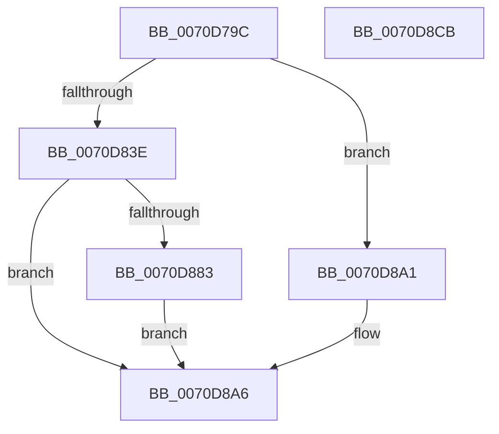

# HalpQueryPccInterface

- RVA: `0x0070D79C`–`0x0070D8CC` (길이 `304` bytes)
- VA: `0x000000014070D79C`
- 실행 섹션: `PAGE`
- PDB 이름 있음: `예`; PDB Function 태그: `아니요`
- unwind 정보 RVA: `0x000C4F78`
- 디코드: `76`개 명령, `304/304` bytes 표시
- 미해석 바이트: `0` (있으면 어셈블리에 `.byte`로 보존)

> 이 문서는 커널 이미지의 기계어와 PDB 기호를 분석해 생성했습니다. 4번과 5번은 함수 원형과 자료형을 바이너리 사용 방식에서 추정한 C 해석이며 원본 소스 복구 결과는 아닙니다.

## 1. Dependencies

- 직접 호출 지점: **7**; 고유 호출 대상: **7**
- 직접 호출자로 확인된 함수: **1**
- RIP 상대 이미지 참조: **1**

### Outgoing calls
- `0x0070D7DE` → [memset](../../text/6C/memset_function_006C6C40.md) (function, `0x006C6C40`)
- `0x0070D7FD` → [KeInitializeEvent](../../text/40/KeInitializeEvent_function_0040DD10.md) (function, `0x0040DD10`)
- `0x0070D805` → [IoGetAttachedDeviceReference](../../text/41/IoGetAttachedDeviceReference_function_0041D940.md) (function, `0x0041D940`)
- `0x0070D834` → [IoBuildSynchronousFsdRequest](../A4/IoBuildSynchronousFsdRequest_function_00A49880.md) (function, `0x00A49880`)
- `0x0070D875` → [IofCallDriver](../../text/29/IofCallDriver_function_0029B4B0.md) (function, `0x0029B4B0`)
- `0x0070D896` → [KeWaitForSingleObject](../../text/20/KeWaitForSingleObject_function_0020E6B0.md) (function, `0x0020E6B0`)
- `0x0070D8A9` → [ObfDereferenceObject](../../text/2F/ObfDereferenceObject_function_002F9350.md) (function, `0x002F9350`)

### Direct callers
- [HalpAcquirePccInterface](HalpAcquirePccInterface_function_0070D524.md) at `0x0070D5F0`

### Static image references
- `0x0070D845` → RVA `0x00024168` (`.rdata`; read)

## 2. Other-region calls and transfers

- 다른 실행 섹션으로 향하는 call: **6**
  - `0x0070D7DE` → [memset](../../text/6C/memset_function_006C6C40.md) (`PAGE` → `.text`)
  - `0x0070D7FD` → [KeInitializeEvent](../../text/40/KeInitializeEvent_function_0040DD10.md) (`PAGE` → `.text`)
  - `0x0070D805` → [IoGetAttachedDeviceReference](../../text/41/IoGetAttachedDeviceReference_function_0041D940.md) (`PAGE` → `.text`)
  - `0x0070D875` → [IofCallDriver](../../text/29/IofCallDriver_function_0029B4B0.md) (`PAGE` → `.text`)
  - `0x0070D896` → [KeWaitForSingleObject](../../text/20/KeWaitForSingleObject_function_0020E6B0.md) (`PAGE` → `.text`)
  - `0x0070D8A9` → [ObfDereferenceObject](../../text/2F/ObfDereferenceObject_function_002F9350.md) (`PAGE` → `.text`)
- 별도 외부 분기/꼬리 이동을 확인하지 못했습니다.

## 3. Assembly (complete function range)

```asm
0070D79C  4C 8B DC                        mov r11, rsp
0070D79F  49 89 5B 08                     mov qword ptr [r11 + 8], rbx
0070D7A3  49 89 73 10                     mov qword ptr [r11 + 0x10], rsi
0070D7A7  49 89 7B 18                     mov qword ptr [r11 + 0x18], rdi
0070D7AB  4D 89 73 20                     mov qword ptr [r11 + 0x20], r14
0070D7AF  41 57                           push r15
0070D7B1  48 83 EC 70                     sub rsp, 0x70
0070D7B5  48 8B B4 24 A8 00 00 00         mov rsi, qword ptr [rsp + 0xa8]
0070D7BD  0F 57 C0                        xorps xmm0, xmm0
0070D7C0  48 8B D9                        mov rbx, rcx
0070D7C3  33 C0                           xor eax, eax
0070D7C5  0F 11 44 24 50                  movups xmmword ptr [rsp + 0x50], xmm0
0070D7CA  48 8B CE                        mov rcx, rsi
0070D7CD  49 89 43 E8                     mov qword ptr [r11 - 0x18], rax
0070D7D1  33 D2                           xor edx, edx
0070D7D3  41 B8 80 00 00 00               mov r8d, 0x80
0070D7D9  0F 11 44 24 40                  movups xmmword ptr [rsp + 0x40], xmm0
0070D7DE  E8 5D 94 FB FF                  call 0x1406c6c40
0070D7E3  8B 84 24 A0 00 00 00            mov eax, dword ptr [rsp + 0xa0]
0070D7EA  48 8D 4C 24 50                  lea rcx, [rsp + 0x50]
0070D7EF  45 33 C0                        xor r8d, r8d
0070D7F2  89 46 20                        mov dword ptr [rsi + 0x20], eax
0070D7F5  33 D2                           xor edx, edx
0070D7F7  C7 06 80 00 01 00               mov dword ptr [rsi], 0x10080
0070D7FD  E8 0E 05 D0 FF                  call 0x14040dd10
0070D802  48 8B CB                        mov rcx, rbx
0070D805  E8 36 01 D1 FF                  call 0x14041d940
0070D80A  48 8B F8                        mov rdi, rax
0070D80D  45 33 C9                        xor r9d, r9d
0070D810  48 8D 44 24 40                  lea rax, [rsp + 0x40]
0070D815  45 33 C0                        xor r8d, r8d
0070D818  48 89 44 24 30                  mov qword ptr [rsp + 0x30], rax
0070D81D  48 8B D7                        mov rdx, rdi
0070D820  48 8D 44 24 50                  lea rax, [rsp + 0x50]
0070D825  48 89 44 24 28                  mov qword ptr [rsp + 0x28], rax
0070D82A  41 8D 49 1B                     lea ecx, [r9 + 0x1b]
0070D82E  48 83 64 24 20 00               and qword ptr [rsp + 0x20], 0
0070D834  E8 47 C0 33 00                  call 0x140a49880
0070D839  48 85 C0                        test rax, rax
0070D83C  74 63                           je 0x14070d8a1
0070D83E  48 8B 88 B8 00 00 00            mov rcx, qword ptr [rax + 0xb8]
0070D845  48 8D 15 1C 69 91 FF            lea rdx, [rip - 0x6e96e4]
0070D84C  C6 40 40 00                     mov byte ptr [rax + 0x40], 0
0070D850  C7 40 30 BB 00 00 C0            mov dword ptr [rax + 0x30], 0xc00000bb
0070D857  48 83 61 D8 00                  and qword ptr [rcx - 0x28], 0
0070D85C  48 89 51 C0                     mov qword ptr [rcx - 0x40], rdx
0070D860  48 8B D0                        mov rdx, rax
0070D863  C6 41 B9 08                     mov byte ptr [rcx - 0x47], 8
0070D867  C7 41 C8 80 00 01 00            mov dword ptr [rcx - 0x38], 0x10080
0070D86E  48 89 71 D0                     mov qword ptr [rcx - 0x30], rsi
0070D872  48 8B CF                        mov rcx, rdi
0070D875  E8 36 DC B8 FF                  call 0x14029b4b0
0070D87A  8B D8                           mov ebx, eax
0070D87C  3D 03 01 00 00                  cmp eax, 0x103
0070D881  75 23                           jne 0x14070d8a6
0070D883  48 83 64 24 20 00               and qword ptr [rsp + 0x20], 0
0070D889  48 8D 4C 24 50                  lea rcx, [rsp + 0x50]
0070D88E  45 33 C9                        xor r9d, r9d
0070D891  45 33 C0                        xor r8d, r8d
0070D894  33 D2                           xor edx, edx
0070D896  E8 15 0E B0 FF                  call 0x14020e6b0
0070D89B  8B 5C 24 40                     mov ebx, dword ptr [rsp + 0x40]
0070D89F  EB 05                           jmp 0x14070d8a6
0070D8A1  BB 9A 00 00 C0                  mov ebx, 0xc000009a
0070D8A6  48 8B CF                        mov rcx, rdi
0070D8A9  E8 A2 BA BE FF                  call 0x1402f9350
0070D8AE  4C 8D 5C 24 70                  lea r11, [rsp + 0x70]
0070D8B3  8B C3                           mov eax, ebx
0070D8B5  49 8B 5B 10                     mov rbx, qword ptr [r11 + 0x10]
0070D8B9  49 8B 73 18                     mov rsi, qword ptr [r11 + 0x18]
0070D8BD  49 8B 7B 20                     mov rdi, qword ptr [r11 + 0x20]
0070D8C1  4D 8B 73 28                     mov r14, qword ptr [r11 + 0x28]
0070D8C5  49 8B E3                        mov rsp, r11
0070D8C8  41 5F                           pop r15
0070D8CA  C3                              ret
0070D8CB  CC                              int3
```

## 4. C-style interpretation (structured pseudocode)

```c
__int64 __fastcall HalpQueryPccInterface(__int64 a1, int a2, __int64 a3, int a4, unsigned int a5, __int64 a6)
{
    __int64 result;
    __int64 v_rsp;
    unsigned __int64 v_stack_m28;
    unsigned __int64 v_stack_m38;
    unsigned __int64 v_stack_m48;
    unsigned __int64 v_stack_m50;
    unsigned __int64 v_stack_m58;
    unsigned __int64 v_stack_m8;

    *(unsigned __int64 *)(v_rsp + 8) = v_rbx;
    *(unsigned __int64 *)(v_rsp + 16) = v_rsi;
    *(unsigned __int64 *)(v_rsp + 24) = v_rdi;
    *(unsigned __int64 *)(v_rsp + 32) = v_r14;
    v_rsp = (v_rsp) - (112);
    result = 0;
    v_stack_m28 = v_xmm0;
    *(unsigned __int64 *)(v_rsp - 24) = 0;
    a2 = 0;
    v_stack_m38 = v_xmm0;
    result = memset(a6, a2, 128, a4);
    a3 = 0;
    *(unsigned int *)(a6 + 32) = (unsigned int)((unsigned int)(a5));
    a2 = 0;
    *(unsigned int *)(a6) = 0x10080ULL;
    result = KeInitializeEvent(v_stack_m28, a2, a3, a4);
    result = IoGetAttachedDeviceReference(a1, a2, a3, a4);
    a4 = 0;
    a3 = 0;
    v_stack_m48 = v_stack_m38;
    v_stack_m50 = v_stack_m28;
    result = IoBuildSynchronousFsdRequest(a4 + 27, result, a3, a4);
    if (result == 0) goto loc_0070D8A1;
    *(unsigned __int8 *)(result + 64) = 0;
    *(unsigned int *)(result + 48) = 0xC00000BBULL;
    *(unsigned __int64 *)(*(unsigned __int64 *)(result + 184) - 64) = v_rip - 7247588;
    *(unsigned __int8 *)(*(unsigned __int64 *)(result + 184) - 71) = 8;
    *(unsigned int *)(*(unsigned __int64 *)(result + 184) - 56) = 0x10080ULL;
    *(unsigned __int64 *)(*(unsigned __int64 *)(result + 184) - 48) = a6;
    result = IofCallDriver(result, result, a3, a4);
    if (((unsigned int)(result)) != 259) goto loc_0070D8A6;
    a4 = 0;
    a3 = 0;
    a2 = 0;
    result = KeWaitForSingleObject(v_stack_m28, a2, a3, a4);
    goto loc_0070D8A6;
loc_0070D8A1:
loc_0070D8A6:
    result = ObfDereferenceObject(result, a2, a3, a4);
    return (unsigned int)((unsigned int)((unsigned int)(0xC000009AULL)));
}
```

## 5. (Beta) C Style

```c
int64_t HalpQueryPccInterface(int64_t Arg1, int32_t Arg2, int64_t Arg3, int32_t Arg4, uint32_t Arg5, void *Arg6)
{
    uint8_t *arg6 = (uint8_t *)Arg6;

    int64_t result;
    int64_t local_rsp;
    uint64_t v_stack_m28;
    uint64_t v_stack_m38;
    uint64_t v_stack_m48;
    uint64_t v_stack_m50;
    uint64_t v_stack_m58;
    uint64_t v_stack_m8;

    *(uint64_t *)(local_rsp + 0x8) = local_rbx;
    *(uint64_t *)(local_rsp + 0x10) = local_rsi;
    *(uint64_t *)(local_rsp + 0x18) = local_rdi;
    *(uint64_t *)(local_rsp + 0x20) = local_r14;
    local_rsp = (local_rsp) - (112);
    result = 0;
    v_stack_m28 = v_xmm0;
    *(uint64_t *)(local_rsp - 0x18) = 0;
    Arg2 = 0;
    v_stack_m38 = v_xmm0;
    result = memset(Arg6, Arg2, 128, Arg4);
    Arg3 = 0;
    *(uint32_t *)(arg6 + 0x20) = (uint32_t)((uint32_t)(Arg5));
    Arg2 = 0;
    *(uint32_t *)(arg6) = 0x10080ULL;
    result = KeInitializeEvent(v_stack_m28, Arg2, Arg3, Arg4);
    result = IoGetAttachedDeviceReference(Arg1, Arg2, Arg3, Arg4);
    Arg4 = 0;
    Arg3 = 0;
    v_stack_m48 = v_stack_m38;
    v_stack_m50 = v_stack_m28;
    result = IoBuildSynchronousFsdRequest(Arg4 + 27, result, Arg3, Arg4);
    if (result == 0) goto loc_0070D8A1;
    *(uint8_t *)(result + 0x40) = 0;
    *(uint32_t *)(result + 0x30) = 0xC00000BBULL;
    *(uint64_t *)(*(uint64_t *)(result + 0xB8) - 0x40) = v_rip - 7247588;
    *(uint8_t *)(*(uint64_t *)(result + 0xB8) - 0x47) = 8;
    *(uint32_t *)(*(uint64_t *)(result + 0xB8) - 0x38) = 0x10080ULL;
    *(void **)(*(uint64_t *)(result + 0xB8) - 0x30) = Arg6;
    result = IofCallDriver(result, result, Arg3, Arg4);
    if (((uint32_t)(result)) != 259) goto loc_0070D8A6;
    Arg4 = 0;
    Arg3 = 0;
    Arg2 = 0;
    result = KeWaitForSingleObject(v_stack_m28, Arg2, Arg3, Arg4);
    goto loc_0070D8A6;
loc_0070D8A1:
loc_0070D8A6:
    result = ObfDereferenceObject(result, Arg2, Arg3, Arg4);
    return (uint32_t)((uint32_t)((uint32_t)(0xC000009AULL)));
}
```

### 관측된 메모리 오프셋

구조체 형식이 확인되지 않은 접근은 인자 기준의 오프셋으로만 기록했습니다.

| 기준 인자 | 오프셋 표현 | 폭 (bit) | 접근 |
|---|---:|---:|---|
| `Arg6` | `+ 0x0` | `32` | `W` |
| `Arg6` | `+ 0x20` | `32` | `W` |

## 6. Execution-region graph

[열기: 2D/3D 그래프와 함수 탐색 컨트롤 패널](../../../control-panel.html?section=page&rva=0x0070D79C&view=graph)

- 2D 그래프는 위에서 아래로 흐르고, 3D 그래프는 빈 공간을 드래그해 회전합니다. Shift+드래그는 이동, 휠은 확대·축소, 함수 노드 선택은 대상 보고서 이동입니다.

### Static fallback


