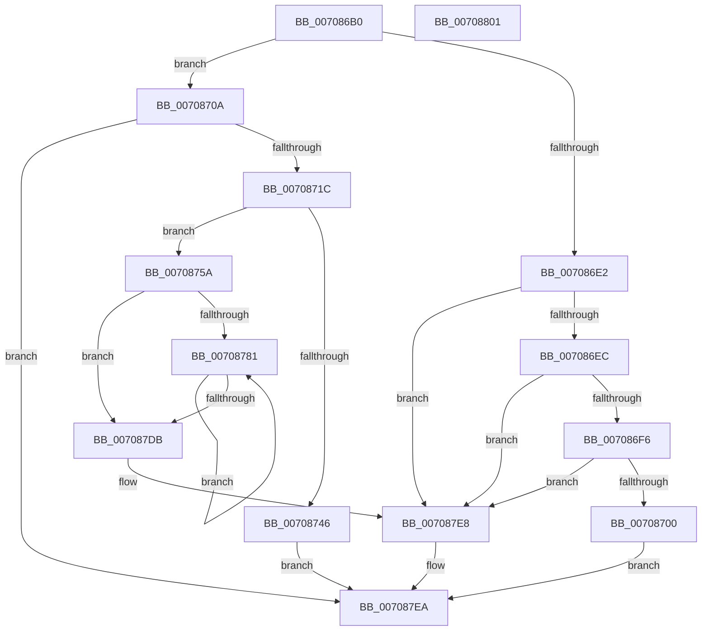

# HalpQueryResources

- RVA: `0x007086B0`–`0x00708802` (길이 `338` bytes)
- VA: `0x00000001407086B0`
- 실행 섹션: `PAGE`
- PDB 이름 있음: `예`; PDB Function 태그: `아니요`
- unwind 정보 RVA: `0x00083688`
- 디코드: `88`개 명령, `338/338` bytes 표시
- 미해석 바이트: `0` (있으면 어셈블리에 `.byte`로 보존)

> 이 문서는 커널 이미지의 기계어와 PDB 기호를 분석해 생성했습니다. 4번과 5번은 함수 원형과 자료형을 바이너리 사용 방식에서 추정한 C 해석이며 원본 소스 복구 결과는 아닙니다.

## 1. Dependencies

- 직접 호출 지점: **5**; 고유 호출 대상: **4**
- 직접 호출자로 확인된 함수: **1**
- RIP 상대 이미지 참조: **0**

### Outgoing calls
- `0x0070870F` → [HalpQueryAcpiResourceRequirements](HalpQueryAcpiResourceRequirements_function_0070BE28.md) (function, `0x0070BE28`)
- `0x00708739` → [ExAllocatePool2](../../poolcode/B8/ExAllocatePool2_function_00B820F0.md) (function, `0x00B820F0`)
- `0x0070874B` → [ExFreePoolWithTag](../../poolcode/B8/ExFreePoolWithTag_function_00B82870.md) (function, `0x00B82870`)
- `0x007087AD` → [HalConvertDeviceIdtToIrql](HalConvertDeviceIdtToIrql_function_007072C0.md) (function, `0x007072C0`)
- `0x007087E3` → [ExFreePoolWithTag](../../poolcode/B8/ExFreePoolWithTag_function_00B82870.md) (function, `0x00B82870`)

### Direct callers
- [sub_00B46B8A](../B4/Unknown_function_00B46B8A.md) at `0x00B46C6A`

### Static image references
- 디코드된 RIP-relative 메모리 참조가 없습니다.

## 2. Other-region calls and transfers

- 다른 실행 섹션으로 향하는 call: **3**
  - `0x00708739` → [ExAllocatePool2](../../poolcode/B8/ExAllocatePool2_function_00B820F0.md) (`PAGE` → `POOLCODE`)
  - `0x0070874B` → [ExFreePoolWithTag](../../poolcode/B8/ExFreePoolWithTag_function_00B82870.md) (`PAGE` → `POOLCODE`)
  - `0x007087E3` → [ExFreePoolWithTag](../../poolcode/B8/ExFreePoolWithTag_function_00B82870.md) (`PAGE` → `POOLCODE`)
- 별도 외부 분기/꼬리 이동을 확인하지 못했습니다.

## 3. Assembly (complete function range)

```asm
007086B0  48 89 5C 24 10                  mov qword ptr [rsp + 0x10], rbx
007086B5  48 89 6C 24 18                  mov qword ptr [rsp + 0x18], rbp
007086BA  56                              push rsi
007086BB  57                              push rdi
007086BC  41 54                           push r12
007086BE  41 56                           push r14
007086C0  41 57                           push r15
007086C2  48 83 EC 20                     sub rsp, 0x20
007086C6  48 8B 49 40                     mov rcx, qword ptr [rcx + 0x40]
007086CA  45 33 F6                        xor r14d, r14d
007086CD  4C 8B FA                        mov r15, rdx
007086D0  4C 89 74 24 50                  mov qword ptr [rsp + 0x50], r14
007086D5  44 8B 41 20                     mov r8d, dword ptr [rcx + 0x20]
007086D9  41 81 E8 81 00 00 00            sub r8d, 0x81
007086E0  74 28                           je 0x14070870a
007086E2  41 83 E8 01                     sub r8d, 1
007086E6  0F 84 FC 00 00 00               je 0x1407087e8
007086EC  41 83 E8 01                     sub r8d, 1
007086F0  0F 84 F2 00 00 00               je 0x1407087e8
007086F6  41 83 F8 01                     cmp r8d, 1
007086FA  0F 84 E8 00 00 00               je 0x1407087e8
00708700  B8 BB 00 00 C0                  mov eax, 0xc00000bb
00708705  E9 E0 00 00 00                  jmp 0x1407087ea
0070870A  48 8D 4C 24 50                  lea rcx, [rsp + 0x50]
0070870F  E8 14 37 00 00                  call 0x14070be28
00708714  85 C0                           test eax, eax
00708716  0F 88 CE 00 00 00               js 0x1407087ea
0070871C  48 8B 6C 24 50                  mov rbp, qword ptr [rsp + 0x50]
00708721  B9 00 01 00 00                  mov ecx, 0x100
00708726  41 B8 48 61 6C 70               mov r8d, 0x706c6148
0070872C  8B 45 24                        mov eax, dword ptr [rbp + 0x24]
0070872F  8D 14 80                        lea edx, [rax + rax*4]
00708732  8D 14 95 27 00 00 00            lea edx, [rdx*4 + 0x27]
00708739  E8 B2 99 47 00                  call 0x140b820f0
0070873E  48 8B F0                        mov rsi, rax
00708741  48 85 C0                        test rax, rax
00708744  75 14                           jne 0x14070875a
00708746  33 D2                           xor edx, edx
00708748  48 8B CD                        mov rcx, rbp
0070874B  E8 20 A1 47 00                  call 0x140b82870
00708750  B8 9A 00 00 C0                  mov eax, 0xc000009a
00708755  E9 90 00 00 00                  jmp 0x1407087ea
0070875A  83 48 08 FF                     or dword ptr [rax + 8], 0xffffffff
0070875E  41 BC 01 00 00 00               mov r12d, 1
00708764  44 89 20                        mov dword ptr [rax], r12d
00708767  C7 40 04 0F 00 00 00            mov dword ptr [rax + 4], 0xf
0070876E  C7 40 0C 01 00 01 00            mov dword ptr [rax + 0xc], 0x10001
00708775  8B 45 24                        mov eax, dword ptr [rbp + 0x24]
00708778  89 46 10                        mov dword ptr [rsi + 0x10], eax
0070877B  44 39 75 24                     cmp dword ptr [rbp + 0x24], r14d
0070877F  76 5A                           jbe 0x1407087db
00708781  41 8B C6                        mov eax, r14d
00708784  41 8B FE                        mov edi, r14d
00708787  48 C1 E7 05                     shl rdi, 5
0070878B  48 8D 1C 80                     lea rbx, [rax + rax*4]
0070878F  8A 44 2F 29                     mov al, byte ptr [rdi + rbp + 0x29]
00708793  88 44 9E 14                     mov byte ptr [rsi + rbx*4 + 0x14], al
00708797  8A 44 2F 2A                     mov al, byte ptr [rdi + rbp + 0x2a]
0070879B  88 44 9E 15                     mov byte ptr [rsi + rbx*4 + 0x15], al
0070879F  0F B7 44 2F 2C                  movzx eax, word ptr [rdi + rbp + 0x2c]
007087A4  66 89 44 9E 16                  mov word ptr [rsi + rbx*4 + 0x16], ax
007087A9  8B 4C 2F 30                     mov ecx, dword ptr [rdi + rbp + 0x30]
007087AD  E8 0E EB FF FF                  call 0x1407072c0
007087B2  0F B6 C0                        movzx eax, al
007087B5  45 03 F4                        add r14d, r12d
007087B8  66 89 44 9E 18                  mov word ptr [rsi + rbx*4 + 0x18], ax
007087BD  8B 44 2F 30                     mov eax, dword ptr [rdi + rbp + 0x30]
007087C1  89 44 9E 1C                     mov dword ptr [rsi + rbx*4 + 0x1c], eax
007087C5  0F B7 44 2F 3A                  movzx eax, word ptr [rdi + rbp + 0x3a]
007087CA  48 83 4C 9E 20 FF               or qword ptr [rsi + rbx*4 + 0x20], 0xffffffffffffffff
007087D0  66 89 44 9E 1A                  mov word ptr [rsi + rbx*4 + 0x1a], ax
007087D5  44 3B 75 24                     cmp r14d, dword ptr [rbp + 0x24]
007087D9  72 A6                           jb 0x140708781
007087DB  33 D2                           xor edx, edx
007087DD  49 89 37                        mov qword ptr [r15], rsi
007087E0  48 8B CD                        mov rcx, rbp
007087E3  E8 88 A0 47 00                  call 0x140b82870
007087E8  33 C0                           xor eax, eax
007087EA  48 8B 5C 24 58                  mov rbx, qword ptr [rsp + 0x58]
007087EF  48 8B 6C 24 60                  mov rbp, qword ptr [rsp + 0x60]
007087F4  48 83 C4 20                     add rsp, 0x20
007087F8  41 5F                           pop r15
007087FA  41 5E                           pop r14
007087FC  41 5C                           pop r12
007087FE  5F                              pop rdi
007087FF  5E                              pop rsi
00708800  C3                              ret
00708801  CC                              int3
```

## 4. C-style interpretation (structured pseudocode)

```c
__int64 __fastcall HalpQueryResources(__int64 a1, __int64 a2)
{
    __int64 result;
    __int64 v_r14;
    __int64 v_rdi;
    __int64 v_rsp;
    unsigned __int64 v_stack_p10;
    unsigned __int64 v_stack_p18;
    unsigned __int64 v_stack_p8;

    v_stack_p10 = v_rbx;
    v_stack_p18 = v_rbp;
    v_rsp = (v_rsp) - (32);
    v_r14 = 0;
    v_stack_p8 = 0;
    a3 = (unsigned int)(((unsigned int)(*(unsigned int *)(*(unsigned __int64 *)(a1 + 64) + 32))) - (129));
    if (condition_is_equal) goto loc_0070870A;
    a3 = (unsigned int)((a3) - (1));
    if (condition_is_equal) goto loc_007087E8;
    a3 = (unsigned int)((a3) - (1));
    if (condition_is_equal) goto loc_007087E8;
    if (((unsigned int)(a3)) == 1) goto loc_007087E8;
    goto loc_007087EA;
loc_0070870A:
    result = HalpQueryAcpiResourceRequirements(v_stack_p8, a2, a3, a4);
    if (sign_flag) goto loc_007087EA;
    result = ExAllocatePool2(256, (unsigned int)(*(unsigned int *)(v_stack_p8 + 36)) + (unsigned int)(*(unsigned int *)(v_stack_p8 + 36)) * 4 * 4 + 39, (unsigned int)(0x706C6148ULL), a4);
    if (result != 0) goto loc_0070875A;
    a2 = 0;
    result = ExFreePoolWithTag(v_stack_p8, a2, (unsigned int)(0x706C6148ULL), a4);
    goto loc_007087EA;
loc_0070875A:
    *(unsigned int *)((unsigned int)(0xC000009AULL)) = 1;
    *(unsigned int *)((unsigned int)(0xC000009AULL) + 4) = 15;
    *(unsigned int *)((unsigned int)(0xC000009AULL) + 12) = 0x10001ULL;
    *(unsigned int *)(result + 16) = (unsigned int)((unsigned int)(*(unsigned int *)(v_stack_p8 + 36)));
    if ((*(unsigned int *)(v_stack_p8 + 36)) <= 0) goto loc_007087DB;
loc_00708781:
    v_rdi = (0) << (5);
    *(unsigned __int8 *)(result + 0 + 0 * 4 * 4 + 20) = (unsigned __int8)(*(unsigned __int8 *)(v_rdi + v_stack_p8 * 1 + 41));
    *(unsigned __int8 *)(result + 0 + 0 * 4 * 4 + 21) = (unsigned __int8)(*(unsigned __int8 *)(v_rdi + v_stack_p8 * 1 + 42));
    *(unsigned __int16 *)(result + 0 + 0 * 4 * 4 + 22) = (unsigned __int16)(*(unsigned __int16 *)(v_rdi + v_stack_p8 * 1 + 44));
    result = HalConvertDeviceIdtToIrql((unsigned int)(*(unsigned int *)(v_rdi + v_stack_p8 * 1 + 48)), a2, (unsigned int)(0x706C6148ULL), a4);
    v_r14 = (unsigned int)((v_r14) + (1));
    *(unsigned __int16 *)(result + 0 + 0 * 4 * 4 + 24) = (unsigned __int16)((unsigned __int8)(result));
    *(unsigned int *)(result + 0 + 0 * 4 * 4 + 28) = (unsigned int)((unsigned int)(*(unsigned int *)(v_rdi + v_stack_p8 * 1 + 48)));
    *(unsigned __int16 *)(result + 0 + 0 * 4 * 4 + 26) = (unsigned __int16)(*(unsigned __int16 *)(v_rdi + v_stack_p8 * 1 + 58));
    if (((unsigned int)(v_r14)) < (*(unsigned int *)(v_stack_p8 + 36))) goto loc_00708781;
loc_007087DB:
    a2 = 0;
    *(unsigned __int64 *)(a2) = result;
    result = ExFreePoolWithTag(v_stack_p8, a2, (unsigned int)(0x706C6148ULL), a4);
loc_007087E8:
    result = 0;
loc_007087EA:
    v_rsp = (v_rsp) + (32);
    return result;
}
```

## 5. (Beta) C Style

```c
int64_t HalpQueryResources(void *Arg1, void *Arg2)
{
    uint8_t *arg1 = (uint8_t *)Arg1;
    uint8_t *arg2 = (uint8_t *)Arg2;

    int64_t result;
    int64_t local_r14;
    int64_t local_rdi;
    int64_t local_rsp;
    uint64_t v_stack_p10;
    uint64_t v_stack_p18;
    uint64_t v_stack_p8;

    v_stack_p10 = local_rbx;
    v_stack_p18 = local_rbp;
    local_rsp = (local_rsp) - (32);
    local_r14 = 0;
    v_stack_p8 = 0;
    a3 = (uint32_t)(((uint32_t)(*(uint32_t *)(*(uint64_t *)(arg1 + 0x40) + 0x20))) - (129));
    if (condition_is_equal) goto loc_0070870A;
    a3 = (uint32_t)((a3) - (1));
    if (condition_is_equal) goto loc_007087E8;
    a3 = (uint32_t)((a3) - (1));
    if (condition_is_equal) goto loc_007087E8;
    if (((uint32_t)(a3)) == 1) goto loc_007087E8;
    goto loc_007087EA;
loc_0070870A:
    result = HalpQueryAcpiResourceRequirements(v_stack_p8, Arg2, a3, a4);
    if (sign_flag) goto loc_007087EA;
    result = ExAllocatePool2(256, (uint32_t)(*(uint32_t *)(v_stack_p8 + 0x24)) + (uint32_t)(*(uint32_t *)(v_stack_p8 + 0x24)) * 4 * 4 + 39, (uint32_t)(0x706C6148ULL), a4);
    if (result != 0) goto loc_0070875A;
    Arg2 = 0;
    result = ExFreePoolWithTag(v_stack_p8, Arg2, (uint32_t)(0x706C6148ULL), a4);
    goto loc_007087EA;
loc_0070875A:
    *(uint32_t *)((uint32_t)(0xC000009AULL)) = 1;
    *(uint32_t *)((uint32_t)(0xC000009AULL) + 0x4) = 15;
    *(uint32_t *)((uint32_t)(0xC000009AULL) + 0xC) = 0x10001ULL;
    *(uint32_t *)(result + 0x10) = (uint32_t)((uint32_t)(*(uint32_t *)(v_stack_p8 + 0x24)));
    if ((*(uint32_t *)(v_stack_p8 + 0x24)) <= 0) goto loc_007087DB;
loc_00708781:
    local_rdi = (0) << (5);
    *(uint8_t *)(result + 0x0 + 0x0 * 4 * 4 + 0x14) = (uint8_t)(*(uint8_t *)(local_rdi + v_stack_p8 * 1 + 0x29));
    *(uint8_t *)(result + 0x0 + 0x0 * 4 * 4 + 0x15) = (uint8_t)(*(uint8_t *)(local_rdi + v_stack_p8 * 1 + 0x2A));
    *(uint16_t *)(result + 0x0 + 0x0 * 4 * 4 + 0x16) = (uint16_t)(*(uint16_t *)(local_rdi + v_stack_p8 * 1 + 0x2C));
    result = HalConvertDeviceIdtToIrql((uint32_t)(*(uint32_t *)(local_rdi + v_stack_p8 * 1 + 0x30)), Arg2, (uint32_t)(0x706C6148ULL), a4);
    local_r14 = (uint32_t)((local_r14) + (1));
    *(uint16_t *)(result + 0x0 + 0x0 * 4 * 4 + 0x18) = (uint16_t)((uint8_t)(result));
    *(uint32_t *)(result + 0x0 + 0x0 * 4 * 4 + 0x1C) = (uint32_t)((uint32_t)(*(uint32_t *)(local_rdi + v_stack_p8 * 1 + 0x30)));
    *(uint16_t *)(result + 0x0 + 0x0 * 4 * 4 + 0x1A) = (uint16_t)(*(uint16_t *)(local_rdi + v_stack_p8 * 1 + 0x3A));
    if (((uint32_t)(local_r14)) < (*(uint32_t *)(v_stack_p8 + 0x24))) goto loc_00708781;
loc_007087DB:
    Arg2 = 0;
    *(uint64_t *)(arg2) = result;
    result = ExFreePoolWithTag(v_stack_p8, Arg2, (uint32_t)(0x706C6148ULL), a4);
loc_007087E8:
    result = 0;
loc_007087EA:
    local_rsp = (local_rsp) + (32);
    return result;
}
```

### 관측된 메모리 오프셋

구조체 형식이 확인되지 않은 접근은 인자 기준의 오프셋으로만 기록했습니다.

| 기준 인자 | 오프셋 표현 | 폭 (bit) | 접근 |
|---|---:|---:|---|
| `Arg1` | `+ 0x40` | `64` | `R` |
| `Arg2` | `+ 0x0` | `64` | `W` |

## 6. Execution-region graph

[열기: 2D/3D 그래프와 함수 탐색 컨트롤 패널](../../../control-panel.html?section=page&rva=0x007086B0&view=graph)

- 2D 그래프는 위에서 아래로 흐르고, 3D 그래프는 빈 공간을 드래그해 회전합니다. Shift+드래그는 이동, 휠은 확대·축소, 함수 노드 선택은 대상 보고서 이동입니다.

### Static fallback


