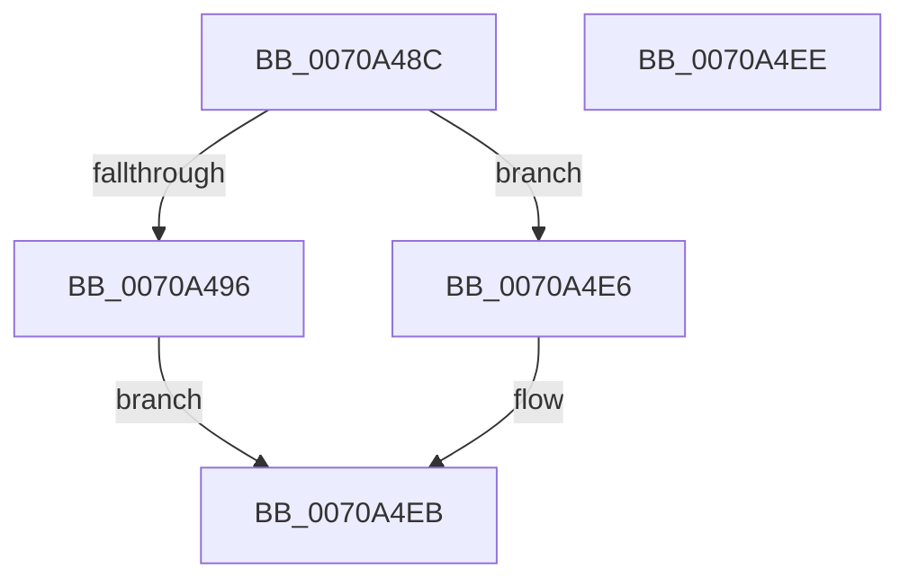

# HalpQuerySecondaryInterruptInformation

- RVA: `0x0070A48C`–`0x0070A4EF` (길이 `99` bytes)
- VA: `0x000000014070A48C`
- 실행 섹션: `PAGE`
- PDB 이름 있음: `예`; PDB Function 태그: `아니요`
- unwind 정보 RVA: `0x000DB714`
- 디코드: `23`개 명령, `99/99` bytes 표시
- 미해석 바이트: `0` (있으면 어셈블리에 `.byte`로 보존)

> 이 문서는 커널 이미지의 기계어와 PDB 기호를 분석해 생성했습니다. 4번과 5번은 함수 원형과 자료형을 바이너리 사용 방식에서 추정한 C 해석이며 원본 소스 복구 결과는 아닙니다.

## 1. Dependencies

- 직접 호출 지점: **0**; 고유 호출 대상: **0**
- 직접 호출자로 확인된 함수: **1**
- RIP 상대 이미지 참조: **8**

### Outgoing calls
- 직접 디코드된 call 명령이 없습니다.

### Direct callers
- [sub_00B80AC2](../../pagelk/B8/Unknown_function_00B80AC2.md) at `0x00B80B9E`

### Static image references
- `0x0070A48E` → RVA `0x00E10424` (`.data`; read)
- `0x0070A49B` → RVA `0x00F909DC` (`.data`; read)
- `0x0070A4A4` → RVA `0x00F90A30` (`.data`; read)
- `0x0070A4AD` → RVA `0x002D1DB0` (`HalpMaskInterrupt`; read)
- `0x0070A4B8` → RVA `0x002D1EE0` (`HalpUnmaskInterrupt`; read)
- `0x0070A4C3` → RVA `0x0047F8D0` (`HalpInvokeIsrForGsiv`; read)
- `0x0070A4CE` → RVA `0x00557230` (`HalpUnregisterSecondaryIcInterface`; read)
- `0x0070A4D9` → RVA `0x00544460` (`HalpInterruptRequestInterrupt`; read)

## 2. Other-region calls and transfers

- 다른 실행 섹션으로 향하는 call: **0**
- 별도 외부 분기/꼬리 이동을 확인하지 못했습니다.

## 3. Assembly (complete function range)

```asm
0070A48C  33 D2                           xor edx, edx
0070A48E  38 15 90 5F 70 00               cmp byte ptr [rip + 0x705f90], dl
0070A494  74 50                           je 0x14070a4e6
0070A496  66 C7 01 01 00                  mov word ptr [rcx], 1
0070A49B  8B 05 3B 65 88 00               mov eax, dword ptr [rip + 0x88653b]
0070A4A1  89 41 04                        mov dword ptr [rcx + 4], eax
0070A4A4  8B 05 86 65 88 00               mov eax, dword ptr [rip + 0x886586]
0070A4AA  89 41 08                        mov dword ptr [rcx + 8], eax
0070A4AD  48 8D 05 FC 78 BC FF            lea rax, [rip - 0x438704]
0070A4B4  48 89 41 10                     mov qword ptr [rcx + 0x10], rax
0070A4B8  48 8D 05 21 7A BC FF            lea rax, [rip - 0x4385df]
0070A4BF  48 89 41 18                     mov qword ptr [rcx + 0x18], rax
0070A4C3  48 8D 05 06 54 D7 FF            lea rax, [rip - 0x28abfa]
0070A4CA  48 89 41 20                     mov qword ptr [rcx + 0x20], rax
0070A4CE  48 8D 05 5B CD E4 FF            lea rax, [rip - 0x1b32a5]
0070A4D5  48 89 41 28                     mov qword ptr [rcx + 0x28], rax
0070A4D9  48 8D 05 80 9F E3 FF            lea rax, [rip - 0x1c6080]
0070A4E0  48 89 41 30                     mov qword ptr [rcx + 0x30], rax
0070A4E4  EB 05                           jmp 0x14070a4eb
0070A4E6  BA 01 00 00 C0                  mov edx, 0xc0000001
0070A4EB  8B C2                           mov eax, edx
0070A4ED  C3                              ret
0070A4EE  CC                              int3
```

## 4. C-style interpretation (structured pseudocode)

```c
__int64 __fastcall HalpQuerySecondaryInterruptInformation(__int64 a1, int a2)
{
    a2 = 0;
    if ((*(unsigned __int8 *)(v_rip + 7364496)) == 0) goto loc_0070A4E6;
    *(unsigned __int16 *)(a1) = 1;
    *(unsigned int *)(a1 + 4) = (unsigned int)((unsigned int)(*(unsigned int *)(v_rip + 8938811)));
    *(unsigned int *)(a1 + 8) = (unsigned int)((unsigned int)(*(unsigned int *)(v_rip + 8938886)));
    *(unsigned __int64 *)(a1 + 16) = v_rip - 4425476;
    *(unsigned __int64 *)(a1 + 24) = v_rip - 4425183;
    *(unsigned __int64 *)(a1 + 32) = v_rip - 2665466;
    *(unsigned __int64 *)(a1 + 40) = v_rip - 1782437;
    *(unsigned __int64 *)(a1 + 48) = v_rip - 1859712;
    goto loc_0070A4EB;
loc_0070A4E6:
loc_0070A4EB:
    return (unsigned int)((unsigned int)((unsigned int)(0xC0000001ULL)));
}
```

## 5. (Beta) C Style

```c
int64_t HalpQuerySecondaryInterruptInformation(void *Arg1, int32_t Arg2)
{
    uint8_t *arg1 = (uint8_t *)Arg1;

    Arg2 = 0;
    if ((*(uint8_t *)(v_rip + 0x705F90)) == 0) goto loc_0070A4E6;
    *(uint16_t *)(arg1) = 1;
    *(uint32_t *)(arg1 + 0x4) = (uint32_t)((uint32_t)(*(uint32_t *)(v_rip + 0x88653B)));
    *(uint32_t *)(arg1 + 0x8) = (uint32_t)((uint32_t)(*(uint32_t *)(v_rip + 0x886586)));
    *(uint64_t *)(arg1 + 0x10) = v_rip - 4425476;
    *(uint64_t *)(arg1 + 0x18) = v_rip - 4425183;
    *(uint64_t *)(arg1 + 0x20) = v_rip - 2665466;
    *(uint64_t *)(arg1 + 0x28) = v_rip - 1782437;
    *(uint64_t *)(arg1 + 0x30) = v_rip - 1859712;
    goto loc_0070A4EB;
loc_0070A4E6:
loc_0070A4EB:
    return (uint32_t)((uint32_t)((uint32_t)(0xC0000001ULL)));
}
```

### 관측된 메모리 오프셋

구조체 형식이 확인되지 않은 접근은 인자 기준의 오프셋으로만 기록했습니다.

| 기준 인자 | 오프셋 표현 | 폭 (bit) | 접근 |
|---|---:|---:|---|
| `Arg1` | `+ 0x0` | `16` | `W` |
| `Arg1` | `+ 0x4` | `32` | `W` |
| `Arg1` | `+ 0x8` | `32` | `W` |
| `Arg1` | `+ 0x10` | `64` | `W` |
| `Arg1` | `+ 0x18` | `64` | `W` |
| `Arg1` | `+ 0x20` | `64` | `W` |
| `Arg1` | `+ 0x28` | `64` | `W` |
| `Arg1` | `+ 0x30` | `64` | `W` |

## 6. Execution-region graph

[열기: 2D/3D 그래프와 함수 탐색 컨트롤 패널](../../../control-panel.html?section=page&rva=0x0070A48C&view=graph)

- 2D 그래프는 위에서 아래로 흐르고, 3D 그래프는 빈 공간을 드래그해 회전합니다. Shift+드래그는 이동, 휠은 확대·축소, 함수 노드 선택은 대상 보고서 이동입니다.

### Static fallback


