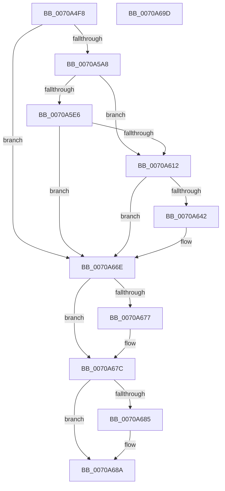

# HalpRecordSecondaryGsivRange

- RVA: `0x0070A4F8`–`0x0070A69E` (길이 `422` bytes)
- VA: `0x000000014070A4F8`
- 실행 섹션: `PAGE`
- PDB 이름 있음: `예`; PDB Function 태그: `아니요`
- unwind 정보 RVA: `0x000C45CC`
- 디코드: `94`개 명령, `422/422` bytes 표시
- 미해석 바이트: `0` (있으면 어셈블리에 `.byte`로 보존)

> 이 문서는 커널 이미지의 기계어와 PDB 기호를 분석해 생성했습니다. 4번과 5번은 함수 원형과 자료형을 바이너리 사용 방식에서 추정한 C 해석이며 원본 소스 복구 결과는 아닙니다.

## 1. Dependencies

- 직접 호출 지점: **7**; 고유 호출 대상: **4**
- 직접 호출자로 확인된 함수: **1**
- RIP 상대 이미지 참조: **6**

### Outgoing calls
- `0x0070A599` → [ZwOpenKey](../../text/6A/ZwOpenKey_function_006AD310.md) (function, `0x006AD310`)
- `0x0070A5DD` → [ZwOpenKey](../../text/6A/ZwOpenKey_function_006AD310.md) (function, `0x006AD310`)
- `0x0070A607` → [ZwCreateKey](../../text/6A/ZwCreateKey_function_006AD470.md) (function, `0x006AD470`)
- `0x0070A637` → [ZwSetValueKey](../../text/6A/ZwSetValueKey_function_006ADCD0.md) (function, `0x006ADCD0`)
- `0x0070A667` → [ZwSetValueKey](../../text/6A/ZwSetValueKey_function_006ADCD0.md) (function, `0x006ADCD0`)
- `0x0070A677` → [ZwClose](../../text/6A/ZwClose_function_006AD2B0.md) (function, `0x006AD2B0`)
- `0x0070A685` → [ZwClose](../../text/6A/ZwClose_function_006AD2B0.md) (function, `0x006AD2B0`)

### Direct callers
- [HalpInitializeSecondaryInterruptServices](../../init/C2/HalpInitializeSecondaryInterruptServices_function_00C21814.md) at `0x00C218EA`

### Static image references
- `0x0070A50E` → RVA `0x00025050` (`.rdata`; read)
- `0x0070A538` → RVA `0x00024FB0` (`.rdata`; read)
- `0x0070A54F` → RVA `0x00024FE0` (`.rdata`; read)
- `0x0070A55A` → RVA `0x00025078` (`.rdata`; read)
- `0x0070A616` → RVA `0x00F909DC` (`.data`; read)
- `0x0070A646` → RVA `0x00F90A30` (`.data`; read)

## 2. Other-region calls and transfers

- 다른 실행 섹션으로 향하는 call: **7**
  - `0x0070A599` → [ZwOpenKey](../../text/6A/ZwOpenKey_function_006AD310.md) (`PAGE` → `.text`)
  - `0x0070A5DD` → [ZwOpenKey](../../text/6A/ZwOpenKey_function_006AD310.md) (`PAGE` → `.text`)
  - `0x0070A607` → [ZwCreateKey](../../text/6A/ZwCreateKey_function_006AD470.md) (`PAGE` → `.text`)
  - `0x0070A637` → [ZwSetValueKey](../../text/6A/ZwSetValueKey_function_006ADCD0.md) (`PAGE` → `.text`)
  - `0x0070A667` → [ZwSetValueKey](../../text/6A/ZwSetValueKey_function_006ADCD0.md) (`PAGE` → `.text`)
  - `0x0070A677` → [ZwClose](../../text/6A/ZwClose_function_006AD2B0.md) (`PAGE` → `.text`)
  - `0x0070A685` → [ZwClose](../../text/6A/ZwClose_function_006AD2B0.md) (`PAGE` → `.text`)
- 별도 외부 분기/꼬리 이동을 확인하지 못했습니다.

## 3. Assembly (complete function range)

```asm
0070A4F8  48 89 5C 24 18                  mov qword ptr [rsp + 0x18], rbx
0070A4FD  55                              push rbp
0070A4FE  48 8D 6C 24 A9                  lea rbp, [rsp - 0x57]
0070A503  48 81 EC B0 00 00 00            sub rsp, 0xb0
0070A50A  83 65 43 00                     and dword ptr [rbp + 0x43], 0
0070A50E  48 8D 05 3B AB 91 FF            lea rax, [rip - 0x6e54c5]
0070A515  48 83 65 2F 00                  and qword ptr [rbp + 0x2f], 0
0070A51A  4C 8D 45 27                     lea r8, [rbp + 0x27]
0070A51E  48 83 65 6F 00                  and qword ptr [rbp + 0x6f], 0
0070A523  48 8D 4D 6F                     lea rcx, [rbp + 0x6f]
0070A527  48 83 65 67 00                  and qword ptr [rbp + 0x67], 0
0070A52C  0F 57 C0                        xorps xmm0, xmm0
0070A52F  48 89 45 0F                     mov qword ptr [rbp + 0xf], rax
0070A533  BA 19 00 02 00                  mov edx, 0x20019
0070A538  48 8D 05 71 AA 91 FF            lea rax, [rip - 0x6e558f]
0070A53F  48 C7 45 27 30 00 00 00         mov qword ptr [rbp + 0x27], 0x30
0070A547  83 65 2B 00                     and dword ptr [rbp + 0x2b], 0
0070A54B  48 89 45 1F                     mov qword ptr [rbp + 0x1f], rax
0070A54F  48 8D 05 8A AA 91 FF            lea rax, [rip - 0x6e5576]
0070A556  48 89 45 EF                     mov qword ptr [rbp - 0x11], rax
0070A55A  48 8D 05 17 AB 91 FF            lea rax, [rip - 0x6e54e9]
0070A561  48 89 45 FF                     mov qword ptr [rbp - 1], rax
0070A565  48 8D 45 E7                     lea rax, [rbp - 0x19]
0070A569  48 89 45 37                     mov qword ptr [rbp + 0x37], rax
0070A56D  48 C7 45 07 22 00 24 00         mov qword ptr [rbp + 7], 0x240022
0070A575  48 C7 45 17 22 00 24 00         mov qword ptr [rbp + 0x17], 0x240022
0070A57D  48 C7 45 E7 6C 00 6E 00         mov qword ptr [rbp - 0x19], 0x6e006c
0070A585  48 C7 45 F7 26 00 28 00         mov qword ptr [rbp - 9], 0x280026
0070A58D  C7 45 3F 40 02 00 00            mov dword ptr [rbp + 0x3f], 0x240
0070A594  F3 0F 7F 45 47                  movdqu xmmword ptr [rbp + 0x47], xmm0
0070A599  E8 72 2D FA FF                  call 0x1406ad310
0070A59E  8B D8                           mov ebx, eax
0070A5A0  85 C0                           test eax, eax
0070A5A2  0F 88 C6 00 00 00               js 0x14070a66e
0070A5A8  48 8B 45 6F                     mov rax, qword ptr [rbp + 0x6f]
0070A5AC  4C 8D 45 27                     lea r8, [rbp + 0x27]
0070A5B0  48 89 45 2F                     mov qword ptr [rbp + 0x2f], rax
0070A5B4  48 8D 4D 67                     lea rcx, [rbp + 0x67]
0070A5B8  48 8D 45 F7                     lea rax, [rbp - 9]
0070A5BC  C7 45 27 30 00 00 00            mov dword ptr [rbp + 0x27], 0x30
0070A5C3  0F 57 C0                        xorps xmm0, xmm0
0070A5C6  48 89 45 37                     mov qword ptr [rbp + 0x37], rax
0070A5CA  BB 02 00 00 00                  mov ebx, 2
0070A5CF  C7 45 3F 40 02 00 00            mov dword ptr [rbp + 0x3f], 0x240
0070A5D6  8B D3                           mov edx, ebx
0070A5D8  F3 0F 7F 45 47                  movdqu xmmword ptr [rbp + 0x47], xmm0
0070A5DD  E8 2E 2D FA FF                  call 0x1406ad310
0070A5E2  85 C0                           test eax, eax
0070A5E4  79 2C                           jns 0x14070a612
0070A5E6  48 83 64 24 30 00               and qword ptr [rsp + 0x30], 0
0070A5EC  4C 8D 45 27                     lea r8, [rbp + 0x27]
0070A5F0  C7 44 24 28 01 00 00 00         mov dword ptr [rsp + 0x28], 1
0070A5F8  48 8D 4D 67                     lea rcx, [rbp + 0x67]
0070A5FC  48 83 64 24 20 00               and qword ptr [rsp + 0x20], 0
0070A602  45 33 C9                        xor r9d, r9d
0070A605  8B D3                           mov edx, ebx
0070A607  E8 64 2E FA FF                  call 0x1406ad470
0070A60C  8B D8                           mov ebx, eax
0070A60E  85 C0                           test eax, eax
0070A610  78 5C                           js 0x14070a66e
0070A612  48 8B 4D 67                     mov rcx, qword ptr [rbp + 0x67]
0070A616  48 8D 05 BF 63 88 00            lea rax, [rip + 0x8863bf]
0070A61D  C7 44 24 28 04 00 00 00         mov dword ptr [rsp + 0x28], 4
0070A625  48 8D 55 07                     lea rdx, [rbp + 7]
0070A629  41 B9 04 00 00 00               mov r9d, 4
0070A62F  48 89 44 24 20                  mov qword ptr [rsp + 0x20], rax
0070A634  45 33 C0                        xor r8d, r8d
0070A637  E8 94 36 FA FF                  call 0x1406adcd0
0070A63C  8B D8                           mov ebx, eax
0070A63E  85 C0                           test eax, eax
0070A640  78 2C                           js 0x14070a66e
0070A642  48 8B 4D 67                     mov rcx, qword ptr [rbp + 0x67]
0070A646  48 8D 05 E3 63 88 00            lea rax, [rip + 0x8863e3]
0070A64D  C7 44 24 28 04 00 00 00         mov dword ptr [rsp + 0x28], 4
0070A655  48 8D 55 17                     lea rdx, [rbp + 0x17]
0070A659  41 B9 04 00 00 00               mov r9d, 4
0070A65F  48 89 44 24 20                  mov qword ptr [rsp + 0x20], rax
0070A664  45 33 C0                        xor r8d, r8d
0070A667  E8 64 36 FA FF                  call 0x1406adcd0
0070A66C  8B D8                           mov ebx, eax
0070A66E  48 8B 4D 67                     mov rcx, qword ptr [rbp + 0x67]
0070A672  48 85 C9                        test rcx, rcx
0070A675  74 05                           je 0x14070a67c
0070A677  E8 34 2C FA FF                  call 0x1406ad2b0
0070A67C  48 8B 4D 6F                     mov rcx, qword ptr [rbp + 0x6f]
0070A680  48 85 C9                        test rcx, rcx
0070A683  74 05                           je 0x14070a68a
0070A685  E8 26 2C FA FF                  call 0x1406ad2b0
0070A68A  8B C3                           mov eax, ebx
0070A68C  48 8B 9C 24 D0 00 00 00         mov rbx, qword ptr [rsp + 0xd0]
0070A694  48 81 C4 B0 00 00 00            add rsp, 0xb0
0070A69B  5D                              pop rbp
0070A69C  C3                              ret
0070A69D  CC                              int3
```

## 4. C-style interpretation (structured pseudocode)

```c
__int64 __fastcall HalpRecordSecondaryGsivRange(__int64 a1, __int64 a2, __int64 a3, int a4)
{
    __int64 result;
    __int64 v_rbx;
    __int64 v_rsp;
    unsigned __int64 v_stack_m18;
    unsigned int v_stack_m1C;
    unsigned int v_stack_m20;
    unsigned __int64 v_stack_m28;
    unsigned __int64 v_stack_m30;
    unsigned int v_stack_m34;
    unsigned __int64 v_stack_m38;
    unsigned __int64 v_stack_m40;
    unsigned __int64 v_stack_m48;
    unsigned __int64 v_stack_m50;
    unsigned __int64 v_stack_m58;
    unsigned __int64 v_stack_m5F;
    unsigned __int64 v_stack_m60;
    unsigned __int64 v_stack_m68;
    unsigned __int64 v_stack_m70;
    unsigned __int64 v_stack_m78;
    unsigned __int64 v_stack_m88;
    unsigned int v_stack_m90;
    unsigned __int64 v_stack_m98;
    unsigned __int64 v_stack_p10;
    unsigned __int64 v_stack_p18;
    unsigned __int64 v_stack_p8;

    v_stack_p18 = v_rbx;
    v_rsp = (v_rsp) - (176);
    v_stack_m50 = v_rip - 7230661;
    v_stack_m38 = 48;
    v_stack_m40 = v_rip - 7230863;
    v_stack_m70 = v_rip - 7230838;
    v_stack_m60 = v_rip - 7230697;
    v_stack_m28 = v_stack_m78;
    v_stack_m58 = 0x240022ULL;
    v_stack_m48 = 0x240022ULL;
    v_stack_m78 = 0x6E006CULL;
    v_stack_m68 = 0x280026ULL;
    v_stack_m20 = 576;
    v_stack_m18 = v_xmm0;
    result = ZwOpenKey(v_stack_p10, (unsigned int)(0x20019ULL), v_stack_m38, a4);
    if (sign_flag) goto loc_0070A66E;
    v_stack_m30 = v_stack_p10;
    v_stack_m38 = 48;
    v_stack_m28 = v_stack_m68;
    v_stack_m20 = 576;
    v_stack_m18 = v_xmm0;
    result = ZwOpenKey(v_stack_p8, 2, v_stack_m38, a4);
    if (!sign_flag) goto loc_0070A612;
    v_stack_m90 = 1;
    a4 = 0;
    result = ZwCreateKey(v_stack_p8, 2, v_stack_m38, a4);
    if (sign_flag) goto loc_0070A66E;
loc_0070A612:
    v_stack_m90 = 4;
    v_stack_m98 = v_rip + 8938431;
    a3 = 0;
    result = ZwSetValueKey(v_stack_p8, v_stack_m58, a3, 4);
    v_rbx = (unsigned int)((unsigned int)(result));
    if (!(sign_flag)) {
        a1 = v_stack_p8;
        result = v_rip + 8938467;
        v_stack_m90 = 4;
        a2 = v_stack_m48;
        a4 = 4;
        v_stack_m98 = result;
        a3 = 0;
        result = ZwSetValueKey(a1, a2, a3, a4);
        v_rbx = (unsigned int)(result);
    }
    if (v_stack_p8 != 0) {
        result = ZwClose(v_stack_p8, a2, a3, a4);
    }
    if (v_stack_p10 != 0) {
        result = ZwClose(v_stack_p10, a2, a3, a4);
    }
    v_rsp = (v_rsp) + (176);
    return (unsigned int)((unsigned int)(v_rbx));
}
```

## 5. (Beta) C Style

```c
int64_t HalpRecordSecondaryGsivRange(int64_t Arg1, int64_t Arg2, int64_t Arg3, int32_t Arg4)
{
    int64_t result;
    int64_t local_rbx;
    int64_t local_rsp;
    uint64_t v_stack_m18;
    uint32_t v_stack_m1C;
    uint32_t v_stack_m20;
    uint64_t v_stack_m28;
    uint64_t v_stack_m30;
    uint32_t v_stack_m34;
    uint64_t v_stack_m38;
    uint64_t v_stack_m40;
    uint64_t v_stack_m48;
    uint64_t v_stack_m50;
    uint64_t v_stack_m58;
    uint64_t v_stack_m5F;
    uint64_t v_stack_m60;
    uint64_t v_stack_m68;
    uint64_t v_stack_m70;
    uint64_t v_stack_m78;
    uint64_t v_stack_m88;
    uint32_t v_stack_m90;
    uint64_t v_stack_m98;
    uint64_t v_stack_p10;
    uint64_t v_stack_p18;
    uint64_t v_stack_p8;

    v_stack_p18 = local_rbx;
    local_rsp = (local_rsp) - (176);
    v_stack_m50 = v_rip - 7230661;
    v_stack_m38 = 48;
    v_stack_m40 = v_rip - 7230863;
    v_stack_m70 = v_rip - 7230838;
    v_stack_m60 = v_rip - 7230697;
    v_stack_m28 = v_stack_m78;
    v_stack_m58 = 0x240022ULL;
    v_stack_m48 = 0x240022ULL;
    v_stack_m78 = 0x6E006CULL;
    v_stack_m68 = 0x280026ULL;
    v_stack_m20 = 576;
    v_stack_m18 = v_xmm0;
    result = ZwOpenKey(v_stack_p10, (uint32_t)(0x20019ULL), v_stack_m38, Arg4);
    if (sign_flag) goto loc_0070A66E;
    v_stack_m30 = v_stack_p10;
    v_stack_m38 = 48;
    v_stack_m28 = v_stack_m68;
    v_stack_m20 = 576;
    v_stack_m18 = v_xmm0;
    result = ZwOpenKey(v_stack_p8, 2, v_stack_m38, Arg4);
    if (!sign_flag) goto loc_0070A612;
    v_stack_m90 = 1;
    Arg4 = 0;
    result = ZwCreateKey(v_stack_p8, 2, v_stack_m38, Arg4);
    if (sign_flag) goto loc_0070A66E;
loc_0070A612:
    v_stack_m90 = 4;
    v_stack_m98 = v_rip + 8938431;
    Arg3 = 0;
    result = ZwSetValueKey(v_stack_p8, v_stack_m58, Arg3, 4);
    local_rbx = (uint32_t)((uint32_t)(result));
    if (!(sign_flag)) {
        Arg1 = v_stack_p8;
        result = v_rip + 8938467;
        v_stack_m90 = 4;
        Arg2 = v_stack_m48;
        Arg4 = 4;
        v_stack_m98 = result;
        Arg3 = 0;
        result = ZwSetValueKey(Arg1, Arg2, Arg3, Arg4);
        local_rbx = (uint32_t)(result);
    }
    if (v_stack_p8 != 0) {
        result = ZwClose(v_stack_p8, Arg2, Arg3, Arg4);
    }
    if (v_stack_p10 != 0) {
        result = ZwClose(v_stack_p10, Arg2, Arg3, Arg4);
    }
    local_rsp = (local_rsp) + (176);
    return (uint32_t)((uint32_t)(local_rbx));
}
```

## 6. Execution-region graph

[열기: 2D/3D 그래프와 함수 탐색 컨트롤 패널](../../../control-panel.html?section=page&rva=0x0070A4F8&view=graph)

- 2D 그래프는 위에서 아래로 흐르고, 3D 그래프는 빈 공간을 드래그해 회전합니다. Shift+드래그는 이동, 휠은 확대·축소, 함수 노드 선택은 대상 보고서 이동입니다.

### Static fallback


