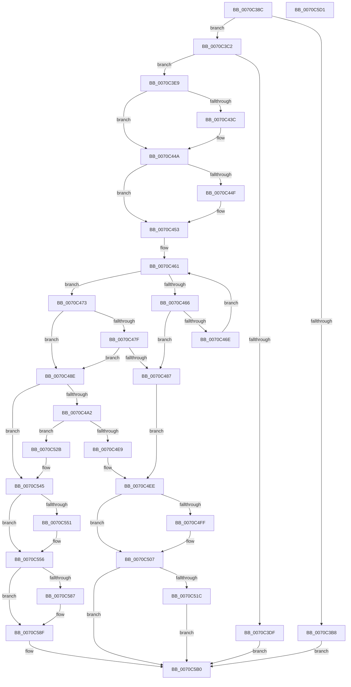

# HalpRegisterPmuNotification

- RVA: `0x0070C38C`–`0x0070C5D2` (길이 `582` bytes)
- VA: `0x000000014070C38C`
- 실행 섹션: `PAGE`
- PDB 이름 있음: `예`; PDB Function 태그: `아니요`
- unwind 정보 RVA: `0x000C4D00`
- 디코드: `145`개 명령, `582/582` bytes 표시
- 미해석 바이트: `0` (있으면 어셈블리에 `.byte`로 보존)

> 이 문서는 커널 이미지의 기계어와 PDB 기호를 분석해 생성했습니다. 4번과 5번은 함수 원형과 자료형을 바이너리 사용 방식에서 추정한 C 해석이며 원본 소스 복구 결과는 아닙니다.

## 1. Dependencies

- 직접 호출 지점: **15**; 고유 호출 대상: **12**
- 직접 호출자로 확인된 함수: **1**
- RIP 상대 이미지 참조: **16**

### Outgoing calls
- `0x0070C3D2` → [ExAllocatePool2](../../poolcode/B8/ExAllocatePool2_function_00B820F0.md) (function, `0x00B820F0`)
- `0x0070C42B` → [KeAbPreAcquire](../../text/21/KeAbPreAcquire_function_00210230.md) (function, `0x00210230`)
- `0x0070C445` → [ExfAcquirePushLockExclusiveEx](../../text/20/ExfAcquirePushLockExclusiveEx_function_0020FC90.md) (function, `0x0020FC90`)
- `0x0070C4D5` → [ExAllocateTimer](../../text/3A/ExAllocateTimer_function_003A30D0.md) (function, `0x003A30D0`)
- `0x0070C502` → [ExfTryToWakePushLock](../../text/26/ExfTryToWakePushLock_function_00265DD0.md) (function, `0x00265DD0`)
- `0x0070C50A` → [KeAbPostRelease](../../text/2E/KeAbPostRelease_function_002E1600.md) (function, `0x002E1600`)
- `0x0070C50F` → [KeLeaveCriticalRegion](../../text/25/KeLeaveCriticalRegion_function_0025D8B0.md) (function, `0x0025D8B0`)
- `0x0070C521` → [ExFreePoolWithTag](../../poolcode/B8/ExFreePoolWithTag_function_00B82870.md) (function, `0x00B82870`)
- `0x0070C540` → [ExSetTimer](../../text/3A/ExSetTimer_function_003A0800.md) (function, `0x003A0800`)
- `0x0070C571` → [ExAcquireRundownProtection](../../text/21/ExAcquireRundownProtection_function_00216620.md) (function, `0x00216620`)
- `0x0070C58A` → [ExfTryToWakePushLock](../../text/26/ExfTryToWakePushLock_function_00265DD0.md) (function, `0x00265DD0`)
- `0x0070C592` → [KeAbPostRelease](../../text/2E/KeAbPostRelease_function_002E1600.md) (function, `0x002E1600`)
- `0x0070C597` → [KeLeaveCriticalRegion](../../text/25/KeLeaveCriticalRegion_function_0025D8B0.md) (function, `0x0025D8B0`)
- `0x0070C5A1` → [HalpNotifyActorIfPmuAvailable](HalpNotifyActorIfPmuAvailable_function_00707880.md) (function, `0x00707880`)
- `0x0070C5A9` → [ExReleaseRundownProtection](../../text/34/ExReleaseRundownProtection_function_00349E80.md) (function, `0x00349E80`)

### Direct callers
- [HalpSetSystemInformation](../AB/HalpSetSystemInformation_function_00AB0850.md) at `0x00AB08D1`

### Static image references
- `0x0070C3F5` → RVA `0x00FC2B40` (`.data`; read)
- `0x0070C453` → RVA `0x00FC2B58` (`.data`; read)
- `0x0070C473` → RVA `0x00FC2BB0` (`.data`; read)
- `0x0070C48E` → RVA `0x00FC2B50` (`.data`; read)
- `0x0070C4A2` → RVA `0x00FC2B90` (`.data`; read/write)
- `0x0070C4AA` → RVA `0x00707B90` (`HalpPmuArbiterPeriodicWorkItem`; read)
- `0x0070C4B1` → RVA `0x00FC2B78` (`.data`; read/write)
- `0x0070C4B9` → RVA `0x00547540` (`HalpPmuArbiterPeriodicTimerCallback`; read)
- `0x0070C4C2` → RVA `0x00FC2B88` (`.data`; write)
- `0x0070C4CF` → RVA `0x00FC2B50` (`.data`; write)
- `0x0070C4DA` → RVA `0x00FC2B70` (`.data`; write)
- `0x0070C4EE` → RVA `0x00FC2B40` (`.data`; read/write)
- `0x0070C52B` → RVA `0x00FC2BC0` (`.data`; read)
- `0x0070C545` → RVA `0x00FC2B60` (`.data`; read)
- `0x0070C563` → RVA `0x00FC2B68` (`.data`; read/write)
- `0x0070C56A` → RVA `0x00FC2B60` (`.data`; write)

## 2. Other-region calls and transfers

- 다른 실행 섹션으로 향하는 call: **14**
  - `0x0070C3D2` → [ExAllocatePool2](../../poolcode/B8/ExAllocatePool2_function_00B820F0.md) (`PAGE` → `POOLCODE`)
  - `0x0070C42B` → [KeAbPreAcquire](../../text/21/KeAbPreAcquire_function_00210230.md) (`PAGE` → `.text`)
  - `0x0070C445` → [ExfAcquirePushLockExclusiveEx](../../text/20/ExfAcquirePushLockExclusiveEx_function_0020FC90.md) (`PAGE` → `.text`)
  - `0x0070C4D5` → [ExAllocateTimer](../../text/3A/ExAllocateTimer_function_003A30D0.md) (`PAGE` → `.text`)
  - `0x0070C502` → [ExfTryToWakePushLock](../../text/26/ExfTryToWakePushLock_function_00265DD0.md) (`PAGE` → `.text`)
  - `0x0070C50A` → [KeAbPostRelease](../../text/2E/KeAbPostRelease_function_002E1600.md) (`PAGE` → `.text`)
  - `0x0070C50F` → [KeLeaveCriticalRegion](../../text/25/KeLeaveCriticalRegion_function_0025D8B0.md) (`PAGE` → `.text`)
  - `0x0070C521` → [ExFreePoolWithTag](../../poolcode/B8/ExFreePoolWithTag_function_00B82870.md) (`PAGE` → `POOLCODE`)
  - `0x0070C540` → [ExSetTimer](../../text/3A/ExSetTimer_function_003A0800.md) (`PAGE` → `.text`)
  - `0x0070C571` → [ExAcquireRundownProtection](../../text/21/ExAcquireRundownProtection_function_00216620.md) (`PAGE` → `.text`)
  - `0x0070C58A` → [ExfTryToWakePushLock](../../text/26/ExfTryToWakePushLock_function_00265DD0.md) (`PAGE` → `.text`)
  - `0x0070C592` → [KeAbPostRelease](../../text/2E/KeAbPostRelease_function_002E1600.md) (`PAGE` → `.text`)
  - `0x0070C597` → [KeLeaveCriticalRegion](../../text/25/KeLeaveCriticalRegion_function_0025D8B0.md) (`PAGE` → `.text`)
  - `0x0070C5A9` → [ExReleaseRundownProtection](../../text/34/ExReleaseRundownProtection_function_00349E80.md) (`PAGE` → `.text`)
- 별도 외부 분기/꼬리 이동을 확인하지 못했습니다.

## 3. Assembly (complete function range)

```asm
0070C38C  48 8B C4                        mov rax, rsp
0070C38F  48 89 58 08                     mov qword ptr [rax + 8], rbx
0070C393  48 89 68 10                     mov qword ptr [rax + 0x10], rbp
0070C397  48 89 70 18                     mov qword ptr [rax + 0x18], rsi
0070C39B  48 89 78 20                     mov qword ptr [rax + 0x20], rdi
0070C39F  41 54                           push r12
0070C3A1  41 55                           push r13
0070C3A3  41 56                           push r14
0070C3A5  48 83 EC 20                     sub rsp, 0x20
0070C3A9  41 BD 01 00 00 00               mov r13d, 1
0070C3AF  48 8B F9                        mov rdi, rcx
0070C3B2  66 44 39 29                     cmp word ptr [rcx], r13w
0070C3B6  74 0A                           je 0x14070c3c2
0070C3B8  BF 59 00 00 C0                  mov edi, 0xc0000059
0070C3BD  E9 EE 01 00 00                  jmp 0x14070c5b0
0070C3C2  BA 40 00 00 00                  mov edx, 0x40
0070C3C7  B9 00 01 00 00                  mov ecx, 0x100
0070C3CC  41 B8 50 72 6F 66               mov r8d, 0x666f7250
0070C3D2  E8 19 5D 47 00                  call 0x140b820f0
0070C3D7  48 8B F0                        mov rsi, rax
0070C3DA  48 85 C0                        test rax, rax
0070C3DD  75 0A                           jne 0x14070c3e9
0070C3DF  BF 17 00 00 C0                  mov edi, 0xc0000017
0070C3E4  E9 C7 01 00 00                  jmp 0x14070c5b0
0070C3E9  48 8B 47 08                     mov rax, qword ptr [rdi + 8]
0070C3ED  4C 8D 76 30                     lea r14, [rsi + 0x30]
0070C3F1  48 89 46 10                     mov qword ptr [rsi + 0x10], rax
0070C3F5  4C 8D 25 44 67 8B 00            lea r12, [rip + 0x8b6744]
0070C3FC  48 8B 47 10                     mov rax, qword ptr [rdi + 0x10]
0070C400  48 83 CB FF                     or rbx, 0xffffffffffffffff
0070C404  48 89 46 18                     mov qword ptr [rsi + 0x18], rax
0070C408  45 33 C0                        xor r8d, r8d
0070C40B  8B 47 04                        mov eax, dword ptr [rdi + 4]
0070C40E  33 D2                           xor edx, edx
0070C410  49 83 26 00                     and qword ptr [r14], 0
0070C414  49 8B CC                        mov rcx, r12
0070C417  89 46 20                        mov dword ptr [rsi + 0x20], eax
0070C41A  65 48 8B 04 25 88 01 00 00      mov rax, qword ptr gs:[0x188]
0070C423  66 01 98 E4 01 00 00            add word ptr [rax + 0x1e4], bx
0070C42A  90                              nop
0070C42B  E8 00 3E B0 FF                  call 0x140210230
0070C430  F0 49 0F BA 2C 24 00            lock bts qword ptr [r12], 0
0070C437  48 8B E8                        mov rbp, rax
0070C43A  73 0E                           jae 0x14070c44a
0070C43C  4D 8B C4                        mov r8, r12
0070C43F  48 8B D0                        mov rdx, rax
0070C442  49 8B CC                        mov rcx, r12
0070C445  E8 46 38 B0 FF                  call 0x14020fc90
0070C44A  48 85 ED                        test rbp, rbp
0070C44D  74 04                           je 0x14070c453
0070C44F  44 88 6D 0A                     mov byte ptr [rbp + 0xa], r13b
0070C453  48 8B 0D FE 66 8B 00            mov rcx, qword ptr [rip + 0x8b66fe]
0070C45A  48 8D 2D F7 66 8B 00            lea rbp, [rip + 0x8b66f7]
0070C461  48 3B CD                        cmp rcx, rbp
0070C464  74 0D                           je 0x14070c473
0070C466  8B 47 04                        mov eax, dword ptr [rdi + 4]
0070C469  39 41 20                        cmp dword ptr [rcx + 0x20], eax
0070C46C  74 19                           je 0x14070c487
0070C46E  48 8B 09                        mov rcx, qword ptr [rcx]
0070C471  EB EE                           jmp 0x14070c461
0070C473  48 8B 0D 36 67 8B 00            mov rcx, qword ptr [rip + 0x8b6736]
0070C47A  48 85 C9                        test rcx, rcx
0070C47D  74 0F                           je 0x14070c48e
0070C47F  8B 47 04                        mov eax, dword ptr [rdi + 4]
0070C482  39 41 20                        cmp dword ptr [rcx + 0x20], eax
0070C485  75 07                           jne 0x14070c48e
0070C487  BF 0D 00 00 C0                  mov edi, 0xc000000d
0070C48C  EB 60                           jmp 0x14070c4ee
0070C48E  8B 05 BC 66 8B 00               mov eax, dword ptr [rip + 0x8b66bc]
0070C494  BF 03 00 00 00                  mov edi, 3
0070C499  41 3B C5                        cmp eax, r13d
0070C49C  0F 85 A3 00 00 00               jne 0x14070c545
0070C4A2  48 83 25 E6 66 8B 00 00         and qword ptr [rip + 0x8b66e6], 0
0070C4AA  48 8D 05 DF B6 FF FF            lea rax, [rip - 0x4921]
0070C4B1  48 83 25 BF 66 8B 00 00         and qword ptr [rip + 0x8b66bf], 0
0070C4B9  48 8D 0D 80 B0 E3 FF            lea rcx, [rip - 0x1c4f80]
0070C4C0  33 D2                           xor edx, edx
0070C4C2  48 89 05 BF 66 8B 00            mov qword ptr [rip + 0x8b66bf], rax
0070C4C9  41 B8 00 00 00 80               mov r8d, 0x80000000
0070C4CF  89 3D 7B 66 8B 00               mov dword ptr [rip + 0x8b667b], edi
0070C4D5  E8 F6 6B C9 FF                  call 0x1403a30d0
0070C4DA  48 89 05 8F 66 8B 00            mov qword ptr [rip + 0x8b668f], rax
0070C4E1  48 8B C8                        mov rcx, rax
0070C4E4  48 85 C0                        test rax, rax
0070C4E7  75 42                           jne 0x14070c52b
0070C4E9  BF 9A 00 00 C0                  mov edi, 0xc000009a
0070C4EE  F0 48 0F C1 1D 49 66 8B 00      lock xadd qword ptr [rip + 0x8b6649], rbx
0070C4F7  80 E3 06                        and bl, 6
0070C4FA  80 FB 02                        cmp bl, 2
0070C4FD  75 08                           jne 0x14070c507
0070C4FF  49 8B CC                        mov rcx, r12
0070C502  E8 C9 98 B5 FF                  call 0x140265dd0
0070C507  49 8B CC                        mov rcx, r12
0070C50A  E8 F1 50 BD FF                  call 0x1402e1600
0070C50F  E8 9C 13 B5 FF                  call 0x14025d8b0
0070C514  85 FF                           test edi, edi
0070C516  0F 89 94 00 00 00               jns 0x14070c5b0
0070C51C  33 D2                           xor edx, edx
0070C51E  48 8B CE                        mov rcx, rsi
0070C521  E8 4A 63 47 00                  call 0x140b82870
0070C526  E9 85 00 00 00                  jmp 0x14070c5b0
0070C52B  69 05 8B 66 8B 00 10 27 00 00   imul eax, dword ptr [rip + 0x8b668b], 0x2710
0070C535  45 33 C9                        xor r9d, r9d
0070C538  8B D0                           mov edx, eax
0070C53A  48 F7 DA                        neg rdx
0070C53D  44 8B C0                        mov r8d, eax
0070C540  E8 BB 42 C9 FF                  call 0x1403a0800
0070C545  48 8B 05 14 66 8B 00            mov rax, qword ptr [rip + 0x8b6614]
0070C54C  48 39 28                        cmp qword ptr [rax], rbp
0070C54F  74 05                           je 0x14070c556
0070C551  48 8B CF                        mov rcx, rdi
0070C554  CD 29                           int 0x29
0070C556  48 89 2E                        mov qword ptr [rsi], rbp
0070C559  49 8B CE                        mov rcx, r14
0070C55C  48 89 46 08                     mov qword ptr [rsi + 8], rax
0070C560  48 89 30                        mov qword ptr [rax], rsi
0070C563  44 01 2D FE 65 8B 00            add dword ptr [rip + 0x8b65fe], r13d
0070C56A  48 89 35 EF 65 8B 00            mov qword ptr [rip + 0x8b65ef], rsi
0070C571  E8 AA A0 B0 FF                  call 0x140216620
0070C576  F0 48 0F C1 1D C1 65 8B 00      lock xadd qword ptr [rip + 0x8b65c1], rbx
0070C57F  80 E3 06                        and bl, 6
0070C582  80 FB 02                        cmp bl, 2
0070C585  75 08                           jne 0x14070c58f
0070C587  49 8B CC                        mov rcx, r12
0070C58A  E8 41 98 B5 FF                  call 0x140265dd0
0070C58F  49 8B CC                        mov rcx, r12
0070C592  E8 69 50 BD FF                  call 0x1402e1600
0070C597  E8 14 13 B5 FF                  call 0x14025d8b0
0070C59C  33 D2                           xor edx, edx
0070C59E  48 8B CE                        mov rcx, rsi
0070C5A1  E8 DA B2 FF FF                  call 0x140707880
0070C5A6  49 8B CE                        mov rcx, r14
0070C5A9  E8 D2 D8 C3 FF                  call 0x140349e80
0070C5AE  33 FF                           xor edi, edi
0070C5B0  48 8B 5C 24 40                  mov rbx, qword ptr [rsp + 0x40]
0070C5B5  8B C7                           mov eax, edi
0070C5B7  48 8B 7C 24 58                  mov rdi, qword ptr [rsp + 0x58]
0070C5BC  48 8B 6C 24 48                  mov rbp, qword ptr [rsp + 0x48]
0070C5C1  48 8B 74 24 50                  mov rsi, qword ptr [rsp + 0x50]
0070C5C6  48 83 C4 20                     add rsp, 0x20
0070C5CA  41 5E                           pop r14
0070C5CC  41 5D                           pop r13
0070C5CE  41 5C                           pop r12
0070C5D0  C3                              ret
0070C5D1  CC                              int3
```

## 4. C-style interpretation (structured pseudocode)

```c
__int64 __fastcall HalpRegisterPmuNotification(__int64 a1, __int64 a2, __int64 a3, int a4)
{
    __int64 result;
    __int64 v_rbx;
    __int64 v_rdi;
    __int64 v_rsp;
    unsigned __int64 v_stack_p10;
    unsigned __int64 v_stack_p18;
    unsigned __int64 v_stack_p20;
    unsigned __int64 v_stack_p8;

    *(unsigned __int64 *)(v_rsp + 8) = v_rbx;
    *(unsigned __int64 *)(v_rsp + 16) = v_rbp;
    *(unsigned __int64 *)(v_rsp + 24) = v_rsi;
    *(unsigned __int64 *)(v_rsp + 32) = v_rdi;
    v_rsp = (v_rsp) - (32);
    if ((*(unsigned __int16 *)(a1)) == 1) goto loc_0070C3C2;
    goto loc_0070C5B0;
loc_0070C3C2:
    result = ExAllocatePool2(256, 64, (unsigned int)(0x666F7250ULL), a4);
    if (result != 0) goto loc_0070C3E9;
    goto loc_0070C5B0;
loc_0070C3E9:
    *(unsigned __int64 *)(result + 16) = *(unsigned __int64 *)((unsigned int)(0xC0000017ULL) + 8);
    v_rbx = (v_rbx) | (-1);
    *(unsigned __int64 *)(result + 24) = *(unsigned __int64 *)((unsigned int)(0xC0000017ULL) + 16);
    a3 = 0;
    a2 = 0;
    *(unsigned int *)(result + 32) = (unsigned int)((unsigned int)(*(unsigned int *)((unsigned int)(0xC0000017ULL) + 4)));
    result = KeAbPreAcquire(v_rip + 9135940, a2, a3, a4);
    if (!(condition_is_above_or_equal)) {
        a3 = v_rip + 9135940;
        a2 = result;
        a1 = v_rip + 9135940;
        result = ExfAcquirePushLockExclusiveEx(a1, a2, a3, a4);
    }
    if (result != 0) {
        *(unsigned __int8 *)(result + 10) = 1;
    }
loc_0070C461:
    if ((*(unsigned __int64 *)(v_rip + 9135870)) == (v_rip + 9135863)) goto loc_0070C473;
    if ((*(unsigned int *)(*(unsigned __int64 *)(v_rip + 9135870) + 32)) == ((unsigned int)((unsigned int)(*(unsigned int *)((unsigned int)(0xC0000017ULL) + 4))))) goto loc_0070C487;
    goto loc_0070C461;
loc_0070C473:
    if (*(unsigned __int64 *)(v_rip + 9135926) == 0) goto loc_0070C48E;
    if ((*(unsigned int *)(*(unsigned __int64 *)(v_rip + 9135926) + 32)) != ((unsigned int)((unsigned int)(*(unsigned int *)((unsigned int)(0xC0000017ULL) + 4))))) goto loc_0070C48E;
loc_0070C487:
    goto loc_0070C4EE;
loc_0070C48E:
    if (((unsigned int)((unsigned int)(*(unsigned int *)(v_rip + 9135804)))) != 1) goto loc_0070C545;
    a2 = 0;
    *(unsigned __int64 *)(v_rip + 9135807) = v_rip - 18721;
    *(unsigned int *)(v_rip + 9135739) = 3;
    result = ExAllocateTimer(v_rip - 1855360, a2, (unsigned int)(0x80000000ULL), a4);
    *(unsigned __int64 *)(v_rip + 9135759) = result;
    if (result != 0) goto loc_0070C52B;
loc_0070C4EE:
    v_rbx = (unsigned __int8)((v_rbx) & (6));
    if (((unsigned __int8)(v_rbx)) == 2) {
        a1 = v_rip + 9135940;
        result = ExfTryToWakePushLock(a1, a2, (unsigned int)(0x80000000ULL), a4);
    }
    result = KeAbPostRelease(v_rip + 9135940, a2, (unsigned int)(0x80000000ULL), a4);
    result = KeLeaveCriticalRegion(v_rip + 9135940, a2, (unsigned int)(0x80000000ULL), a4);
    if (!sign_flag) goto loc_0070C5B0;
    a2 = 0;
    result = ExFreePoolWithTag(result, a2, (unsigned int)(0x80000000ULL), a4);
    goto loc_0070C5B0;
loc_0070C52B:
    result = (unsigned int)((result) * (*(unsigned int *)(v_rip + 9135755)));
    a4 = 0;
    a2 = -((unsigned int)((unsigned int)(result)));
    result = ExSetTimer(result, a2, (unsigned int)((unsigned int)(result)), a4);
loc_0070C545:
    if ((*(unsigned __int64 *)(*(unsigned __int64 *)(v_rip + 9135636))) != (v_rip + 9135863)) {
        a1 = (unsigned int)(0xC000009AULL);
    }
    *(unsigned __int64 *)(result) = v_rip + 9135863;
    *(unsigned __int64 *)(result + 8) = *(unsigned __int64 *)(v_rip + 9135636);
    *(unsigned __int64 *)(*(unsigned __int64 *)(v_rip + 9135636)) = result;
    *(unsigned __int64 *)(v_rip + 9135599) = result;
    result = ExAcquireRundownProtection(result + 48, a2, (unsigned int)((unsigned int)(result)), a4);
    v_rbx = (unsigned __int8)((v_rbx) & (6));
    if (((unsigned __int8)(v_rbx)) == 2) {
        a1 = v_rip + 9135940;
        result = ExfTryToWakePushLock(a1, a2, (unsigned int)((unsigned int)(result)), a4);
    }
    result = KeAbPostRelease(v_rip + 9135940, a2, (unsigned int)((unsigned int)(result)), a4);
    result = KeLeaveCriticalRegion(v_rip + 9135940, a2, (unsigned int)((unsigned int)(result)), a4);
    a2 = 0;
    result = HalpNotifyActorIfPmuAvailable(result, a2, (unsigned int)((unsigned int)(result)), a4);
    result = ExReleaseRundownProtection(result + 48, a2, (unsigned int)((unsigned int)(result)), a4);
    v_rdi = 0;
loc_0070C5B0:
    v_rsp = (v_rsp) + (32);
    return 0;
}
```

## 5. (Beta) C Style

```c
int64_t HalpRegisterPmuNotification(void *Arg1, int64_t Arg2, int64_t Arg3, int32_t Arg4)
{
    uint8_t *arg1 = (uint8_t *)Arg1;

    int64_t result;
    int64_t local_rbx;
    int64_t local_rdi;
    int64_t local_rsp;
    uint64_t v_stack_p10;
    uint64_t v_stack_p18;
    uint64_t v_stack_p20;
    uint64_t v_stack_p8;

    *(uint64_t *)(local_rsp + 0x8) = local_rbx;
    *(uint64_t *)(local_rsp + 0x10) = local_rbp;
    *(uint64_t *)(local_rsp + 0x18) = local_rsi;
    *(uint64_t *)(local_rsp + 0x20) = local_rdi;
    local_rsp = (local_rsp) - (32);
    if ((*(uint16_t *)(arg1)) == 1) goto loc_0070C3C2;
    goto loc_0070C5B0;
loc_0070C3C2:
    result = ExAllocatePool2(256, 64, (uint32_t)(0x666F7250ULL), Arg4);
    if (result != 0) goto loc_0070C3E9;
    goto loc_0070C5B0;
loc_0070C3E9:
    *(uint64_t *)(result + 0x10) = *(uint64_t *)((uint32_t)(0xC0000017ULL) + 0x8);
    local_rbx = (local_rbx) | (-1);
    *(uint64_t *)(result + 0x18) = *(uint64_t *)((uint32_t)(0xC0000017ULL) + 0x10);
    Arg3 = 0;
    Arg2 = 0;
    *(uint32_t *)(result + 0x20) = (uint32_t)((uint32_t)(*(uint32_t *)((uint32_t)(0xC0000017ULL) + 0x4)));
    result = KeAbPreAcquire(v_rip + 9135940, Arg2, Arg3, Arg4);
    if (!(condition_is_above_or_equal)) {
        Arg3 = v_rip + 9135940;
        Arg2 = result;
        Arg1 = v_rip + 9135940;
        result = ExfAcquirePushLockExclusiveEx(Arg1, Arg2, Arg3, Arg4);
    }
    if (result != 0) {
        *(uint8_t *)(result + 0xA) = 1;
    }
loc_0070C461:
    if ((*(uint64_t *)(v_rip + 0x8B66FE)) == (v_rip + 9135863)) goto loc_0070C473;
    if ((*(uint32_t *)(*(uint64_t *)(v_rip + 0x8B66FE) + 0x20)) == ((uint32_t)((uint32_t)(*(uint32_t *)((uint32_t)(0xC0000017ULL) + 0x4))))) goto loc_0070C487;
    goto loc_0070C461;
loc_0070C473:
    if (*(uint64_t *)(v_rip + 0x8B6736) == 0) goto loc_0070C48E;
    if ((*(uint32_t *)(*(uint64_t *)(v_rip + 0x8B6736) + 0x20)) != ((uint32_t)((uint32_t)(*(uint32_t *)((uint32_t)(0xC0000017ULL) + 0x4))))) goto loc_0070C48E;
loc_0070C487:
    goto loc_0070C4EE;
loc_0070C48E:
    if (((uint32_t)((uint32_t)(*(uint32_t *)(v_rip + 0x8B66BC)))) != 1) goto loc_0070C545;
    Arg2 = 0;
    *(uint64_t *)(v_rip + 0x8B66BF) = v_rip - 18721;
    *(uint32_t *)(v_rip + 0x8B667B) = 3;
    result = ExAllocateTimer(v_rip - 1855360, Arg2, (uint32_t)(0x80000000ULL), Arg4);
    *(uint64_t *)(v_rip + 0x8B668F) = result;
    if (result != 0) goto loc_0070C52B;
loc_0070C4EE:
    local_rbx = (uint8_t)((local_rbx) & (6));
    if (((uint8_t)(local_rbx)) == 2) {
        Arg1 = v_rip + 9135940;
        result = ExfTryToWakePushLock(Arg1, Arg2, (uint32_t)(0x80000000ULL), Arg4);
    }
    result = KeAbPostRelease(v_rip + 9135940, Arg2, (uint32_t)(0x80000000ULL), Arg4);
    result = KeLeaveCriticalRegion(v_rip + 9135940, Arg2, (uint32_t)(0x80000000ULL), Arg4);
    if (!sign_flag) goto loc_0070C5B0;
    Arg2 = 0;
    result = ExFreePoolWithTag(result, Arg2, (uint32_t)(0x80000000ULL), Arg4);
    goto loc_0070C5B0;
loc_0070C52B:
    result = (uint32_t)((result) * (*(uint32_t *)(v_rip + 0x8B668B)));
    Arg4 = 0;
    Arg2 = -((uint32_t)((uint32_t)(result)));
    result = ExSetTimer(result, Arg2, (uint32_t)((uint32_t)(result)), Arg4);
loc_0070C545:
    if ((*(uint64_t *)(*(uint64_t *)(v_rip + 0x8B6614))) != (v_rip + 9135863)) {
        Arg1 = (uint32_t)(0xC000009AULL);
    }
    *(uint64_t *)(result) = v_rip + 9135863;
    *(uint64_t *)(result + 0x8) = *(uint64_t *)(v_rip + 0x8B6614);
    *(uint64_t *)(*(uint64_t *)(v_rip + 0x8B6614)) = result;
    *(uint64_t *)(v_rip + 0x8B65EF) = result;
    result = ExAcquireRundownProtection(result + 48, Arg2, (uint32_t)((uint32_t)(result)), Arg4);
    local_rbx = (uint8_t)((local_rbx) & (6));
    if (((uint8_t)(local_rbx)) == 2) {
        Arg1 = v_rip + 9135940;
        result = ExfTryToWakePushLock(Arg1, Arg2, (uint32_t)((uint32_t)(result)), Arg4);
    }
    result = KeAbPostRelease(v_rip + 9135940, Arg2, (uint32_t)((uint32_t)(result)), Arg4);
    result = KeLeaveCriticalRegion(v_rip + 9135940, Arg2, (uint32_t)((uint32_t)(result)), Arg4);
    Arg2 = 0;
    result = HalpNotifyActorIfPmuAvailable(result, Arg2, (uint32_t)((uint32_t)(result)), Arg4);
    result = ExReleaseRundownProtection(result + 48, Arg2, (uint32_t)((uint32_t)(result)), Arg4);
    local_rdi = 0;
loc_0070C5B0:
    local_rsp = (local_rsp) + (32);
    return 0;
}
```

### 관측된 메모리 오프셋

구조체 형식이 확인되지 않은 접근은 인자 기준의 오프셋으로만 기록했습니다.

| 기준 인자 | 오프셋 표현 | 폭 (bit) | 접근 |
|---|---:|---:|---|
| `Arg1` | `+ 0x0` | `16` | `R` |
| `Arg1` | `+ 0x4` | `32` | `R` |
| `Arg1` | `+ 0x8` | `64` | `R` |
| `Arg1` | `+ 0x10` | `64` | `R` |

## 6. Execution-region graph

[열기: 2D/3D 그래프와 함수 탐색 컨트롤 패널](../../../control-panel.html?section=page&rva=0x0070C38C&view=graph)

- 2D 그래프는 위에서 아래로 흐르고, 3D 그래프는 빈 공간을 드래그해 회전합니다. Shift+드래그는 이동, 휠은 확대·축소, 함수 노드 선택은 대상 보고서 이동입니다.

### Static fallback


