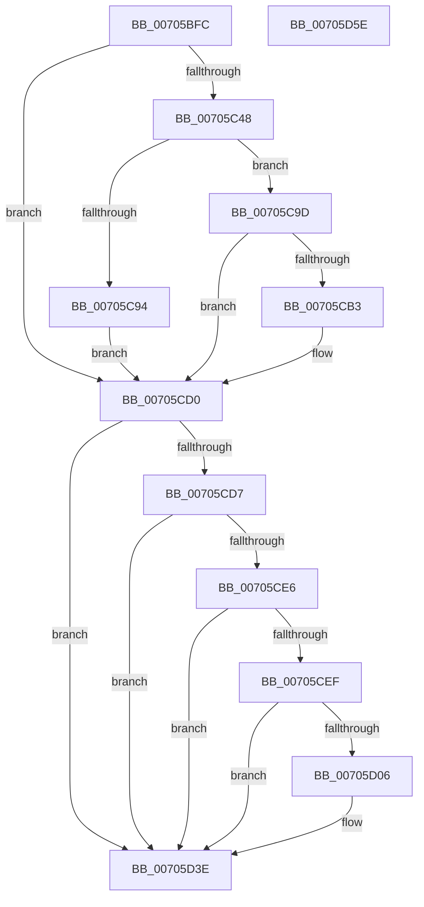

# HalpSetAcpiRealTimeClock

- RVA: `0x00705BFC`–`0x00705D5F` (길이 `355` bytes)
- VA: `0x0000000140705BFC`
- 실행 섹션: `PAGE`
- PDB 이름 있음: `예`; PDB Function 태그: `아니요`
- unwind 정보 RVA: `0x000B9FF0`
- 디코드: `86`개 명령, `355/355` bytes 표시
- 미해석 바이트: `0` (있으면 어셈블리에 `.byte`로 보존)

> 이 문서는 커널 이미지의 기계어와 PDB 기호를 분석해 생성했습니다. 4번과 5번은 함수 원형과 자료형을 바이너리 사용 방식에서 추정한 C 해석이며 원본 소스 복구 결과는 아닙니다.

## 1. Dependencies

- 직접 호출 지점: **9**; 고유 호출 대상: **9**
- 직접 호출자로 확인된 함수: **1**
- RIP 상대 이미지 참조: **4**

### Outgoing calls
- `0x00705C38` → [HalpGetDynamicDevicePointer](../A9/HalpGetDynamicDevicePointer_function_00A983AC.md) (function, `0x00A983AC`)
- `0x00705C51` → [KeInitializeEvent](../../text/40/KeInitializeEvent_function_0040DD10.md) (function, `0x0040DD10`)
- `0x00705C8A` → [IoBuildDeviceIoControlRequest](../../text/20/IoBuildDeviceIoControlRequest_function_00204FD0.md) (function, `0x00204FD0`)
- `0x00705CA4` → [IofCallDriver](../../text/29/IofCallDriver_function_0029B4B0.md) (function, `0x0029B4B0`)
- `0x00705CC5` → [KeWaitForSingleObject](../../text/20/KeWaitForSingleObject_function_0020E6B0.md) (function, `0x0020E6B0`)
- `0x00705CDB` → [ObfDereferenceObject](../../text/2F/ObfDereferenceObject_function_002F9350.md) (function, `0x002F9350`)
- `0x00705CFD` → [EtwEventEnabled](../../text/39/EtwEventEnabled_function_00392450.md) (function, `0x00392450`)
- `0x00705D39` → [EtwWrite](../../text/41/EtwWrite_function_0041C720.md) (function, `0x0041C720`)
- `0x00705D48` → [_security_check_cookie](../../text/6A/_security_check_cookie_function_006AC640.md) (function, `0x006AC640`)

### Direct callers
- [HalSetRealTimeClock](../../text/42/HalSetRealTimeClock_function_0042D310.md) at `0x0042D3CB`

### Static image references
- `0x00705C0E` → RVA `0x00E0A740` (`.data`; read)
- `0x00705CE6` → RVA `0x00FC22C0` (`.data`; read)
- `0x00705CEF` → RVA `0x00FC22B8` (`.data`; read)
- `0x00705CF6` → RVA `0x00021008` (`.rdata`; read)

## 2. Other-region calls and transfers

- 다른 실행 섹션으로 향하는 call: **8**
  - `0x00705C51` → [KeInitializeEvent](../../text/40/KeInitializeEvent_function_0040DD10.md) (`PAGE` → `.text`)
  - `0x00705C8A` → [IoBuildDeviceIoControlRequest](../../text/20/IoBuildDeviceIoControlRequest_function_00204FD0.md) (`PAGE` → `.text`)
  - `0x00705CA4` → [IofCallDriver](../../text/29/IofCallDriver_function_0029B4B0.md) (`PAGE` → `.text`)
  - `0x00705CC5` → [KeWaitForSingleObject](../../text/20/KeWaitForSingleObject_function_0020E6B0.md) (`PAGE` → `.text`)
  - `0x00705CDB` → [ObfDereferenceObject](../../text/2F/ObfDereferenceObject_function_002F9350.md) (`PAGE` → `.text`)
  - `0x00705CFD` → [EtwEventEnabled](../../text/39/EtwEventEnabled_function_00392450.md) (`PAGE` → `.text`)
  - `0x00705D39` → [EtwWrite](../../text/41/EtwWrite_function_0041C720.md) (`PAGE` → `.text`)
  - `0x00705D48` → [_security_check_cookie](../../text/6A/_security_check_cookie_function_006AC640.md) (`PAGE` → `.text`)
- 별도 외부 분기/꼬리 이동을 확인하지 못했습니다.

## 3. Assembly (complete function range)

```asm
00705BFC  48 89 7C 24 10                  mov qword ptr [rsp + 0x10], rdi
00705C01  55                              push rbp
00705C02  48 8D 6C 24 A9                  lea rbp, [rsp - 0x57]
00705C07  48 81 EC A0 00 00 00            sub rsp, 0xa0
00705C0E  48 8B 05 2B 4B 70 00            mov rax, qword ptr [rip + 0x704b2b]
00705C15  48 33 C4                        xor rax, rsp
00705C18  48 89 45 4F                     mov qword ptr [rbp + 0x4f], rax
00705C1C  0F 57 C0                        xorps xmm0, xmm0
00705C1F  48 8D 55 0F                     lea rdx, [rbp + 0xf]
00705C23  33 C0                           xor eax, eax
00705C25  48 8B F9                        mov rdi, rcx
00705C28  48 21 45 0F                     and qword ptr [rbp + 0xf], rax
00705C2C  0F 11 45 17                     movups xmmword ptr [rbp + 0x17], xmm0
00705C30  48 89 45 27                     mov qword ptr [rbp + 0x27], rax
00705C34  0F 11 45 2F                     movups xmmword ptr [rbp + 0x2f], xmm0
00705C38  E8 6F 27 39 00                  call 0x140a983ac
00705C3D  89 45 07                        mov dword ptr [rbp + 7], eax
00705C40  85 C0                           test eax, eax
00705C42  0F 88 88 00 00 00               js 0x140705cd0
00705C48  45 33 C0                        xor r8d, r8d
00705C4B  48 8D 4D 17                     lea rcx, [rbp + 0x17]
00705C4F  33 D2                           xor edx, edx
00705C51  E8 BA 80 D0 FF                  call 0x14040dd10
00705C56  48 8B 55 0F                     mov rdx, qword ptr [rbp + 0xf]
00705C5A  48 8D 45 2F                     lea rax, [rbp + 0x2f]
00705C5E  48 89 44 24 40                  mov qword ptr [rsp + 0x40], rax
00705C63  41 B9 10 00 00 00               mov r9d, 0x10
00705C69  48 8D 45 17                     lea rax, [rbp + 0x17]
00705C6D  4C 8B C7                        mov r8, rdi
00705C70  48 89 44 24 38                  mov qword ptr [rsp + 0x38], rax
00705C75  B9 14 82 29 00                  mov ecx, 0x298214
00705C7A  C6 44 24 30 00                  mov byte ptr [rsp + 0x30], 0
00705C7F  83 64 24 28 00                  and dword ptr [rsp + 0x28], 0
00705C84  48 83 64 24 20 00               and qword ptr [rsp + 0x20], 0
00705C8A  E8 41 F3 AF FF                  call 0x140204fd0
00705C8F  48 85 C0                        test rax, rax
00705C92  75 09                           jne 0x140705c9d
00705C94  C7 45 07 9A 00 00 C0            mov dword ptr [rbp + 7], 0xc000009a
00705C9B  EB 33                           jmp 0x140705cd0
00705C9D  48 8B 4D 0F                     mov rcx, qword ptr [rbp + 0xf]
00705CA1  48 8B D0                        mov rdx, rax
00705CA4  E8 07 58 B9 FF                  call 0x14029b4b0
00705CA9  89 45 07                        mov dword ptr [rbp + 7], eax
00705CAC  3D 03 01 00 00                  cmp eax, 0x103
00705CB1  75 1D                           jne 0x140705cd0
00705CB3  48 83 64 24 20 00               and qword ptr [rsp + 0x20], 0
00705CB9  48 8D 4D 17                     lea rcx, [rbp + 0x17]
00705CBD  45 33 C9                        xor r9d, r9d
00705CC0  45 33 C0                        xor r8d, r8d
00705CC3  33 D2                           xor edx, edx
00705CC5  E8 E6 89 B0 FF                  call 0x14020e6b0
00705CCA  8B 45 2F                        mov eax, dword ptr [rbp + 0x2f]
00705CCD  89 45 07                        mov dword ptr [rbp + 7], eax
00705CD0  48 83 7D 0F 00                  cmp qword ptr [rbp + 0xf], 0
00705CD5  74 67                           je 0x140705d3e
00705CD7  48 8B 4D 0F                     mov rcx, qword ptr [rbp + 0xf]
00705CDB  E8 70 36 BF FF                  call 0x1402f9350
00705CE0  83 7D 07 00                     cmp dword ptr [rbp + 7], 0
00705CE4  7D 58                           jge 0x140705d3e
00705CE6  80 3D D3 C5 8B 00 00            cmp byte ptr [rip + 0x8bc5d3], 0
00705CED  74 4F                           je 0x140705d3e
00705CEF  48 8B 0D C2 C5 8B 00            mov rcx, qword ptr [rip + 0x8bc5c2]
00705CF6  48 8D 15 0B B3 91 FF            lea rdx, [rip - 0x6e4cf5]
00705CFD  E8 4E C7 C8 FF                  call 0x140392450
00705D02  84 C0                           test al, al
00705D04  74 38                           je 0x140705d3e
00705D06  83 65 4B 00                     and dword ptr [rbp + 0x4b], 0
00705D0A  48 8D 45 07                     lea rax, [rbp + 7]
00705D0E  48 8B 0D A3 C5 8B 00            mov rcx, qword ptr [rip + 0x8bc5a3]
00705D15  48 8D 15 EC B2 91 FF            lea rdx, [rip - 0x6e4d14]
00705D1C  48 89 45 3F                     mov qword ptr [rbp + 0x3f], rax
00705D20  41 B9 01 00 00 00               mov r9d, 1
00705D26  48 8D 45 3F                     lea rax, [rbp + 0x3f]
00705D2A  C7 45 47 04 00 00 00            mov dword ptr [rbp + 0x47], 4
00705D31  45 33 C0                        xor r8d, r8d
00705D34  48 89 44 24 20                  mov qword ptr [rsp + 0x20], rax
00705D39  E8 E2 69 D1 FF                  call 0x14041c720
00705D3E  8B 45 07                        mov eax, dword ptr [rbp + 7]
00705D41  48 8B 4D 4F                     mov rcx, qword ptr [rbp + 0x4f]
00705D45  48 33 CC                        xor rcx, rsp
00705D48  E8 F3 68 FA FF                  call 0x1406ac640
00705D4D  48 8B BC 24 B8 00 00 00         mov rdi, qword ptr [rsp + 0xb8]
00705D55  48 81 C4 A0 00 00 00            add rsp, 0xa0
00705D5C  5D                              pop rbp
00705D5D  C3                              ret
00705D5E  CC                              int3
```

## 4. C-style interpretation (structured pseudocode)

```c
__int64 __fastcall HalpSetAcpiRealTimeClock(__int64 a1, __int64 a2, int a3)
{
    __int64 result;
    __int64 v_rsp;
    unsigned __int64 v_stack_m10;
    unsigned int v_stack_m14;
    unsigned int v_stack_m18;
    unsigned __int64 v_stack_m20;
    unsigned __int64 v_stack_m30;
    unsigned __int64 v_stack_m38;
    unsigned __int64 v_stack_m48;
    unsigned __int64 v_stack_m50;
    unsigned int v_stack_m58;
    unsigned __int64 v_stack_m5F;
    unsigned __int64 v_stack_m68;
    unsigned __int64 v_stack_m70;
    unsigned __int8 v_stack_m78;
    unsigned int v_stack_m80;
    unsigned __int64 v_stack_m88;
    unsigned __int64 v_stack_p10;

    v_stack_p10 = v_rdi;
    v_rsp = (v_rsp) - (160);
    result = (*(unsigned __int64 *)(v_rip + 7359275)) ^ (v_rsp);
    v_stack_m10 = result;
    result = 0;
    v_stack_m48 = v_xmm0;
    v_stack_m38 = 0;
    v_stack_m30 = v_xmm0;
    result = HalpGetDynamicDevicePointer(a1, v_stack_m50, a3, a4);
    v_stack_m58 = (unsigned int)(result);
    if (sign_flag) goto loc_00705CD0;
    a3 = 0;
    a2 = 0;
    result = KeInitializeEvent(v_stack_m48, a2, a3, a4);
    v_stack_m68 = v_stack_m30;
    v_stack_m70 = v_stack_m48;
    v_stack_m78 = 0;
    result = IoBuildDeviceIoControlRequest((unsigned int)(0x298214ULL), v_stack_m50, a1, 16);
    if (result != 0) goto loc_00705C9D;
    v_stack_m58 = 0xC000009AULL;
    goto loc_00705CD0;
loc_00705C9D:
    result = IofCallDriver(v_stack_m50, result, a1, 16);
    v_stack_m58 = (unsigned int)(result);
    if (((unsigned int)(result)) == 259) {
        a1 = v_stack_m48;
        a4 = 0;
        a3 = 0;
        a2 = 0;
        result = KeWaitForSingleObject(a1, a2, a3, a4);
        result = v_stack_m30;
        v_stack_m58 = (unsigned int)(result);
    }
    if (v_stack_m50 == 0) goto loc_00705D3E;
    result = ObfDereferenceObject(v_stack_m50, a2, a3, a4);
    if (v_stack_m58 >= 0) goto loc_00705D3E;
    if ((*(unsigned __int8 *)(v_rip + 9160147)) == 0) goto loc_00705D3E;
    result = EtwEventEnabled(*(unsigned __int64 *)(v_rip + 9160130), v_rip - 7228661, a3, a4);
    if ((unsigned __int8)(result) != 0) {
        result = v_stack_m58;
        a1 = *(unsigned __int64 *)(v_rip + 9160099);
        a2 = v_rip - 7228692;
        v_stack_m20 = result;
        a4 = 1;
        result = v_stack_m20;
        v_stack_m18 = 4;
        a3 = 0;
        v_stack_m88 = result;
        result = EtwWrite(a1, a2, a3, a4);
    }
    a1 = (v_stack_m10) ^ (v_rsp);
    result = _security_check_cookie(a1, a2, a3, a4);
    v_rsp = (v_rsp) + (160);
    return result;
}
```

## 5. (Beta) C Style

```c
int64_t HalpSetAcpiRealTimeClock(int64_t Arg1, int64_t Arg2, int32_t Arg3)
{
    int64_t result;
    int64_t local_rsp;
    uint64_t v_stack_m10;
    uint32_t v_stack_m14;
    uint32_t v_stack_m18;
    uint64_t v_stack_m20;
    uint64_t v_stack_m30;
    uint64_t v_stack_m38;
    uint64_t v_stack_m48;
    uint64_t v_stack_m50;
    uint32_t v_stack_m58;
    uint64_t v_stack_m5F;
    uint64_t v_stack_m68;
    uint64_t v_stack_m70;
    uint8_t v_stack_m78;
    uint32_t v_stack_m80;
    uint64_t v_stack_m88;
    uint64_t v_stack_p10;

    v_stack_p10 = local_rdi;
    local_rsp = (local_rsp) - (160);
    result = (*(uint64_t *)(v_rip + 0x704B2B)) ^ (local_rsp);
    v_stack_m10 = result;
    result = 0;
    v_stack_m48 = v_xmm0;
    v_stack_m38 = 0;
    v_stack_m30 = v_xmm0;
    result = HalpGetDynamicDevicePointer(Arg1, v_stack_m50, Arg3, a4);
    v_stack_m58 = (uint32_t)(result);
    if (sign_flag) goto loc_00705CD0;
    Arg3 = 0;
    Arg2 = 0;
    result = KeInitializeEvent(v_stack_m48, Arg2, Arg3, a4);
    v_stack_m68 = v_stack_m30;
    v_stack_m70 = v_stack_m48;
    v_stack_m78 = 0;
    result = IoBuildDeviceIoControlRequest((uint32_t)(0x298214ULL), v_stack_m50, Arg1, 16);
    if (result != 0) goto loc_00705C9D;
    v_stack_m58 = 0xC000009AULL;
    goto loc_00705CD0;
loc_00705C9D:
    result = IofCallDriver(v_stack_m50, result, Arg1, 16);
    v_stack_m58 = (uint32_t)(result);
    if (((uint32_t)(result)) == 259) {
        Arg1 = v_stack_m48;
        a4 = 0;
        Arg3 = 0;
        Arg2 = 0;
        result = KeWaitForSingleObject(Arg1, Arg2, Arg3, a4);
        result = v_stack_m30;
        v_stack_m58 = (uint32_t)(result);
    }
    if (v_stack_m50 == 0) goto loc_00705D3E;
    result = ObfDereferenceObject(v_stack_m50, Arg2, Arg3, a4);
    if (v_stack_m58 >= 0) goto loc_00705D3E;
    if ((*(uint8_t *)(v_rip + 0x8BC5D3)) == 0) goto loc_00705D3E;
    result = EtwEventEnabled(*(uint64_t *)(v_rip + 0x8BC5C2), v_rip - 7228661, Arg3, a4);
    if ((uint8_t)(result) != 0) {
        result = v_stack_m58;
        Arg1 = *(uint64_t *)(v_rip + 0x8BC5A3);
        Arg2 = v_rip - 7228692;
        v_stack_m20 = result;
        a4 = 1;
        result = v_stack_m20;
        v_stack_m18 = 4;
        Arg3 = 0;
        v_stack_m88 = result;
        result = EtwWrite(Arg1, Arg2, Arg3, a4);
    }
    Arg1 = (v_stack_m10) ^ (local_rsp);
    result = _security_check_cookie(Arg1, Arg2, Arg3, a4);
    local_rsp = (local_rsp) + (160);
    return result;
}
```

## 6. Execution-region graph

[열기: 2D/3D 그래프와 함수 탐색 컨트롤 패널](../../../control-panel.html?section=page&rva=0x00705BFC&view=graph)

- 2D 그래프는 위에서 아래로 흐르고, 3D 그래프는 빈 공간을 드래그해 회전합니다. Shift+드래그는 이동, 휠은 확대·축소, 함수 노드 선택은 대상 보고서 이동입니다.

### Static fallback


