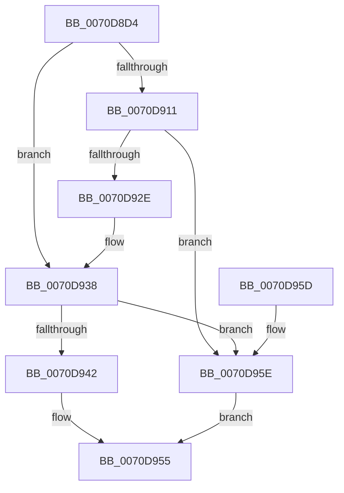

# HalpStartPccCommand

- RVA: `0x0070D8D4`–`0x0070D965` (길이 `145` bytes)
- VA: `0x000000014070D8D4`
- 실행 섹션: `PAGE`
- PDB 이름 있음: `예`; PDB Function 태그: `아니요`
- unwind 정보 RVA: `0x000C4F6C`
- 디코드: `33`개 명령, `145/145` bytes 표시
- 미해석 바이트: `0` (있으면 어셈블리에 `.byte`로 보존)

> 이 문서는 커널 이미지의 기계어와 PDB 기호를 분석해 생성했습니다. 4번과 5번은 함수 원형과 자료형을 바이너리 사용 방식에서 추정한 C 해석이며 원본 소스 복구 결과는 아닙니다.

## 1. Dependencies

- 직접 호출 지점: **6**; 고유 호출 대상: **5**
- 직접 호출자로 확인된 함수: **1**
- RIP 상대 이미지 참조: **5**

### Outgoing calls
- `0x0070D8F0` → [memset](../../text/6C/memset_function_006C6C40.md) (function, `0x006C6C40`)
- `0x0070D901` → [RtlInitUnicodeString](../../text/42/RtlInitUnicodeString_function_0042A780.md) (function, `0x0042A780`)
- `0x0070D908` → [HalpUpdateCoolingPacket](../../text/56/HalpUpdateCoolingPacket_function_00569530.md) (function, `0x00569530`)
- `0x0070D925` → [HalpAcquirePccInterface](HalpAcquirePccInterface_function_0070D524.md) (function, `0x0070D524`)
- `0x0070D933` → [HalpUpdateCoolingPacket](../../text/56/HalpUpdateCoolingPacket_function_00569530.md) (function, `0x00569530`)
- `0x0070D950` → [guard_dispatch_icall](../../text/6B/guard_dispatch_icall_function_006BAAD0.md) (function, `0x006BAAD0`)

### Direct callers
- [HalpChannelPowerRequest](HalpChannelPowerRequest_function_0070D62C.md) at `0x0070D6E8`

### Static image references
- `0x0070D8F5` → RVA `0x00026038` (`.rdata`; read)
- `0x0070D911` → RVA `0x00E117E8` (`.data`; read)
- `0x0070D938` → RVA `0x00F8FA80` (`.data`; read)
- `0x0070D942` → RVA `0x00F8FA38` (`.data`; read)
- `0x0070D949` → RVA `0x00F8FA58` (`.data`; read)

## 2. Other-region calls and transfers

- 다른 실행 섹션으로 향하는 call: **5**
  - `0x0070D8F0` → [memset](../../text/6C/memset_function_006C6C40.md) (`PAGE` → `.text`)
  - `0x0070D901` → [RtlInitUnicodeString](../../text/42/RtlInitUnicodeString_function_0042A780.md) (`PAGE` → `.text`)
  - `0x0070D908` → [HalpUpdateCoolingPacket](../../text/56/HalpUpdateCoolingPacket_function_00569530.md) (`PAGE` → `.text`)
  - `0x0070D933` → [HalpUpdateCoolingPacket](../../text/56/HalpUpdateCoolingPacket_function_00569530.md) (`PAGE` → `.text`)
  - `0x0070D950` → [guard_dispatch_icall](../../text/6B/guard_dispatch_icall_function_006BAAD0.md) (`PAGE` → `.text`)
- 별도 외부 분기/꼬리 이동을 확인하지 못했습니다.

## 3. Assembly (complete function range)

```asm
0070D8D4  48 81 EC B8 00 00 00            sub rsp, 0xb8
0070D8DB  0F 57 C0                        xorps xmm0, xmm0
0070D8DE  48 8D 4C 24 30                  lea rcx, [rsp + 0x30]
0070D8E3  33 D2                           xor edx, edx
0070D8E5  41 B8 80 00 00 00               mov r8d, 0x80
0070D8EB  0F 11 44 24 20                  movups xmmword ptr [rsp + 0x20], xmm0
0070D8F0  E8 4B 93 FB FF                  call 0x1406c6c40
0070D8F5  48 8D 15 3C 87 91 FF            lea rdx, [rip - 0x6e78c4]
0070D8FC  48 8D 4C 24 20                  lea rcx, [rsp + 0x20]
0070D901  E8 7A CE D1 FF                  call 0x14042a780
0070D906  33 C9                           xor ecx, ecx
0070D908  E8 23 BC E5 FF                  call 0x140569530
0070D90D  84 C0                           test al, al
0070D90F  75 27                           jne 0x14070d938
0070D911  48 8B 0D D0 3E 70 00            mov rcx, qword ptr [rip + 0x703ed0]
0070D918  4C 8D 44 24 30                  lea r8, [rsp + 0x30]
0070D91D  48 8D 54 24 20                  lea rdx, [rsp + 0x20]
0070D922  8A 49 24                        mov cl, byte ptr [rcx + 0x24]
0070D925  E8 FA FB FF FF                  call 0x14070d524
0070D92A  85 C0                           test eax, eax
0070D92C  78 30                           js 0x14070d95e
0070D92E  48 8D 4C 24 30                  lea rcx, [rsp + 0x30]
0070D933  E8 F8 BB E5 FF                  call 0x140569530
0070D938  48 83 3D 40 21 88 00 00         cmp qword ptr [rip + 0x882140], 0
0070D940  74 1C                           je 0x14070d95e
0070D942  48 8B 0D EF 20 88 00            mov rcx, qword ptr [rip + 0x8820ef]
0070D949  48 8B 05 08 21 88 00            mov rax, qword ptr [rip + 0x882108]
0070D950  E8 7B D1 FA FF                  call 0x1406baad0
0070D955  48 81 C4 B8 00 00 00            add rsp, 0xb8
0070D95C  C3                              ret
0070D95D  CC                              int3
0070D95E  B8 10 00 00 C0                  mov eax, 0xc0000010
0070D963  EB F0                           jmp 0x14070d955
```

## 4. C-style interpretation (structured pseudocode)

```c
__int64 __fastcall HalpStartPccCommand(__int64 a1, int a2)
{
    __int64 result;
    __int64 v_rsp;
    unsigned __int64 v_stack_m88;
    unsigned __int64 v_stack_m98;

    v_rsp = (v_rsp) - (184);
    a2 = 0;
    v_stack_m98 = v_xmm0;
    result = memset(v_stack_m88, a2, 128, a4);
    result = RtlInitUnicodeString(v_stack_m98, v_rip - 7239876, 128, a4);
    a1 = 0;
    result = HalpUpdateCoolingPacket(a1, v_rip - 7239876, 128, a4);
    if ((unsigned __int8)(result) != 0) goto loc_0070D938;
    result = HalpAcquirePccInterface(*(unsigned __int8 *)(*(unsigned __int64 *)(v_rip + 7356112) + 36), v_stack_m98, v_stack_m88, a4);
    if (sign_flag) goto loc_0070D95E;
    result = HalpUpdateCoolingPacket(v_stack_m88, v_stack_m98, v_stack_m88, a4);
loc_0070D938:
    if ((*(unsigned __int64 *)(v_rip + 8921408)) == 0) goto loc_0070D95E;
    result = guard_dispatch_icall(*(unsigned __int64 *)(v_rip + 8921327), v_stack_m98, v_stack_m88, a4);
loc_0070D955:
    v_rsp = (v_rsp) + (184);
    return result;
loc_0070D95E:
    goto loc_0070D955;
}
```

## 5. (Beta) C Style

```c
int64_t HalpStartPccCommand(int64_t Arg1, int32_t Arg2)
{
    int64_t result;
    int64_t local_rsp;
    uint64_t v_stack_m88;
    uint64_t v_stack_m98;

    local_rsp = (local_rsp) - (184);
    Arg2 = 0;
    v_stack_m98 = v_xmm0;
    result = memset(v_stack_m88, Arg2, 128, a4);
    result = RtlInitUnicodeString(v_stack_m98, v_rip - 7239876, 128, a4);
    Arg1 = 0;
    result = HalpUpdateCoolingPacket(Arg1, v_rip - 7239876, 128, a4);
    if ((uint8_t)(result) != 0) goto loc_0070D938;
    result = HalpAcquirePccInterface(*(uint8_t *)(*(uint64_t *)(v_rip + 0x703ED0) + 0x24), v_stack_m98, v_stack_m88, a4);
    if (sign_flag) goto loc_0070D95E;
    result = HalpUpdateCoolingPacket(v_stack_m88, v_stack_m98, v_stack_m88, a4);
loc_0070D938:
    if ((*(uint64_t *)(v_rip + 0x882140)) == 0) goto loc_0070D95E;
    result = guard_dispatch_icall(*(uint64_t *)(v_rip + 0x8820EF), v_stack_m98, v_stack_m88, a4);
loc_0070D955:
    local_rsp = (local_rsp) + (184);
    return result;
loc_0070D95E:
    goto loc_0070D955;
}
```

## 6. Execution-region graph

[열기: 2D/3D 그래프와 함수 탐색 컨트롤 패널](../../../control-panel.html?section=page&rva=0x0070D8D4&view=graph)

- 2D 그래프는 위에서 아래로 흐르고, 3D 그래프는 빈 공간을 드래그해 회전합니다. Shift+드래그는 이동, 휠은 확대·축소, 함수 노드 선택은 대상 보고서 이동입니다.

### Static fallback


