# HalpTimerTraceTimingHardware

- RVA: `0x00706350`–`0x007065D2` (길이 `642` bytes)
- VA: `0x0000000140706350`
- 실행 섹션: `PAGE`
- PDB 이름 있음: `예`; PDB Function 태그: `아니요`
- unwind 정보 RVA: `0x000C38A8`
- 디코드: `137`개 명령, `642/642` bytes 표시
- 미해석 바이트: `0` (있으면 어셈블리에 `.byte`로 보존)

> 이 문서는 커널 이미지의 기계어와 PDB 기호를 분석해 생성했습니다. 4번과 5번은 함수 원형과 자료형을 바이너리 사용 방식에서 추정한 C 해석이며 원본 소스 복구 결과는 아닙니다.

## 1. Dependencies

- 직접 호출 지점: **5**; 고유 호출 대상: **4**
- 직접 호출자로 확인된 함수: **1**
- RIP 상대 이미지 참조: **17**

### Outgoing calls
- `0x00706390` → [tlgKeywordOn](../../text/42/tlgKeywordOn_function_0042EAA0.md) (function, `0x0042EAA0`)
- `0x0070654B` → [tlgWriteTransfer_EtwWriteTransfer](../../text/42/tlgWriteTransfer_EtwWriteTransfer_function_004260E0.md) (function, `0x004260E0`)
- `0x00706581` → [EtwWrite](../../text/41/EtwWrite_function_0041C720.md) (function, `0x0041C720`)
- `0x007065AF` → [EtwWrite](../../text/41/EtwWrite_function_0041C720.md) (function, `0x0041C720`)
- `0x007065BB` → [_security_check_cookie](../../text/6A/_security_check_cookie_function_006AC640.md) (function, `0x006AC640`)

### Direct callers
- [HalpTimerInitSystem](../../text/53/HalpTimerInitSystem_function_0053CB70.md) at `0x0053CBE9`

### Static image references
- `0x00706362` → RVA `0x00E0A740` (`.data`; read)
- `0x00706372` → RVA `0x00E03B28` (`.data`; read)
- `0x0070639D` → RVA `0x00FC40F0` (`.data`; read)
- `0x007063C3` → RVA `0x00FC3FD0` (`.data`; read)
- `0x007063DD` → RVA `0x00FC4108` (`.data`; read)
- `0x00706404` → RVA `0x00FC2248` (`.data`; read)
- `0x0070642F` → RVA `0x00FC4140` (`.data`; read)
- `0x0070645A` → RVA `0x00FC4028` (`.data`; read)
- `0x00706485` → RVA `0x00FC4130` (`.data`; read)
- `0x007064A3` → RVA `0x00FC4100` (`.data`; read)
- `0x007064CC` → RVA `0x00FC6B60` (`ALMOSTRO`; read)
- `0x007064EE` → RVA `0x00FC1C80` (`.data`; read)
- `0x00706514` → RVA `0x000435A1` (`.rdata`; read)
- `0x00706550` → RVA `0x00FC22C0` (`.data`; read)
- `0x00706568` → RVA `0x00FC22B8` (`.data`; read)
- `0x0070656F` → RVA `0x000210D8` (`.rdata`; read)
- `0x0070659D` → RVA `0x00021588` (`.rdata`; read)

## 2. Other-region calls and transfers

- 다른 실행 섹션으로 향하는 call: **5**
  - `0x00706390` → [tlgKeywordOn](../../text/42/tlgKeywordOn_function_0042EAA0.md) (`PAGE` → `.text`)
  - `0x0070654B` → [tlgWriteTransfer_EtwWriteTransfer](../../text/42/tlgWriteTransfer_EtwWriteTransfer_function_004260E0.md) (`PAGE` → `.text`)
  - `0x00706581` → [EtwWrite](../../text/41/EtwWrite_function_0041C720.md) (`PAGE` → `.text`)
  - `0x007065AF` → [EtwWrite](../../text/41/EtwWrite_function_0041C720.md) (`PAGE` → `.text`)
  - `0x007065BB` → [_security_check_cookie](../../text/6A/_security_check_cookie_function_006AC640.md) (`PAGE` → `.text`)
- 별도 외부 분기/꼬리 이동을 확인하지 못했습니다.

## 3. Assembly (complete function range)

```asm
00706350  48 89 5C 24 08                  mov qword ptr [rsp + 8], rbx
00706355  55                              push rbp
00706356  48 8D 6C 24 E0                  lea rbp, [rsp - 0x20]
0070635B  48 81 EC 20 01 00 00            sub rsp, 0x120
00706362  48 8B 05 D7 43 70 00            mov rax, qword ptr [rip + 0x7043d7]
00706369  48 33 C4                        xor rax, rsp
0070636C  48 89 45 10                     mov qword ptr [rbp + 0x10], rax
00706370  33 DB                           xor ebx, ebx
00706372  83 3D AF D7 6F 00 05            cmp dword ptr [rip + 0x6fd7af], 5
00706379  0F 86 D1 01 00 00               jbe 0x140706550
0070637F  48 BA 00 00 00 00 00 40 00 00   movabs rdx, 0x400000000000
00706389  48 8D 0D 98 D7 6F 00            lea rcx, [rip + 0x6fd798]
00706390  E8 0B 87 D2 FF                  call 0x14042eaa0
00706395  84 C0                           test al, al
00706397  0F 84 B3 01 00 00               je 0x140706550
0070639D  48 8B 05 4C DD 8B 00            mov rax, qword ptr [rip + 0x8bdd4c]
007063A4  48 C7 45 88 04 00 00 00         mov qword ptr [rbp - 0x78], 4
007063AC  48 C7 45 98 04 00 00 00         mov qword ptr [rbp - 0x68], 4
007063B4  8B 88 E4 00 00 00               mov ecx, dword ptr [rax + 0xe4]
007063BA  48 8D 44 24 34                  lea rax, [rsp + 0x34]
007063BF  48 89 45 80                     mov qword ptr [rbp - 0x80], rax
007063C3  48 8B 05 06 DC 8B 00            mov rax, qword ptr [rip + 0x8bdc06]
007063CA  89 4C 24 34                     mov dword ptr [rsp + 0x34], ecx
007063CE  8B 88 E4 00 00 00               mov ecx, dword ptr [rax + 0xe4]
007063D4  48 8D 44 24 38                  lea rax, [rsp + 0x38]
007063D9  48 89 45 90                     mov qword ptr [rbp - 0x70], rax
007063DD  48 8B 05 24 DD 8B 00            mov rax, qword ptr [rip + 0x8bdd24]
007063E4  89 4C 24 38                     mov dword ptr [rsp + 0x38], ecx
007063E8  48 85 C0                        test rax, rax
007063EB  75 04                           jne 0x1407063f1
007063ED  8B C3                           mov eax, ebx
007063EF  EB 06                           jmp 0x1407063f7
007063F1  8B 80 E4 00 00 00               mov eax, dword ptr [rax + 0xe4]
007063F7  89 44 24 3C                     mov dword ptr [rsp + 0x3c], eax
007063FB  48 8D 44 24 3C                  lea rax, [rsp + 0x3c]
00706400  48 89 45 A0                     mov qword ptr [rbp - 0x60], rax
00706404  48 8B 05 3D BE 8B 00            mov rax, qword ptr [rip + 0x8bbe3d]
0070640B  48 C7 45 A8 04 00 00 00         mov qword ptr [rbp - 0x58], 4
00706413  48 85 C0                        test rax, rax
00706416  75 04                           jne 0x14070641c
00706418  8B C3                           mov eax, ebx
0070641A  EB 06                           jmp 0x140706422
0070641C  8B 80 E4 00 00 00               mov eax, dword ptr [rax + 0xe4]
00706422  89 44 24 40                     mov dword ptr [rsp + 0x40], eax
00706426  48 8D 44 24 40                  lea rax, [rsp + 0x40]
0070642B  48 89 45 B0                     mov qword ptr [rbp - 0x50], rax
0070642F  48 8B 05 0A DD 8B 00            mov rax, qword ptr [rip + 0x8bdd0a]
00706436  48 C7 45 B8 04 00 00 00         mov qword ptr [rbp - 0x48], 4
0070643E  48 85 C0                        test rax, rax
00706441  75 04                           jne 0x140706447
00706443  8B C3                           mov eax, ebx
00706445  EB 06                           jmp 0x14070644d
00706447  8B 80 E4 00 00 00               mov eax, dword ptr [rax + 0xe4]
0070644D  89 44 24 44                     mov dword ptr [rsp + 0x44], eax
00706451  48 8D 44 24 44                  lea rax, [rsp + 0x44]
00706456  48 89 45 C0                     mov qword ptr [rbp - 0x40], rax
0070645A  48 8B 05 C7 DB 8B 00            mov rax, qword ptr [rip + 0x8bdbc7]
00706461  48 C7 45 C8 04 00 00 00         mov qword ptr [rbp - 0x38], 4
00706469  48 85 C0                        test rax, rax
0070646C  75 04                           jne 0x140706472
0070646E  8B C3                           mov eax, ebx
00706470  EB 06                           jmp 0x140706478
00706472  8B 80 E4 00 00 00               mov eax, dword ptr [rax + 0xe4]
00706478  89 44 24 48                     mov dword ptr [rsp + 0x48], eax
0070647C  48 8D 44 24 48                  lea rax, [rsp + 0x48]
00706481  48 89 45 D0                     mov qword ptr [rbp - 0x30], rax
00706485  48 8B 05 A4 DC 8B 00            mov rax, qword ptr [rip + 0x8bdca4]
0070648C  48 C7 45 D8 04 00 00 00         mov qword ptr [rbp - 0x28], 4
00706494  48 85 C0                        test rax, rax
00706497  75 04                           jne 0x14070649d
00706499  8B C3                           mov eax, ebx
0070649B  EB 06                           jmp 0x1407064a3
0070649D  8B 80 E4 00 00 00               mov eax, dword ptr [rax + 0xe4]
007064A3  48 8B 0D 56 DC 8B 00            mov rcx, qword ptr [rip + 0x8bdc56]
007064AA  89 44 24 4C                     mov dword ptr [rsp + 0x4c], eax
007064AE  48 8D 44 24 4C                  lea rax, [rsp + 0x4c]
007064B3  48 89 45 E0                     mov qword ptr [rbp - 0x20], rax
007064B7  8B C3                           mov eax, ebx
007064B9  48 C7 45 E8 04 00 00 00         mov qword ptr [rbp - 0x18], 4
007064C1  48 85 C9                        test rcx, rcx
007064C4  74 06                           je 0x1407064cc
007064C6  8B 81 E4 00 00 00               mov eax, dword ptr [rcx + 0xe4]
007064CC  48 F7 05 89 06 8C 00 00 00 80 00  test qword ptr [rip + 0x8c0689], 0x800000
007064D7  89 44 24 50                     mov dword ptr [rsp + 0x50], eax
007064DB  48 8D 44 24 50                  lea rax, [rsp + 0x50]
007064E0  48 89 45 F0                     mov qword ptr [rbp - 0x10], rax
007064E4  48 C7 45 F8 04 00 00 00         mov qword ptr [rbp - 8], 4
007064EC  74 20                           je 0x14070650e
007064EE  48 39 1D 8B B7 8B 00            cmp qword ptr [rip + 0x8bb78b], rbx
007064F5  75 17                           jne 0x14070650e
007064F7  F7 81 E0 00 00 00 00 60 00 00   test dword ptr [rcx + 0xe0], 0x6000
00706501  75 0B                           jne 0x14070650e
00706503  83 B9 E4 00 00 00 05            cmp dword ptr [rcx + 0xe4], 5
0070650A  B0 01                           mov al, 1
0070650C  74 02                           je 0x140706510
0070650E  8A C3                           mov al, bl
00706510  88 44 24 30                     mov byte ptr [rsp + 0x30], al
00706514  48 8D 15 86 D0 93 FF            lea rdx, [rip - 0x6c2f7a]
0070651B  48 8D 44 24 30                  lea rax, [rsp + 0x30]
00706520  48 C7 45 08 01 00 00 00         mov qword ptr [rbp + 8], 1
00706528  48 89 45 00                     mov qword ptr [rbp], rax
0070652C  48 8D 0D F5 D5 6F 00            lea rcx, [rip + 0x6fd5f5]
00706533  48 8D 44 24 60                  lea rax, [rsp + 0x60]
00706538  45 33 C9                        xor r9d, r9d
0070653B  48 89 44 24 28                  mov qword ptr [rsp + 0x28], rax
00706540  45 33 C0                        xor r8d, r8d
00706543  C7 44 24 20 0B 00 00 00         mov dword ptr [rsp + 0x20], 0xb
0070654B  E8 90 FB D1 FF                  call 0x1404260e0
00706550  38 1D 6A BD 8B 00               cmp byte ptr [rip + 0x8bbd6a], bl
00706556  74 5C                           je 0x1407065b4
00706558  48 8B 05 91 DB 8B 00            mov rax, qword ptr [rip + 0x8bdb91]
0070655F  83 B8 E4 00 00 00 0C            cmp dword ptr [rax + 0xe4], 0xc
00706566  75 1E                           jne 0x140706586
00706568  48 8B 0D 49 BD 8B 00            mov rcx, qword ptr [rip + 0x8bbd49]
0070656F  48 8D 15 62 AB 91 FF            lea rdx, [rip - 0x6e549e]
00706576  45 33 C9                        xor r9d, r9d
00706579  48 89 5C 24 20                  mov qword ptr [rsp + 0x20], rbx
0070657E  45 33 C0                        xor r8d, r8d
00706581  E8 9A 61 D1 FF                  call 0x14041c720
00706586  48 B8 C6 03 00 00 80 F7 FF FF   movabs rax, 0xfffff780000003c6
00706590  8A 00                           mov al, byte ptr [rax]
00706592  A8 01                           test al, 1
00706594  75 1E                           jne 0x1407065b4
00706596  48 8B 0D 1B BD 8B 00            mov rcx, qword ptr [rip + 0x8bbd1b]
0070659D  48 8D 15 E4 AF 91 FF            lea rdx, [rip - 0x6e501c]
007065A4  45 33 C9                        xor r9d, r9d
007065A7  48 89 5C 24 20                  mov qword ptr [rsp + 0x20], rbx
007065AC  45 33 C0                        xor r8d, r8d
007065AF  E8 6C 61 D1 FF                  call 0x14041c720
007065B4  48 8B 4D 10                     mov rcx, qword ptr [rbp + 0x10]
007065B8  48 33 CC                        xor rcx, rsp
007065BB  E8 80 60 FA FF                  call 0x1406ac640
007065C0  48 8B 9C 24 30 01 00 00         mov rbx, qword ptr [rsp + 0x130]
007065C8  48 81 C4 20 01 00 00            add rsp, 0x120
007065CF  5D                              pop rbp
007065D0  C3                              ret
007065D1  CC                              int3
```

## 4. C-style interpretation (structured pseudocode)

```c
__int64 __fastcall HalpTimerTraceTimingHardware(__int64 a1, __int64 a2, int a3, int a4)
{
    __int64 result;
    __int64 v_rbx;
    __int64 v_rsp;
    unsigned __int64 v_stack_m100;
    unsigned int v_stack_m108;
    unsigned __int64 v_stack_m18;
    unsigned __int64 v_stack_m20;
    unsigned __int64 v_stack_m28;
    unsigned __int64 v_stack_m30;
    unsigned __int64 v_stack_m38;
    unsigned __int64 v_stack_m40;
    unsigned __int64 v_stack_m48;
    unsigned __int64 v_stack_m50;
    unsigned __int64 v_stack_m58;
    unsigned __int64 v_stack_m60;
    unsigned __int64 v_stack_m68;
    unsigned __int64 v_stack_m70;
    unsigned __int64 v_stack_m78;
    unsigned __int64 v_stack_m80;
    unsigned __int64 v_stack_m88;
    unsigned __int64 v_stack_m90;
    unsigned __int64 v_stack_m98;
    unsigned __int64 v_stack_mA0;
    unsigned __int64 v_stack_mA8;
    unsigned __int64 v_stack_mC8;
    unsigned int v_stack_mD8;
    unsigned int v_stack_mDC;
    unsigned int v_stack_mE0;
    unsigned int v_stack_mE4;
    unsigned int v_stack_mE8;
    unsigned int v_stack_mEC;
    unsigned __int64 v_stack_mF0;
    unsigned __int64 v_stack_mF4;
    unsigned __int8 v_stack_mF8;
    unsigned __int64 v_stack_p8;

    v_stack_p8 = v_rbx;
    v_rsp = (v_rsp) - (288);
    result = (*(unsigned __int64 *)(v_rip + 7357399)) ^ (v_rsp);
    v_stack_m18 = result;
    v_rbx = 0;
    if ((*(unsigned int *)(v_rip + 7329711)) <= 5) goto loc_00706550;
    result = tlgKeywordOn(v_rip + 7329688, a2, a3, a4);
    if ((unsigned __int8)(result) == 0) goto loc_00706550;
    v_stack_mA0 = 4;
    v_stack_m90 = 4;
    v_stack_mA8 = v_stack_mF4;
    v_stack_mF4 = (unsigned int)((unsigned int)(*(unsigned int *)(*(unsigned __int64 *)(v_rip + 9166156) + 228)));
    v_stack_m98 = v_stack_mF0;
    v_stack_mF0 = (unsigned int)((unsigned int)(*(unsigned int *)(*(unsigned __int64 *)(v_rip + 9165830) + 228)));
    if (*(unsigned __int64 *)(v_rip + 9166116) != 0) goto loc_007063F1;
    goto loc_007063F7;
loc_007063F1:
loc_007063F7:
    v_stack_mEC = (unsigned int)((unsigned int)(*(unsigned int *)(0 + 228)));
    v_stack_m88 = v_stack_mEC;
    v_stack_m80 = 4;
    if (*(unsigned __int64 *)(v_rip + 9158205) != 0) goto loc_0070641C;
    goto loc_00706422;
loc_0070641C:
loc_00706422:
    v_stack_mE8 = (unsigned int)((unsigned int)(*(unsigned int *)(0 + 228)));
    v_stack_m78 = v_stack_mE8;
    v_stack_m70 = 4;
    if (*(unsigned __int64 *)(v_rip + 9166090) != 0) goto loc_00706447;
    goto loc_0070644D;
loc_00706447:
loc_0070644D:
    v_stack_mE4 = (unsigned int)((unsigned int)(*(unsigned int *)(0 + 228)));
    v_stack_m68 = v_stack_mE4;
    v_stack_m60 = 4;
    if (*(unsigned __int64 *)(v_rip + 9165767) != 0) goto loc_00706472;
    goto loc_00706478;
loc_00706472:
loc_00706478:
    v_stack_mE0 = (unsigned int)((unsigned int)(*(unsigned int *)(0 + 228)));
    v_stack_m58 = v_stack_mE0;
    v_stack_m50 = 4;
    if (*(unsigned __int64 *)(v_rip + 9165988) != 0) goto loc_0070649D;
    goto loc_007064A3;
loc_0070649D:
loc_007064A3:
    v_stack_mDC = (unsigned int)((unsigned int)(*(unsigned int *)(0 + 228)));
    v_stack_m48 = v_stack_mDC;
    v_stack_m40 = 4;
    result = 0;
    if (*(unsigned __int64 *)(v_rip + 9165910) != 0) {
        result = *(unsigned int *)(*(unsigned __int64 *)(v_rip + 9165910) + 228);
    }
    v_stack_mD8 = (unsigned int)(result);
    v_stack_m38 = v_stack_mD8;
    v_stack_m30 = 4;
    if (((*(unsigned __int64 *)(v_rip + 9176713)) & (0x800000ULL)) == 0) goto loc_0070650E;
    if ((*(unsigned __int64 *)(v_rip + 9156491)) != 0) goto loc_0070650E;
    if (((*(unsigned int *)(*(unsigned __int64 *)(v_rip + 9165910) + 224)) & (0x6000ULL)) != 0) goto loc_0070650E;
    result = 1;
    if ((*(unsigned int *)(*(unsigned __int64 *)(v_rip + 9165910) + 228)) != 5) {
        result = 0;
    }
    v_stack_mF8 = (unsigned __int8)(result);
    v_stack_m20 = 1;
    v_stack_m28 = v_stack_mF8;
    a4 = 0;
    v_stack_m100 = v_stack_mC8;
    a3 = 0;
    v_stack_m108 = 11;
    result = tlgWriteTransfer_EtwWriteTransfer(v_rip + 7329269, v_rip - 7090042, a3, a4);
loc_00706550:
    if ((*(unsigned __int8 *)(v_rip + 9157994)) == 0) goto loc_007065B4;
    result = *(unsigned __int64 *)(v_rip + 9165713);
    if ((*(unsigned int *)(*(unsigned __int64 *)(v_rip + 9165713) + 228)) == 12) {
        a1 = *(unsigned __int64 *)(v_rip + 9157961);
        a2 = v_rip - 7230622;
        a4 = 0;
        v_stack_m108 = 0;
        a3 = 0;
        result = EtwWrite(a1, a2, a3, a4);
    }
    result = *(unsigned __int8 *)(result);
    if ((((unsigned __int8)(*(unsigned __int8 *)(result))) & (1)) == 0) {
        a1 = *(unsigned __int64 *)(v_rip + 9157915);
        a2 = v_rip - 7229468;
        a4 = 0;
        v_stack_m108 = 0;
        a3 = 0;
        result = EtwWrite(a1, a2, a3, a4);
    }
    a1 = (v_stack_m18) ^ (v_rsp);
    result = _security_check_cookie(a1, a2, a3, a4);
    v_rsp = (v_rsp) + (288);
    return result;
}
```

## 5. (Beta) C Style

```c
int64_t HalpTimerTraceTimingHardware(int64_t Arg1, int64_t Arg2, int32_t Arg3, int32_t Arg4)
{
    int64_t result;
    int64_t local_rbx;
    int64_t local_rsp;
    uint64_t v_stack_m100;
    uint32_t v_stack_m108;
    uint64_t v_stack_m18;
    uint64_t v_stack_m20;
    uint64_t v_stack_m28;
    uint64_t v_stack_m30;
    uint64_t v_stack_m38;
    uint64_t v_stack_m40;
    uint64_t v_stack_m48;
    uint64_t v_stack_m50;
    uint64_t v_stack_m58;
    uint64_t v_stack_m60;
    uint64_t v_stack_m68;
    uint64_t v_stack_m70;
    uint64_t v_stack_m78;
    uint64_t v_stack_m80;
    uint64_t v_stack_m88;
    uint64_t v_stack_m90;
    uint64_t v_stack_m98;
    uint64_t v_stack_mA0;
    uint64_t v_stack_mA8;
    uint64_t v_stack_mC8;
    uint32_t v_stack_mD8;
    uint32_t v_stack_mDC;
    uint32_t v_stack_mE0;
    uint32_t v_stack_mE4;
    uint32_t v_stack_mE8;
    uint32_t v_stack_mEC;
    uint64_t v_stack_mF0;
    uint64_t v_stack_mF4;
    uint8_t v_stack_mF8;
    uint64_t v_stack_p8;

    v_stack_p8 = local_rbx;
    local_rsp = (local_rsp) - (288);
    result = (*(uint64_t *)(v_rip + 0x7043D7)) ^ (local_rsp);
    v_stack_m18 = result;
    local_rbx = 0;
    if ((*(uint32_t *)(v_rip + 0x6FD7AF)) <= 5) goto loc_00706550;
    result = tlgKeywordOn(v_rip + 7329688, Arg2, Arg3, Arg4);
    if ((uint8_t)(result) == 0) goto loc_00706550;
    v_stack_mA0 = 4;
    v_stack_m90 = 4;
    v_stack_mA8 = v_stack_mF4;
    v_stack_mF4 = (uint32_t)((uint32_t)(*(uint32_t *)(*(uint64_t *)(v_rip + 0x8BDD4C) + 0xE4)));
    v_stack_m98 = v_stack_mF0;
    v_stack_mF0 = (uint32_t)((uint32_t)(*(uint32_t *)(*(uint64_t *)(v_rip + 0x8BDC06) + 0xE4)));
    if (*(uint64_t *)(v_rip + 0x8BDD24) != 0) goto loc_007063F1;
    goto loc_007063F7;
loc_007063F1:
loc_007063F7:
    v_stack_mEC = (uint32_t)((uint32_t)(*(uint32_t *)(0 + 0xE4)));
    v_stack_m88 = v_stack_mEC;
    v_stack_m80 = 4;
    if (*(uint64_t *)(v_rip + 0x8BBE3D) != 0) goto loc_0070641C;
    goto loc_00706422;
loc_0070641C:
loc_00706422:
    v_stack_mE8 = (uint32_t)((uint32_t)(*(uint32_t *)(0 + 0xE4)));
    v_stack_m78 = v_stack_mE8;
    v_stack_m70 = 4;
    if (*(uint64_t *)(v_rip + 0x8BDD0A) != 0) goto loc_00706447;
    goto loc_0070644D;
loc_00706447:
loc_0070644D:
    v_stack_mE4 = (uint32_t)((uint32_t)(*(uint32_t *)(0 + 0xE4)));
    v_stack_m68 = v_stack_mE4;
    v_stack_m60 = 4;
    if (*(uint64_t *)(v_rip + 0x8BDBC7) != 0) goto loc_00706472;
    goto loc_00706478;
loc_00706472:
loc_00706478:
    v_stack_mE0 = (uint32_t)((uint32_t)(*(uint32_t *)(0 + 0xE4)));
    v_stack_m58 = v_stack_mE0;
    v_stack_m50 = 4;
    if (*(uint64_t *)(v_rip + 0x8BDCA4) != 0) goto loc_0070649D;
    goto loc_007064A3;
loc_0070649D:
loc_007064A3:
    v_stack_mDC = (uint32_t)((uint32_t)(*(uint32_t *)(0 + 0xE4)));
    v_stack_m48 = v_stack_mDC;
    v_stack_m40 = 4;
    result = 0;
    if (*(uint64_t *)(v_rip + 0x8BDC56) != 0) {
        result = *(uint32_t *)(*(uint64_t *)(v_rip + 0x8BDC56) + 0xE4);
    }
    v_stack_mD8 = (uint32_t)(result);
    v_stack_m38 = v_stack_mD8;
    v_stack_m30 = 4;
    if (((*(uint64_t *)(v_rip + 0x8C0689)) & (0x800000ULL)) == 0) goto loc_0070650E;
    if ((*(uint64_t *)(v_rip + 0x8BB78B)) != 0) goto loc_0070650E;
    if (((*(uint32_t *)(*(uint64_t *)(v_rip + 0x8BDC56) + 0xE0)) & (0x6000ULL)) != 0) goto loc_0070650E;
    result = 1;
    if ((*(uint32_t *)(*(uint64_t *)(v_rip + 0x8BDC56) + 0xE4)) != 5) {
        result = 0;
    }
    v_stack_mF8 = (uint8_t)(result);
    v_stack_m20 = 1;
    v_stack_m28 = v_stack_mF8;
    Arg4 = 0;
    v_stack_m100 = v_stack_mC8;
    Arg3 = 0;
    v_stack_m108 = 11;
    result = tlgWriteTransfer_EtwWriteTransfer(v_rip + 7329269, v_rip - 7090042, Arg3, Arg4);
loc_00706550:
    if ((*(uint8_t *)(v_rip + 0x8BBD6A)) == 0) goto loc_007065B4;
    result = *(uint64_t *)(v_rip + 0x8BDB91);
    if ((*(uint32_t *)(*(uint64_t *)(v_rip + 0x8BDB91) + 0xE4)) == 12) {
        Arg1 = *(uint64_t *)(v_rip + 0x8BBD49);
        Arg2 = v_rip - 7230622;
        Arg4 = 0;
        v_stack_m108 = 0;
        Arg3 = 0;
        result = EtwWrite(Arg1, Arg2, Arg3, Arg4);
    }
    result = *(uint8_t *)(result);
    if ((((uint8_t)(*(uint8_t *)(result))) & (1)) == 0) {
        Arg1 = *(uint64_t *)(v_rip + 0x8BBD1B);
        Arg2 = v_rip - 7229468;
        Arg4 = 0;
        v_stack_m108 = 0;
        Arg3 = 0;
        result = EtwWrite(Arg1, Arg2, Arg3, Arg4);
    }
    Arg1 = (v_stack_m18) ^ (local_rsp);
    result = _security_check_cookie(Arg1, Arg2, Arg3, Arg4);
    local_rsp = (local_rsp) + (288);
    return result;
}
```

## 6. Execution-region graph

[열기: 2D/3D 그래프와 함수 탐색 컨트롤 패널](../../../control-panel.html?section=page&rva=0x00706350&view=graph)

- 2D 그래프는 위에서 아래로 흐르고, 3D 그래프는 빈 공간을 드래그해 회전합니다. Shift+드래그는 이동, 휠은 확대·축소, 함수 노드 선택은 대상 보고서 이동입니다.

### Static fallback

```mermaid
flowchart TD
  bb_00706350[BB_00706350]
  bb_0070637F[BB_0070637F]
  bb_0070639D[BB_0070639D]
  bb_007063ED[BB_007063ED]
  bb_007063F1[BB_007063F1]
  bb_007063F7[BB_007063F7]
  bb_00706418[BB_00706418]
  bb_0070641C[BB_0070641C]
  bb_00706422[BB_00706422]
  bb_00706443[BB_00706443]
  bb_00706447[BB_00706447]
  bb_0070644D[BB_0070644D]
  bb_0070646E[BB_0070646E]
  bb_00706472[BB_00706472]
  bb_00706478[BB_00706478]
  bb_00706499[BB_00706499]
  bb_0070649D[BB_0070649D]
  bb_007064A3[BB_007064A3]
  bb_007064C6[BB_007064C6]
  bb_007064CC[BB_007064CC]
  bb_007064EE[BB_007064EE]
  bb_007064F7[BB_007064F7]
  bb_00706503[BB_00706503]
  bb_0070650E[BB_0070650E]
  bb_00706510[BB_00706510]
  bb_00706550[BB_00706550]
  bb_00706558[BB_00706558]
  bb_00706568[BB_00706568]
  bb_00706586[BB_00706586]
  bb_00706596[BB_00706596]
  bb_007065B4[BB_007065B4]
  bb_007065D1[BB_007065D1]
  bb_00706350 -->|branch| bb_00706550
  bb_00706350 -->|fallthrough| bb_0070637F
  bb_0070637F -->|branch| bb_00706550
  bb_0070637F -->|fallthrough| bb_0070639D
  bb_0070639D -->|branch| bb_007063F1
  bb_0070639D -->|fallthrough| bb_007063ED
  bb_007063ED -->|branch| bb_007063F7
  bb_007063F1 -->|flow| bb_007063F7
  bb_007063F7 -->|branch| bb_0070641C
  bb_007063F7 -->|fallthrough| bb_00706418
  bb_00706418 -->|branch| bb_00706422
  bb_0070641C -->|flow| bb_00706422
  bb_00706422 -->|branch| bb_00706447
  bb_00706422 -->|fallthrough| bb_00706443
  bb_00706443 -->|branch| bb_0070644D
  bb_00706447 -->|flow| bb_0070644D
  bb_0070644D -->|branch| bb_00706472
  bb_0070644D -->|fallthrough| bb_0070646E
  bb_0070646E -->|branch| bb_00706478
  bb_00706472 -->|flow| bb_00706478
  bb_00706478 -->|branch| bb_0070649D
  bb_00706478 -->|fallthrough| bb_00706499
  bb_00706499 -->|branch| bb_007064A3
  bb_0070649D -->|flow| bb_007064A3
  bb_007064A3 -->|branch| bb_007064CC
  bb_007064A3 -->|fallthrough| bb_007064C6
  bb_007064C6 -->|flow| bb_007064CC
  bb_007064CC -->|branch| bb_0070650E
  bb_007064CC -->|fallthrough| bb_007064EE
  bb_007064EE -->|branch| bb_0070650E
  bb_007064EE -->|fallthrough| bb_007064F7
  bb_007064F7 -->|branch| bb_0070650E
  bb_007064F7 -->|fallthrough| bb_00706503
  bb_00706503 -->|branch| bb_00706510
  bb_00706503 -->|fallthrough| bb_0070650E
  bb_0070650E -->|flow| bb_00706510
  bb_00706510 -->|flow| bb_00706550
  bb_00706550 -->|branch| bb_007065B4
  bb_00706550 -->|fallthrough| bb_00706558
  bb_00706558 -->|branch| bb_00706586
  bb_00706558 -->|fallthrough| bb_00706568
  bb_00706568 -->|flow| bb_00706586
  bb_00706586 -->|branch| bb_007065B4
  bb_00706586 -->|fallthrough| bb_00706596
  bb_00706596 -->|flow| bb_007065B4
```


