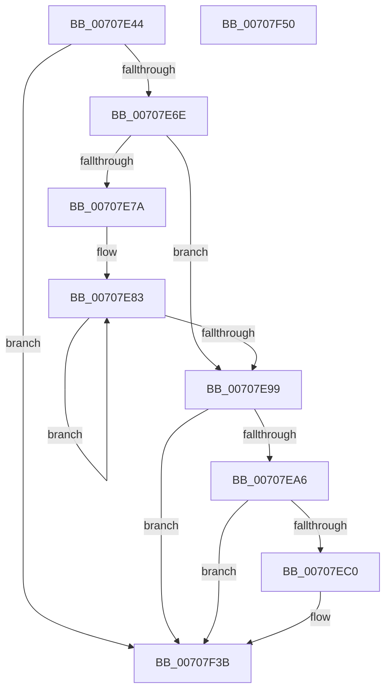

# HalpTscReportSyncStatus

- RVA: `0x00707E44`–`0x00707F51` (길이 `269` bytes)
- VA: `0x0000000140707E44`
- 실행 섹션: `PAGE`
- PDB 이름 있음: `예`; PDB Function 태그: `아니요`
- unwind 정보 RVA: `0x0009EA9C`
- 디코드: `60`개 명령, `269/269` bytes 표시
- 미해석 바이트: `0` (있으면 어셈블리에 `.byte`로 보존)

> 이 문서는 커널 이미지의 기계어와 PDB 기호를 분석해 생성했습니다. 4번과 5번은 함수 원형과 자료형을 바이너리 사용 방식에서 추정한 C 해석이며 원본 소스 복구 결과는 아닙니다.

## 1. Dependencies

- 직접 호출 지점: **4**; 고유 호출 대상: **4**
- 직접 호출자로 확인된 함수: **1**
- RIP 상대 이미지 참조: **6**

### Outgoing calls
- `0x00707E6E` → [HalpQueryMaximumRegisteredProcessorCount](../../text/54/HalpQueryMaximumRegisteredProcessorCount_function_00543BE8.md) (function, `0x00543BE8`)
- `0x00707EB7` → [tlgKeywordOn](../../text/42/tlgKeywordOn_function_0042EAA0.md) (function, `0x0042EAA0`)
- `0x00707F36` → [tlgWriteTransfer_EtwWriteTransfer](../../text/42/tlgWriteTransfer_EtwWriteTransfer_function_004260E0.md) (function, `0x004260E0`)
- `0x00707F42` → [_security_check_cookie](../../text/6A/_security_check_cookie_function_006AC640.md) (function, `0x006AC640`)

### Direct callers
- [HalpTimerInitSystem](../../text/53/HalpTimerInitSystem_function_0053CB70.md) at `0x0053CBEE`

### Static image references
- `0x00707E52` → RVA `0x00E0A740` (`.data`; read)
- `0x00707E60` → RVA `0x00FC21F8` (`.data`; read)
- `0x00707E99` → RVA `0x00E03B28` (`.data`; read)
- `0x00707EC0` → RVA `0x00FC2244` (`.data`; read)
- `0x00707EC6` → RVA `0x000436FD` (`.rdata`; read)
- `0x00707EEE` → RVA `0x00FC2228` (`.data`; read)

## 2. Other-region calls and transfers

- 다른 실행 섹션으로 향하는 call: **4**
  - `0x00707E6E` → [HalpQueryMaximumRegisteredProcessorCount](../../text/54/HalpQueryMaximumRegisteredProcessorCount_function_00543BE8.md) (`PAGE` → `.text`)
  - `0x00707EB7` → [tlgKeywordOn](../../text/42/tlgKeywordOn_function_0042EAA0.md) (`PAGE` → `.text`)
  - `0x00707F36` → [tlgWriteTransfer_EtwWriteTransfer](../../text/42/tlgWriteTransfer_EtwWriteTransfer_function_004260E0.md) (`PAGE` → `.text`)
  - `0x00707F42` → [_security_check_cookie](../../text/6A/_security_check_cookie_function_006AC640.md) (`PAGE` → `.text`)
- 별도 외부 분기/꼬리 이동을 확인하지 못했습니다.

## 3. Assembly (complete function range)

```asm
00707E44  40 55                           push rbp
00707E46  48 8D 6C 24 A9                  lea rbp, [rsp - 0x57]
00707E4B  48 81 EC A0 00 00 00            sub rsp, 0xa0
00707E52  48 8B 05 E7 28 70 00            mov rax, qword ptr [rip + 0x7028e7]
00707E59  48 33 C4                        xor rax, rsp
00707E5C  48 89 45 47                     mov qword ptr [rbp + 0x47], rax
00707E60  48 83 3D 90 A3 8B 00 00         cmp qword ptr [rip + 0x8ba390], 0
00707E68  0F 84 CD 00 00 00               je 0x140707f3b
00707E6E  E8 75 BD E3 FF                  call 0x140543be8
00707E73  45 33 C0                        xor r8d, r8d
00707E76  85 C0                           test eax, eax
00707E78  74 1F                           je 0x140707e99
00707E7A  48 8B 0D 77 A3 8B 00            mov rcx, qword ptr [rip + 0x8ba377]
00707E81  8B D0                           mov edx, eax
00707E83  8B 01                           mov eax, dword ptr [rcx]
00707E85  41 3B C0                        cmp eax, r8d
00707E88  48 8D 49 04                     lea rcx, [rcx + 4]
00707E8C  41 0F 46 C0                     cmovbe eax, r8d
00707E90  44 8B C0                        mov r8d, eax
00707E93  48 83 EA 01                     sub rdx, 1
00707E97  75 EA                           jne 0x140707e83
00707E99  83 3D 88 BC 6F 00 05            cmp dword ptr [rip + 0x6fbc88], 5
00707EA0  0F 86 95 00 00 00               jbe 0x140707f3b
00707EA6  48 BA 00 00 00 00 00 40 00 00   movabs rdx, 0x400000000000
00707EB0  48 8D 0D 71 BC 6F 00            lea rcx, [rip + 0x6fbc71]
00707EB7  E8 E4 6B D2 FF                  call 0x14042eaa0
00707EBC  84 C0                           test al, al
00707EBE  74 7B                           je 0x140707f3b
00707EC0  8A 05 7E A3 8B 00               mov al, byte ptr [rip + 0x8ba37e]
00707EC6  48 8D 15 30 B8 93 FF            lea rdx, [rip - 0x6c47d0]
00707ECD  83 65 23 00                     and dword ptr [rbp + 0x23], 0
00707ED1  48 8D 0D 50 BC 6F 00            lea rcx, [rip + 0x6fbc50]
00707ED8  83 65 33 00                     and dword ptr [rbp + 0x33], 0
00707EDC  45 33 C9                        xor r9d, r9d
00707EDF  83 65 43 00                     and dword ptr [rbp + 0x43], 0
00707EE3  88 45 E7                        mov byte ptr [rbp - 0x19], al
00707EE6  48 8D 45 E7                     lea rax, [rbp - 0x19]
00707EEA  48 89 45 17                     mov qword ptr [rbp + 0x17], rax
00707EEE  48 8B 05 33 A3 8B 00            mov rax, qword ptr [rip + 0x8ba333]
00707EF5  48 89 45 EF                     mov qword ptr [rbp - 0x11], rax
00707EF9  48 8D 45 EF                     lea rax, [rbp - 0x11]
00707EFD  48 89 45 27                     mov qword ptr [rbp + 0x27], rax
00707F01  48 8D 45 EB                     lea rax, [rbp - 0x15]
00707F05  48 89 45 37                     mov qword ptr [rbp + 0x37], rax
00707F09  48 8D 45 F7                     lea rax, [rbp - 9]
00707F0D  44 89 45 EB                     mov dword ptr [rbp - 0x15], r8d
00707F11  45 33 C0                        xor r8d, r8d
00707F14  48 89 44 24 28                  mov qword ptr [rsp + 0x28], rax
00707F19  C7 44 24 20 05 00 00 00         mov dword ptr [rsp + 0x20], 5
00707F21  C7 45 1F 01 00 00 00            mov dword ptr [rbp + 0x1f], 1
00707F28  C7 45 2F 08 00 00 00            mov dword ptr [rbp + 0x2f], 8
00707F2F  C7 45 3F 04 00 00 00            mov dword ptr [rbp + 0x3f], 4
00707F36  E8 A5 E1 D1 FF                  call 0x1404260e0
00707F3B  48 8B 4D 47                     mov rcx, qword ptr [rbp + 0x47]
00707F3F  48 33 CC                        xor rcx, rsp
00707F42  E8 F9 46 FA FF                  call 0x1406ac640
00707F47  48 81 C4 A0 00 00 00            add rsp, 0xa0
00707F4E  5D                              pop rbp
00707F4F  C3                              ret
00707F50  CC                              int3
```

## 4. C-style interpretation (structured pseudocode)

```c
__int64 __fastcall HalpTscReportSyncStatus(__int64 a1, __int64 a2, int a3, int a4)
{
    __int64 result;
    __int64 v_rsp;
    unsigned __int64 v_stack_m18;
    unsigned int v_stack_m1C;
    unsigned int v_stack_m20;
    unsigned __int64 v_stack_m28;
    unsigned int v_stack_m2C;
    unsigned int v_stack_m30;
    unsigned __int64 v_stack_m38;
    unsigned int v_stack_m3C;
    unsigned int v_stack_m40;
    unsigned __int64 v_stack_m48;
    unsigned __int64 v_stack_m5F;
    unsigned __int64 v_stack_m68;
    unsigned __int64 v_stack_m70;
    unsigned __int64 v_stack_m74;
    unsigned __int8 v_stack_m78;
    unsigned __int64 v_stack_m80;
    unsigned int v_stack_m88;

    v_rsp = (v_rsp) - (160);
    result = (*(unsigned __int64 *)(v_rip + 7350503)) ^ (v_rsp);
    v_stack_m18 = result;
    if ((*(unsigned __int64 *)(v_rip + 9151376)) == 0) goto loc_00707F3B;
    result = HalpQueryMaximumRegisteredProcessorCount(a1, a2, a3, a4);
    a3 = 0;
    if ((unsigned int)(result) == 0) goto loc_00707E99;
loc_00707E83:
    result = (unsigned int)(*(unsigned int *)(*(unsigned __int64 *)(v_rip + 9151351)));
    if (((unsigned int)((unsigned int)(*(unsigned int *)(*(unsigned __int64 *)(v_rip + 9151351))))) <= 0) { result = 0; }
    a2 = ((unsigned int)((unsigned int)(result))) - (1);
    if (condition_is_not_equal) goto loc_00707E83;
loc_00707E99:
    if ((*(unsigned int *)(v_rip + 7322760)) <= 5) goto loc_00707F3B;
    result = tlgKeywordOn(v_rip + 7322737, a2, (unsigned int)((unsigned int)(result)), a4);
    if ((unsigned __int8)(result) != 0) {
        result = *(unsigned __int8 *)(v_rip + 9151358);
        a2 = v_rip - 7096272;
        a1 = v_rip + 7322704;
        a4 = 0;
        v_stack_m78 = (unsigned __int8)(result);
        result = v_stack_m78;
        v_stack_m48 = result;
        result = *(unsigned __int64 *)(v_rip + 9151283);
        v_stack_m70 = result;
        result = v_stack_m70;
        v_stack_m38 = result;
        result = v_stack_m74;
        v_stack_m28 = result;
        result = v_stack_m68;
        v_stack_m74 = (unsigned int)((unsigned int)((unsigned int)(result)));
        a3 = 0;
        v_stack_m80 = result;
        v_stack_m88 = 5;
        v_stack_m40 = 1;
        v_stack_m30 = 8;
        v_stack_m20 = 4;
        result = tlgWriteTransfer_EtwWriteTransfer(a1, a2, a3, a4);
    }
    a1 = (v_stack_m18) ^ (v_rsp);
    result = _security_check_cookie(a1, a2, a3, a4);
    v_rsp = (v_rsp) + (160);
    return result;
}
```

## 5. (Beta) C Style

```c
int64_t HalpTscReportSyncStatus(int64_t Arg1, int64_t Arg2, int32_t Arg3, int32_t Arg4)
{
    int64_t result;
    int64_t local_rsp;
    uint64_t v_stack_m18;
    uint32_t v_stack_m1C;
    uint32_t v_stack_m20;
    uint64_t v_stack_m28;
    uint32_t v_stack_m2C;
    uint32_t v_stack_m30;
    uint64_t v_stack_m38;
    uint32_t v_stack_m3C;
    uint32_t v_stack_m40;
    uint64_t v_stack_m48;
    uint64_t v_stack_m5F;
    uint64_t v_stack_m68;
    uint64_t v_stack_m70;
    uint64_t v_stack_m74;
    uint8_t v_stack_m78;
    uint64_t v_stack_m80;
    uint32_t v_stack_m88;

    local_rsp = (local_rsp) - (160);
    result = (*(uint64_t *)(v_rip + 0x7028E7)) ^ (local_rsp);
    v_stack_m18 = result;
    if ((*(uint64_t *)(v_rip + 0x8BA390)) == 0) goto loc_00707F3B;
    result = HalpQueryMaximumRegisteredProcessorCount(Arg1, Arg2, Arg3, Arg4);
    Arg3 = 0;
    if ((uint32_t)(result) == 0) goto loc_00707E99;
loc_00707E83:
    result = (uint32_t)(*(uint32_t *)(*(uint64_t *)(v_rip + 0x8BA377)));
    if (((uint32_t)((uint32_t)(*(uint32_t *)(*(uint64_t *)(v_rip + 0x8BA377))))) <= 0) { result = 0; }
    Arg2 = ((uint32_t)((uint32_t)(result))) - (1);
    if (condition_is_not_equal) goto loc_00707E83;
loc_00707E99:
    if ((*(uint32_t *)(v_rip + 0x6FBC88)) <= 5) goto loc_00707F3B;
    result = tlgKeywordOn(v_rip + 7322737, Arg2, (uint32_t)((uint32_t)(result)), Arg4);
    if ((uint8_t)(result) != 0) {
        result = *(uint8_t *)(v_rip + 0x8BA37E);
        Arg2 = v_rip - 7096272;
        Arg1 = v_rip + 7322704;
        Arg4 = 0;
        v_stack_m78 = (uint8_t)(result);
        result = v_stack_m78;
        v_stack_m48 = result;
        result = *(uint64_t *)(v_rip + 0x8BA333);
        v_stack_m70 = result;
        result = v_stack_m70;
        v_stack_m38 = result;
        result = v_stack_m74;
        v_stack_m28 = result;
        result = v_stack_m68;
        v_stack_m74 = (uint32_t)((uint32_t)((uint32_t)(result)));
        Arg3 = 0;
        v_stack_m80 = result;
        v_stack_m88 = 5;
        v_stack_m40 = 1;
        v_stack_m30 = 8;
        v_stack_m20 = 4;
        result = tlgWriteTransfer_EtwWriteTransfer(Arg1, Arg2, Arg3, Arg4);
    }
    Arg1 = (v_stack_m18) ^ (local_rsp);
    result = _security_check_cookie(Arg1, Arg2, Arg3, Arg4);
    local_rsp = (local_rsp) + (160);
    return result;
}
```

## 6. Execution-region graph

[열기: 2D/3D 그래프와 함수 탐색 컨트롤 패널](../../../control-panel.html?section=page&rva=0x00707E44&view=graph)

- 2D 그래프는 위에서 아래로 흐르고, 3D 그래프는 빈 공간을 드래그해 회전합니다. Shift+드래그는 이동, 휠은 확대·축소, 함수 노드 선택은 대상 보고서 이동입니다.

### Static fallback


