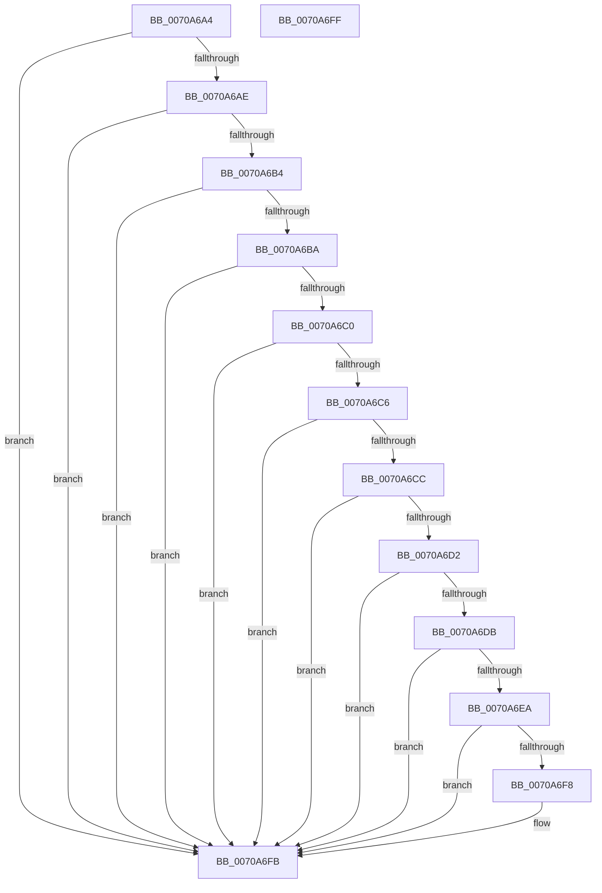

# HalpValidateInterface

- RVA: `0x0070A6A4`–`0x0070A700` (길이 `92` bytes)
- VA: `0x000000014070A6A4`
- 실행 섹션: `PAGE`
- PDB 이름 있음: `예`; PDB Function 태그: `아니요`
- unwind 정보 RVA: `0x000DB714`
- 디코드: `30`개 명령, `92/92` bytes 표시
- 미해석 바이트: `0` (있으면 어셈블리에 `.byte`로 보존)

> 이 문서는 커널 이미지의 기계어와 PDB 기호를 분석해 생성했습니다. 4번과 5번은 함수 원형과 자료형을 바이너리 사용 방식에서 추정한 C 해석이며 원본 소스 복구 결과는 아닙니다.

## 1. Dependencies

- 직접 호출 지점: **0**; 고유 호출 대상: **0**
- 직접 호출자로 확인된 함수: **1**
- RIP 상대 이미지 참조: **2**

### Outgoing calls
- 직접 디코드된 call 명령이 없습니다.

### Direct callers
- [HalpRegisterSecondaryIcInterface](../../text/55/HalpRegisterSecondaryIcInterface_function_005571FC.md) at `0x00557203`

### Static image references
- `0x0070A6DF` → RVA `0x00F909DC` (`.data`; read)
- `0x0070A6EA` → RVA `0x00F90A30` (`.data`; read)

## 2. Other-region calls and transfers

- 다른 실행 섹션으로 향하는 call: **0**
- 별도 외부 분기/꼬리 이동을 확인하지 못했습니다.

## 3. Assembly (complete function range)

```asm
0070A6A4  45 33 C0                        xor r8d, r8d
0070A6A7  66 83 79 02 01                  cmp word ptr [rcx + 2], 1
0070A6AC  75 4D                           jne 0x14070a6fb
0070A6AE  4C 39 41 20                     cmp qword ptr [rcx + 0x20], r8
0070A6B2  74 47                           je 0x14070a6fb
0070A6B4  4C 39 41 28                     cmp qword ptr [rcx + 0x28], r8
0070A6B8  74 41                           je 0x14070a6fb
0070A6BA  4C 39 41 30                     cmp qword ptr [rcx + 0x30], r8
0070A6BE  74 3B                           je 0x14070a6fb
0070A6C0  4C 39 41 38                     cmp qword ptr [rcx + 0x38], r8
0070A6C4  74 35                           je 0x14070a6fb
0070A6C6  4C 39 41 40                     cmp qword ptr [rcx + 0x40], r8
0070A6CA  74 2F                           je 0x14070a6fb
0070A6CC  4C 39 41 18                     cmp qword ptr [rcx + 0x18], r8
0070A6D0  74 29                           je 0x14070a6fb
0070A6D2  0F B7 41 14                     movzx eax, word ptr [rcx + 0x14]
0070A6D6  66 85 C0                        test ax, ax
0070A6D9  74 20                           je 0x14070a6fb
0070A6DB  44 8B 49 10                     mov r9d, dword ptr [rcx + 0x10]
0070A6DF  8B 0D F7 62 88 00               mov ecx, dword ptr [rip + 0x8862f7]
0070A6E5  44 3B C9                        cmp r9d, ecx
0070A6E8  72 11                           jb 0x14070a6fb
0070A6EA  03 0D 40 63 88 00               add ecx, dword ptr [rip + 0x886340]
0070A6F0  41 8D 14 01                     lea edx, [r9 + rax]
0070A6F4  3B D1                           cmp edx, ecx
0070A6F6  77 03                           ja 0x14070a6fb
0070A6F8  41 B0 01                        mov r8b, 1
0070A6FB  41 8A C0                        mov al, r8b
0070A6FE  C3                              ret
0070A6FF  CC                              int3
```

## 4. C-style interpretation (structured pseudocode)

```c
__int64 __fastcall HalpValidateInterface(__int64 a1, __int64 a2, int a3)
{
    a3 = 0;
    if ((*(unsigned __int16 *)(a1 + 2)) != 1) goto loc_0070A6FB;
    if ((*(unsigned __int64 *)(a1 + 32)) == 0) goto loc_0070A6FB;
    if ((*(unsigned __int64 *)(a1 + 40)) == 0) goto loc_0070A6FB;
    if ((*(unsigned __int64 *)(a1 + 48)) == 0) goto loc_0070A6FB;
    if ((*(unsigned __int64 *)(a1 + 56)) == 0) goto loc_0070A6FB;
    if ((*(unsigned __int64 *)(a1 + 64)) == 0) goto loc_0070A6FB;
    if ((*(unsigned __int64 *)(a1 + 24)) == 0) goto loc_0070A6FB;
    if ((unsigned __int16)(*(unsigned __int16 *)(a1 + 20)) == 0) goto loc_0070A6FB;
    if (((unsigned int)((unsigned int)(*(unsigned int *)(a1 + 16)))) < ((unsigned int)((unsigned int)(*(unsigned int *)(v_rip + 8938231))))) goto loc_0070A6FB;
    a1 = (unsigned int)(((unsigned int)(*(unsigned int *)(v_rip + 8938231))) + (*(unsigned int *)(v_rip + 8938304)));
    if (((unsigned int)((unsigned int)(*(unsigned int *)(a1 + 16)) + *(unsigned __int16 *)(a1 + 20) * 1)) <= ((unsigned int)(a1))) {
        a3 = 1;
    }
    return (unsigned __int8)(a3);
}
```

## 5. (Beta) C Style

```c
int64_t HalpValidateInterface(void *Arg1, int64_t Arg2, int32_t Arg3)
{
    uint8_t *arg1 = (uint8_t *)Arg1;

    Arg3 = 0;
    if ((*(uint16_t *)(arg1 + 0x2)) != 1) goto loc_0070A6FB;
    if ((*(uint64_t *)(arg1 + 0x20)) == 0) goto loc_0070A6FB;
    if ((*(uint64_t *)(arg1 + 0x28)) == 0) goto loc_0070A6FB;
    if ((*(uint64_t *)(arg1 + 0x30)) == 0) goto loc_0070A6FB;
    if ((*(uint64_t *)(arg1 + 0x38)) == 0) goto loc_0070A6FB;
    if ((*(uint64_t *)(arg1 + 0x40)) == 0) goto loc_0070A6FB;
    if ((*(uint64_t *)(arg1 + 0x18)) == 0) goto loc_0070A6FB;
    if ((uint16_t)(*(uint16_t *)(arg1 + 0x14)) == 0) goto loc_0070A6FB;
    if (((uint32_t)((uint32_t)(*(uint32_t *)(arg1 + 0x10)))) < ((uint32_t)((uint32_t)(*(uint32_t *)(v_rip + 0x8862F7))))) goto loc_0070A6FB;
    Arg1 = (uint32_t)(((uint32_t)(*(uint32_t *)(v_rip + 0x8862F7))) + (*(uint32_t *)(v_rip + 0x886340)));
    if (((uint32_t)((uint32_t)(*(uint32_t *)(arg1 + 0x10)) + *(uint16_t *)(arg1 + 0x14) * 1)) <= ((uint32_t)(Arg1))) {
        Arg3 = 1;
    }
    return (uint8_t)(Arg3);
}
```

### 관측된 메모리 오프셋

구조체 형식이 확인되지 않은 접근은 인자 기준의 오프셋으로만 기록했습니다.

| 기준 인자 | 오프셋 표현 | 폭 (bit) | 접근 |
|---|---:|---:|---|
| `Arg1` | `+ 0x2` | `16` | `R` |
| `Arg1` | `+ 0x10` | `32` | `R` |
| `Arg1` | `+ 0x14` | `16` | `R` |
| `Arg1` | `+ 0x18` | `64` | `R` |
| `Arg1` | `+ 0x20` | `64` | `R` |
| `Arg1` | `+ 0x28` | `64` | `R` |
| `Arg1` | `+ 0x30` | `64` | `R` |
| `Arg1` | `+ 0x38` | `64` | `R` |
| `Arg1` | `+ 0x40` | `64` | `R` |

## 6. Execution-region graph

[열기: 2D/3D 그래프와 함수 탐색 컨트롤 패널](../../../control-panel.html?section=page&rva=0x0070A6A4&view=graph)

- 2D 그래프는 위에서 아래로 흐르고, 3D 그래프는 빈 공간을 드래그해 회전합니다. Shift+드래그는 이동, 휠은 확대·축소, 함수 노드 선택은 대상 보고서 이동입니다.

### Static fallback


