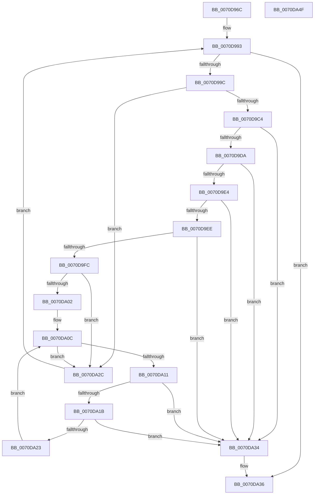

# HalpValidateMpns

- RVA: `0x0070D96C`–`0x0070DA50` (길이 `228` bytes)
- VA: `0x000000014070D96C`
- 실행 섹션: `PAGE`
- PDB 이름 있음: `예`; PDB Function 태그: `아니요`
- unwind 정보 RVA: `0x000A6CEC`
- 디코드: `67`개 명령, `228/228` bytes 표시
- 미해석 바이트: `0` (있으면 어셈블리에 `.byte`로 보존)

> 이 문서는 커널 이미지의 기계어와 PDB 기호를 분석해 생성했습니다. 4번과 5번은 함수 원형과 자료형을 바이너리 사용 방식에서 추정한 C 해석이며 원본 소스 복구 결과는 아닙니다.

## 1. Dependencies

- 직접 호출 지점: **0**; 고유 호출 대상: **0**
- 직접 호출자로 확인된 함수: **1**
- RIP 상대 이미지 참조: **2**

### Outgoing calls
- 직접 디코드된 call 명령이 없습니다.

### Direct callers
- [HalpChannelInitializeStaticConfiguration](../../init/C2/HalpChannelInitializeStaticConfiguration_function_00C25318.md) at `0x00C25582`

### Static image references
- `0x0070D981` → RVA `0x00F8F9E0` (`.data`; read)
- `0x0070D99C` → RVA `0x00F8F9D8` (`.data`; read)

## 2. Other-region calls and transfers

- 다른 실행 섹션으로 향하는 call: **0**
- 별도 외부 분기/꼬리 이동을 확인하지 못했습니다.

## 3. Assembly (complete function range)

```asm
0070D96C  48 8B C4                        mov rax, rsp
0070D96F  48 89 58 08                     mov qword ptr [rax + 8], rbx
0070D973  48 89 68 10                     mov qword ptr [rax + 0x10], rbp
0070D977  48 89 70 18                     mov qword ptr [rax + 0x18], rsi
0070D97B  48 89 78 20                     mov qword ptr [rax + 0x20], rdi
0070D97F  41 56                           push r14
0070D981  44 8B 35 58 20 88 00            mov r14d, dword ptr [rip + 0x882058]
0070D988  BA 01 00 00 00                  mov edx, 1
0070D98D  44 8B CA                        mov r9d, edx
0070D990  41 FF CE                        dec r14d
0070D993  45 3B CE                        cmp r9d, r14d
0070D996  0F 83 9A 00 00 00               jae 0x14070da36
0070D99C  4C 8B 1D 35 20 88 00            mov r11, qword ptr [rip + 0x882035]
0070D9A3  41 8D 59 FF                     lea ebx, [r9 - 1]
0070D9A7  48 03 DB                        add rbx, rbx
0070D9AA  41 8B F9                        mov edi, r9d
0070D9AD  48 03 FF                        add rdi, rdi
0070D9B0  4D 8B 14 DB                     mov r10, qword ptr [r11 + rbx*8]
0070D9B4  4D 8B 04 FB                     mov r8, qword ptr [r11 + rdi*8]
0070D9B8  41 0F B7 40 02                  movzx eax, word ptr [r8 + 2]
0070D9BD  66 41 39 42 02                  cmp word ptr [r10 + 2], ax
0070D9C2  75 68                           jne 0x14070da2c
0070D9C4  41 8A 32                        mov sil, byte ptr [r10]
0070D9C7  41 8A 08                        mov cl, byte ptr [r8]
0070D9CA  40 8A C6                        mov al, sil
0070D9CD  22 C2                           and al, dl
0070D9CF  22 CA                           and cl, dl
0070D9D1  0C 06                           or al, 6
0070D9D3  80 C9 06                        or cl, 6
0070D9D6  3A C1                           cmp al, cl
0070D9D8  75 5A                           jne 0x14070da34
0070D9DA  41 8B 6A 18                     mov ebp, dword ptr [r10 + 0x18]
0070D9DE  41 3B 68 18                     cmp ebp, dword ptr [r8 + 0x18]
0070D9E2  75 50                           jne 0x14070da34
0070D9E4  41 8B 40 1C                     mov eax, dword ptr [r8 + 0x1c]
0070D9E8  41 39 42 1C                     cmp dword ptr [r10 + 0x1c], eax
0070D9EC  75 46                           jne 0x14070da34
0070D9EE  41 0F B7 44 FB 0A               movzx eax, word ptr [r11 + rdi*8 + 0xa]
0070D9F4  66 41 39 44 DB 0A               cmp word ptr [r11 + rbx*8 + 0xa], ax
0070D9FA  75 38                           jne 0x14070da34
0070D9FC  40 F6 C6 02                     test sil, 2
0070DA00  74 2A                           je 0x14070da2c
0070DA02  45 33 DB                        xor r11d, r11d
0070DA05  49 8D 4A 20                     lea rcx, [r10 + 0x20]
0070DA09  4D 2B C2                        sub r8, r10
0070DA0C  44 3B DD                        cmp r11d, ebp
0070DA0F  73 1B                           jae 0x14070da2c
0070DA11  41 8A 44 08 01                  mov al, byte ptr [r8 + rcx + 1]
0070DA16  38 41 01                        cmp byte ptr [rcx + 1], al
0070DA19  75 19                           jne 0x14070da34
0070DA1B  41 8A 04 08                     mov al, byte ptr [r8 + rcx]
0070DA1F  38 01                           cmp byte ptr [rcx], al
0070DA21  75 11                           jne 0x14070da34
0070DA23  44 03 DA                        add r11d, edx
0070DA26  48 83 C1 02                     add rcx, 2
0070DA2A  EB E0                           jmp 0x14070da0c
0070DA2C  44 03 CA                        add r9d, edx
0070DA2F  E9 5F FF FF FF                  jmp 0x14070d993
0070DA34  33 D2                           xor edx, edx
0070DA36  48 8B 5C 24 10                  mov rbx, qword ptr [rsp + 0x10]
0070DA3B  8B C2                           mov eax, edx
0070DA3D  48 8B 6C 24 18                  mov rbp, qword ptr [rsp + 0x18]
0070DA42  48 8B 74 24 20                  mov rsi, qword ptr [rsp + 0x20]
0070DA47  48 8B 7C 24 28                  mov rdi, qword ptr [rsp + 0x28]
0070DA4C  41 5E                           pop r14
0070DA4E  C3                              ret
0070DA4F  CC                              int3
```

## 4. C-style interpretation (structured pseudocode)

```c
__int64 __fastcall HalpValidateMpns(void)
{
    __int64 result;
    __int64 v_r11;
    __int64 v_r14;
    __int64 v_rbx;
    __int64 v_rdi;
    unsigned __int64 v_stack_p10;
    unsigned __int64 v_stack_p18;
    unsigned __int64 v_stack_p20;
    unsigned __int64 v_stack_p8;

    *(unsigned __int64 *)(v_rsp + 8) = v_rbx;
    *(unsigned __int64 *)(v_rsp + 16) = v_rbp;
    *(unsigned __int64 *)(v_rsp + 24) = v_rsi;
    *(unsigned __int64 *)(v_rsp + 32) = v_rdi;
    v_r14 = (unsigned int)(((unsigned int)(*(unsigned int *)(v_rip + 8921176))) - 1);
loc_0070D993:
    if (1 >= ((unsigned int)(v_r14))) goto loc_0070DA36;
    v_rbx = (1 - 1) + (1 - 1);
    v_rdi = (1) + (1);
    if ((*(unsigned __int16 *)(*(unsigned __int64 *)(*(unsigned __int64 *)(v_rip + 8921141) + v_rbx * 8) + 2)) != ((unsigned __int16)(*(unsigned __int16 *)(*(unsigned __int64 *)(*(unsigned __int64 *)(v_rip + 8921141) + v_rdi * 8) + 2)))) goto loc_0070DA2C;
    result = (unsigned __int8)(((unsigned __int8)(*(unsigned __int8 *)(*(unsigned __int64 *)(*(unsigned __int64 *)(v_rip + 8921141) + v_rbx * 8)))) & (1));
    a1 = (unsigned __int8)((*(unsigned __int8 *)(*(unsigned __int64 *)(*(unsigned __int64 *)(v_rip + 8921141) + v_rdi * 8))) & (1));
    result = (unsigned __int8)((result) | (6));
    a1 = (unsigned __int8)((a1) | (6));
    if (((unsigned __int8)(result)) != ((unsigned __int8)(a1))) goto loc_0070DA34;
    if (((unsigned int)((unsigned int)(*(unsigned int *)(*(unsigned __int64 *)(*(unsigned __int64 *)(v_rip + 8921141) + v_rbx * 8) + 24)))) != (*(unsigned int *)(*(unsigned __int64 *)(*(unsigned __int64 *)(v_rip + 8921141) + v_rdi * 8) + 24))) goto loc_0070DA34;
    if ((*(unsigned int *)(*(unsigned __int64 *)(*(unsigned __int64 *)(v_rip + 8921141) + v_rbx * 8) + 28)) != ((unsigned int)((unsigned int)(*(unsigned int *)(*(unsigned __int64 *)(*(unsigned __int64 *)(v_rip + 8921141) + v_rdi * 8) + 28))))) goto loc_0070DA34;
    if ((*(unsigned __int16 *)(*(unsigned __int64 *)(v_rip + 8921141) + v_rbx * 8 + 10)) != ((unsigned __int16)(*(unsigned __int16 *)(*(unsigned __int64 *)(v_rip + 8921141) + v_rdi * 8 + 10)))) goto loc_0070DA34;
    if ((((unsigned __int8)(*(unsigned __int8 *)(*(unsigned __int64 *)(*(unsigned __int64 *)(v_rip + 8921141) + v_rbx * 8)))) & (2)) == 0) goto loc_0070DA2C;
    v_r11 = 0;
    a3 = (*(unsigned __int64 *)(*(unsigned __int64 *)(v_rip + 8921141) + v_rdi * 8)) - (*(unsigned __int64 *)(*(unsigned __int64 *)(v_rip + 8921141) + v_rbx * 8));
loc_0070DA0C:
    if (0 >= ((unsigned int)((unsigned int)(*(unsigned int *)(*(unsigned __int64 *)(*(unsigned __int64 *)(v_rip + 8921141) + v_rbx * 8) + 24))))) goto loc_0070DA2C;
    if ((*(unsigned __int8 *)(*(unsigned __int64 *)(*(unsigned __int64 *)(v_rip + 8921141) + v_rbx * 8) + 32 + 1)) != ((unsigned __int8)(*(unsigned __int8 *)(a3 + *(unsigned __int64 *)(*(unsigned __int64 *)(v_rip + 8921141) + v_rbx * 8) + 32 * 1 + 1)))) goto loc_0070DA34;
    if ((*(unsigned __int8 *)(*(unsigned __int64 *)(*(unsigned __int64 *)(v_rip + 8921141) + v_rbx * 8) + 32)) != ((unsigned __int8)(*(unsigned __int8 *)(a3 + *(unsigned __int64 *)(*(unsigned __int64 *)(v_rip + 8921141) + v_rbx * 8) + 32 * 1)))) goto loc_0070DA34;
    v_r11 = (unsigned int)((v_r11) + (1));
    a1 = (*(unsigned __int64 *)(*(unsigned __int64 *)(v_rip + 8921141) + v_rbx * 8) + 32) + (2);
    goto loc_0070DA0C;
loc_0070DA2C:
    a4 = (unsigned int)((1) + (1));
    goto loc_0070D993;
loc_0070DA34:
    a2 = 0;
loc_0070DA36:
    return 0;
}
```

## 5. (Beta) C Style

```c
void HalpValidateMpns(void)
{
    int64_t result;
    int64_t local_r11;
    int64_t local_r14;
    int64_t local_rbx;
    int64_t local_rdi;
    uint64_t v_stack_p10;
    uint64_t v_stack_p18;
    uint64_t v_stack_p20;
    uint64_t v_stack_p8;

    *(uint64_t *)(local_rsp + 0x8) = local_rbx;
    *(uint64_t *)(local_rsp + 0x10) = local_rbp;
    *(uint64_t *)(local_rsp + 0x18) = local_rsi;
    *(uint64_t *)(local_rsp + 0x20) = local_rdi;
    local_r14 = (uint32_t)(((uint32_t)(*(uint32_t *)(v_rip + 0x882058))) - 1);
loc_0070D993:
    if (1 >= ((uint32_t)(local_r14))) goto loc_0070DA36;
    local_rbx = (1 - 1) + (1 - 1);
    local_rdi = (1) + (1);
    if ((*(uint16_t *)(*(uint64_t *)(*(uint64_t *)(v_rip + 0x882035) + local_rbx * 8) + 0x2)) != ((uint16_t)(*(uint16_t *)(*(uint64_t *)(*(uint64_t *)(v_rip + 0x882035) + local_rdi * 8) + 0x2)))) goto loc_0070DA2C;
    result = (uint8_t)(((uint8_t)(*(uint8_t *)(*(uint64_t *)(*(uint64_t *)(v_rip + 0x882035) + local_rbx * 8)))) & (1));
    a1 = (uint8_t)((*(uint8_t *)(*(uint64_t *)(*(uint64_t *)(v_rip + 0x882035) + local_rdi * 8))) & (1));
    result = (uint8_t)((result) | (6));
    a1 = (uint8_t)((a1) | (6));
    if (((uint8_t)(result)) != ((uint8_t)(a1))) goto loc_0070DA34;
    if (((uint32_t)((uint32_t)(*(uint32_t *)(*(uint64_t *)(*(uint64_t *)(v_rip + 0x882035) + local_rbx * 8) + 0x18)))) != (*(uint32_t *)(*(uint64_t *)(*(uint64_t *)(v_rip + 0x882035) + local_rdi * 8) + 0x18))) goto loc_0070DA34;
    if ((*(uint32_t *)(*(uint64_t *)(*(uint64_t *)(v_rip + 0x882035) + local_rbx * 8) + 0x1C)) != ((uint32_t)((uint32_t)(*(uint32_t *)(*(uint64_t *)(*(uint64_t *)(v_rip + 0x882035) + local_rdi * 8) + 0x1C))))) goto loc_0070DA34;
    if ((*(uint16_t *)(*(uint64_t *)(v_rip + 0x882035) + local_rbx * 8 + 0xA)) != ((uint16_t)(*(uint16_t *)(*(uint64_t *)(v_rip + 0x882035) + local_rdi * 8 + 0xA)))) goto loc_0070DA34;
    if ((((uint8_t)(*(uint8_t *)(*(uint64_t *)(*(uint64_t *)(v_rip + 0x882035) + local_rbx * 8)))) & (2)) == 0) goto loc_0070DA2C;
    local_r11 = 0;
    a3 = (*(uint64_t *)(*(uint64_t *)(v_rip + 0x882035) + local_rdi * 8)) - (*(uint64_t *)(*(uint64_t *)(v_rip + 0x882035) + local_rbx * 8));
loc_0070DA0C:
    if (0 >= ((uint32_t)((uint32_t)(*(uint32_t *)(*(uint64_t *)(*(uint64_t *)(v_rip + 0x882035) + local_rbx * 8) + 0x18))))) goto loc_0070DA2C;
    if ((*(uint8_t *)(*(uint64_t *)(*(uint64_t *)(v_rip + 0x882035) + local_rbx * 8) + 0x20 + 0x1)) != ((uint8_t)(*(uint8_t *)(a3 + *(uint64_t *)(*(uint64_t *)(v_rip + 0x882035) + local_rbx * 8) + 0x20 * 1 + 0x1)))) goto loc_0070DA34;
    if ((*(uint8_t *)(*(uint64_t *)(*(uint64_t *)(v_rip + 0x882035) + local_rbx * 8) + 0x20)) != ((uint8_t)(*(uint8_t *)(a3 + *(uint64_t *)(*(uint64_t *)(v_rip + 0x882035) + local_rbx * 8) + 0x20 * 1)))) goto loc_0070DA34;
    local_r11 = (uint32_t)((local_r11) + (1));
    a1 = (*(uint64_t *)(*(uint64_t *)(v_rip + 0x882035) + local_rbx * 8) + 32) + (2);
    goto loc_0070DA0C;
loc_0070DA2C:
    a4 = (uint32_t)((1) + (1));
    goto loc_0070D993;
loc_0070DA34:
    a2 = 0;
loc_0070DA36:
    return 0;
}
```

## 6. Execution-region graph

[열기: 2D/3D 그래프와 함수 탐색 컨트롤 패널](../../../control-panel.html?section=page&rva=0x0070D96C&view=graph)

- 2D 그래프는 위에서 아래로 흐르고, 3D 그래프는 빈 공간을 드래그해 회전합니다. Shift+드래그는 이동, 휠은 확대·축소, 함수 노드 선택은 대상 보고서 이동입니다.

### Static fallback


