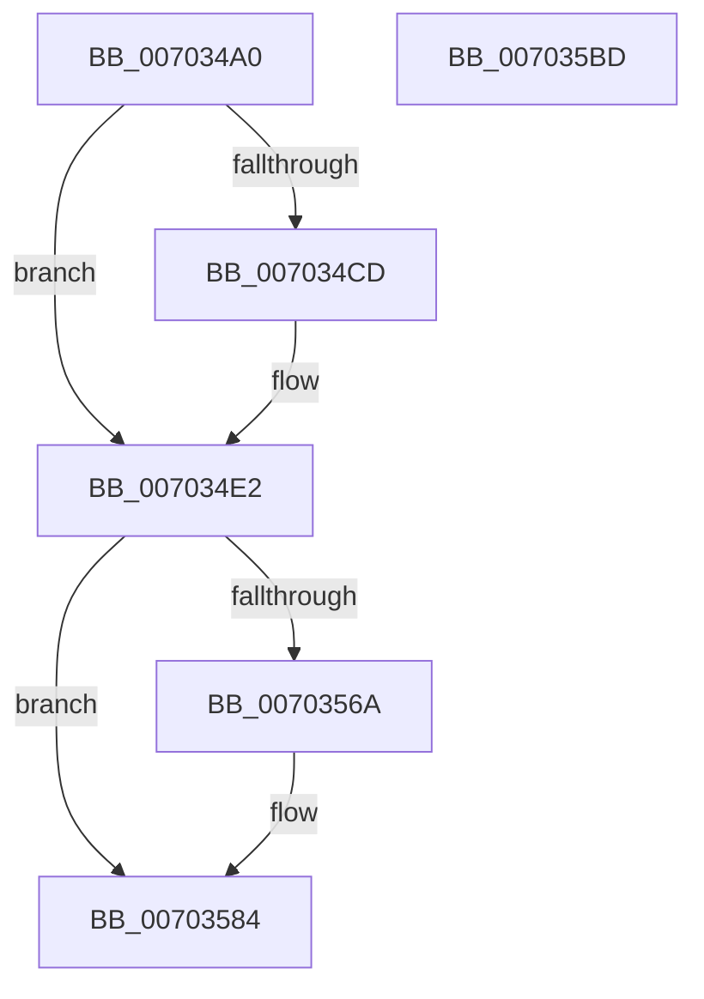

# IoCancelFileOpen

- RVA: `0x007034A0`–`0x007035BE` (길이 `286` bytes)
- VA: `0x00000001407034A0`
- 실행 섹션: `PAGE`
- PDB 이름 있음: `예`; PDB Function 태그: `아니요`
- unwind 정보 RVA: `0x0007F83C`
- 디코드: `70`개 명령, `286/286` bytes 표시
- 미해석 바이트: `0` (있으면 어셈블리에 `.byte`로 보존)

> 이 문서는 커널 이미지의 기계어와 PDB 기호를 분석해 생성했습니다. 4번과 5번은 함수 원형과 자료형을 바이너리 사용 방식에서 추정한 C 해석이며 원본 소스 복구 결과는 아닙니다.

## 1. Dependencies

- 직접 호출 지점: **11**; 고유 호출 대상: **11**
- 직접 호출자로 확인된 함수: **1**
- RIP 상대 이미지 참조: **0**

### Outgoing calls
- `0x007034DC` → [KeBugCheckEx](../../text/4F/KeBugCheckEx_function_004FD660.md) (function, `0x004FD660`)
- `0x007034EE` → [KeInitializeEvent](../../text/40/KeInitializeEvent_function_0040DD10.md) (function, `0x0040DD10`)
- `0x007034F6` → [IopResetEvent](../../text/29/IopResetEvent_function_0029D5F0.md) (function, `0x0029D5F0`)
- `0x00703501` → [IopAllocateIrpMustSucceed](../../text/20/IopAllocateIrpMustSucceed_function_002076C0.md) (function, `0x002076C0`)
- `0x00703553` → [IopQueueThreadIrp](../../text/20/IopQueueThreadIrp_function_002075C0.md) (function, `0x002075C0`)
- `0x0070355E` → [IoCallDriver](../../text/49/IoCallDriver_function_0049FE30.md) (function, `0x0049FE30`)
- `0x0070357F` → [KeWaitForSingleObject](../../text/20/KeWaitForSingleObject_function_0020E6B0.md) (function, `0x0020E6B0`)
- `0x00703587` → [IopDequeueIrpFromThread](../../text/20/IopDequeueIrpFromThread_function_00207B20.md) (function, `0x00207B20`)
- `0x0070358F` → [IoFreeIrp](../../text/24/IoFreeIrp_function_0024DF70.md) (function, `0x0024DF70`)
- `0x0070359B` → [KeResetEvent](../../text/24/KeResetEvent_function_00248350.md) (function, `0x00248350`)
- `0x007035A8` → [IopCloseFileObjectExtension](../../text/38/IopCloseFileObjectExtension_function_0038F6E0.md) (function, `0x0038F6E0`)

### Direct callers
- [IopParseDevice](../89/IopParseDevice_function_0089E510.md) at `0x0089F0CC`

### Static image references
- 디코드된 RIP-relative 메모리 참조가 없습니다.

## 2. Other-region calls and transfers

- 다른 실행 섹션으로 향하는 call: **11**
  - `0x007034DC` → [KeBugCheckEx](../../text/4F/KeBugCheckEx_function_004FD660.md) (`PAGE` → `.text`)
  - `0x007034EE` → [KeInitializeEvent](../../text/40/KeInitializeEvent_function_0040DD10.md) (`PAGE` → `.text`)
  - `0x007034F6` → [IopResetEvent](../../text/29/IopResetEvent_function_0029D5F0.md) (`PAGE` → `.text`)
  - `0x00703501` → [IopAllocateIrpMustSucceed](../../text/20/IopAllocateIrpMustSucceed_function_002076C0.md) (`PAGE` → `.text`)
  - `0x00703553` → [IopQueueThreadIrp](../../text/20/IopQueueThreadIrp_function_002075C0.md) (`PAGE` → `.text`)
  - `0x0070355E` → [IoCallDriver](../../text/49/IoCallDriver_function_0049FE30.md) (`PAGE` → `.text`)
  - `0x0070357F` → [KeWaitForSingleObject](../../text/20/KeWaitForSingleObject_function_0020E6B0.md) (`PAGE` → `.text`)
  - `0x00703587` → [IopDequeueIrpFromThread](../../text/20/IopDequeueIrpFromThread_function_00207B20.md) (`PAGE` → `.text`)
  - `0x0070358F` → [IoFreeIrp](../../text/24/IoFreeIrp_function_0024DF70.md) (`PAGE` → `.text`)
  - `0x0070359B` → [KeResetEvent](../../text/24/KeResetEvent_function_00248350.md) (`PAGE` → `.text`)
  - `0x007035A8` → [IopCloseFileObjectExtension](../../text/38/IopCloseFileObjectExtension_function_0038F6E0.md) (`PAGE` → `.text`)
- 별도 외부 분기/꼬리 이동을 확인하지 못했습니다.

## 3. Assembly (complete function range)

```asm
007034A0  4C 8B DC                        mov r11, rsp
007034A3  49 89 5B 08                     mov qword ptr [r11 + 8], rbx
007034A7  49 89 73 10                     mov qword ptr [r11 + 0x10], rsi
007034AB  57                              push rdi
007034AC  48 83 EC 50                     sub rsp, 0x50
007034B0  33 C0                           xor eax, eax
007034B2  0F 57 C0                        xorps xmm0, xmm0
007034B5  F7 42 50 00 00 04 00            test dword ptr [rdx + 0x50], 0x40000
007034BC  48 8B DA                        mov rbx, rdx
007034BF  0F 11 44 24 30                  movups xmmword ptr [rsp + 0x30], xmm0
007034C4  49 89 43 E8                     mov qword ptr [r11 - 0x18], rax
007034C8  48 8B F1                        mov rsi, rcx
007034CB  74 15                           je 0x1407034e2
007034CD  49 21 43 C8                     and qword ptr [r11 - 0x38], rax
007034D1  4C 8B C1                        mov r8, rcx
007034D4  B9 E8 00 00 00                  mov ecx, 0xe8
007034D9  45 33 C9                        xor r9d, r9d
007034DC  E8 7F A1 DF FF                  call 0x1404fd660
007034E1  CC                              int3
007034E2  45 33 C0                        xor r8d, r8d
007034E5  48 8D 4C 24 30                  lea rcx, [rsp + 0x30]
007034EA  41 8D 50 01                     lea edx, [r8 + 1]
007034EE  E8 1D A8 D0 FF                  call 0x14040dd10
007034F3  48 8B CB                        mov rcx, rbx
007034F6  E8 F5 A0 B9 FF                  call 0x14029d5f0
007034FB  8A 56 4C                        mov dl, byte ptr [rsi + 0x4c]
007034FE  48 8B CE                        mov rcx, rsi
00703501  E8 BA 41 B0 FF                  call 0x1402076c0
00703506  48 8B F8                        mov rdi, rax
00703509  48 89 98 C0 00 00 00            mov qword ptr [rax + 0xc0], rbx
00703510  65 48 8B 0C 25 88 01 00 00      mov rcx, qword ptr gs:[0x188]
00703519  48 83 67 58 00                  and qword ptr [rdi + 0x58], 0
0070351E  48 89 88 98 00 00 00            mov qword ptr [rax + 0x98], rcx
00703525  48 8D 4F 30                     lea rcx, [rdi + 0x30]
00703529  48 89 4F 48                     mov qword ptr [rdi + 0x48], rcx
0070352D  48 8B 8F B8 00 00 00            mov rcx, qword ptr [rdi + 0xb8]
00703534  C6 40 40 00                     mov byte ptr [rax + 0x40], 0
00703538  48 8D 44 24 30                  lea rax, [rsp + 0x30]
0070353D  48 89 47 50                     mov qword ptr [rdi + 0x50], rax
00703541  C7 47 10 04 04 00 00            mov dword ptr [rdi + 0x10], 0x404
00703548  C6 41 B8 12                     mov byte ptr [rcx - 0x48], 0x12
0070354C  48 89 59 E8                     mov qword ptr [rcx - 0x18], rbx
00703550  48 8B CF                        mov rcx, rdi
00703553  E8 68 40 B0 FF                  call 0x1402075c0
00703558  48 8B D7                        mov rdx, rdi
0070355B  48 8B CE                        mov rcx, rsi
0070355E  E8 CD C8 D9 FF                  call 0x14049fe30
00703563  3D 03 01 00 00                  cmp eax, 0x103
00703568  75 1A                           jne 0x140703584
0070356A  48 83 64 24 20 00               and qword ptr [rsp + 0x20], 0
00703570  48 8D 4C 24 30                  lea rcx, [rsp + 0x30]
00703575  45 33 C9                        xor r9d, r9d
00703578  45 33 C0                        xor r8d, r8d
0070357B  41 8D 51 06                     lea edx, [r9 + 6]
0070357F  E8 2C B1 B0 FF                  call 0x14020e6b0
00703584  48 8B CF                        mov rcx, rdi
00703587  E8 94 45 B0 FF                  call 0x140207b20
0070358C  48 8B CF                        mov rcx, rdi
0070358F  E8 DC A9 B4 FF                  call 0x14024df70
00703594  48 8D 8B 98 00 00 00            lea rcx, [rbx + 0x98]
0070359B  E8 B0 4D B4 FF                  call 0x140248350
007035A0  0F BA 6B 50 15                  bts dword ptr [rbx + 0x50], 0x15
007035A5  48 8B CB                        mov rcx, rbx
007035A8  E8 33 C1 C8 FF                  call 0x14038f6e0
007035AD  48 8B 5C 24 60                  mov rbx, qword ptr [rsp + 0x60]
007035B2  48 8B 74 24 68                  mov rsi, qword ptr [rsp + 0x68]
007035B7  48 83 C4 50                     add rsp, 0x50
007035BB  5F                              pop rdi
007035BC  C3                              ret
007035BD  CC                              int3
```

## 4. C-style interpretation (structured pseudocode)

```c
__int64 __fastcall IoCancelFileOpen(__int64 a1, __int64 a2, __int64 a3, int a4)
{
    __int64 result;
    __int64 v_rsp;
    unsigned __int64 v_stack_m28;
    unsigned __int64 v_stack_m38;
    unsigned __int64 v_stack_p10;
    unsigned __int64 v_stack_p8;

    *(unsigned __int64 *)(v_rsp + 8) = v_rbx;
    *(unsigned __int64 *)(v_rsp + 16) = v_rsi;
    v_rsp = (v_rsp) - (80);
    result = 0;
    v_stack_m28 = v_xmm0;
    *(unsigned __int64 *)(v_rsp - 24) = 0;
    if (((*(unsigned int *)(a2 + 80)) & (0x40000ULL)) != 0) {
        a3 = a1;
        a1 = 232;
        a4 = 0;
        result = KeBugCheckEx(a1, a2, a3, a4);
    }
    a3 = 0;
    result = KeInitializeEvent(v_stack_m28, a3 + 1, a3, a4);
    result = IopResetEvent(a2, a3 + 1, a3, a4);
    result = IopAllocateIrpMustSucceed(a1, *(unsigned __int8 *)(a1 + 76), a3, a4);
    *(unsigned __int64 *)(result + 192) = a2;
    *(unsigned __int64 *)(result + 152) = *(unsigned __int64 *)(gs_base + (0 + 392));
    *(unsigned __int64 *)(result + 72) = result + 48;
    *(unsigned __int8 *)(result + 64) = 0;
    *(unsigned __int64 *)(result + 80) = v_stack_m28;
    *(unsigned int *)(result + 16) = 0x404ULL;
    *(unsigned __int8 *)(*(unsigned __int64 *)(result + 184) - 72) = 18;
    *(unsigned __int64 *)(*(unsigned __int64 *)(result + 184) - 24) = a2;
    result = IopQueueThreadIrp(result, *(unsigned __int8 *)(a1 + 76), a3, a4);
    result = IoCallDriver(a1, result, a3, a4);
    if (((unsigned int)(result)) == 259) {
        a1 = v_stack_m28;
        a4 = 0;
        a3 = 0;
        a2 = a4 + 6;
        result = KeWaitForSingleObject(a1, a2, a3, a4);
    }
    result = IopDequeueIrpFromThread(result, a2, a3, a4);
    result = IoFreeIrp(result, a2, a3, a4);
    result = KeResetEvent(a2 + 152, a2, a3, a4);
    result = IopCloseFileObjectExtension(a2, a2, a3, a4);
    v_rsp = (v_rsp) + (80);
    return result;
}
```

## 5. (Beta) C Style

```c
int64_t IoCancelFileOpen(void *Arg1, void *Arg2, int64_t Arg3, int32_t Arg4)
{
    uint8_t *arg1 = (uint8_t *)Arg1;
    uint8_t *arg2 = (uint8_t *)Arg2;

    int64_t result;
    int64_t local_rsp;
    uint64_t v_stack_m28;
    uint64_t v_stack_m38;
    uint64_t v_stack_p10;
    uint64_t v_stack_p8;

    *(uint64_t *)(local_rsp + 0x8) = local_rbx;
    *(uint64_t *)(local_rsp + 0x10) = local_rsi;
    local_rsp = (local_rsp) - (80);
    result = 0;
    v_stack_m28 = v_xmm0;
    *(uint64_t *)(local_rsp - 0x18) = 0;
    if (((*(uint32_t *)(arg2 + 0x50)) & (0x40000ULL)) != 0) {
        Arg3 = Arg1;
        Arg1 = 232;
        Arg4 = 0;
        result = KeBugCheckEx(Arg1, Arg2, Arg3, Arg4);
    }
    Arg3 = 0;
    result = KeInitializeEvent(v_stack_m28, Arg3 + 1, Arg3, Arg4);
    result = IopResetEvent(Arg2, Arg3 + 1, Arg3, Arg4);
    result = IopAllocateIrpMustSucceed(Arg1, *(uint8_t *)(arg1 + 0x4C), Arg3, Arg4);
    *(void **)(result + 0xC0) = Arg2;
    *(uint64_t *)(result + 0x98) = *(uint64_t *)(gs_base + (0 + 0x188));
    *(uint64_t *)(result + 0x48) = result + 48;
    *(uint8_t *)(result + 0x40) = 0;
    *(uint64_t *)(result + 0x50) = v_stack_m28;
    *(uint32_t *)(result + 0x10) = 0x404ULL;
    *(uint8_t *)(*(uint64_t *)(result + 0xB8) - 0x48) = 18;
    *(void **)(*(uint64_t *)(result + 0xB8) - 0x18) = Arg2;
    result = IopQueueThreadIrp(result, *(uint8_t *)(arg1 + 0x4C), Arg3, Arg4);
    result = IoCallDriver(Arg1, result, Arg3, Arg4);
    if (((uint32_t)(result)) == 259) {
        Arg1 = v_stack_m28;
        Arg4 = 0;
        Arg3 = 0;
        Arg2 = Arg4 + 6;
        result = KeWaitForSingleObject(Arg1, Arg2, Arg3, Arg4);
    }
    result = IopDequeueIrpFromThread(result, Arg2, Arg3, Arg4);
    result = IoFreeIrp(result, Arg2, Arg3, Arg4);
    result = KeResetEvent(Arg2 + 152, Arg2, Arg3, Arg4);
    result = IopCloseFileObjectExtension(Arg2, Arg2, Arg3, Arg4);
    local_rsp = (local_rsp) + (80);
    return result;
}
```

### 관측된 메모리 오프셋

구조체 형식이 확인되지 않은 접근은 인자 기준의 오프셋으로만 기록했습니다.

| 기준 인자 | 오프셋 표현 | 폭 (bit) | 접근 |
|---|---:|---:|---|
| `Arg1` | `+ 0x4C` | `8` | `R` |
| `Arg2` | `+ 0x50` | `32` | `R` |
| `Arg2` | `+ 0x50` | `32` | `R/W` |
| `Arg2` | `+ 0x98` | `64` | `R` |

## 6. Execution-region graph

[열기: 2D/3D 그래프와 함수 탐색 컨트롤 패널](../../../control-panel.html?section=page&rva=0x007034A0&view=graph)

- 2D 그래프는 위에서 아래로 흐르고, 3D 그래프는 빈 공간을 드래그해 회전합니다. Shift+드래그는 이동, 휠은 확대·축소, 함수 노드 선택은 대상 보고서 이동입니다.

### Static fallback


