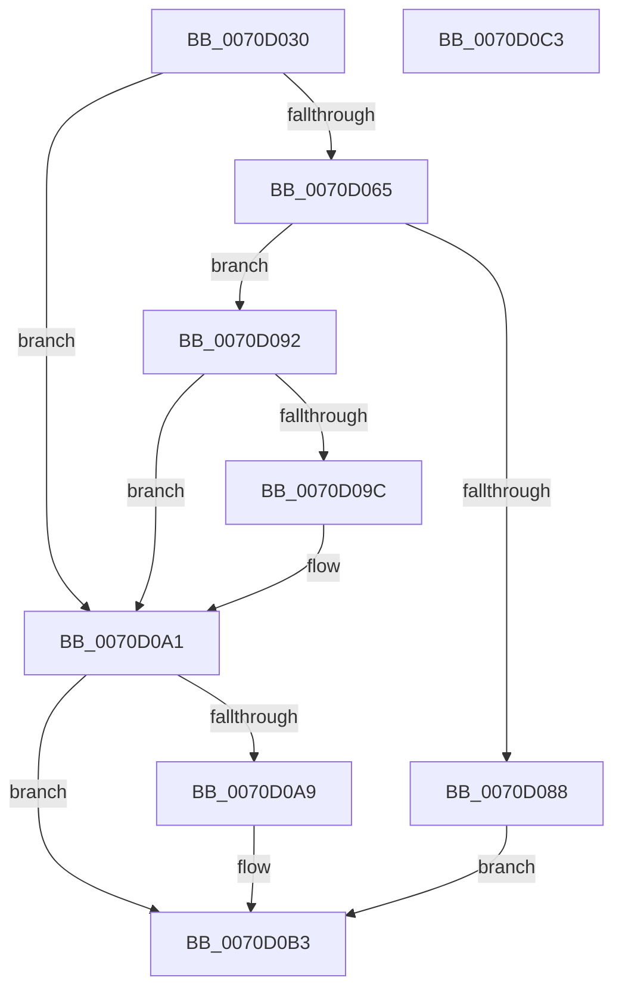

# IommuDeviceCreate

- RVA: `0x0070D030`–`0x0070D0C4` (길이 `148` bytes)
- VA: `0x000000014070D030`
- 실행 섹션: `PAGE`
- PDB 이름 있음: `예`; PDB Function 태그: `아니요`
- unwind 정보 RVA: `0x000C4E90`
- 디코드: `46`개 명령, `148/148` bytes 표시
- 미해석 바이트: `0` (있으면 어셈블리에 `.byte`로 보존)

> 이 문서는 커널 이미지의 기계어와 PDB 기호를 분석해 생성했습니다. 4번과 5번은 함수 원형과 자료형을 바이너리 사용 방식에서 추정한 C 해석이며 원본 소스 복구 결과는 아닙니다.

## 1. Dependencies

- 직접 호출 지점: **4**; 고유 호출 대상: **4**
- 직접 호출자로 확인된 함수: **0**
- RIP 상대 이미지 참조: **0**

### Outgoing calls
- `0x0070D05A` → [IommupCreateDeviceId](../../text/56/IommupCreateDeviceId_function_0056888C.md) (function, `0x0056888C`)
- `0x0070D07D` → [HalpIommuCreateDevice](../../text/54/HalpIommuCreateDevice_function_0054ED60.md) (function, `0x0054ED60`)
- `0x0070D09C` → [HalpIommuDeleteDevice](../../text/54/HalpIommuDeleteDevice_function_0054F368.md) (function, `0x0054F368`)
- `0x0070D0AE` → [HalpIommuFreeDeviceId](../../text/55/HalpIommuFreeDeviceId_function_00553640.md) (function, `0x00553640`)

### Direct callers
- 이 함수 시작 RVA로 연결되는 직접 call은 확인되지 않았습니다. 간접 호출은 완전히 역산할 수 없습니다.

### Static image references
- 디코드된 RIP-relative 메모리 참조가 없습니다.

## 2. Other-region calls and transfers

- 다른 실행 섹션으로 향하는 call: **4**
  - `0x0070D05A` → [IommupCreateDeviceId](../../text/56/IommupCreateDeviceId_function_0056888C.md) (`PAGE` → `.text`)
  - `0x0070D07D` → [HalpIommuCreateDevice](../../text/54/HalpIommuCreateDevice_function_0054ED60.md) (`PAGE` → `.text`)
  - `0x0070D09C` → [HalpIommuDeleteDevice](../../text/54/HalpIommuDeleteDevice_function_0054F368.md) (`PAGE` → `.text`)
  - `0x0070D0AE` → [HalpIommuFreeDeviceId](../../text/55/HalpIommuFreeDeviceId_function_00553640.md) (`PAGE` → `.text`)
- 별도 외부 분기/꼬리 이동을 확인하지 못했습니다.

## 3. Assembly (complete function range)

```asm
0070D030  48 8B C4                        mov rax, rsp
0070D033  48 89 68 08                     mov qword ptr [rax + 8], rbp
0070D037  56                              push rsi
0070D038  57                              push rdi
0070D039  41 56                           push r14
0070D03B  48 83 EC 30                     sub rsp, 0x30
0070D03F  49 83 20 00                     and qword ptr [r8], 0
0070D043  49 8B F0                        mov rsi, r8
0070D046  48 83 60 18 00                  and qword ptr [rax + 0x18], 0
0070D04B  4C 8D 40 18                     lea r8, [rax + 0x18]
0070D04F  48 83 60 20 00                  and qword ptr [rax + 0x20], 0
0070D054  4C 8B F2                        mov r14, rdx
0070D057  48 8B E9                        mov rbp, rcx
0070D05A  E8 2D B8 E5 FF                  call 0x14056888c
0070D05F  8B F8                           mov edi, eax
0070D061  85 C0                           test eax, eax
0070D063  78 3C                           js 0x14070d0a1
0070D065  48 8B 4C 24 60                  mov rcx, qword ptr [rsp + 0x60]
0070D06A  48 8D 44 24 68                  lea rax, [rsp + 0x68]
0070D06F  45 33 C9                        xor r9d, r9d
0070D072  48 89 44 24 20                  mov qword ptr [rsp + 0x20], rax
0070D077  4D 8B C6                        mov r8, r14
0070D07A  48 8B D5                        mov rdx, rbp
0070D07D  E8 DE 1C E4 FF                  call 0x14054ed60
0070D082  8B F8                           mov edi, eax
0070D084  85 C0                           test eax, eax
0070D086  78 0A                           js 0x14070d092
0070D088  48 8B 44 24 68                  mov rax, qword ptr [rsp + 0x68]
0070D08D  48 89 06                        mov qword ptr [rsi], rax
0070D090  EB 21                           jmp 0x14070d0b3
0070D092  48 8B 4C 24 68                  mov rcx, qword ptr [rsp + 0x68]
0070D097  48 85 C9                        test rcx, rcx
0070D09A  74 05                           je 0x14070d0a1
0070D09C  E8 C7 22 E4 FF                  call 0x14054f368
0070D0A1  48 83 7C 24 60 00               cmp qword ptr [rsp + 0x60], 0
0070D0A7  74 0A                           je 0x14070d0b3
0070D0A9  48 8B 4C 24 60                  mov rcx, qword ptr [rsp + 0x60]
0070D0AE  E8 8D 65 E4 FF                  call 0x140553640
0070D0B3  48 8B 6C 24 50                  mov rbp, qword ptr [rsp + 0x50]
0070D0B8  8B C7                           mov eax, edi
0070D0BA  48 83 C4 30                     add rsp, 0x30
0070D0BE  41 5E                           pop r14
0070D0C0  5F                              pop rdi
0070D0C1  5E                              pop rsi
0070D0C2  C3                              ret
0070D0C3  CC                              int3
```

## 4. C-style interpretation (structured pseudocode)

```c
__int64 __fastcall IommuDeviceCreate(__int64 a1, __int64 a2, __int64 a3, int a4)
{
    __int64 result;
    __int64 v_rsp;
    unsigned __int64 v_stack_m28;
    unsigned __int64 v_stack_p18;
    unsigned __int64 v_stack_p20;
    unsigned __int64 v_stack_p8;

    *(unsigned __int64 *)(v_rsp + 8) = v_rbp;
    v_rsp = (v_rsp) - (48);
    result = IommupCreateDeviceId(a1, a2, v_rsp + 24, a4);
    if (sign_flag) goto loc_0070D0A1;
    a4 = 0;
    v_stack_m28 = v_stack_p20;
    result = HalpIommuCreateDevice(v_stack_p18, a1, a2, a4);
    if (sign_flag) goto loc_0070D092;
    *(unsigned __int64 *)(a3) = v_stack_p20;
    goto loc_0070D0B3;
loc_0070D092:
    result = v_stack_p20;
    if (v_stack_p20 != 0) {
        result = HalpIommuDeleteDevice(v_stack_p20, a1, a2, a4);
    }
    if (v_stack_p18 != 0) {
        a1 = v_stack_p18;
        result = HalpIommuFreeDeviceId(a1, a1, a2, a4);
    }
    v_rsp = (v_rsp) + (48);
    return (unsigned int)((unsigned int)((unsigned int)((unsigned int)(result))));
}
```

## 5. (Beta) C Style

```c
int64_t IommuDeviceCreate(int64_t Arg1, int64_t Arg2, void *Arg3, int32_t Arg4)
{
    uint8_t *arg3 = (uint8_t *)Arg3;

    int64_t result;
    int64_t local_rsp;
    uint64_t v_stack_m28;
    uint64_t v_stack_p18;
    uint64_t v_stack_p20;
    uint64_t v_stack_p8;

    *(uint64_t *)(local_rsp + 0x8) = local_rbp;
    local_rsp = (local_rsp) - (48);
    result = IommupCreateDeviceId(Arg1, Arg2, local_rsp + 24, Arg4);
    if (sign_flag) goto loc_0070D0A1;
    Arg4 = 0;
    v_stack_m28 = v_stack_p20;
    result = HalpIommuCreateDevice(v_stack_p18, Arg1, Arg2, Arg4);
    if (sign_flag) goto loc_0070D092;
    *(uint64_t *)(arg3) = v_stack_p20;
    goto loc_0070D0B3;
loc_0070D092:
    result = v_stack_p20;
    if (v_stack_p20 != 0) {
        result = HalpIommuDeleteDevice(v_stack_p20, Arg1, Arg2, Arg4);
    }
    if (v_stack_p18 != 0) {
        Arg1 = v_stack_p18;
        result = HalpIommuFreeDeviceId(Arg1, Arg1, Arg2, Arg4);
    }
    local_rsp = (local_rsp) + (48);
    return (uint32_t)((uint32_t)((uint32_t)((uint32_t)(result))));
}
```

### 관측된 메모리 오프셋

구조체 형식이 확인되지 않은 접근은 인자 기준의 오프셋으로만 기록했습니다.

| 기준 인자 | 오프셋 표현 | 폭 (bit) | 접근 |
|---|---:|---:|---|
| `Arg3` | `+ 0x0` | `64` | `R/W` |
| `Arg3` | `+ 0x0` | `64` | `W` |

## 6. Execution-region graph

[열기: 2D/3D 그래프와 함수 탐색 컨트롤 패널](../../../control-panel.html?section=page&rva=0x0070D030&view=graph)

- 2D 그래프는 위에서 아래로 흐르고, 3D 그래프는 빈 공간을 드래그해 회전합니다. Shift+드래그는 이동, 휠은 확대·축소, 함수 노드 선택은 대상 보고서 이동입니다.

### Static fallback


