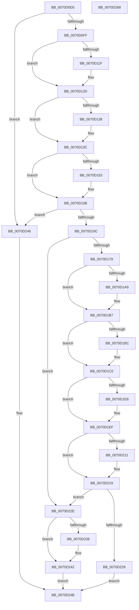

# IommuDeviceDelete

- RVA: `0x0070D0D0`–`0x0070D269` (길이 `409` bytes)
- VA: `0x000000014070D0D0`
- 실행 섹션: `PAGE`
- PDB 이름 있음: `예`; PDB Function 태그: `아니요`
- unwind 정보 RVA: `0x0005D79C`
- 디코드: `115`개 명령, `409/409` bytes 표시
- 미해석 바이트: `0` (있으면 어셈블리에 `.byte`로 보존)

> 이 문서는 커널 이미지의 기계어와 PDB 기호를 분석해 생성했습니다. 4번과 5번은 함수 원형과 자료형을 바이너리 사용 방식에서 추정한 C 해석이며 원본 소스 복구 결과는 아닙니다.

## 1. Dependencies

- 직접 호출 지점: **10**; 고유 호출 대상: **6**
- 직접 호출자로 확인된 함수: **0**
- RIP 상대 이미지 참조: **0**

### Outgoing calls
- `0x0070D10E` → [KeAbPreAcquire](../../text/21/KeAbPreAcquire_function_00210230.md) (function, `0x00210230`)
- `0x0070D128` → [ExfAcquirePushLockExclusiveEx](../../text/20/ExfAcquirePushLockExclusiveEx_function_0020FC90.md) (function, `0x0020FC90`)
- `0x0070D156` → [ExfTryToWakePushLock](../../text/26/ExfTryToWakePushLock_function_00265DD0.md) (function, `0x00265DD0`)
- `0x0070D15E` → [KeAbPostRelease](../../text/2E/KeAbPostRelease_function_002E1600.md) (function, `0x002E1600`)
- `0x0070D184` → [IommupDeviceGetPasidDevice](../../text/54/IommupDeviceGetPasidDevice_function_0054F82C.md) (function, `0x0054F82C`)
- `0x0070D198` → [KeAbPreAcquire](../../text/21/KeAbPreAcquire_function_00210230.md) (function, `0x00210230`)
- `0x0070D1B2` → [ExfAcquirePushLockExclusiveEx](../../text/20/ExfAcquirePushLockExclusiveEx_function_0020FC90.md) (function, `0x0020FC90`)
- `0x0070D214` → [ExfTryToWakePushLock](../../text/26/ExfTryToWakePushLock_function_00265DD0.md) (function, `0x00265DD0`)
- `0x0070D21C` → [KeAbPostRelease](../../text/2E/KeAbPostRelease_function_002E1600.md) (function, `0x002E1600`)
- `0x0070D23B` → [HalpIommuDeleteDevice](../../text/54/HalpIommuDeleteDevice_function_0054F368.md) (function, `0x0054F368`)

### Direct callers
- 이 함수 시작 RVA로 연결되는 직접 call은 확인되지 않았습니다. 간접 호출은 완전히 역산할 수 없습니다.

### Static image references
- 디코드된 RIP-relative 메모리 참조가 없습니다.

## 2. Other-region calls and transfers

- 다른 실행 섹션으로 향하는 call: **10**
  - `0x0070D10E` → [KeAbPreAcquire](../../text/21/KeAbPreAcquire_function_00210230.md) (`PAGE` → `.text`)
  - `0x0070D128` → [ExfAcquirePushLockExclusiveEx](../../text/20/ExfAcquirePushLockExclusiveEx_function_0020FC90.md) (`PAGE` → `.text`)
  - `0x0070D156` → [ExfTryToWakePushLock](../../text/26/ExfTryToWakePushLock_function_00265DD0.md) (`PAGE` → `.text`)
  - `0x0070D15E` → [KeAbPostRelease](../../text/2E/KeAbPostRelease_function_002E1600.md) (`PAGE` → `.text`)
  - `0x0070D184` → [IommupDeviceGetPasidDevice](../../text/54/IommupDeviceGetPasidDevice_function_0054F82C.md) (`PAGE` → `.text`)
  - `0x0070D198` → [KeAbPreAcquire](../../text/21/KeAbPreAcquire_function_00210230.md) (`PAGE` → `.text`)
  - `0x0070D1B2` → [ExfAcquirePushLockExclusiveEx](../../text/20/ExfAcquirePushLockExclusiveEx_function_0020FC90.md) (`PAGE` → `.text`)
  - `0x0070D214` → [ExfTryToWakePushLock](../../text/26/ExfTryToWakePushLock_function_00265DD0.md) (`PAGE` → `.text`)
  - `0x0070D21C` → [KeAbPostRelease](../../text/2E/KeAbPostRelease_function_002E1600.md) (`PAGE` → `.text`)
  - `0x0070D23B` → [HalpIommuDeleteDevice](../../text/54/HalpIommuDeleteDevice_function_0054F368.md) (`PAGE` → `.text`)
- 별도 외부 분기/꼬리 이동을 확인하지 못했습니다.

## 3. Assembly (complete function range)

```asm
0070D0D0  48 8B C4                        mov rax, rsp
0070D0D3  48 89 58 10                     mov qword ptr [rax + 0x10], rbx
0070D0D7  48 89 68 18                     mov qword ptr [rax + 0x18], rbp
0070D0DB  48 89 70 20                     mov qword ptr [rax + 0x20], rsi
0070D0DF  57                              push rdi
0070D0E0  41 54                           push r12
0070D0E2  41 55                           push r13
0070D0E4  41 56                           push r14
0070D0E6  41 57                           push r15
0070D0E8  48 83 EC 20                     sub rsp, 0x20
0070D0EC  33 FF                           xor edi, edi
0070D0EE  48 8B F1                        mov rsi, rcx
0070D0F1  48 89 78 08                     mov qword ptr [rax + 8], rdi
0070D0F5  48 39 79 18                     cmp qword ptr [rcx + 0x18], rdi
0070D0F9  0F 85 47 01 00 00               jne 0x14070d246
0070D0FF  48 8D A9 A0 01 00 00            lea rbp, [rcx + 0x1a0]
0070D106  45 33 C0                        xor r8d, r8d
0070D109  48 8B CD                        mov rcx, rbp
0070D10C  33 D2                           xor edx, edx
0070D10E  E8 1D 31 B0 FF                  call 0x140210230
0070D113  F0 48 0F BA 6D 00 00            lock bts qword ptr [rbp], 0
0070D11A  48 8B D8                        mov rbx, rax
0070D11D  73 0E                           jae 0x14070d12d
0070D11F  4C 8B C5                        mov r8, rbp
0070D122  48 8B D0                        mov rdx, rax
0070D125  48 8B CD                        mov rcx, rbp
0070D128  E8 63 2B B0 FF                  call 0x14020fc90
0070D12D  41 BE 01 00 00 00               mov r14d, 1
0070D133  48 85 DB                        test rbx, rbx
0070D136  74 04                           je 0x14070d13c
0070D138  44 88 73 0A                     mov byte ptr [rbx + 0xa], r14b
0070D13C  4C 8B 7E 50                     mov r15, qword ptr [rsi + 0x50]
0070D140  48 83 CB FF                     or rbx, 0xffffffffffffffff
0070D144  48 8B C3                        mov rax, rbx
0070D147  F0 48 0F C1 45 00               lock xadd qword ptr [rbp], rax
0070D14D  24 06                           and al, 6
0070D14F  3C 02                           cmp al, 2
0070D151  75 08                           jne 0x14070d15b
0070D153  48 8B CD                        mov rcx, rbp
0070D156  E8 75 8C B5 FF                  call 0x140265dd0
0070D15B  48 8B CD                        mov rcx, rbp
0070D15E  E8 9D 44 BD FF                  call 0x1402e1600
0070D163  4D 85 FF                        test r15, r15
0070D166  0F 85 DA 00 00 00               jne 0x14070d246
0070D16C  40 38 BE 12 01 00 00            cmp byte ptr [rsi + 0x112], dil
0070D173  0F 84 B5 00 00 00               je 0x14070d22e
0070D179  4C 8D 4C 24 50                  lea r9, [rsp + 0x50]
0070D17E  45 8A C6                        mov r8b, r14b
0070D181  48 8B CE                        mov rcx, rsi
0070D184  E8 A3 26 E4 FF                  call 0x14054f82c
0070D189  48 8D AE 78 01 00 00            lea rbp, [rsi + 0x178]
0070D190  45 33 C0                        xor r8d, r8d
0070D193  48 8B CD                        mov rcx, rbp
0070D196  33 D2                           xor edx, edx
0070D198  E8 93 30 B0 FF                  call 0x140210230
0070D19D  F0 48 0F BA 6D 00 00            lock bts qword ptr [rbp], 0
0070D1A4  4C 8B F8                        mov r15, rax
0070D1A7  73 0E                           jae 0x14070d1b7
0070D1A9  4C 8B C5                        mov r8, rbp
0070D1AC  48 8B D0                        mov rdx, rax
0070D1AF  48 8B CD                        mov rcx, rbp
0070D1B2  E8 D9 2A B0 FF                  call 0x14020fc90
0070D1B7  4D 85 FF                        test r15, r15
0070D1BA  74 04                           je 0x14070d1c0
0070D1BC  45 88 77 0A                     mov byte ptr [r15 + 0xa], r14b
0070D1C0  4C 8D A6 68 01 00 00            lea r12, [rsi + 0x168]
0070D1C7  4D 8B 2C 24                     mov r13, qword ptr [r12]
0070D1CB  49 8B 4C 24 08                  mov rcx, qword ptr [r12 + 8]
0070D1D0  49 8B C5                        mov rax, r13
0070D1D3  49 2B C4                        sub rax, r12
0070D1D6  48 F7 D8                        neg rax
0070D1D9  45 1B FF                        sbb r15d, r15d
0070D1DC  41 81 E7 08 07 00 C0            and r15d, 0xc0000708
0070D1E3  4C 39 21                        cmp qword ptr [rcx], r12
0070D1E6  74 07                           je 0x14070d1ef
0070D1E8  B9 03 00 00 00                  mov ecx, 3
0070D1ED  CD 29                           int 0x29
0070D1EF  48 8B 44 24 50                  mov rax, qword ptr [rsp + 0x50]
0070D1F4  4C 89 20                        mov qword ptr [rax], r12
0070D1F7  48 89 48 08                     mov qword ptr [rax + 8], rcx
0070D1FB  48 89 01                        mov qword ptr [rcx], rax
0070D1FE  49 89 44 24 08                  mov qword ptr [r12 + 8], rax
0070D203  F0 48 0F C1 5D 00               lock xadd qword ptr [rbp], rbx
0070D209  80 E3 06                        and bl, 6
0070D20C  80 FB 02                        cmp bl, 2
0070D20F  75 08                           jne 0x14070d219
0070D211  48 8B CD                        mov rcx, rbp
0070D214  E8 B7 8B B5 FF                  call 0x140265dd0
0070D219  48 8B CD                        mov rcx, rbp
0070D21C  E8 DF 43 BD FF                  call 0x1402e1600
0070D221  41 8B FF                        mov edi, r15d
0070D224  4D 3B EC                        cmp r13, r12
0070D227  74 05                           je 0x14070d22e
0070D229  41 8B C7                        mov eax, r15d
0070D22C  EB 1D                           jmp 0x14070d24b
0070D22E  44 87 76 10                     xchg dword ptr [rsi + 0x10], r14d
0070D232  41 83 FE 02                     cmp r14d, 2
0070D236  74 0A                           je 0x14070d242
0070D238  48 8B CE                        mov rcx, rsi
0070D23B  E8 28 21 E4 FF                  call 0x14054f368
0070D240  8B F8                           mov edi, eax
0070D242  8B C7                           mov eax, edi
0070D244  EB 05                           jmp 0x14070d24b
0070D246  B8 08 07 00 C0                  mov eax, 0xc0000708
0070D24B  48 8B 5C 24 58                  mov rbx, qword ptr [rsp + 0x58]
0070D250  48 8B 6C 24 60                  mov rbp, qword ptr [rsp + 0x60]
0070D255  48 8B 74 24 68                  mov rsi, qword ptr [rsp + 0x68]
0070D25A  48 83 C4 20                     add rsp, 0x20
0070D25E  41 5F                           pop r15
0070D260  41 5E                           pop r14
0070D262  41 5D                           pop r13
0070D264  41 5C                           pop r12
0070D266  5F                              pop rdi
0070D267  C3                              ret
0070D268  CC                              int3
```

## 4. C-style interpretation (structured pseudocode)

```c
__int64 __fastcall IommuDeviceDelete(__int64 a1, int a2, int a3)
{
    __int64 result;
    __int64 v_r15;
    __int64 v_rbx;
    __int64 v_rdi;
    __int64 v_rsp;
    unsigned __int64 v_stack_p10;
    unsigned __int64 v_stack_p18;
    unsigned __int64 v_stack_p20;
    unsigned __int64 v_stack_p8;

    *(unsigned __int64 *)(v_rsp + 16) = v_rbx;
    *(unsigned __int64 *)(v_rsp + 24) = v_rbp;
    *(unsigned __int64 *)(v_rsp + 32) = v_rsi;
    v_rsp = (v_rsp) - (32);
    v_rdi = 0;
    *(unsigned __int64 *)(v_rsp + 8) = 0;
    if ((*(unsigned __int64 *)(a1 + 24)) != 0) goto loc_0070D246;
    a3 = 0;
    a2 = 0;
    result = KeAbPreAcquire(a1 + 416, a2, a3, a4);
    if (!(condition_is_above_or_equal)) {
        a3 = a1 + 416;
        a2 = result;
        a1 = a1 + 416;
        result = ExfAcquirePushLockExclusiveEx(a1, a2, a3, a4);
    }
    if (result != 0) {
        *(unsigned __int8 *)(result + 10) = 1;
    }
    v_rbx = (result) | (-1);
    result = (unsigned __int8)((v_rbx) & (6));
    if (((unsigned __int8)(result)) == 2) {
        a1 = a1 + 416;
        result = ExfTryToWakePushLock(a1, a2, a3, a4);
    }
    result = KeAbPostRelease(a1 + 416, a2, a3, a4);
    if (*(unsigned __int64 *)(a1 + 80) != 0) goto loc_0070D246;
    if ((*(unsigned __int8 *)(a1 + 274)) == 0) goto loc_0070D22E;
    result = IommupDeviceGetPasidDevice(a1, a2, 1, v_stack_p8);
    a3 = 0;
    a2 = 0;
    result = KeAbPreAcquire(a1 + 376, a2, a3, v_stack_p8);
    if (!(condition_is_above_or_equal)) {
        a3 = a1 + 376;
        a2 = result;
        a1 = a1 + 376;
        result = ExfAcquirePushLockExclusiveEx(a1, a2, a3, v_stack_p8);
    }
    if (result != 0) {
        *(unsigned __int8 *)(result + 10) = 1;
    }
    result = (*(unsigned __int64 *)(a1 + 360)) - (a1 + 360);
    result = -(result);
    v_r15 = (unsigned int)((result) & (0xC0000708ULL));
    if ((*(unsigned __int64 *)(*(unsigned __int64 *)(a1 + 360 + 8))) != (a1 + 360)) {
        a1 = 3;
    }
    *(unsigned __int64 *)(v_stack_p8) = a1 + 360;
    *(unsigned __int64 *)(v_stack_p8 + 8) = a1;
    *(unsigned __int64 *)(a1) = v_stack_p8;
    *(unsigned __int64 *)(a1 + 360 + 8) = v_stack_p8;
    v_rbx = (unsigned __int8)((v_rbx) & (6));
    result = v_stack_p8;
    if (((unsigned __int8)(v_rbx)) == 2) {
        a1 = a1 + 376;
        result = ExfTryToWakePushLock(a1, a2, a3, v_stack_p8);
    }
    result = KeAbPostRelease(a1 + 376, a2, a3, v_stack_p8);
    if ((*(unsigned __int64 *)(a1 + 360)) == (a1 + 360)) goto loc_0070D22E;
    goto loc_0070D24B;
loc_0070D22E:
    result = (unsigned int)((unsigned int)(v_r15));
    v_rdi = (unsigned int)((unsigned int)(v_r15));
    if (1 != 2) {
        a1 = a1;
        result = HalpIommuDeleteDevice(a1, a2, a3, v_stack_p8);
        v_rdi = (unsigned int)(result);
    }
    goto loc_0070D24B;
loc_0070D246:
loc_0070D24B:
    v_rsp = (v_rsp) + (32);
    return (unsigned int)(0xC0000708ULL);
}
```

## 5. (Beta) C Style

```c
int64_t IommuDeviceDelete(void *Arg1, int32_t Arg2, int32_t Arg3)
{
    uint8_t *arg1 = (uint8_t *)Arg1;

    int64_t result;
    int64_t local_r15;
    int64_t local_rbx;
    int64_t local_rdi;
    int64_t local_rsp;
    uint64_t v_stack_p10;
    uint64_t v_stack_p18;
    uint64_t v_stack_p20;
    uint64_t v_stack_p8;

    *(uint64_t *)(local_rsp + 0x10) = local_rbx;
    *(uint64_t *)(local_rsp + 0x18) = local_rbp;
    *(uint64_t *)(local_rsp + 0x20) = local_rsi;
    local_rsp = (local_rsp) - (32);
    local_rdi = 0;
    *(uint64_t *)(local_rsp + 0x8) = 0;
    if ((*(uint64_t *)(arg1 + 0x18)) != 0) goto loc_0070D246;
    Arg3 = 0;
    Arg2 = 0;
    result = KeAbPreAcquire(Arg1 + 416, Arg2, Arg3, a4);
    if (!(condition_is_above_or_equal)) {
        Arg3 = Arg1 + 416;
        Arg2 = result;
        Arg1 = Arg1 + 416;
        result = ExfAcquirePushLockExclusiveEx(Arg1, Arg2, Arg3, a4);
    }
    if (result != 0) {
        *(uint8_t *)(result + 0xA) = 1;
    }
    local_rbx = (result) | (-1);
    result = (uint8_t)((local_rbx) & (6));
    if (((uint8_t)(result)) == 2) {
        Arg1 = Arg1 + 416;
        result = ExfTryToWakePushLock(Arg1, Arg2, Arg3, a4);
    }
    result = KeAbPostRelease(Arg1 + 416, Arg2, Arg3, a4);
    if (*(uint64_t *)(arg1 + 0x50) != 0) goto loc_0070D246;
    if ((*(uint8_t *)(arg1 + 0x112)) == 0) goto loc_0070D22E;
    result = IommupDeviceGetPasidDevice(Arg1, Arg2, 1, v_stack_p8);
    Arg3 = 0;
    Arg2 = 0;
    result = KeAbPreAcquire(Arg1 + 376, Arg2, Arg3, v_stack_p8);
    if (!(condition_is_above_or_equal)) {
        Arg3 = Arg1 + 376;
        Arg2 = result;
        Arg1 = Arg1 + 376;
        result = ExfAcquirePushLockExclusiveEx(Arg1, Arg2, Arg3, v_stack_p8);
    }
    if (result != 0) {
        *(uint8_t *)(result + 0xA) = 1;
    }
    result = (*(uint64_t *)(arg1 + 0x168)) - (Arg1 + 360);
    result = -(result);
    local_r15 = (uint32_t)((result) & (0xC0000708ULL));
    if ((*(uint64_t *)(*(uint64_t *)(arg1 + 0x168 + 0x8))) != (Arg1 + 360)) {
        Arg1 = 3;
    }
    *(void **)(v_stack_p8) = Arg1 + 360;
    *(void **)(v_stack_p8 + 0x8) = Arg1;
    *(uint64_t *)(arg1) = v_stack_p8;
    *(uint64_t *)(arg1 + 0x168 + 0x8) = v_stack_p8;
    local_rbx = (uint8_t)((local_rbx) & (6));
    result = v_stack_p8;
    if (((uint8_t)(local_rbx)) == 2) {
        Arg1 = Arg1 + 376;
        result = ExfTryToWakePushLock(Arg1, Arg2, Arg3, v_stack_p8);
    }
    result = KeAbPostRelease(Arg1 + 376, Arg2, Arg3, v_stack_p8);
    if ((*(uint64_t *)(arg1 + 0x168)) == (Arg1 + 360)) goto loc_0070D22E;
    goto loc_0070D24B;
loc_0070D22E:
    result = (uint32_t)((uint32_t)(local_r15));
    local_rdi = (uint32_t)((uint32_t)(local_r15));
    if (1 != 2) {
        Arg1 = Arg1;
        result = HalpIommuDeleteDevice(Arg1, Arg2, Arg3, v_stack_p8);
        local_rdi = (uint32_t)(result);
    }
    goto loc_0070D24B;
loc_0070D246:
loc_0070D24B:
    local_rsp = (local_rsp) + (32);
    return (uint32_t)(0xC0000708ULL);
}
```

### 관측된 메모리 오프셋

구조체 형식이 확인되지 않은 접근은 인자 기준의 오프셋으로만 기록했습니다.

| 기준 인자 | 오프셋 표현 | 폭 (bit) | 접근 |
|---|---:|---:|---|
| `Arg1` | `+ 0x0` | `64` | `R` |
| `Arg1` | `+ 0x0` | `64` | `R/W` |
| `Arg1` | `+ 0x8` | `64` | `R` |
| `Arg1` | `+ 0x8` | `64` | `W` |
| `Arg1` | `+ 0x10` | `32` | `R/W` |
| `Arg1` | `+ 0x18` | `64` | `R` |
| `Arg1` | `+ 0x50` | `64` | `R` |
| `Arg1` | `+ 0x112` | `8` | `R` |
| `Arg1` | `+ 0x168` | `64` | `R` |
| `Arg1` | `+ 0x178` | `64` | `R` |
| `Arg1` | `+ 0x1A0` | `64` | `R` |

## 6. Execution-region graph

[열기: 2D/3D 그래프와 함수 탐색 컨트롤 패널](../../../control-panel.html?section=page&rva=0x0070D0D0&view=graph)

- 2D 그래프는 위에서 아래로 흐르고, 3D 그래프는 빈 공간을 드래그해 회전합니다. Shift+드래그는 이동, 휠은 확대·축소, 함수 노드 선택은 대상 보고서 이동입니다.

### Static fallback


