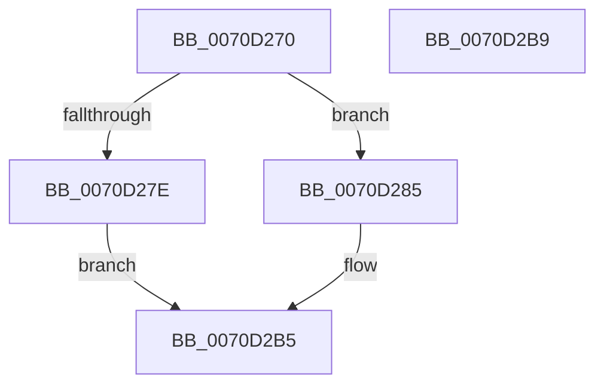

# IommuDeviceQueryInformation

- RVA: `0x0070D270`–`0x0070D2BA` (길이 `74` bytes)
- VA: `0x000000014070D270`
- 실행 섹션: `PAGE`
- PDB 이름 있음: `예`; PDB Function 태그: `아니요`
- unwind 정보 RVA: `0x000DB714`
- 디코드: `20`개 명령, `74/74` bytes 표시
- 미해석 바이트: `0` (있으면 어셈블리에 `.byte`로 보존)

> 이 문서는 커널 이미지의 기계어와 PDB 기호를 분석해 생성했습니다. 4번과 5번은 함수 원형과 자료형을 바이너리 사용 방식에서 추정한 C 해석이며 원본 소스 복구 결과는 아닙니다.

## 1. Dependencies

- 직접 호출 지점: **0**; 고유 호출 대상: **0**
- 직접 호출자로 확인된 함수: **0**
- RIP 상대 이미지 참조: **0**

### Outgoing calls
- 직접 디코드된 call 명령이 없습니다.

### Direct callers
- 이 함수 시작 RVA로 연결되는 직접 call은 확인되지 않았습니다. 간접 호출은 완전히 역산할 수 없습니다.

### Static image references
- 디코드된 RIP-relative 메모리 참조가 없습니다.

## 2. Other-region calls and transfers

- 다른 실행 섹션으로 향하는 call: **0**
- 별도 외부 분기/꼬리 이동을 확인하지 못했습니다.

## 3. Assembly (complete function range)

```asm
0070D270  45 33 D2                        xor r10d, r10d
0070D273  4C 8B D9                        mov r11, rcx
0070D276  41 8B C2                        mov eax, r10d
0070D279  83 FA 03                        cmp edx, 3
0070D27C  73 07                           jae 0x14070d285
0070D27E  B8 23 00 00 C0                  mov eax, 0xc0000023
0070D283  EB 30                           jmp 0x14070d2b5
0070D285  33 C9                           xor ecx, ecx
0070D287  41 BA 03 00 00 00               mov r10d, 3
0070D28D  66 41 89 09                     mov word ptr [r9], cx
0070D291  41 88 49 02                     mov byte ptr [r9 + 2], cl
0070D295  41 8A 8B 12 01 00 00            mov cl, byte ptr [r11 + 0x112]
0070D29C  41 88 09                        mov byte ptr [r9], cl
0070D29F  41 8A 8B 11 01 00 00            mov cl, byte ptr [r11 + 0x111]
0070D2A6  41 88 49 01                     mov byte ptr [r9 + 1], cl
0070D2AA  41 8A 8B 10 01 00 00            mov cl, byte ptr [r11 + 0x110]
0070D2B1  41 88 49 02                     mov byte ptr [r9 + 2], cl
0070D2B5  45 89 10                        mov dword ptr [r8], r10d
0070D2B8  C3                              ret
0070D2B9  CC                              int3
```

## 4. C-style interpretation (structured pseudocode)

```c
__int64 __fastcall IommuDeviceQueryInformation(__int64 a1, int a2, __int64 a3, __int64 a4)
{
    __int64 v_r10;

    v_r10 = 0;
    if (a2 >= 3) goto loc_0070D285;
    goto loc_0070D2B5;
loc_0070D285:
    a1 = 0;
    *(unsigned __int16 *)(a4) = 0;
    *(unsigned __int8 *)(a4 + 2) = 0;
    *(unsigned __int8 *)(a4) = (unsigned __int8)(*(unsigned __int8 *)(a1 + 274));
    *(unsigned __int8 *)(a4 + 1) = (unsigned __int8)(*(unsigned __int8 *)(a1 + 273));
    *(unsigned __int8 *)(a4 + 2) = (unsigned __int8)(*(unsigned __int8 *)(a1 + 272));
loc_0070D2B5:
    *(unsigned int *)(a3) = 3;
    return (unsigned int)(0xC0000023ULL);
}
```

## 5. (Beta) C Style

```c
int64_t IommuDeviceQueryInformation(void *Arg1, int32_t Arg2, void *Arg3, void *Arg4)
{
    uint8_t *arg1 = (uint8_t *)Arg1;
    uint8_t *arg3 = (uint8_t *)Arg3;
    uint8_t *arg4 = (uint8_t *)Arg4;

    int64_t local_r10;

    local_r10 = 0;
    if (Arg2 >= 3) goto loc_0070D285;
    goto loc_0070D2B5;
loc_0070D285:
    Arg1 = 0;
    *(uint16_t *)(arg4) = 0;
    *(uint8_t *)(arg4 + 0x2) = 0;
    *(uint8_t *)(arg4) = (uint8_t)(*(uint8_t *)(arg1 + 0x112));
    *(uint8_t *)(arg4 + 0x1) = (uint8_t)(*(uint8_t *)(arg1 + 0x111));
    *(uint8_t *)(arg4 + 0x2) = (uint8_t)(*(uint8_t *)(arg1 + 0x110));
loc_0070D2B5:
    *(uint32_t *)(arg3) = 3;
    return (uint32_t)(0xC0000023ULL);
}
```

### 관측된 메모리 오프셋

구조체 형식이 확인되지 않은 접근은 인자 기준의 오프셋으로만 기록했습니다.

| 기준 인자 | 오프셋 표현 | 폭 (bit) | 접근 |
|---|---:|---:|---|
| `Arg1` | `+ 0x110` | `8` | `R` |
| `Arg1` | `+ 0x111` | `8` | `R` |
| `Arg1` | `+ 0x112` | `8` | `R` |
| `Arg3` | `+ 0x0` | `32` | `W` |
| `Arg4` | `+ 0x0` | `8` | `W` |
| `Arg4` | `+ 0x0` | `16` | `W` |
| `Arg4` | `+ 0x1` | `8` | `W` |
| `Arg4` | `+ 0x2` | `8` | `W` |

## 6. Execution-region graph

[열기: 2D/3D 그래프와 함수 탐색 컨트롤 패널](../../../control-panel.html?section=page&rva=0x0070D270&view=graph)

- 2D 그래프는 위에서 아래로 흐르고, 3D 그래프는 빈 공간을 드래그해 회전합니다. Shift+드래그는 이동, 휠은 확대·축소, 함수 노드 선택은 대상 보고서 이동입니다.

### Static fallback


