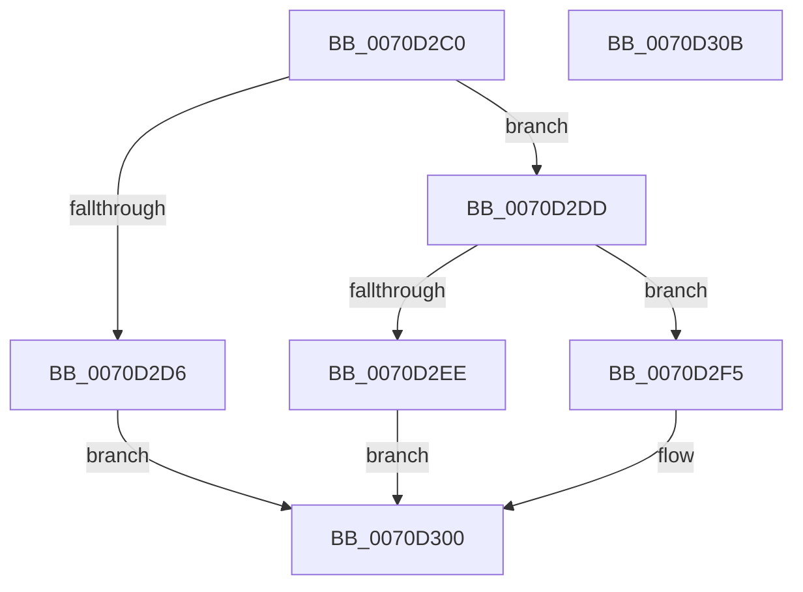

# IommuDomainAttachPasidDevice

- RVA: `0x0070D2C0`–`0x0070D30C` (길이 `76` bytes)
- VA: `0x000000014070D2C0`
- 실행 섹션: `PAGE`
- PDB 이름 있음: `예`; PDB Function 태그: `아니요`
- unwind 정보 RVA: `0x0005CAAC`
- 디코드: `24`개 명령, `76/76` bytes 표시
- 미해석 바이트: `0` (있으면 어셈블리에 `.byte`로 보존)

> 이 문서는 커널 이미지의 기계어와 PDB 기호를 분석해 생성했습니다. 4번과 5번은 함수 원형과 자료형을 바이너리 사용 방식에서 추정한 C 해석이며 원본 소스 복구 결과는 아닙니다.

## 1. Dependencies

- 직접 호출 지점: **2**; 고유 호출 대상: **2**
- 직접 호출자로 확인된 함수: **0**
- RIP 상대 이미지 참조: **0**

### Outgoing calls
- `0x0070D2E1` → [HalpIommuDeviceGetDomainTypes](../../text/54/HalpIommuDeviceGetDomainTypes_function_0054F538.md) (function, `0x0054F538`)
- `0x0070D2FB` → [IommupDomainAttachPasidDevice](../../text/54/IommupDomainAttachPasidDevice_function_0054F984.md) (function, `0x0054F984`)

### Direct callers
- 이 함수 시작 RVA로 연결되는 직접 call은 확인되지 않았습니다. 간접 호출은 완전히 역산할 수 없습니다.

### Static image references
- 디코드된 RIP-relative 메모리 참조가 없습니다.

## 2. Other-region calls and transfers

- 다른 실행 섹션으로 향하는 call: **2**
  - `0x0070D2E1` → [HalpIommuDeviceGetDomainTypes](../../text/54/HalpIommuDeviceGetDomainTypes_function_0054F538.md) (`PAGE` → `.text`)
  - `0x0070D2FB` → [IommupDomainAttachPasidDevice](../../text/54/IommupDomainAttachPasidDevice_function_0054F984.md) (`PAGE` → `.text`)
- 별도 외부 분기/꼬리 이동을 확인하지 못했습니다.

## 3. Assembly (complete function range)

```asm
0070D2C0  48 89 5C 24 08                  mov qword ptr [rsp + 8], rbx
0070D2C5  57                              push rdi
0070D2C6  48 83 EC 20                     sub rsp, 0x20
0070D2CA  83 7A 30 00                     cmp dword ptr [rdx + 0x30], 0
0070D2CE  48 8B DA                        mov rbx, rdx
0070D2D1  48 8B F9                        mov rdi, rcx
0070D2D4  75 07                           jne 0x14070d2dd
0070D2D6  B8 BB 00 00 C0                  mov eax, 0xc00000bb
0070D2DB  EB 23                           jmp 0x14070d300
0070D2DD  48 8B 4A 10                     mov rcx, qword ptr [rdx + 0x10]
0070D2E1  E8 52 22 E4 FF                  call 0x14054f538
0070D2E6  8B 4F 08                        mov ecx, dword ptr [rdi + 8]
0070D2E9  0F A3 C8                        bt eax, ecx
0070D2EC  72 07                           jb 0x14070d2f5
0070D2EE  B8 22 00 00 C0                  mov eax, 0xc0000022
0070D2F3  EB 0B                           jmp 0x14070d300
0070D2F5  48 8B D3                        mov rdx, rbx
0070D2F8  48 8B CF                        mov rcx, rdi
0070D2FB  E8 84 26 E4 FF                  call 0x14054f984
0070D300  48 8B 5C 24 30                  mov rbx, qword ptr [rsp + 0x30]
0070D305  48 83 C4 20                     add rsp, 0x20
0070D309  5F                              pop rdi
0070D30A  C3                              ret
0070D30B  CC                              int3
```

## 4. C-style interpretation (structured pseudocode)

```c
__int64 __fastcall IommuDomainAttachPasidDevice(__int64 a1, __int64 a2)
{
    __int64 result;
    __int64 v_rsp;
    unsigned __int64 v_stack_p8;

    v_stack_p8 = v_rbx;
    v_rsp = (v_rsp) - (32);
    if ((*(unsigned int *)(a2 + 48)) != 0) goto loc_0070D2DD;
    goto loc_0070D300;
loc_0070D2DD:
    result = HalpIommuDeviceGetDomainTypes(*(unsigned __int64 *)(a2 + 16), a2, a3, a4);
    if ((*(unsigned int *)(a2 + 48)) < 0) goto loc_0070D2F5;
    goto loc_0070D300;
loc_0070D2F5:
    result = IommupDomainAttachPasidDevice(a1, a2, a3, a4);
loc_0070D300:
    v_rsp = (v_rsp) + (32);
    return result;
}
```

## 5. (Beta) C Style

```c
int64_t IommuDomainAttachPasidDevice(void *Arg1, void *Arg2)
{
    uint8_t *arg1 = (uint8_t *)Arg1;
    uint8_t *arg2 = (uint8_t *)Arg2;

    int64_t result;
    int64_t local_rsp;
    uint64_t v_stack_p8;

    v_stack_p8 = local_rbx;
    local_rsp = (local_rsp) - (32);
    if ((*(uint32_t *)(arg2 + 0x30)) != 0) goto loc_0070D2DD;
    goto loc_0070D300;
loc_0070D2DD:
    result = HalpIommuDeviceGetDomainTypes(*(uint64_t *)(arg2 + 0x10), Arg2, a3, a4);
    if ((*(uint32_t *)(arg2 + 0x30)) < 0) goto loc_0070D2F5;
    goto loc_0070D300;
loc_0070D2F5:
    result = IommupDomainAttachPasidDevice(Arg1, Arg2, a3, a4);
loc_0070D300:
    local_rsp = (local_rsp) + (32);
    return result;
}
```

### 관측된 메모리 오프셋

구조체 형식이 확인되지 않은 접근은 인자 기준의 오프셋으로만 기록했습니다.

| 기준 인자 | 오프셋 표현 | 폭 (bit) | 접근 |
|---|---:|---:|---|
| `Arg1` | `+ 0x8` | `32` | `R` |
| `Arg2` | `+ 0x10` | `64` | `R` |
| `Arg2` | `+ 0x30` | `32` | `R` |

## 6. Execution-region graph

[열기: 2D/3D 그래프와 함수 탐색 컨트롤 패널](../../../control-panel.html?section=page&rva=0x0070D2C0&view=graph)

- 2D 그래프는 위에서 아래로 흐르고, 3D 그래프는 빈 공간을 드래그해 회전합니다. Shift+드래그는 이동, 휠은 확대·축소, 함수 노드 선택은 대상 보고서 이동입니다.

### Static fallback


