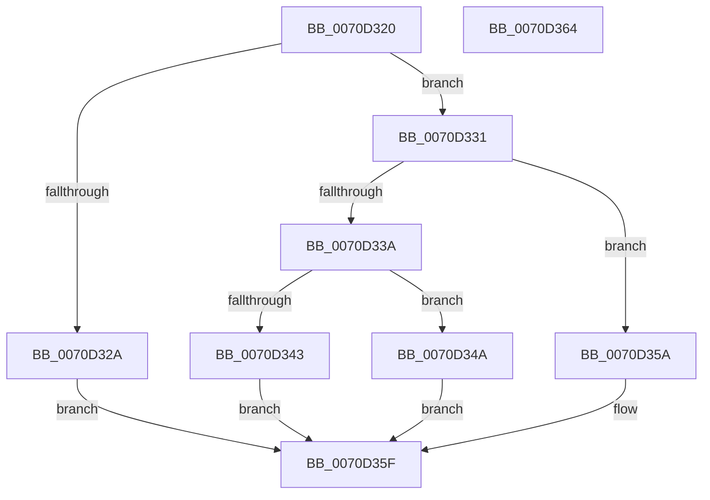

# IommuDomainConfigure

- RVA: `0x0070D320`–`0x0070D365` (길이 `69` bytes)
- VA: `0x000000014070D320`
- 실행 섹션: `PAGE`
- PDB 이름 있음: `예`; PDB Function 태그: `아니요`
- unwind 정보 RVA: `0x0005C788`
- 디코드: `20`개 명령, `69/69` bytes 표시
- 미해석 바이트: `0` (있으면 어셈블리에 `.byte`로 보존)

> 이 문서는 커널 이미지의 기계어와 PDB 기호를 분석해 생성했습니다. 4번과 5번은 함수 원형과 자료형을 바이너리 사용 방식에서 추정한 C 해석이며 원본 소스 복구 결과는 아닙니다.

## 1. Dependencies

- 직접 호출 지점: **1**; 고유 호출 대상: **1**
- 직접 호출자로 확인된 함수: **0**
- RIP 상대 이미지 참조: **2**

### Outgoing calls
- `0x0070D353` → [IommupHvConfigureDeviceDomain](../../text/56/IommupHvConfigureDeviceDomain_function_00566FD4.md) (function, `0x00566FD4`)

### Direct callers
- 이 함수 시작 RVA로 연결되는 직접 call은 확인되지 않았습니다. 간접 호출은 완전히 역산할 수 없습니다.

### Static image references
- `0x0070D331` → RVA `0x00FC1710` (`.data`; read)
- `0x0070D33A` → RVA `0x00FC1711` (`.data`; read)

## 2. Other-region calls and transfers

- 다른 실행 섹션으로 향하는 call: **1**
  - `0x0070D353` → [IommupHvConfigureDeviceDomain](../../text/56/IommupHvConfigureDeviceDomain_function_00566FD4.md) (`PAGE` → `.text`)
- 별도 외부 분기/꼬리 이동을 확인하지 못했습니다.

## 3. Assembly (complete function range)

```asm
0070D320  48 83 EC 28                     sub rsp, 0x28
0070D324  83 79 08 02                     cmp dword ptr [rcx + 8], 2
0070D328  74 07                           je 0x14070d331
0070D32A  B8 EF 00 00 C0                  mov eax, 0xc00000ef
0070D32F  EB 2E                           jmp 0x14070d35f
0070D331  80 3D D8 43 8B 00 00            cmp byte ptr [rip + 0x8b43d8], 0
0070D338  74 20                           je 0x14070d35a
0070D33A  80 3D D0 43 8B 00 00            cmp byte ptr [rip + 0x8b43d0], 0
0070D341  75 07                           jne 0x14070d34a
0070D343  B8 BB 00 00 C0                  mov eax, 0xc00000bb
0070D348  EB 15                           jmp 0x14070d35f
0070D34A  4C 8B CA                        mov r9, rdx
0070D34D  8A 51 34                        mov dl, byte ptr [rcx + 0x34]
0070D350  8B 49 30                        mov ecx, dword ptr [rcx + 0x30]
0070D353  E8 7C 9C E5 FF                  call 0x140566fd4
0070D358  EB 05                           jmp 0x14070d35f
0070D35A  B8 02 00 00 C0                  mov eax, 0xc0000002
0070D35F  48 83 C4 28                     add rsp, 0x28
0070D363  C3                              ret
0070D364  CC                              int3
```

## 4. C-style interpretation (structured pseudocode)

```c
__int64 __fastcall IommuDomainConfigure(__int64 a1, __int64 a2)
{
    __int64 result;
    __int64 v_rsp;

    v_rsp = (v_rsp) - (40);
    if ((*(unsigned int *)(a1 + 8)) == 2) goto loc_0070D331;
    goto loc_0070D35F;
loc_0070D331:
    if ((*(unsigned __int8 *)(v_rip + 9126872)) == 0) goto loc_0070D35A;
    if ((*(unsigned __int8 *)(v_rip + 9126864)) != 0) goto loc_0070D34A;
    goto loc_0070D35F;
loc_0070D34A:
    result = IommupHvConfigureDeviceDomain((unsigned int)(*(unsigned int *)(a1 + 48)), *(unsigned __int8 *)(a1 + 52), a3, a2);
    goto loc_0070D35F;
loc_0070D35A:
loc_0070D35F:
    v_rsp = (v_rsp) + (40);
    return (unsigned int)(0xC0000002ULL);
}
```

## 5. (Beta) C Style

```c
int64_t IommuDomainConfigure(void *Arg1, int64_t Arg2)
{
    uint8_t *arg1 = (uint8_t *)Arg1;

    int64_t result;
    int64_t local_rsp;

    local_rsp = (local_rsp) - (40);
    if ((*(uint32_t *)(arg1 + 0x8)) == 2) goto loc_0070D331;
    goto loc_0070D35F;
loc_0070D331:
    if ((*(uint8_t *)(v_rip + 0x8B43D8)) == 0) goto loc_0070D35A;
    if ((*(uint8_t *)(v_rip + 0x8B43D0)) != 0) goto loc_0070D34A;
    goto loc_0070D35F;
loc_0070D34A:
    result = IommupHvConfigureDeviceDomain((uint32_t)(*(uint32_t *)(arg1 + 0x30)), *(uint8_t *)(arg1 + 0x34), a3, Arg2);
    goto loc_0070D35F;
loc_0070D35A:
loc_0070D35F:
    local_rsp = (local_rsp) + (40);
    return (uint32_t)(0xC0000002ULL);
}
```

### 관측된 메모리 오프셋

구조체 형식이 확인되지 않은 접근은 인자 기준의 오프셋으로만 기록했습니다.

| 기준 인자 | 오프셋 표현 | 폭 (bit) | 접근 |
|---|---:|---:|---|
| `Arg1` | `+ 0x8` | `32` | `R` |
| `Arg1` | `+ 0x30` | `32` | `R` |
| `Arg1` | `+ 0x34` | `8` | `R` |

## 6. Execution-region graph

[열기: 2D/3D 그래프와 함수 탐색 컨트롤 패널](../../../control-panel.html?section=page&rva=0x0070D320&view=graph)

- 2D 그래프는 위에서 아래로 흐르고, 3D 그래프는 빈 공간을 드래그해 회전합니다. Shift+드래그는 이동, 휠은 확대·축소, 함수 노드 선택은 대상 보고서 이동입니다.

### Static fallback


