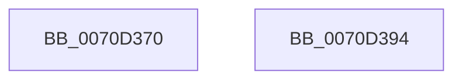

# IommuDomainCreate

- RVA: `0x0070D370`–`0x0070D395` (길이 `37` bytes)
- VA: `0x000000014070D370`
- 실행 섹션: `PAGE`
- PDB 이름 있음: `예`; PDB Function 태그: `아니요`
- unwind 정보 RVA: `0x0005D2F4`
- 디코드: `13`개 명령, `37/37` bytes 표시
- 미해석 바이트: `0` (있으면 어셈블리에 `.byte`로 보존)

> 이 문서는 커널 이미지의 기계어와 PDB 기호를 분석해 생성했습니다. 4번과 5번은 함수 원형과 자료형을 바이너리 사용 방식에서 추정한 C 해석이며 원본 소스 복구 결과는 아닙니다.

## 1. Dependencies

- 직접 호출 지점: **1**; 고유 호출 대상: **1**
- 직접 호출자로 확인된 함수: **0**
- RIP 상대 이미지 참조: **0**

### Outgoing calls
- `0x0070D38A` → [HalpIommuAllocateDmaDomain](../../text/55/HalpIommuAllocateDmaDomain_function_00554904.md) (function, `0x00554904`)

### Direct callers
- 이 함수 시작 RVA로 연결되는 직접 call은 확인되지 않았습니다. 간접 호출은 완전히 역산할 수 없습니다.

### Static image references
- 디코드된 RIP-relative 메모리 참조가 없습니다.

## 2. Other-region calls and transfers

- 다른 실행 섹션으로 향하는 call: **1**
  - `0x0070D38A` → [HalpIommuAllocateDmaDomain](../../text/55/HalpIommuAllocateDmaDomain_function_00554904.md) (`PAGE` → `.text`)
- 별도 외부 분기/꼬리 이동을 확인하지 못했습니다.

## 3. Assembly (complete function range)

```asm
0070D370  48 83 EC 38                     sub rsp, 0x38
0070D374  F6 D9                           neg cl
0070D376  48 89 54 24 20                  mov qword ptr [rsp + 0x20], rdx
0070D37B  1B C9                           sbb ecx, ecx
0070D37D  45 33 C9                        xor r9d, r9d
0070D380  F7 D1                           not ecx
0070D382  45 33 C0                        xor r8d, r8d
0070D385  83 E1 02                        and ecx, 2
0070D388  33 D2                           xor edx, edx
0070D38A  E8 75 75 E4 FF                  call 0x140554904
0070D38F  48 83 C4 38                     add rsp, 0x38
0070D393  C3                              ret
0070D394  CC                              int3
```

## 4. C-style interpretation (structured pseudocode)

```c
__int64 __fastcall IommuDomainCreate(unsigned __int8 a1, __int64 a2, int a3, int a4)
{
    __int64 result;
    __int64 v_rsp;
    unsigned __int64 v_stack_m18;

    v_rsp = (v_rsp) - (56);
    a1 = (unsigned __int8)(-(a1));
    v_stack_m18 = a2;
    a4 = 0;
    a1 = (unsigned int)(~(a1));
    a3 = 0;
    a1 = (unsigned int)((a1) & (2));
    a2 = 0;
    result = HalpIommuAllocateDmaDomain(a1, a2, a3, a4);
    v_rsp = (v_rsp) + (56);
    return result;
}
```

## 5. (Beta) C Style

```c
int64_t IommuDomainCreate(uint8_t Arg1, int64_t Arg2, int32_t Arg3, int32_t Arg4)
{
    int64_t result;
    int64_t local_rsp;
    uint64_t v_stack_m18;

    local_rsp = (local_rsp) - (56);
    Arg1 = (uint8_t)(-(Arg1));
    v_stack_m18 = Arg2;
    Arg4 = 0;
    Arg1 = (uint32_t)(~(Arg1));
    Arg3 = 0;
    Arg1 = (uint32_t)((Arg1) & (2));
    Arg2 = 0;
    result = HalpIommuAllocateDmaDomain(Arg1, Arg2, Arg3, Arg4);
    local_rsp = (local_rsp) + (56);
    return result;
}
```

## 6. Execution-region graph

[열기: 2D/3D 그래프와 함수 탐색 컨트롤 패널](../../../control-panel.html?section=page&rva=0x0070D370&view=graph)

- 2D 그래프는 위에서 아래로 흐르고, 3D 그래프는 빈 공간을 드래그해 회전합니다. Shift+드래그는 이동, 휠은 확대·축소, 함수 노드 선택은 대상 보고서 이동입니다.

### Static fallback


