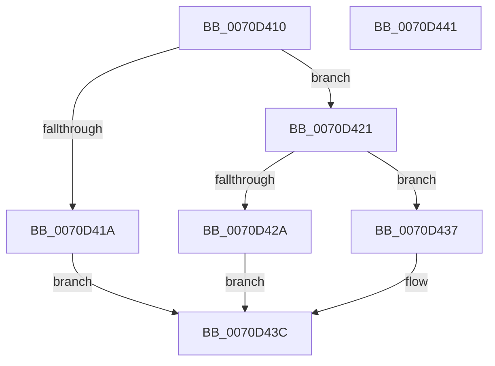

# IommuFlushDomainVaList

- RVA: `0x0070D410`–`0x0070D442` (길이 `50` bytes)
- VA: `0x000000014070D410`
- 실행 섹션: `PAGE`
- PDB 이름 있음: `예`; PDB Function 태그: `아니요`
- unwind 정보 RVA: `0x0005C788`
- 디코드: `15`개 명령, `50/50` bytes 표시
- 미해석 바이트: `0` (있으면 어셈블리에 `.byte`로 보존)

> 이 문서는 커널 이미지의 기계어와 PDB 기호를 분석해 생성했습니다. 4번과 5번은 함수 원형과 자료형을 바이너리 사용 방식에서 추정한 C 해석이며 원본 소스 복구 결과는 아닙니다.

## 1. Dependencies

- 직접 호출 지점: **1**; 고유 호출 대상: **1**
- 직접 호출자로 확인된 함수: **0**
- RIP 상대 이미지 참조: **1**

### Outgoing calls
- `0x0070D430` → [IommupHvFlushDeviceDomainVaList](../../text/56/IommupHvFlushDeviceDomainVaList_function_005673B0.md) (function, `0x005673B0`)

### Direct callers
- 이 함수 시작 RVA로 연결되는 직접 call은 확인되지 않았습니다. 간접 호출은 완전히 역산할 수 없습니다.

### Static image references
- `0x0070D421` → RVA `0x00FC1710` (`.data`; read)

## 2. Other-region calls and transfers

- 다른 실행 섹션으로 향하는 call: **1**
  - `0x0070D430` → [IommupHvFlushDeviceDomainVaList](../../text/56/IommupHvFlushDeviceDomainVaList_function_005673B0.md) (`PAGE` → `.text`)
- 별도 외부 분기/꼬리 이동을 확인하지 못했습니다.

## 3. Assembly (complete function range)

```asm
0070D410  48 83 EC 28                     sub rsp, 0x28
0070D414  83 79 08 02                     cmp dword ptr [rcx + 8], 2
0070D418  74 07                           je 0x14070d421
0070D41A  B8 EF 00 00 C0                  mov eax, 0xc00000ef
0070D41F  EB 1B                           jmp 0x14070d43c
0070D421  80 3D E8 42 8B 00 00            cmp byte ptr [rip + 0x8b42e8], 0
0070D428  74 0D                           je 0x14070d437
0070D42A  8A 51 34                        mov dl, byte ptr [rcx + 0x34]
0070D42D  8B 49 30                        mov ecx, dword ptr [rcx + 0x30]
0070D430  E8 7B 9F E5 FF                  call 0x1405673b0
0070D435  EB 05                           jmp 0x14070d43c
0070D437  B8 02 00 00 C0                  mov eax, 0xc0000002
0070D43C  48 83 C4 28                     add rsp, 0x28
0070D440  C3                              ret
0070D441  CC                              int3
```

## 4. C-style interpretation (structured pseudocode)

```c
__int64 __fastcall IommuFlushDomainVaList(__int64 a1)
{
    __int64 result;
    __int64 v_rsp;

    v_rsp = (v_rsp) - (40);
    if ((*(unsigned int *)(a1 + 8)) == 2) goto loc_0070D421;
    goto loc_0070D43C;
loc_0070D421:
    if ((*(unsigned __int8 *)(v_rip + 9126632)) == 0) goto loc_0070D437;
    result = IommupHvFlushDeviceDomainVaList((unsigned int)(*(unsigned int *)(a1 + 48)), *(unsigned __int8 *)(a1 + 52), a3, a4);
    goto loc_0070D43C;
loc_0070D437:
loc_0070D43C:
    v_rsp = (v_rsp) + (40);
    return (unsigned int)(0xC0000002ULL);
}
```

## 5. (Beta) C Style

```c
int64_t IommuFlushDomainVaList(void *Arg1)
{
    uint8_t *arg1 = (uint8_t *)Arg1;

    int64_t result;
    int64_t local_rsp;

    local_rsp = (local_rsp) - (40);
    if ((*(uint32_t *)(arg1 + 0x8)) == 2) goto loc_0070D421;
    goto loc_0070D43C;
loc_0070D421:
    if ((*(uint8_t *)(v_rip + 0x8B42E8)) == 0) goto loc_0070D437;
    result = IommupHvFlushDeviceDomainVaList((uint32_t)(*(uint32_t *)(arg1 + 0x30)), *(uint8_t *)(arg1 + 0x34), a3, a4);
    goto loc_0070D43C;
loc_0070D437:
loc_0070D43C:
    local_rsp = (local_rsp) + (40);
    return (uint32_t)(0xC0000002ULL);
}
```

### 관측된 메모리 오프셋

구조체 형식이 확인되지 않은 접근은 인자 기준의 오프셋으로만 기록했습니다.

| 기준 인자 | 오프셋 표현 | 폭 (bit) | 접근 |
|---|---:|---:|---|
| `Arg1` | `+ 0x8` | `32` | `R` |
| `Arg1` | `+ 0x30` | `32` | `R` |
| `Arg1` | `+ 0x34` | `8` | `R` |

## 6. Execution-region graph

[열기: 2D/3D 그래프와 함수 탐색 컨트롤 패널](../../../control-panel.html?section=page&rva=0x0070D410&view=graph)

- 2D 그래프는 위에서 아래로 흐르고, 3D 그래프는 빈 공간을 드래그해 회전합니다. Shift+드래그는 이동, 휠은 확대·축소, 함수 노드 선택은 대상 보고서 이동입니다.

### Static fallback


