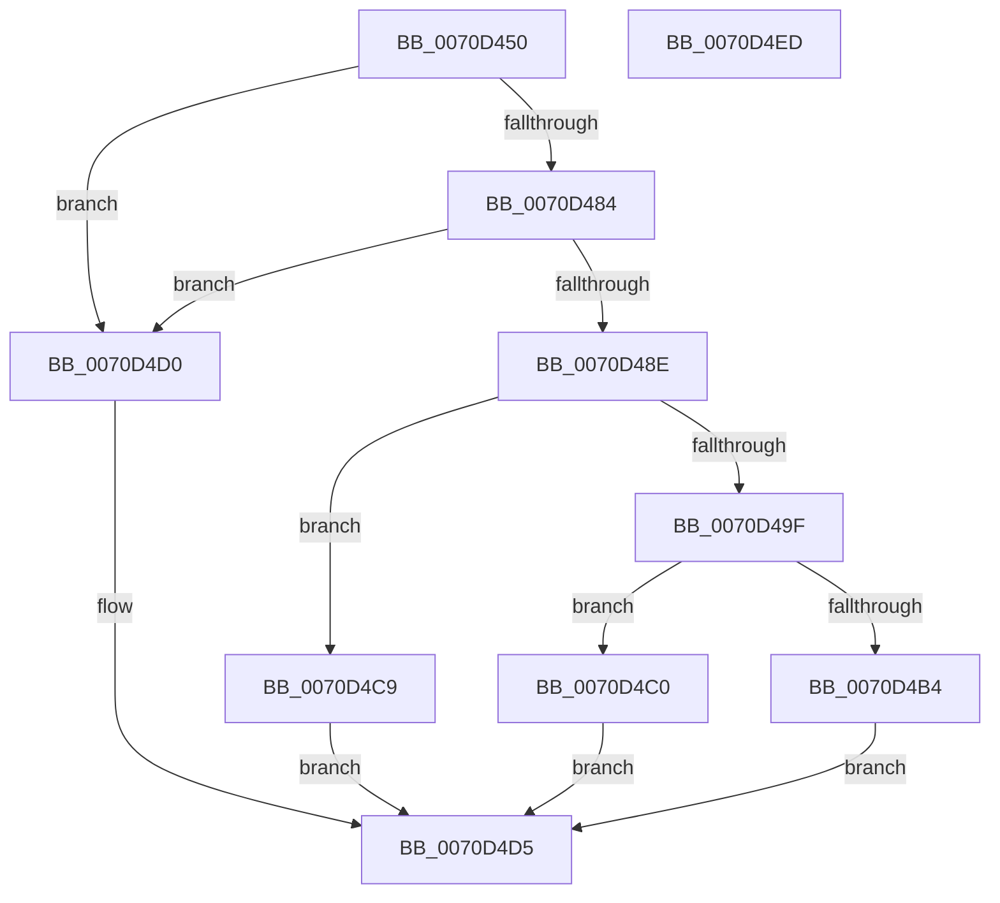

# IommuPasidDeviceCreate

- RVA: `0x0070D450`–`0x0070D4EE` (길이 `158` bytes)
- VA: `0x000000014070D450`
- 실행 섹션: `PAGE`
- PDB 이름 있음: `예`; PDB Function 태그: `아니요`
- unwind 정보 RVA: `0x000A85B0`
- 디코드: `48`개 명령, `158/158` bytes 표시
- 미해석 바이트: `0` (있으면 어셈블리에 `.byte`로 보존)

> 이 문서는 커널 이미지의 기계어와 PDB 기호를 분석해 생성했습니다. 4번과 5번은 함수 원형과 자료형을 바이너리 사용 방식에서 추정한 C 해석이며 원본 소스 복구 결과는 아닙니다.

## 1. Dependencies

- 직접 호출 지점: **3**; 고유 호출 대상: **3**
- 직접 호출자로 확인된 함수: **0**
- RIP 상대 이미지 참조: **0**

### Outgoing calls
- `0x0070D490` → [ExpAllocateAsid](../../text/65/ExpAllocateAsid_function_0065AF68.md) (function, `0x0065AF68`)
- `0x0070D4A9` → [IommupPasidDeviceCreate](../../text/54/IommupPasidDeviceCreate_function_0054FEEC.md) (function, `0x0054FEEC`)
- `0x0070D4C2` → [ExFreeAsid](../../text/65/ExFreeAsid_function_0065ACB8.md) (function, `0x0065ACB8`)

### Direct callers
- 이 함수 시작 RVA로 연결되는 직접 call은 확인되지 않았습니다. 간접 호출은 완전히 역산할 수 없습니다.

### Static image references
- 디코드된 RIP-relative 메모리 참조가 없습니다.

## 2. Other-region calls and transfers

- 다른 실행 섹션으로 향하는 call: **3**
  - `0x0070D490` → [ExpAllocateAsid](../../text/65/ExpAllocateAsid_function_0065AF68.md) (`PAGE` → `.text`)
  - `0x0070D4A9` → [IommupPasidDeviceCreate](../../text/54/IommupPasidDeviceCreate_function_0054FEEC.md) (`PAGE` → `.text`)
  - `0x0070D4C2` → [ExFreeAsid](../../text/65/ExFreeAsid_function_0065ACB8.md) (`PAGE` → `.text`)
- 별도 외부 분기/꼬리 이동을 확인하지 못했습니다.

## 3. Assembly (complete function range)

```asm
0070D450  48 8B C4                        mov rax, rsp
0070D453  48 89 58 10                     mov qword ptr [rax + 0x10], rbx
0070D457  48 89 70 18                     mov qword ptr [rax + 0x18], rsi
0070D45B  48 89 78 20                     mov qword ptr [rax + 0x20], rdi
0070D45F  41 56                           push r14
0070D461  48 83 EC 20                     sub rsp, 0x20
0070D465  41 83 08 FF                     or dword ptr [r8], 0xffffffff
0070D469  49 8B F0                        mov rsi, r8
0070D46C  48 83 22 00                     and qword ptr [rdx], 0
0070D470  4C 8B F2                        mov r14, rdx
0070D473  48 83 60 08 00                  and qword ptr [rax + 8], 0
0070D478  48 8B D9                        mov rbx, rcx
0070D47B  80 B9 11 01 00 00 00            cmp byte ptr [rcx + 0x111], 0
0070D482  74 4C                           je 0x14070d4d0
0070D484  8B 81 80 01 00 00               mov eax, dword ptr [rcx + 0x180]
0070D48A  A8 04                           test al, 4
0070D48C  74 42                           je 0x14070d4d0
0070D48E  33 D2                           xor edx, edx
0070D490  E8 D3 DA F4 FF                  call 0x14065af68
0070D495  8B F8                           mov edi, eax
0070D497  8D 48 FF                        lea ecx, [rax - 1]
0070D49A  83 F9 FD                        cmp ecx, -3
0070D49D  77 2A                           ja 0x14070d4c9
0070D49F  4C 8D 44 24 30                  lea r8, [rsp + 0x30]
0070D4A4  8B D0                           mov edx, eax
0070D4A6  48 8B CB                        mov rcx, rbx
0070D4A9  E8 3E 2A E4 FF                  call 0x14054feec
0070D4AE  8B D8                           mov ebx, eax
0070D4B0  85 C0                           test eax, eax
0070D4B2  78 0C                           js 0x14070d4c0
0070D4B4  48 8B 4C 24 30                  mov rcx, qword ptr [rsp + 0x30]
0070D4B9  89 3E                           mov dword ptr [rsi], edi
0070D4BB  49 89 0E                        mov qword ptr [r14], rcx
0070D4BE  EB 15                           jmp 0x14070d4d5
0070D4C0  8B CF                           mov ecx, edi
0070D4C2  E8 F1 D7 F4 FF                  call 0x14065acb8
0070D4C7  EB 0C                           jmp 0x14070d4d5
0070D4C9  BB 73 00 00 C0                  mov ebx, 0xc0000073
0070D4CE  EB 05                           jmp 0x14070d4d5
0070D4D0  BB EF 00 00 C0                  mov ebx, 0xc00000ef
0070D4D5  48 8B 74 24 40                  mov rsi, qword ptr [rsp + 0x40]
0070D4DA  8B C3                           mov eax, ebx
0070D4DC  48 8B 5C 24 38                  mov rbx, qword ptr [rsp + 0x38]
0070D4E1  48 8B 7C 24 48                  mov rdi, qword ptr [rsp + 0x48]
0070D4E6  48 83 C4 20                     add rsp, 0x20
0070D4EA  41 5E                           pop r14
0070D4EC  C3                              ret
0070D4ED  CC                              int3
```

## 4. C-style interpretation (structured pseudocode)

```c
__int64 __fastcall IommuPasidDeviceCreate(__int64 a1, __int64 a2, __int64 a3)
{
    __int64 result;
    __int64 v_rsp;
    unsigned __int64 v_stack_p10;
    unsigned __int64 v_stack_p18;
    unsigned __int64 v_stack_p20;
    unsigned __int64 v_stack_p8;

    *(unsigned __int64 *)(v_rsp + 16) = v_rbx;
    *(unsigned __int64 *)(v_rsp + 24) = v_rsi;
    *(unsigned __int64 *)(v_rsp + 32) = v_rdi;
    v_rsp = (v_rsp) - (32);
    if ((*(unsigned __int8 *)(a1 + 273)) == 0) goto loc_0070D4D0;
    if ((((unsigned __int8)((unsigned int)(*(unsigned int *)(a1 + 384)))) & (4)) == 0) goto loc_0070D4D0;
    a2 = 0;
    result = ExpAllocateAsid(a1, a2, a3, a4);
    if (((unsigned int)(result - 1)) > -3) goto loc_0070D4C9;
    result = IommupPasidDeviceCreate(a1, (unsigned int)((unsigned int)(result)), v_stack_p8, a4);
    if (sign_flag) goto loc_0070D4C0;
    *(unsigned int *)(a3) = (unsigned int)((unsigned int)((unsigned int)(result)));
    *(unsigned __int64 *)(a2) = v_stack_p8;
    goto loc_0070D4D5;
loc_0070D4C0:
    result = ExFreeAsid((unsigned int)((unsigned int)((unsigned int)((unsigned int)(result)))), (unsigned int)((unsigned int)(result)), v_stack_p8, a4);
    goto loc_0070D4D5;
loc_0070D4C9:
    goto loc_0070D4D5;
loc_0070D4D0:
loc_0070D4D5:
    v_rsp = (v_rsp) + (32);
    return (unsigned int)((unsigned int)((unsigned int)(0xC00000EFULL)));
}
```

## 5. (Beta) C Style

```c
int64_t IommuPasidDeviceCreate(void *Arg1, void *Arg2, void *Arg3)
{
    uint8_t *arg1 = (uint8_t *)Arg1;
    uint8_t *arg2 = (uint8_t *)Arg2;
    uint8_t *arg3 = (uint8_t *)Arg3;

    int64_t result;
    int64_t local_rsp;
    uint64_t v_stack_p10;
    uint64_t v_stack_p18;
    uint64_t v_stack_p20;
    uint64_t v_stack_p8;

    *(uint64_t *)(local_rsp + 0x10) = local_rbx;
    *(uint64_t *)(local_rsp + 0x18) = local_rsi;
    *(uint64_t *)(local_rsp + 0x20) = local_rdi;
    local_rsp = (local_rsp) - (32);
    if ((*(uint8_t *)(arg1 + 0x111)) == 0) goto loc_0070D4D0;
    if ((((uint8_t)((uint32_t)(*(uint32_t *)(arg1 + 0x180)))) & (4)) == 0) goto loc_0070D4D0;
    Arg2 = 0;
    result = ExpAllocateAsid(Arg1, Arg2, Arg3, a4);
    if (((uint32_t)(result - 1)) > -3) goto loc_0070D4C9;
    result = IommupPasidDeviceCreate(Arg1, (uint32_t)((uint32_t)(result)), v_stack_p8, a4);
    if (sign_flag) goto loc_0070D4C0;
    *(uint32_t *)(arg3) = (uint32_t)((uint32_t)((uint32_t)(result)));
    *(uint64_t *)(arg2) = v_stack_p8;
    goto loc_0070D4D5;
loc_0070D4C0:
    result = ExFreeAsid((uint32_t)((uint32_t)((uint32_t)((uint32_t)(result)))), (uint32_t)((uint32_t)(result)), v_stack_p8, a4);
    goto loc_0070D4D5;
loc_0070D4C9:
    goto loc_0070D4D5;
loc_0070D4D0:
loc_0070D4D5:
    local_rsp = (local_rsp) + (32);
    return (uint32_t)((uint32_t)((uint32_t)(0xC00000EFULL)));
}
```

### 관측된 메모리 오프셋

구조체 형식이 확인되지 않은 접근은 인자 기준의 오프셋으로만 기록했습니다.

| 기준 인자 | 오프셋 표현 | 폭 (bit) | 접근 |
|---|---:|---:|---|
| `Arg1` | `+ 0x111` | `8` | `R` |
| `Arg1` | `+ 0x180` | `32` | `R` |
| `Arg2` | `+ 0x0` | `64` | `R/W` |
| `Arg2` | `+ 0x0` | `64` | `W` |
| `Arg3` | `+ 0x0` | `32` | `R/W` |
| `Arg3` | `+ 0x0` | `32` | `W` |

## 6. Execution-region graph

[열기: 2D/3D 그래프와 함수 탐색 컨트롤 패널](../../../control-panel.html?section=page&rva=0x0070D450&view=graph)

- 2D 그래프는 위에서 아래로 흐르고, 3D 그래프는 빈 공간을 드래그해 회전합니다. Shift+드래그는 이동, 휠은 확대·축소, 함수 노드 선택은 대상 보고서 이동입니다.

### Static fallback


