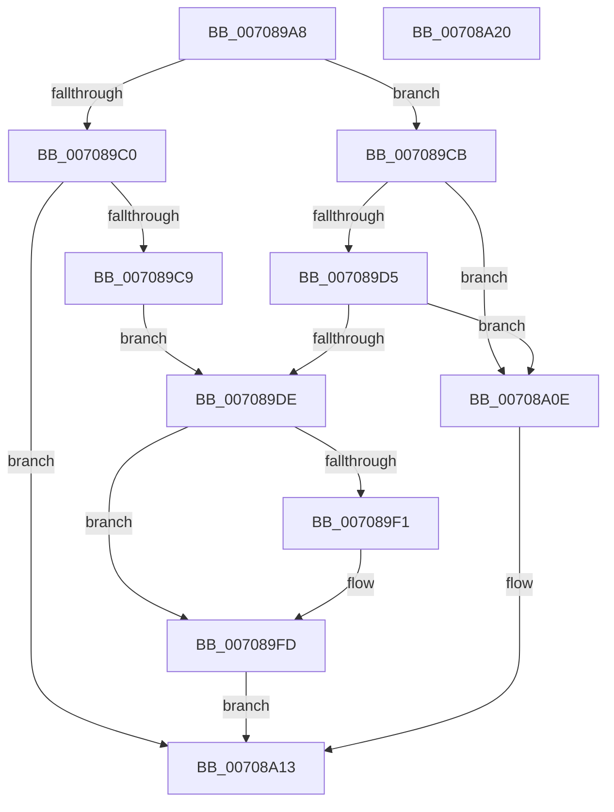

# IommupDeviceDisablePasidTaggedDma

- RVA: `0x007089A8`–`0x00708A21` (길이 `121` bytes)
- VA: `0x00000001407089A8`
- 실행 섹션: `PAGE`
- PDB 이름 있음: `예`; PDB Function 태그: `아니요`
- unwind 정보 RVA: `0x0005CAAC`
- 디코드: `32`개 명령, `121/121` bytes 표시
- 미해석 바이트: `0` (있으면 어셈블리에 `.byte`로 보존)

> 이 문서는 커널 이미지의 기계어와 PDB 기호를 분석해 생성했습니다. 4번과 5번은 함수 원형과 자료형을 바이너리 사용 방식에서 추정한 C 해석이며 원본 소스 복구 결과는 아닙니다.

## 1. Dependencies

- 직접 호출 지점: **2**; 고유 호출 대상: **2**
- 직접 호출자로 확인된 함수: **2**
- RIP 상대 이미지 참조: **0**

### Outgoing calls
- `0x007089DE` → [IommupDeviceDisableSvm](IommupDeviceDisableSvm_function_00708A28.md) (function, `0x00708A28`)
- `0x007089F8` → [guard_dispatch_icall](../../text/6B/guard_dispatch_icall_function_006BAAD0.md) (function, `0x006BAAD0`)

### Direct callers
- [HalpIommuCreateDevice](../../text/54/HalpIommuCreateDevice_function_0054ED60.md) at `0x0054EFC5`
- [HalpIommuDeleteDevice](../../text/54/HalpIommuDeleteDevice_function_0054F368.md) at `0x0054F4B3`

### Static image references
- 디코드된 RIP-relative 메모리 참조가 없습니다.

## 2. Other-region calls and transfers

- 다른 실행 섹션으로 향하는 call: **1**
  - `0x007089F8` → [guard_dispatch_icall](../../text/6B/guard_dispatch_icall_function_006BAAD0.md) (`PAGE` → `.text`)
- 별도 외부 분기/꼬리 이동을 확인하지 못했습니다.

## 3. Assembly (complete function range)

```asm
007089A8  48 89 5C 24 08                  mov qword ptr [rsp + 8], rbx
007089AD  57                              push rdi
007089AE  48 83 EC 20                     sub rsp, 0x20
007089B2  33 FF                           xor edi, edi
007089B4  48 8B D9                        mov rbx, rcx
007089B7  40 38 B9 11 01 00 00            cmp byte ptr [rcx + 0x111], dil
007089BE  75 0B                           jne 0x1407089cb
007089C0  40 38 B9 12 01 00 00            cmp byte ptr [rcx + 0x112], dil
007089C7  74 4A                           je 0x140708a13
007089C9  EB 13                           jmp 0x1407089de
007089CB  8B 81 80 01 00 00               mov eax, dword ptr [rcx + 0x180]
007089D1  A8 04                           test al, 4
007089D3  74 39                           je 0x140708a0e
007089D5  40 38 B9 12 01 00 00            cmp byte ptr [rcx + 0x112], dil
007089DC  74 30                           je 0x140708a0e
007089DE  E8 45 00 00 00                  call 0x140708a28
007089E3  8B F8                           mov edi, eax
007089E5  48 8B 83 30 01 00 00            mov rax, qword ptr [rbx + 0x130]
007089EC  48 85 C0                        test rax, rax
007089EF  74 0C                           je 0x1407089fd
007089F1  48 8B 8B 20 01 00 00            mov rcx, qword ptr [rbx + 0x120]
007089F8  E8 D3 20 FB FF                  call 0x1406baad0
007089FD  66 83 A3 11 01 00 00 00         and word ptr [rbx + 0x111], 0
00708A05  C6 83 10 01 00 00 00            mov byte ptr [rbx + 0x110], 0
00708A0C  EB 05                           jmp 0x140708a13
00708A0E  BF 01 00 00 C0                  mov edi, 0xc0000001
00708A13  48 8B 5C 24 30                  mov rbx, qword ptr [rsp + 0x30]
00708A18  8B C7                           mov eax, edi
00708A1A  48 83 C4 20                     add rsp, 0x20
00708A1E  5F                              pop rdi
00708A1F  C3                              ret
00708A20  CC                              int3
```

## 4. C-style interpretation (structured pseudocode)

```c
__int64 __fastcall IommupDeviceDisablePasidTaggedDma(__int64 a1)
{
    __int64 result;
    __int64 v_rdi;
    __int64 v_rsp;
    unsigned __int64 v_stack_p8;

    v_stack_p8 = v_rbx;
    v_rsp = (v_rsp) - (32);
    v_rdi = 0;
    if ((*(unsigned __int8 *)(a1 + 273)) != 0) goto loc_007089CB;
    if ((*(unsigned __int8 *)(a1 + 274)) == 0) goto loc_00708A13;
    goto loc_007089DE;
loc_007089CB:
    if ((((unsigned __int8)((unsigned int)(*(unsigned int *)(a1 + 384)))) & (4)) == 0) goto loc_00708A0E;
    if ((*(unsigned __int8 *)(a1 + 274)) == 0) goto loc_00708A0E;
loc_007089DE:
    result = IommupDeviceDisableSvm(a1, a2, a3, a4);
    result = *(unsigned __int64 *)(a1 + 304);
    if (*(unsigned __int64 *)(a1 + 304) != 0) {
        a1 = *(unsigned __int64 *)(a1 + 288);
        result = guard_dispatch_icall(a1, a2, a3, a4);
    }
    *(unsigned __int8 *)(a1 + 272) = 0;
    goto loc_00708A13;
loc_00708A0E:
loc_00708A13:
    v_rsp = (v_rsp) + (32);
    return (unsigned int)((unsigned int)((unsigned int)(0xC0000001ULL)));
}
```

## 5. (Beta) C Style

```c
int64_t IommupDeviceDisablePasidTaggedDma(void *Arg1)
{
    uint8_t *arg1 = (uint8_t *)Arg1;

    int64_t result;
    int64_t local_rdi;
    int64_t local_rsp;
    uint64_t v_stack_p8;

    v_stack_p8 = local_rbx;
    local_rsp = (local_rsp) - (32);
    local_rdi = 0;
    if ((*(uint8_t *)(arg1 + 0x111)) != 0) goto loc_007089CB;
    if ((*(uint8_t *)(arg1 + 0x112)) == 0) goto loc_00708A13;
    goto loc_007089DE;
loc_007089CB:
    if ((((uint8_t)((uint32_t)(*(uint32_t *)(arg1 + 0x180)))) & (4)) == 0) goto loc_00708A0E;
    if ((*(uint8_t *)(arg1 + 0x112)) == 0) goto loc_00708A0E;
loc_007089DE:
    result = IommupDeviceDisableSvm(Arg1, a2, a3, a4);
    result = *(uint64_t *)(arg1 + 0x130);
    if (*(uint64_t *)(arg1 + 0x130) != 0) {
        Arg1 = *(uint64_t *)(arg1 + 0x120);
        result = guard_dispatch_icall(Arg1, a2, a3, a4);
    }
    *(uint8_t *)(arg1 + 0x110) = 0;
    goto loc_00708A13;
loc_00708A0E:
loc_00708A13:
    local_rsp = (local_rsp) + (32);
    return (uint32_t)((uint32_t)((uint32_t)(0xC0000001ULL)));
}
```

### 관측된 메모리 오프셋

구조체 형식이 확인되지 않은 접근은 인자 기준의 오프셋으로만 기록했습니다.

| 기준 인자 | 오프셋 표현 | 폭 (bit) | 접근 |
|---|---:|---:|---|
| `Arg1` | `+ 0x110` | `8` | `W` |
| `Arg1` | `+ 0x111` | `8` | `R` |
| `Arg1` | `+ 0x111` | `16` | `R/W` |
| `Arg1` | `+ 0x112` | `8` | `R` |
| `Arg1` | `+ 0x120` | `64` | `R` |
| `Arg1` | `+ 0x130` | `64` | `R` |
| `Arg1` | `+ 0x180` | `32` | `R` |

## 6. Execution-region graph

[열기: 2D/3D 그래프와 함수 탐색 컨트롤 패널](../../../control-panel.html?section=page&rva=0x007089A8&view=graph)

- 2D 그래프는 위에서 아래로 흐르고, 3D 그래프는 빈 공간을 드래그해 회전합니다. Shift+드래그는 이동, 휠은 확대·축소, 함수 노드 선택은 대상 보고서 이동입니다.

### Static fallback


