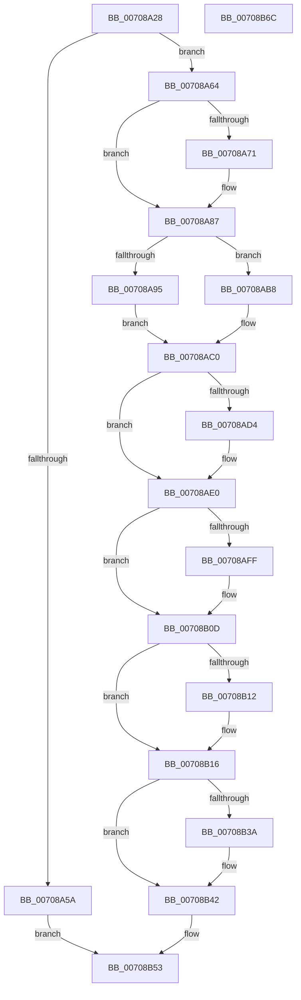

# IommupDeviceDisableSvm

- RVA: `0x00708A28`–`0x00708B6D` (길이 `325` bytes)
- VA: `0x0000000140708A28`
- 실행 섹션: `PAGE`
- PDB 이름 있음: `예`; PDB Function 태그: `아니요`
- unwind 정보 RVA: `0x00095AD0`
- 디코드: `88`개 명령, `325/325` bytes 표시
- 미해석 바이트: `0` (있으면 어셈블리에 `.byte`로 보존)

> 이 문서는 커널 이미지의 기계어와 PDB 기호를 분석해 생성했습니다. 4번과 5번은 함수 원형과 자료형을 바이너리 사용 방식에서 추정한 C 해석이며 원본 소스 복구 결과는 아닙니다.

## 1. Dependencies

- 직접 호출 지점: **11**; 고유 호출 대상: **11**
- 직접 호출자로 확인된 함수: **1**
- RIP 상대 이미지 참조: **1**

### Outgoing calls
- `0x00708A51` → [IommupDeviceGetPasidDevice](../../text/54/IommupDeviceGetPasidDevice_function_0054F82C.md) (function, `0x0054F82C`)
- `0x00708A82` → [guard_dispatch_icall](../../text/6B/guard_dispatch_icall_function_006BAAD0.md) (function, `0x006BAAD0`)
- `0x00708AA6` → [IommuDisableDevicePasid](../../text/56/IommuDisableDevicePasid_function_00564E80.md) (function, `0x00564E80`)
- `0x00708AB1` → [IommupUnmapDeviceInternal](../../text/56/IommupUnmapDeviceInternal_function_005667D8.md) (function, `0x005667D8`)
- `0x00708ABB` → [IommupHvDetachPasidDevice](../../text/56/IommupHvDetachPasidDevice_function_00567150.md) (function, `0x00567150`)
- `0x00708AC3` → [IommupPasidDeviceDelete](../../text/55/IommupPasidDeviceDelete_function_00550030.md) (function, `0x00550030`)
- `0x00708ADB` → [HalpIommuFreeDomainId](../../text/55/HalpIommuFreeDomainId_function_00553658.md) (function, `0x00553658`)
- `0x00708AEF` → [KeAbPreAcquire](../../text/21/KeAbPreAcquire_function_00210230.md) (function, `0x00210230`)
- `0x00708B08` → [ExfAcquirePushLockExclusiveEx](../../text/20/ExfAcquirePushLockExclusiveEx_function_0020FC90.md) (function, `0x0020FC90`)
- `0x00708B3D` → [ExfTryToWakePushLock](../../text/26/ExfTryToWakePushLock_function_00265DD0.md) (function, `0x00265DD0`)
- `0x00708B45` → [KeAbPostRelease](../../text/2E/KeAbPostRelease_function_002E1600.md) (function, `0x002E1600`)

### Direct callers
- [IommupDeviceDisablePasidTaggedDma](IommupDeviceDisablePasidTaggedDma_function_007089A8.md) at `0x007089DE`

### Static image references
- `0x00708A87` → RVA `0x00FC1710` (`.data`; read)

## 2. Other-region calls and transfers

- 다른 실행 섹션으로 향하는 call: **11**
  - `0x00708A51` → [IommupDeviceGetPasidDevice](../../text/54/IommupDeviceGetPasidDevice_function_0054F82C.md) (`PAGE` → `.text`)
  - `0x00708A82` → [guard_dispatch_icall](../../text/6B/guard_dispatch_icall_function_006BAAD0.md) (`PAGE` → `.text`)
  - `0x00708AA6` → [IommuDisableDevicePasid](../../text/56/IommuDisableDevicePasid_function_00564E80.md) (`PAGE` → `.text`)
  - `0x00708AB1` → [IommupUnmapDeviceInternal](../../text/56/IommupUnmapDeviceInternal_function_005667D8.md) (`PAGE` → `.text`)
  - `0x00708ABB` → [IommupHvDetachPasidDevice](../../text/56/IommupHvDetachPasidDevice_function_00567150.md) (`PAGE` → `.text`)
  - `0x00708AC3` → [IommupPasidDeviceDelete](../../text/55/IommupPasidDeviceDelete_function_00550030.md) (`PAGE` → `.text`)
  - `0x00708ADB` → [HalpIommuFreeDomainId](../../text/55/HalpIommuFreeDomainId_function_00553658.md) (`PAGE` → `.text`)
  - `0x00708AEF` → [KeAbPreAcquire](../../text/21/KeAbPreAcquire_function_00210230.md) (`PAGE` → `.text`)
  - `0x00708B08` → [ExfAcquirePushLockExclusiveEx](../../text/20/ExfAcquirePushLockExclusiveEx_function_0020FC90.md) (`PAGE` → `.text`)
  - `0x00708B3D` → [ExfTryToWakePushLock](../../text/26/ExfTryToWakePushLock_function_00265DD0.md) (`PAGE` → `.text`)
  - `0x00708B45` → [KeAbPostRelease](../../text/2E/KeAbPostRelease_function_002E1600.md) (`PAGE` → `.text`)
- 별도 외부 분기/꼬리 이동을 확인하지 못했습니다.

## 3. Assembly (complete function range)

```asm
00708A28  48 8B C4                        mov rax, rsp
00708A2B  48 89 58 08                     mov qword ptr [rax + 8], rbx
00708A2F  48 89 68 18                     mov qword ptr [rax + 0x18], rbp
00708A33  48 89 70 20                     mov qword ptr [rax + 0x20], rsi
00708A37  57                              push rdi
00708A38  41 56                           push r14
00708A3A  41 57                           push r15
00708A3C  48 83 EC 20                     sub rsp, 0x20
00708A40  45 33 FF                        xor r15d, r15d
00708A43  4C 8D 48 10                     lea r9, [rax + 0x10]
00708A47  4C 21 78 10                     and qword ptr [rax + 0x10], r15
00708A4B  45 33 C0                        xor r8d, r8d
00708A4E  48 8B F9                        mov rdi, rcx
00708A51  E8 D6 6D E4 FF                  call 0x14054f82c
00708A56  84 C0                           test al, al
00708A58  75 0A                           jne 0x140708a64
00708A5A  B8 01 00 00 C0                  mov eax, 0xc0000001
00708A5F  E9 EF 00 00 00                  jmp 0x140708b53
00708A64  48 8D B7 80 01 00 00            lea rsi, [rdi + 0x180]
00708A6B  8B 06                           mov eax, dword ptr [rsi]
00708A6D  A8 04                           test al, 4
00708A6F  74 16                           je 0x140708a87
00708A71  48 8B 87 48 01 00 00            mov rax, qword ptr [rdi + 0x148]
00708A78  48 8B D6                        mov rdx, rsi
00708A7B  48 8B 8F 20 01 00 00            mov rcx, qword ptr [rdi + 0x120]
00708A82  E8 49 20 FB FF                  call 0x1406baad0
00708A87  44 38 3D 82 8C 8B 00            cmp byte ptr [rip + 0x8b8c82], r15b
00708A8E  48 8B 6C 24 48                  mov rbp, qword ptr [rsp + 0x48]
00708A93  75 23                           jne 0x140708ab8
00708A95  48 8B 5D 38                     mov rbx, qword ptr [rbp + 0x38]
00708A99  48 8B D7                        mov rdx, rdi
00708A9C  48 8B CB                        mov rcx, rbx
00708A9F  48 8B 03                        mov rax, qword ptr [rbx]
00708AA2  44 8B 78 10                     mov r15d, dword ptr [rax + 0x10]
00708AA6  E8 D5 C3 E5 FF                  call 0x140564e80
00708AAB  48 8B 0B                        mov rcx, qword ptr [rbx]
00708AAE  48 8B D7                        mov rdx, rdi
00708AB1  E8 22 DD E5 FF                  call 0x1405667d8
00708AB6  EB 08                           jmp 0x140708ac0
00708AB8  48 8B CF                        mov rcx, rdi
00708ABB  E8 90 E6 E5 FF                  call 0x140567150
00708AC0  48 8B CD                        mov rcx, rbp
00708AC3  E8 68 75 E4 FF                  call 0x140550030
00708AC8  80 3D 41 8C 8B 00 00            cmp byte ptr [rip + 0x8b8c41], 0
00708ACF  44 8B F0                        mov r14d, eax
00708AD2  75 0C                           jne 0x140708ae0
00708AD4  48 8B 4F 20                     mov rcx, qword ptr [rdi + 0x20]
00708AD8  41 8B D7                        mov edx, r15d
00708ADB  E8 78 AB E4 FF                  call 0x140553658
00708AE0  48 8D 9F 78 01 00 00            lea rbx, [rdi + 0x178]
00708AE7  45 33 C0                        xor r8d, r8d
00708AEA  48 8B CB                        mov rcx, rbx
00708AED  33 D2                           xor edx, edx
00708AEF  E8 3C 77 B0 FF                  call 0x140210230
00708AF4  F0 48 0F BA 2B 00               lock bts qword ptr [rbx], 0
00708AFA  48 8B E8                        mov rbp, rax
00708AFD  73 0E                           jae 0x140708b0d
00708AFF  4C 8B C3                        mov r8, rbx
00708B02  48 8B D0                        mov rdx, rax
00708B05  48 8B CB                        mov rcx, rbx
00708B08  E8 83 71 B0 FF                  call 0x14020fc90
00708B0D  48 85 ED                        test rbp, rbp
00708B10  74 04                           je 0x140708b16
00708B12  C6 45 0A 01                     mov byte ptr [rbp + 0xa], 1
00708B16  48 8D 87 68 01 00 00            lea rax, [rdi + 0x168]
00708B1D  B9 08 07 00 C0                  mov ecx, 0xc0000708
00708B22  48 39 00                        cmp qword ptr [rax], rax
00708B25  44 0F 45 F1                     cmovne r14d, ecx
00708B29  48 83 CA FF                     or rdx, 0xffffffffffffffff
00708B2D  F0 48 0F C1 13                  lock xadd qword ptr [rbx], rdx
00708B32  80 E2 06                        and dl, 6
00708B35  80 FA 02                        cmp dl, 2
00708B38  75 08                           jne 0x140708b42
00708B3A  48 8B CB                        mov rcx, rbx
00708B3D  E8 8E D2 B5 FF                  call 0x140265dd0
00708B42  48 8B CB                        mov rcx, rbx
00708B45  E8 B6 8A BD FF                  call 0x1402e1600
00708B4A  81 26 03 FF FF FF               and dword ptr [rsi], 0xffffff03
00708B50  41 8B C6                        mov eax, r14d
00708B53  48 8B 5C 24 40                  mov rbx, qword ptr [rsp + 0x40]
00708B58  48 8B 6C 24 50                  mov rbp, qword ptr [rsp + 0x50]
00708B5D  48 8B 74 24 58                  mov rsi, qword ptr [rsp + 0x58]
00708B62  48 83 C4 20                     add rsp, 0x20
00708B66  41 5F                           pop r15
00708B68  41 5E                           pop r14
00708B6A  5F                              pop rdi
00708B6B  C3                              ret
00708B6C  CC                              int3
```

## 4. C-style interpretation (structured pseudocode)

```c
__int64 __fastcall IommupDeviceDisableSvm(__int64 a1, __int64 a2, int a3)
{
    __int64 result;
    __int64 v_r14;
    __int64 v_r15;
    __int64 v_rsp;
    unsigned __int64 v_stack_p10;
    unsigned __int64 v_stack_p18;
    unsigned __int64 v_stack_p20;
    unsigned __int64 v_stack_p8;

    *(unsigned __int64 *)(v_rsp + 8) = v_rbx;
    *(unsigned __int64 *)(v_rsp + 24) = v_rbp;
    *(unsigned __int64 *)(v_rsp + 32) = v_rsi;
    v_rsp = (v_rsp) - (32);
    v_r15 = 0;
    a3 = 0;
    result = IommupDeviceGetPasidDevice(a1, a2, a3, v_rsp + 16);
    if ((unsigned __int8)(result) != 0) goto loc_00708A64;
    goto loc_00708B53;
loc_00708A64:
    result = (unsigned int)(*(unsigned int *)(a1 + 384));
    if ((((unsigned __int8)((unsigned int)(*(unsigned int *)(a1 + 384)))) & (4)) != 0) {
        result = *(unsigned __int64 *)(a1 + 328);
        a2 = a1 + 384;
        a1 = *(unsigned __int64 *)(a1 + 288);
        result = guard_dispatch_icall(a1, a2, a3, v_rsp + 16);
    }
    if ((*(unsigned __int8 *)(v_rip + 9145474)) != 0) goto loc_00708AB8;
    result = IommuDisableDevicePasid(*(unsigned __int64 *)(v_stack_p10 + 56), a1, a3, v_rsp + 16);
    result = IommupUnmapDeviceInternal(*(unsigned __int64 *)(*(unsigned __int64 *)(v_stack_p10 + 56)), a1, a3, v_rsp + 16);
    goto loc_00708AC0;
loc_00708AB8:
    result = IommupHvDetachPasidDevice(a1, a1, a3, v_rsp + 16);
loc_00708AC0:
    result = IommupPasidDeviceDelete(v_stack_p10, a1, a3, v_rsp + 16);
    if ((*(unsigned __int8 *)(v_rip + 9145409)) == 0) {
        a1 = *(unsigned __int64 *)(a1 + 32);
        a2 = (unsigned int)((unsigned int)(*(unsigned int *)(*(unsigned __int64 *)(*(unsigned __int64 *)(v_stack_p10 + 56)) + 16)));
        result = HalpIommuFreeDomainId(a1, a2, a3, v_rsp + 16);
    }
    a3 = 0;
    a2 = 0;
    result = KeAbPreAcquire(a1 + 376, a2, a3, v_rsp + 16);
    if (!(condition_is_above_or_equal)) {
        a3 = a1 + 376;
        a2 = result;
        a1 = a1 + 376;
        result = ExfAcquirePushLockExclusiveEx(a1, a2, a3, v_rsp + 16);
    }
    if (result != 0) {
        *(unsigned __int8 *)(result + 10) = 1;
    }
    v_r14 = (unsigned int)((unsigned int)(result));
    if ((*(unsigned __int64 *)(a1 + 360)) != (a1 + 360)) { v_r14 = (unsigned int)((unsigned int)(0xC0000708ULL)); }
    a2 = (a2) | (-1);
    a2 = (unsigned __int8)((a2) & (6));
    result = a1 + 360;
    if (((unsigned __int8)(a2)) == 2) {
        a1 = a1 + 376;
        result = ExfTryToWakePushLock(a1, a2, a3, v_rsp + 16);
    }
    result = KeAbPostRelease(a1 + 376, a2, a3, v_rsp + 16);
loc_00708B53:
    v_rsp = (v_rsp) + (32);
    return (unsigned int)((unsigned int)(v_r14));
}
```

## 5. (Beta) C Style

```c
int64_t IommupDeviceDisableSvm(void *Arg1, int64_t Arg2, int32_t Arg3)
{
    uint8_t *arg1 = (uint8_t *)Arg1;

    int64_t result;
    int64_t local_r14;
    int64_t local_r15;
    int64_t local_rsp;
    uint64_t v_stack_p10;
    uint64_t v_stack_p18;
    uint64_t v_stack_p20;
    uint64_t v_stack_p8;

    *(uint64_t *)(local_rsp + 0x8) = local_rbx;
    *(uint64_t *)(local_rsp + 0x18) = local_rbp;
    *(uint64_t *)(local_rsp + 0x20) = local_rsi;
    local_rsp = (local_rsp) - (32);
    local_r15 = 0;
    Arg3 = 0;
    result = IommupDeviceGetPasidDevice(Arg1, Arg2, Arg3, local_rsp + 16);
    if ((uint8_t)(result) != 0) goto loc_00708A64;
    goto loc_00708B53;
loc_00708A64:
    result = (uint32_t)(*(uint32_t *)(arg1 + 0x180));
    if ((((uint8_t)((uint32_t)(*(uint32_t *)(arg1 + 0x180)))) & (4)) != 0) {
        result = *(uint64_t *)(arg1 + 0x148);
        Arg2 = Arg1 + 384;
        Arg1 = *(uint64_t *)(arg1 + 0x120);
        result = guard_dispatch_icall(Arg1, Arg2, Arg3, local_rsp + 16);
    }
    if ((*(uint8_t *)(v_rip + 0x8B8C82)) != 0) goto loc_00708AB8;
    result = IommuDisableDevicePasid(*(uint64_t *)(v_stack_p10 + 0x38), Arg1, Arg3, local_rsp + 16);
    result = IommupUnmapDeviceInternal(*(uint64_t *)(*(uint64_t *)(v_stack_p10 + 0x38)), Arg1, Arg3, local_rsp + 16);
    goto loc_00708AC0;
loc_00708AB8:
    result = IommupHvDetachPasidDevice(Arg1, Arg1, Arg3, local_rsp + 16);
loc_00708AC0:
    result = IommupPasidDeviceDelete(v_stack_p10, Arg1, Arg3, local_rsp + 16);
    if ((*(uint8_t *)(v_rip + 0x8B8C41)) == 0) {
        Arg1 = *(uint64_t *)(arg1 + 0x20);
        Arg2 = (uint32_t)((uint32_t)(*(uint32_t *)(*(uint64_t *)(*(uint64_t *)(v_stack_p10 + 0x38)) + 0x10)));
        result = HalpIommuFreeDomainId(Arg1, Arg2, Arg3, local_rsp + 16);
    }
    Arg3 = 0;
    Arg2 = 0;
    result = KeAbPreAcquire(Arg1 + 376, Arg2, Arg3, local_rsp + 16);
    if (!(condition_is_above_or_equal)) {
        Arg3 = Arg1 + 376;
        Arg2 = result;
        Arg1 = Arg1 + 376;
        result = ExfAcquirePushLockExclusiveEx(Arg1, Arg2, Arg3, local_rsp + 16);
    }
    if (result != 0) {
        *(uint8_t *)(result + 0xA) = 1;
    }
    local_r14 = (uint32_t)((uint32_t)(result));
    if ((*(uint64_t *)(arg1 + 0x168)) != (Arg1 + 360)) { local_r14 = (uint32_t)((uint32_t)(0xC0000708ULL)); }
    Arg2 = (Arg2) | (-1);
    Arg2 = (uint8_t)((Arg2) & (6));
    result = Arg1 + 360;
    if (((uint8_t)(Arg2)) == 2) {
        Arg1 = Arg1 + 376;
        result = ExfTryToWakePushLock(Arg1, Arg2, Arg3, local_rsp + 16);
    }
    result = KeAbPostRelease(Arg1 + 376, Arg2, Arg3, local_rsp + 16);
loc_00708B53:
    local_rsp = (local_rsp) + (32);
    return (uint32_t)((uint32_t)(local_r14));
}
```

### 관측된 메모리 오프셋

구조체 형식이 확인되지 않은 접근은 인자 기준의 오프셋으로만 기록했습니다.

| 기준 인자 | 오프셋 표현 | 폭 (bit) | 접근 |
|---|---:|---:|---|
| `Arg1` | `+ 0x0` | `32` | `R` |
| `Arg1` | `+ 0x0` | `32` | `R/W` |
| `Arg1` | `+ 0x0` | `64` | `R` |
| `Arg1` | `+ 0x0` | `64` | `R/W` |
| `Arg1` | `+ 0x20` | `64` | `R` |
| `Arg1` | `+ 0x120` | `64` | `R` |
| `Arg1` | `+ 0x148` | `64` | `R` |
| `Arg1` | `+ 0x168` | `64` | `R` |
| `Arg1` | `+ 0x178` | `64` | `R` |
| `Arg1` | `+ 0x180` | `64` | `R` |

## 6. Execution-region graph

[열기: 2D/3D 그래프와 함수 탐색 컨트롤 패널](../../../control-panel.html?section=page&rva=0x00708A28&view=graph)

- 2D 그래프는 위에서 아래로 흐르고, 3D 그래프는 빈 공간을 드래그해 회전합니다. Shift+드래그는 이동, 휠은 확대·축소, 함수 노드 선택은 대상 보고서 이동입니다.

### Static fallback


