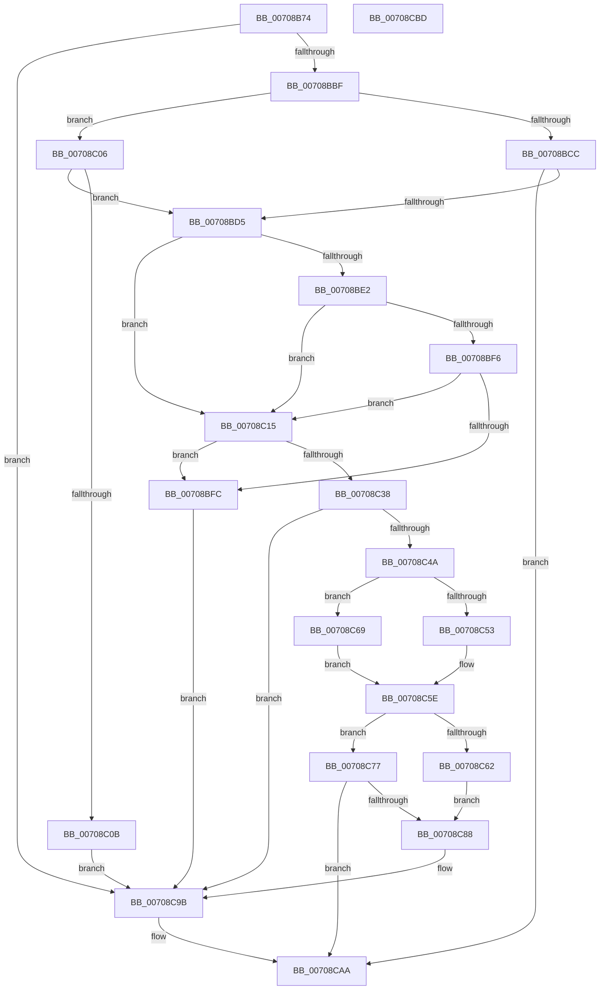

# IommupDeviceEnablePasidTaggedDma

- RVA: `0x00708B74`–`0x00708CBE` (길이 `330` bytes)
- VA: `0x0000000140708B74`
- 실행 섹션: `PAGE`
- PDB 이름 있음: `예`; PDB Function 태그: `아니요`
- unwind 정보 RVA: `0x000C41B0`
- 디코드: `94`개 명령, `330/330` bytes 표시
- 미해석 바이트: `0` (있으면 어셈블리에 `.byte`로 보존)

> 이 문서는 커널 이미지의 기계어와 PDB 기호를 분석해 생성했습니다. 4번과 5번은 함수 원형과 자료형을 바이너리 사용 방식에서 추정한 C 해석이며 원본 소스 복구 결과는 아닙니다.

## 1. Dependencies

- 직접 호출 지점: **8**; 고유 호출 대상: **8**
- 직접 호출자로 확인된 함수: **1**
- RIP 상대 이미지 참조: **1**

### Outgoing calls
- `0x00708BB0` → [IommupDeviceGetPasidSettings](../../text/54/IommupDeviceGetPasidSettings_function_0054F910.md) (function, `0x0054F910`)
- `0x00708BD9` → [Feature_Test57481295__private_IsEnabledDeviceUsageNoInline](../../text/4F/Feature_Test57481295__private_IsEnabledDeviceUsageNoInline_function_004F7B90.md) (function, `0x004F7B90`)
- `0x00708BED` → [HalpGetCpuInfo](../../text/49/HalpGetCpuInfo_function_00498A70.md) (function, `0x00498A70`)
- `0x00708C3F` → [HalpDmaGetIommuInterface](../../text/53/HalpDmaGetIommuInterface_function_0053E2A0.md) (function, `0x0053E2A0`)
- `0x00708C59` → [IommupHvIsStage1DmarCompatible](../../text/56/IommupHvIsStage1DmarCompatible_function_00567670.md) (function, `0x00567670`)
- `0x00708C70` → [HalpIommuIsDmarStageCompatible](../../text/55/HalpIommuIsDmarStageCompatible_function_005554C0.md) (function, `0x005554C0`)
- `0x00708C7D` → [IommupDeviceEnableSvm](IommupDeviceEnableSvm_function_00708CC4.md) (function, `0x00708CC4`)
- `0x00708C96` → [guard_dispatch_icall](../../text/6B/guard_dispatch_icall_function_006BAAD0.md) (function, `0x006BAAD0`)

### Direct callers
- [HalpIommuCreateDevice](../../text/54/HalpIommuCreateDevice_function_0054ED60.md) at `0x0054F222`

### Static image references
- `0x00708C4A` → RVA `0x00FC1710` (`.data`; read)

## 2. Other-region calls and transfers

- 다른 실행 섹션으로 향하는 call: **7**
  - `0x00708BB0` → [IommupDeviceGetPasidSettings](../../text/54/IommupDeviceGetPasidSettings_function_0054F910.md) (`PAGE` → `.text`)
  - `0x00708BD9` → [Feature_Test57481295__private_IsEnabledDeviceUsageNoInline](../../text/4F/Feature_Test57481295__private_IsEnabledDeviceUsageNoInline_function_004F7B90.md) (`PAGE` → `.text`)
  - `0x00708BED` → [HalpGetCpuInfo](../../text/49/HalpGetCpuInfo_function_00498A70.md) (`PAGE` → `.text`)
  - `0x00708C3F` → [HalpDmaGetIommuInterface](../../text/53/HalpDmaGetIommuInterface_function_0053E2A0.md) (`PAGE` → `.text`)
  - `0x00708C59` → [IommupHvIsStage1DmarCompatible](../../text/56/IommupHvIsStage1DmarCompatible_function_00567670.md) (`PAGE` → `.text`)
  - `0x00708C70` → [HalpIommuIsDmarStageCompatible](../../text/55/HalpIommuIsDmarStageCompatible_function_005554C0.md) (`PAGE` → `.text`)
  - `0x00708C96` → [guard_dispatch_icall](../../text/6B/guard_dispatch_icall_function_006BAAD0.md) (`PAGE` → `.text`)
- 별도 외부 분기/꼬리 이동을 확인하지 못했습니다.

## 3. Assembly (complete function range)

```asm
00708B74  48 89 5C 24 10                  mov qword ptr [rsp + 0x10], rbx
00708B79  55                              push rbp
00708B7A  56                              push rsi
00708B7B  57                              push rdi
00708B7C  41 54                           push r12
00708B7E  41 56                           push r14
00708B80  48 8B EC                        mov rbp, rsp
00708B83  48 83 EC 20                     sub rsp, 0x20
00708B87  66 83 A1 11 01 00 00 00         and word ptr [rcx + 0x111], 0
00708B8F  4C 8D 4D 48                     lea r9, [rbp + 0x48]
00708B93  48 8B C2                        mov rax, rdx
00708B96  C6 45 30 00                     mov byte ptr [rbp + 0x30], 0
00708B9A  48 8B F9                        mov rdi, rcx
00708B9D  C6 45 40 00                     mov byte ptr [rbp + 0x40], 0
00708BA1  48 8B C8                        mov rcx, rax
00708BA4  C6 45 48 00                     mov byte ptr [rbp + 0x48], 0
00708BA8  4C 8D 45 30                     lea r8, [rbp + 0x30]
00708BAC  48 8D 55 40                     lea rdx, [rbp + 0x40]
00708BB0  E8 5B 6D E4 FF                  call 0x14054f910
00708BB5  8B D8                           mov ebx, eax
00708BB7  85 C0                           test eax, eax
00708BB9  0F 88 DC 00 00 00               js 0x140708c9b
00708BBF  44 8A 75 40                     mov r14b, byte ptr [rbp + 0x40]
00708BC3  40 8A 75 30                     mov sil, byte ptr [rbp + 0x30]
00708BC7  45 84 F6                        test r14b, r14b
00708BCA  75 3A                           jne 0x140708c06
00708BCC  40 84 F6                        test sil, sil
00708BCF  0F 84 D5 00 00 00               je 0x140708caa
00708BD5  C6 45 30 00                     mov byte ptr [rbp + 0x30], 0
00708BD9  E8 B2 EF DE FF                  call 0x1404f7b90
00708BDE  85 C0                           test eax, eax
00708BE0  75 33                           jne 0x140708c15
00708BE2  4C 8D 4D 30                     lea r9, [rbp + 0x30]
00708BE6  45 33 C0                        xor r8d, r8d
00708BE9  33 D2                           xor edx, edx
00708BEB  33 C9                           xor ecx, ecx
00708BED  E8 7E FE D8 FF                  call 0x140498a70
00708BF2  84 C0                           test al, al
00708BF4  74 1F                           je 0x140708c15
00708BF6  80 7D 30 02                     cmp byte ptr [rbp + 0x30], 2
00708BFA  75 19                           jne 0x140708c15
00708BFC  BB BB 00 00 C0                  mov ebx, 0xc00000bb
00708C01  E9 95 00 00 00                  jmp 0x140708c9b
00708C06  40 84 F6                        test sil, sil
00708C09  74 CA                           je 0x140708bd5
00708C0B  BB 30 00 00 C0                  mov ebx, 0xc0000030
00708C10  E9 86 00 00 00                  jmp 0x140708c9b
00708C15  48 8B 4F 08                     mov rcx, qword ptr [rdi + 8]
00708C19  41 B4 01                        mov r12b, 1
00708C1C  8A 45 48                        mov al, byte ptr [rbp + 0x48]
00708C1F  44 88 B7 11 01 00 00            mov byte ptr [rdi + 0x111], r14b
00708C26  44 88 A7 12 01 00 00            mov byte ptr [rdi + 0x112], r12b
00708C2D  88 87 10 01 00 00               mov byte ptr [rdi + 0x110], al
00708C33  48 85 C9                        test rcx, rcx
00708C36  74 C4                           je 0x140708bfc
00708C38  48 8D 97 18 01 00 00            lea rdx, [rdi + 0x118]
00708C3F  E8 5C 56 E3 FF                  call 0x14053e2a0
00708C44  8B D8                           mov ebx, eax
00708C46  85 C0                           test eax, eax
00708C48  78 51                           js 0x140708c9b
00708C4A  80 3D BF 8A 8B 00 00            cmp byte ptr [rip + 0x8b8abf], 0
00708C51  74 16                           je 0x140708c69
00708C53  48 8B 0F                        mov rcx, qword ptr [rdi]
00708C56  41 8A D6                        mov dl, r14b
00708C59  E8 12 EA E5 FF                  call 0x140567670
00708C5E  84 C0                           test al, al
00708C60  75 15                           jne 0x140708c77
00708C62  BB BB 00 00 C0                  mov ebx, 0xc00000bb
00708C67  EB 1F                           jmp 0x140708c88
00708C69  48 8B 4F 20                     mov rcx, qword ptr [rdi + 0x20]
00708C6D  41 8A D4                        mov dl, r12b
00708C70  E8 4B C8 E4 FF                  call 0x1405554c0
00708C75  EB E7                           jmp 0x140708c5e
00708C77  40 8A D6                        mov dl, sil
00708C7A  48 8B CF                        mov rcx, rdi
00708C7D  E8 42 00 00 00                  call 0x140708cc4
00708C82  8B D8                           mov ebx, eax
00708C84  85 C0                           test eax, eax
00708C86  79 22                           jns 0x140708caa
00708C88  48 8B 87 30 01 00 00            mov rax, qword ptr [rdi + 0x130]
00708C8F  48 8B 8F 20 01 00 00            mov rcx, qword ptr [rdi + 0x120]
00708C96  E8 35 1E FB FF                  call 0x1406baad0
00708C9B  66 83 A7 11 01 00 00 00         and word ptr [rdi + 0x111], 0
00708CA3  C6 87 10 01 00 00 00            mov byte ptr [rdi + 0x110], 0
00708CAA  8B C3                           mov eax, ebx
00708CAC  48 8B 5C 24 58                  mov rbx, qword ptr [rsp + 0x58]
00708CB1  48 83 C4 20                     add rsp, 0x20
00708CB5  41 5E                           pop r14
00708CB7  41 5C                           pop r12
00708CB9  5F                              pop rdi
00708CBA  5E                              pop rsi
00708CBB  5D                              pop rbp
00708CBC  C3                              ret
00708CBD  CC                              int3
```

## 4. C-style interpretation (structured pseudocode)

```c
__int64 __fastcall IommupDeviceEnablePasidTaggedDma(__int64 a1, __int64 a2)
{
    __int64 result;
    __int64 v_rsp;
    unsigned __int64 v_stack_p10;
    unsigned __int8 v_stack_p18;
    unsigned __int64 v_stack_p20;
    unsigned __int8 v_stack_p8;

    v_stack_p10 = v_rbx;
    v_rsp = (v_rsp) - (32);
    v_stack_p8 = 0;
    v_stack_p18 = 0;
    v_stack_p20 = 0;
    result = IommupDeviceGetPasidSettings(a2, v_stack_p18, v_stack_p8, v_stack_p20);
    if (sign_flag) goto loc_00708C9B;
    if ((unsigned __int8)(v_stack_p18) != 0) goto loc_00708C06;
    if ((unsigned __int8)(v_stack_p8) == 0) goto loc_00708CAA;
loc_00708BD5:
    v_stack_p8 = 0;
    result = Feature_Test57481295__private_IsEnabledDeviceUsageNoInline(a2, v_stack_p18, v_stack_p8, v_stack_p20);
    if ((unsigned int)(result) != 0) goto loc_00708C15;
    a3 = 0;
    a2 = 0;
    a1 = 0;
    result = HalpGetCpuInfo(a1, a2, a3, v_stack_p8);
    if ((unsigned __int8)(result) == 0) goto loc_00708C15;
    if (v_stack_p8 != 2) goto loc_00708C15;
loc_00708BFC:
    goto loc_00708C9B;
loc_00708C06:
    if ((unsigned __int8)(v_stack_p8) == 0) goto loc_00708BD5;
    goto loc_00708C9B;
loc_00708C15:
    *(unsigned __int8 *)(a1 + 273) = (unsigned __int8)(v_stack_p18);
    *(unsigned __int8 *)(a1 + 274) = 1;
    *(unsigned __int8 *)(a1 + 272) = (unsigned __int8)(v_stack_p20);
    if (*(unsigned __int64 *)(a1 + 8) == 0) goto loc_00708BFC;
    result = HalpDmaGetIommuInterface(*(unsigned __int64 *)(a1 + 8), a1 + 280, a3, v_stack_p8);
    if (sign_flag) goto loc_00708C9B;
    if ((*(unsigned __int8 *)(v_rip + 9145023)) == 0) goto loc_00708C69;
    result = IommupHvIsStage1DmarCompatible(*(unsigned __int64 *)(a1), (unsigned __int8)(v_stack_p18), a3, v_stack_p8);
loc_00708C5E:
    if ((unsigned __int8)(result) != 0) goto loc_00708C77;
    goto loc_00708C88;
loc_00708C69:
    result = HalpIommuIsDmarStageCompatible(*(unsigned __int64 *)(a1 + 32), 1, a3, v_stack_p8);
    goto loc_00708C5E;
loc_00708C77:
    result = IommupDeviceEnableSvm(0, (unsigned __int8)(v_stack_p8), a3, v_stack_p8);
    if (!sign_flag) goto loc_00708CAA;
loc_00708C88:
    result = guard_dispatch_icall(*(unsigned __int64 *)(a1 + 288), (unsigned __int8)(v_stack_p8), a3, v_stack_p8);
loc_00708C9B:
    *(unsigned __int8 *)(a1 + 272) = 0;
loc_00708CAA:
    v_rsp = (v_rsp) + (32);
    return (unsigned int)((unsigned int)((unsigned int)((unsigned int)(result))));
}
```

## 5. (Beta) C Style

```c
int64_t IommupDeviceEnablePasidTaggedDma(void *Arg1, int64_t Arg2)
{
    uint8_t *arg1 = (uint8_t *)Arg1;

    int64_t result;
    int64_t local_rsp;
    uint64_t v_stack_p10;
    uint8_t v_stack_p18;
    uint64_t v_stack_p20;
    uint8_t v_stack_p8;

    v_stack_p10 = local_rbx;
    local_rsp = (local_rsp) - (32);
    v_stack_p8 = 0;
    v_stack_p18 = 0;
    v_stack_p20 = 0;
    result = IommupDeviceGetPasidSettings(Arg2, v_stack_p18, v_stack_p8, v_stack_p20);
    if (sign_flag) goto loc_00708C9B;
    if ((uint8_t)(v_stack_p18) != 0) goto loc_00708C06;
    if ((uint8_t)(v_stack_p8) == 0) goto loc_00708CAA;
loc_00708BD5:
    v_stack_p8 = 0;
    result = Feature_Test57481295__private_IsEnabledDeviceUsageNoInline(Arg2, v_stack_p18, v_stack_p8, v_stack_p20);
    if ((uint32_t)(result) != 0) goto loc_00708C15;
    a3 = 0;
    Arg2 = 0;
    Arg1 = 0;
    result = HalpGetCpuInfo(Arg1, Arg2, a3, v_stack_p8);
    if ((uint8_t)(result) == 0) goto loc_00708C15;
    if (v_stack_p8 != 2) goto loc_00708C15;
loc_00708BFC:
    goto loc_00708C9B;
loc_00708C06:
    if ((uint8_t)(v_stack_p8) == 0) goto loc_00708BD5;
    goto loc_00708C9B;
loc_00708C15:
    *(uint8_t *)(arg1 + 0x111) = (uint8_t)(v_stack_p18);
    *(uint8_t *)(arg1 + 0x112) = 1;
    *(uint8_t *)(arg1 + 0x110) = (uint8_t)(v_stack_p20);
    if (*(uint64_t *)(arg1 + 0x8) == 0) goto loc_00708BFC;
    result = HalpDmaGetIommuInterface(*(uint64_t *)(arg1 + 0x8), Arg1 + 280, a3, v_stack_p8);
    if (sign_flag) goto loc_00708C9B;
    if ((*(uint8_t *)(v_rip + 0x8B8ABF)) == 0) goto loc_00708C69;
    result = IommupHvIsStage1DmarCompatible(*(uint64_t *)(arg1), (uint8_t)(v_stack_p18), a3, v_stack_p8);
loc_00708C5E:
    if ((uint8_t)(result) != 0) goto loc_00708C77;
    goto loc_00708C88;
loc_00708C69:
    result = HalpIommuIsDmarStageCompatible(*(uint64_t *)(arg1 + 0x20), 1, a3, v_stack_p8);
    goto loc_00708C5E;
loc_00708C77:
    result = IommupDeviceEnableSvm(0, (uint8_t)(v_stack_p8), a3, v_stack_p8);
    if (!sign_flag) goto loc_00708CAA;
loc_00708C88:
    result = guard_dispatch_icall(*(uint64_t *)(arg1 + 0x120), (uint8_t)(v_stack_p8), a3, v_stack_p8);
loc_00708C9B:
    *(uint8_t *)(arg1 + 0x110) = 0;
loc_00708CAA:
    local_rsp = (local_rsp) + (32);
    return (uint32_t)((uint32_t)((uint32_t)((uint32_t)(result))));
}
```

### 관측된 메모리 오프셋

구조체 형식이 확인되지 않은 접근은 인자 기준의 오프셋으로만 기록했습니다.

| 기준 인자 | 오프셋 표현 | 폭 (bit) | 접근 |
|---|---:|---:|---|
| `Arg1` | `+ 0x0` | `64` | `R` |
| `Arg1` | `+ 0x8` | `64` | `R` |
| `Arg1` | `+ 0x20` | `64` | `R` |
| `Arg1` | `+ 0x110` | `8` | `W` |
| `Arg1` | `+ 0x111` | `8` | `W` |
| `Arg1` | `+ 0x111` | `16` | `R/W` |
| `Arg1` | `+ 0x112` | `8` | `W` |
| `Arg1` | `+ 0x118` | `64` | `R` |
| `Arg1` | `+ 0x120` | `64` | `R` |
| `Arg1` | `+ 0x130` | `64` | `R` |

## 6. Execution-region graph

[열기: 2D/3D 그래프와 함수 탐색 컨트롤 패널](../../../control-panel.html?section=page&rva=0x00708B74&view=graph)

- 2D 그래프는 위에서 아래로 흐르고, 3D 그래프는 빈 공간을 드래그해 회전합니다. Shift+드래그는 이동, 휠은 확대·축소, 함수 노드 선택은 대상 보고서 이동입니다.

### Static fallback


