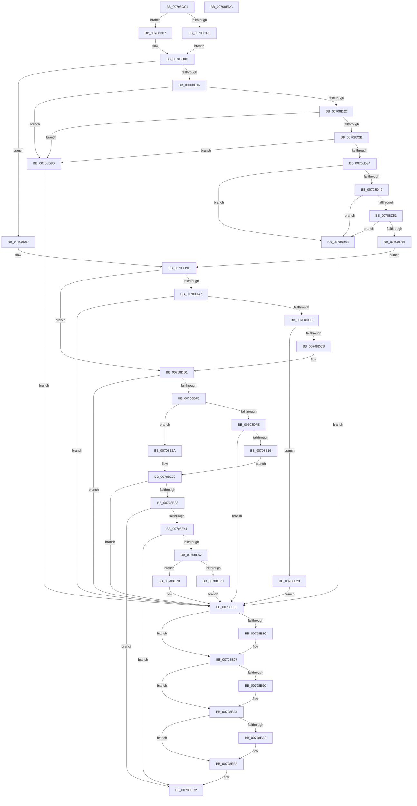

# IommupDeviceEnableSvm

- RVA: `0x00708CC4`–`0x00708EDD` (길이 `537` bytes)
- VA: `0x0000000140708CC4`
- 실행 섹션: `PAGE`
- PDB 이름 있음: `예`; PDB Function 태그: `아니요`
- unwind 정보 RVA: `0x000C41C8`
- 디코드: `152`개 명령, `537/537` bytes 표시
- 미해석 바이트: `0` (있으면 어셈블리에 `.byte`로 보존)

> 이 문서는 커널 이미지의 기계어와 PDB 기호를 분석해 생성했습니다. 4번과 5번은 함수 원형과 자료형을 바이너리 사용 방식에서 추정한 C 해석이며 원본 소스 복구 결과는 아닙니다.

## 1. Dependencies

- 직접 호출 지점: **13**; 고유 호출 대상: **12**
- 직접 호출자로 확인된 함수: **1**
- RIP 상대 이미지 참조: **3**

### Outgoing calls
- `0x00708CFE` → [IommuGetLeastMaximumSupportedAsidValue](../../text/56/IommuGetLeastMaximumSupportedAsidValue_function_00565944.md) (function, `0x00565944`)
- `0x00708D40` → [guard_dispatch_icall](../../text/6B/guard_dispatch_icall_function_006BAAD0.md) (function, `0x006BAAD0`)
- `0x00708DB0` → [HalpIommuGetDomainId](../../text/55/HalpIommuGetDomainId_function_005537E4.md) (function, `0x005537E4`)
- `0x00708DDE` → [IommupPasidDeviceCreate](../../text/54/IommupPasidDeviceCreate_function_0054FEEC.md) (function, `0x0054FEEC`)
- `0x00708E0B` → [IommupMapDeviceInternal](../../text/56/IommupMapDeviceInternal_function_00566478.md) (function, `0x00566478`)
- `0x00708E1C` → [IommuEnableDevicePasid](../../text/56/IommuEnableDevicePasid_function_00565150.md) (function, `0x00565150`)
- `0x00708E2D` → [IommupHvAttachPasidDevice](../../text/56/IommupHvAttachPasidDevice_function_00566AEC.md) (function, `0x00566AEC`)
- `0x00708E5C` → [guard_dispatch_icall](../../text/6B/guard_dispatch_icall_function_006BAAD0.md) (function, `0x006BAAD0`)
- `0x00708E76` → [IommuDisableDevicePasid](../../text/56/IommuDisableDevicePasid_function_00564E80.md) (function, `0x00564E80`)
- `0x00708E80` → [IommupHvDetachPasidDevice](../../text/56/IommupHvDetachPasidDevice_function_00567150.md) (function, `0x00567150`)
- `0x00708E92` → [IommupUnmapDeviceInternal](../../text/56/IommupUnmapDeviceInternal_function_005667D8.md) (function, `0x005667D8`)
- `0x00708E9F` → [IommupPasidDeviceDelete](../../text/55/IommupPasidDeviceDelete_function_00550030.md) (function, `0x00550030`)
- `0x00708EAF` → [HalpIommuFreeDomainId](../../text/55/HalpIommuFreeDomainId_function_00553658.md) (function, `0x00553658`)

### Direct callers
- [IommupDeviceEnablePasidTaggedDma](IommupDeviceEnablePasidTaggedDma_function_00708B74.md) at `0x00708C7D`

### Static image references
- `0x00708CEB` → RVA `0x00FC1710` (`.data`; read)
- `0x00708D07` → RVA `0x00F8FAF0` (`.data`; read)
- `0x00708E48` → RVA `0x00A97CF0` (`ArbPreprocessEntry`; read)

## 2. Other-region calls and transfers

- 다른 실행 섹션으로 향하는 call: **13**
  - `0x00708CFE` → [IommuGetLeastMaximumSupportedAsidValue](../../text/56/IommuGetLeastMaximumSupportedAsidValue_function_00565944.md) (`PAGE` → `.text`)
  - `0x00708D40` → [guard_dispatch_icall](../../text/6B/guard_dispatch_icall_function_006BAAD0.md) (`PAGE` → `.text`)
  - `0x00708DB0` → [HalpIommuGetDomainId](../../text/55/HalpIommuGetDomainId_function_005537E4.md) (`PAGE` → `.text`)
  - `0x00708DDE` → [IommupPasidDeviceCreate](../../text/54/IommupPasidDeviceCreate_function_0054FEEC.md) (`PAGE` → `.text`)
  - `0x00708E0B` → [IommupMapDeviceInternal](../../text/56/IommupMapDeviceInternal_function_00566478.md) (`PAGE` → `.text`)
  - `0x00708E1C` → [IommuEnableDevicePasid](../../text/56/IommuEnableDevicePasid_function_00565150.md) (`PAGE` → `.text`)
  - `0x00708E2D` → [IommupHvAttachPasidDevice](../../text/56/IommupHvAttachPasidDevice_function_00566AEC.md) (`PAGE` → `.text`)
  - `0x00708E5C` → [guard_dispatch_icall](../../text/6B/guard_dispatch_icall_function_006BAAD0.md) (`PAGE` → `.text`)
  - `0x00708E76` → [IommuDisableDevicePasid](../../text/56/IommuDisableDevicePasid_function_00564E80.md) (`PAGE` → `.text`)
  - `0x00708E80` → [IommupHvDetachPasidDevice](../../text/56/IommupHvDetachPasidDevice_function_00567150.md) (`PAGE` → `.text`)
  - `0x00708E92` → [IommupUnmapDeviceInternal](../../text/56/IommupUnmapDeviceInternal_function_005667D8.md) (`PAGE` → `.text`)
  - `0x00708E9F` → [IommupPasidDeviceDelete](../../text/55/IommupPasidDeviceDelete_function_00550030.md) (`PAGE` → `.text`)
  - `0x00708EAF` → [HalpIommuFreeDomainId](../../text/55/HalpIommuFreeDomainId_function_00553658.md) (`PAGE` → `.text`)
- 별도 외부 분기/꼬리 이동을 확인하지 못했습니다.

## 3. Assembly (complete function range)

```asm
00708CC4  48 8B C4                        mov rax, rsp
00708CC7  48 89 58 20                     mov qword ptr [rax + 0x20], rbx
00708CCB  55                              push rbp
00708CCC  56                              push rsi
00708CCD  57                              push rdi
00708CCE  41 54                           push r12
00708CD0  41 55                           push r13
00708CD2  41 56                           push r14
00708CD4  41 57                           push r15
00708CD6  48 83 EC 30                     sub rsp, 0x30
00708CDA  33 F6                           xor esi, esi
00708CDC  83 CD FF                        or ebp, 0xffffffff
00708CDF  21 70 08                        and dword ptr [rax + 8], esi
00708CE2  45 33 FF                        xor r15d, r15d
00708CE5  45 32 ED                        xor r13b, r13b
00708CE8  89 68 10                        mov dword ptr [rax + 0x10], ebp
00708CEB  40 38 35 1E 8A 8B 00            cmp byte ptr [rip + 0x8b8a1e], sil
00708CF2  44 8A E2                        mov r12b, dl
00708CF5  48 8B D9                        mov rbx, rcx
00708CF8  48 89 70 18                     mov qword ptr [rax + 0x18], rsi
00708CFC  75 09                           jne 0x140708d07
00708CFE  E8 41 CC E5 FF                  call 0x140565944
00708D03  8B F8                           mov edi, eax
00708D05  EB 06                           jmp 0x140708d0d
00708D07  8B 3D E3 6D 88 00               mov edi, dword ptr [rip + 0x886de3]
00708D0D  45 84 E4                        test r12b, r12b
00708D10  0F 85 81 00 00 00               jne 0x140708d97
00708D16  48 8B 83 38 01 00 00            mov rax, qword ptr [rbx + 0x138]
00708D1D  48 85 C0                        test rax, rax
00708D20  74 6B                           je 0x140708d8d
00708D22  48 39 B3 40 01 00 00            cmp qword ptr [rbx + 0x140], rsi
00708D29  74 62                           je 0x140708d8d
00708D2B  48 39 B3 48 01 00 00            cmp qword ptr [rbx + 0x148], rsi
00708D32  74 59                           je 0x140708d8d
00708D34  48 8B 8B 20 01 00 00            mov rcx, qword ptr [rbx + 0x120]
00708D3B  48 8D 54 24 70                  lea rdx, [rsp + 0x70]
00708D40  E8 8B 1D FB FF                  call 0x1406baad0
00708D45  85 C0                           test eax, eax
00708D47  78 3A                           js 0x140708d83
00708D49  8B 44 24 70                     mov eax, dword ptr [rsp + 0x70]
00708D4D  A8 04                           test al, 4
00708D4F  74 32                           je 0x140708d83
00708D51  8B C8                           mov ecx, eax
00708D53  BA 01 00 00 00                  mov edx, 1
00708D58  C1 E9 03                        shr ecx, 3
00708D5B  83 E1 1F                        and ecx, 0x1f
00708D5E  D3 E2                           shl edx, cl
00708D60  3B D7                           cmp edx, edi
00708D62  72 1F                           jb 0x140708d83
00708D64  4C 8D B3 80 01 00 00            lea r14, [rbx + 0x180]
00708D6B  25 F8 00 00 00                  and eax, 0xf8
00708D70  41 8B 0E                        mov ecx, dword ptr [r14]
00708D73  81 E1 07 FF FF FF               and ecx, 0xffffff07
00708D79  0B C8                           or ecx, eax
00708D7B  83 C9 04                        or ecx, 4
00708D7E  41 89 0E                        mov dword ptr [r14], ecx
00708D81  EB 1B                           jmp 0x140708d9e
00708D83  BF BB 00 00 C0                  mov edi, 0xc00000bb
00708D88  E9 F8 00 00 00                  jmp 0x140708e85
00708D8D  BF 02 00 00 C0                  mov edi, 0xc0000002
00708D92  E9 EE 00 00 00                  jmp 0x140708e85
00708D97  4C 8D B3 80 01 00 00            lea r14, [rbx + 0x180]
00708D9E  40 38 35 6B 89 8B 00            cmp byte ptr [rip + 0x8b896b], sil
00708DA5  75 2A                           jne 0x140708dd1
00708DA7  48 8B 4B 20                     mov rcx, qword ptr [rbx + 0x20]
00708DAB  48 8D 54 24 78                  lea rdx, [rsp + 0x78]
00708DB0  E8 2F AA E4 FF                  call 0x1405537e4
00708DB5  8B 6C 24 78                     mov ebp, dword ptr [rsp + 0x78]
00708DB9  8B F8                           mov edi, eax
00708DBB  85 C0                           test eax, eax
00708DBD  0F 88 C2 00 00 00               js 0x140708e85
00708DC3  8D 45 FF                        lea eax, [rbp - 1]
00708DC6  83 F8 FD                        cmp eax, -3
00708DC9  77 58                           ja 0x140708e23
00708DCB  89 6B 48                        mov dword ptr [rbx + 0x48], ebp
00708DCE  41 B5 01                        mov r13b, 1
00708DD1  4C 8D 84 24 80 00 00 00         lea r8, [rsp + 0x80]
00708DD9  33 D2                           xor edx, edx
00708DDB  48 8B CB                        mov rcx, rbx
00708DDE  E8 09 71 E4 FF                  call 0x14054feec
00708DE3  48 8B B4 24 80 00 00 00         mov rsi, qword ptr [rsp + 0x80]
00708DEB  8B F8                           mov edi, eax
00708DED  85 C0                           test eax, eax
00708DEF  0F 88 90 00 00 00               js 0x140708e85
00708DF5  44 38 3D 14 89 8B 00            cmp byte ptr [rip + 0x8b8914], r15b
00708DFC  75 2C                           jne 0x140708e2a
00708DFE  4C 8B 7E 38                     mov r15, qword ptr [rsi + 0x38]
00708E02  4D 8B C6                        mov r8, r14
00708E05  48 8B D3                        mov rdx, rbx
00708E08  49 8B 0F                        mov rcx, qword ptr [r15]
00708E0B  E8 68 D6 E5 FF                  call 0x140566478
00708E10  8B F8                           mov edi, eax
00708E12  85 C0                           test eax, eax
00708E14  78 6F                           js 0x140708e85
00708E16  48 8B D3                        mov rdx, rbx
00708E19  49 8B CF                        mov rcx, r15
00708E1C  E8 2F C3 E5 FF                  call 0x140565150
00708E21  EB 0F                           jmp 0x140708e32
00708E23  BF 9A 00 00 C0                  mov edi, 0xc000009a
00708E28  EB 5B                           jmp 0x140708e85
00708E2A  48 8B CB                        mov rcx, rbx
00708E2D  E8 BA DC E5 FF                  call 0x140566aec
00708E32  8B F8                           mov edi, eax
00708E34  85 C0                           test eax, eax
00708E36  78 4D                           js 0x140708e85
00708E38  45 84 E4                        test r12b, r12b
00708E3B  0F 85 81 00 00 00               jne 0x140708ec2
00708E41  48 8B 83 40 01 00 00            mov rax, qword ptr [rbx + 0x140]
00708E48  4C 8D 05 A1 EE 38 00            lea r8, [rip + 0x38eea1]
00708E4F  48 8B 8B 20 01 00 00            mov rcx, qword ptr [rbx + 0x120]
00708E56  4C 8B CB                        mov r9, rbx
00708E59  49 8B D6                        mov rdx, r14
00708E5C  E8 6F 1C FB FF                  call 0x1406baad0
00708E61  8B F8                           mov edi, eax
00708E63  85 C0                           test eax, eax
00708E65  79 5B                           jns 0x140708ec2
00708E67  44 38 25 A2 88 8B 00            cmp byte ptr [rip + 0x8b88a2], r12b
00708E6E  75 0D                           jne 0x140708e7d
00708E70  48 8B D3                        mov rdx, rbx
00708E73  49 8B CF                        mov rcx, r15
00708E76  E8 05 C0 E5 FF                  call 0x140564e80
00708E7B  EB 08                           jmp 0x140708e85
00708E7D  48 8B CB                        mov rcx, rbx
00708E80  E8 CB E2 E5 FF                  call 0x140567150
00708E85  48 83 7B 60 00                  cmp qword ptr [rbx + 0x60], 0
00708E8A  74 0B                           je 0x140708e97
00708E8C  49 8B 0F                        mov rcx, qword ptr [r15]
00708E8F  48 8B D3                        mov rdx, rbx
00708E92  E8 41 D9 E5 FF                  call 0x1405667d8
00708E97  48 85 F6                        test rsi, rsi
00708E9A  74 08                           je 0x140708ea4
00708E9C  48 8B CE                        mov rcx, rsi
00708E9F  E8 8C 71 E4 FF                  call 0x140550030
00708EA4  45 84 ED                        test r13b, r13b
00708EA7  74 0F                           je 0x140708eb8
00708EA9  48 8B 4B 20                     mov rcx, qword ptr [rbx + 0x20]
00708EAD  8B D5                           mov edx, ebp
00708EAF  E8 A4 A7 E4 FF                  call 0x140553658
00708EB4  83 4B 48 FF                     or dword ptr [rbx + 0x48], 0xffffffff
00708EB8  81 A3 80 01 00 00 03 FF FF FF   and dword ptr [rbx + 0x180], 0xffffff03
00708EC2  48 8B 9C 24 88 00 00 00         mov rbx, qword ptr [rsp + 0x88]
00708ECA  8B C7                           mov eax, edi
00708ECC  48 83 C4 30                     add rsp, 0x30
00708ED0  41 5F                           pop r15
00708ED2  41 5E                           pop r14
00708ED4  41 5D                           pop r13
00708ED6  41 5C                           pop r12
00708ED8  5F                              pop rdi
00708ED9  5E                              pop rsi
00708EDA  5D                              pop rbp
00708EDB  C3                              ret
00708EDC  CC                              int3
```

## 4. C-style interpretation (structured pseudocode)

```c
__int64 __fastcall IommupDeviceEnableSvm(__int64 a1, unsigned __int8 a2)
{
    __int64 result;
    __int64 v_r13;
    __int64 v_r15;
    __int64 v_rbp;
    __int64 v_rsi;
    __int64 v_rsp;
    unsigned __int64 v_stack_p10;
    unsigned __int64 v_stack_p18;
    unsigned __int64 v_stack_p20;
    unsigned __int64 v_stack_p8;

    *(unsigned __int64 *)(v_rsp + 32) = v_rbx;
    v_rsp = (v_rsp) - (48);
    v_rsi = 0;
    v_rbp = (unsigned int)((v_rbp) | (0xFFFFFFFFULL));
    v_r15 = 0;
    v_r13 = 0;
    *(unsigned int *)(v_rsp + 16) = (unsigned int)(v_rbp);
    *(unsigned __int64 *)(v_rsp + 24) = 0;
    if ((*(unsigned __int8 *)(v_rip + 9144862)) != 0) goto loc_00708D07;
    result = IommuGetLeastMaximumSupportedAsidValue(a1, a2, a3, a4);
    goto loc_00708D0D;
loc_00708D07:
loc_00708D0D:
    if (a2 != 0) goto loc_00708D97;
    if (*(unsigned __int64 *)(a1 + 312) == 0) goto loc_00708D8D;
    if ((*(unsigned __int64 *)(a1 + 320)) == 0) goto loc_00708D8D;
    if ((*(unsigned __int64 *)(a1 + 328)) == 0) goto loc_00708D8D;
    result = guard_dispatch_icall(*(unsigned __int64 *)(a1 + 288), v_stack_p8, a3, a4);
    if (sign_flag) goto loc_00708D83;
    if ((((unsigned __int8)((unsigned int)(v_stack_p8))) & (4)) == 0) goto loc_00708D83;
    a1 = (unsigned int)(((unsigned int)((unsigned int)((unsigned int)(v_stack_p8)))) >> (3));
    a1 = (unsigned int)((a1) & (31));
    a2 = (unsigned int)((1) << ((unsigned __int8)(a1)));
    if (a2 < ((unsigned int)((unsigned int)(*(unsigned int *)(v_rip + 8941027))))) goto loc_00708D83;
    result = (unsigned int)(((unsigned int)(v_stack_p8)) & (248));
    a1 = (unsigned int)(((unsigned int)(*(unsigned int *)(a1 + 384))) & (0xFFFFFF07ULL));
    a1 = (unsigned int)((a1) | ((unsigned int)(result)));
    a1 = (unsigned int)((a1) | (4));
    *(unsigned int *)(a1 + 384) = (unsigned int)(a1);
    goto loc_00708D9E;
loc_00708D83:
    goto loc_00708E85;
loc_00708D8D:
    goto loc_00708E85;
loc_00708D97:
loc_00708D9E:
    if ((*(unsigned __int8 *)(v_rip + 9144683)) != 0) goto loc_00708DD1;
    result = HalpIommuGetDomainId(*(unsigned __int64 *)(a1 + 32), v_stack_p10, a3, a4);
    if (sign_flag) goto loc_00708E85;
    if (((unsigned int)((unsigned int)(v_stack_p10) - 1)) > -3) goto loc_00708E23;
    *(unsigned int *)(a1 + 72) = (unsigned int)((unsigned int)(v_stack_p10));
loc_00708DD1:
    a2 = 0;
    result = IommupPasidDeviceCreate(a1, a2, v_stack_p18, a4);
    if (sign_flag) goto loc_00708E85;
    if ((*(unsigned __int8 *)(v_rip + 9144596)) != 0) goto loc_00708E2A;
    result = IommupMapDeviceInternal(*(unsigned __int64 *)(*(unsigned __int64 *)(v_stack_p18 + 56)), a1, a1 + 384, a4);
    if (sign_flag) goto loc_00708E85;
    result = IommuEnableDevicePasid(*(unsigned __int64 *)(v_stack_p18 + 56), a1, a1 + 384, a4);
    goto loc_00708E32;
loc_00708E23:
    goto loc_00708E85;
loc_00708E2A:
    result = IommupHvAttachPasidDevice(a1, a1, a1 + 384, a4);
loc_00708E32:
    if (sign_flag) goto loc_00708E85;
    if (0 != 0) goto loc_00708EC2;
    result = guard_dispatch_icall(*(unsigned __int64 *)(a1 + 288), a1 + 384, v_rip + 3731105, a1);
    if (!sign_flag) goto loc_00708EC2;
    if ((*(unsigned __int8 *)(v_rip + 9144482)) != 0) goto loc_00708E7D;
    result = IommuDisableDevicePasid(*(unsigned __int64 *)(v_stack_p18 + 56), a1, v_rip + 3731105, a1);
    goto loc_00708E85;
loc_00708E7D:
    result = IommupHvDetachPasidDevice(a1, a1, v_rip + 3731105, a1);
loc_00708E85:
    if ((*(unsigned __int64 *)(a1 + 96)) != 0) {
        a1 = *(unsigned __int64 *)(*(unsigned __int64 *)(v_stack_p18 + 56));
        a2 = a1;
        result = IommupUnmapDeviceInternal(a1, a2, v_rip + 3731105, a1);
    }
    if (v_stack_p18 != 0) {
        a1 = v_stack_p18;
        result = IommupPasidDeviceDelete(a1, a2, v_rip + 3731105, a1);
    }
    if (1 != 0) {
        a1 = *(unsigned __int64 *)(a1 + 32);
        a2 = (unsigned int)((unsigned int)(v_stack_p10));
        result = HalpIommuFreeDomainId(a1, a2, v_rip + 3731105, a1);
    }
loc_00708EC2:
    v_rsp = (v_rsp) + (48);
    return (unsigned int)((unsigned int)((unsigned int)((unsigned int)(result))));
}
```

## 5. (Beta) C Style

```c
int64_t IommupDeviceEnableSvm(void *Arg1, uint8_t Arg2)
{
    uint8_t *arg1 = (uint8_t *)Arg1;

    int64_t result;
    int64_t local_r13;
    int64_t local_r15;
    int64_t local_rbp;
    int64_t local_rsi;
    int64_t local_rsp;
    uint64_t v_stack_p10;
    uint64_t v_stack_p18;
    uint64_t v_stack_p20;
    uint64_t v_stack_p8;

    *(uint64_t *)(local_rsp + 0x20) = local_rbx;
    local_rsp = (local_rsp) - (48);
    local_rsi = 0;
    local_rbp = (uint32_t)((local_rbp) | (0xFFFFFFFFULL));
    local_r15 = 0;
    local_r13 = 0;
    *(uint32_t *)(local_rsp + 0x10) = (uint32_t)(local_rbp);
    *(uint64_t *)(local_rsp + 0x18) = 0;
    if ((*(uint8_t *)(v_rip + 0x8B8A1E)) != 0) goto loc_00708D07;
    result = IommuGetLeastMaximumSupportedAsidValue(Arg1, Arg2, a3, a4);
    goto loc_00708D0D;
loc_00708D07:
loc_00708D0D:
    if (Arg2 != 0) goto loc_00708D97;
    if (*(uint64_t *)(arg1 + 0x138) == 0) goto loc_00708D8D;
    if ((*(uint64_t *)(arg1 + 0x140)) == 0) goto loc_00708D8D;
    if ((*(uint64_t *)(arg1 + 0x148)) == 0) goto loc_00708D8D;
    result = guard_dispatch_icall(*(uint64_t *)(arg1 + 0x120), v_stack_p8, a3, a4);
    if (sign_flag) goto loc_00708D83;
    if ((((uint8_t)((uint32_t)(v_stack_p8))) & (4)) == 0) goto loc_00708D83;
    Arg1 = (uint32_t)(((uint32_t)((uint32_t)((uint32_t)(v_stack_p8)))) >> (3));
    Arg1 = (uint32_t)((Arg1) & (31));
    Arg2 = (uint32_t)((1) << ((uint8_t)(Arg1)));
    if (Arg2 < ((uint32_t)((uint32_t)(*(uint32_t *)(v_rip + 0x886DE3))))) goto loc_00708D83;
    result = (uint32_t)(((uint32_t)(v_stack_p8)) & (248));
    Arg1 = (uint32_t)(((uint32_t)(*(uint32_t *)(arg1 + 0x180))) & (0xFFFFFF07ULL));
    Arg1 = (uint32_t)((Arg1) | ((uint32_t)(result)));
    Arg1 = (uint32_t)((Arg1) | (4));
    *(uint32_t *)(arg1 + 0x180) = (uint32_t)(Arg1);
    goto loc_00708D9E;
loc_00708D83:
    goto loc_00708E85;
loc_00708D8D:
    goto loc_00708E85;
loc_00708D97:
loc_00708D9E:
    if ((*(uint8_t *)(v_rip + 0x8B896B)) != 0) goto loc_00708DD1;
    result = HalpIommuGetDomainId(*(uint64_t *)(arg1 + 0x20), v_stack_p10, a3, a4);
    if (sign_flag) goto loc_00708E85;
    if (((uint32_t)((uint32_t)(v_stack_p10) - 1)) > -3) goto loc_00708E23;
    *(uint32_t *)(arg1 + 0x48) = (uint32_t)((uint32_t)(v_stack_p10));
loc_00708DD1:
    Arg2 = 0;
    result = IommupPasidDeviceCreate(Arg1, Arg2, v_stack_p18, a4);
    if (sign_flag) goto loc_00708E85;
    if ((*(uint8_t *)(v_rip + 0x8B8914)) != 0) goto loc_00708E2A;
    result = IommupMapDeviceInternal(*(uint64_t *)(*(uint64_t *)(v_stack_p18 + 0x38)), Arg1, Arg1 + 384, a4);
    if (sign_flag) goto loc_00708E85;
    result = IommuEnableDevicePasid(*(uint64_t *)(v_stack_p18 + 0x38), Arg1, Arg1 + 384, a4);
    goto loc_00708E32;
loc_00708E23:
    goto loc_00708E85;
loc_00708E2A:
    result = IommupHvAttachPasidDevice(Arg1, Arg1, Arg1 + 384, a4);
loc_00708E32:
    if (sign_flag) goto loc_00708E85;
    if (0 != 0) goto loc_00708EC2;
    result = guard_dispatch_icall(*(uint64_t *)(arg1 + 0x120), Arg1 + 384, v_rip + 3731105, Arg1);
    if (!sign_flag) goto loc_00708EC2;
    if ((*(uint8_t *)(v_rip + 0x8B88A2)) != 0) goto loc_00708E7D;
    result = IommuDisableDevicePasid(*(uint64_t *)(v_stack_p18 + 0x38), Arg1, v_rip + 3731105, Arg1);
    goto loc_00708E85;
loc_00708E7D:
    result = IommupHvDetachPasidDevice(Arg1, Arg1, v_rip + 3731105, Arg1);
loc_00708E85:
    if ((*(uint64_t *)(arg1 + 0x60)) != 0) {
        Arg1 = *(uint64_t *)(*(uint64_t *)(v_stack_p18 + 0x38));
        Arg2 = Arg1;
        result = IommupUnmapDeviceInternal(Arg1, Arg2, v_rip + 3731105, Arg1);
    }
    if (v_stack_p18 != 0) {
        Arg1 = v_stack_p18;
        result = IommupPasidDeviceDelete(Arg1, Arg2, v_rip + 3731105, Arg1);
    }
    if (1 != 0) {
        Arg1 = *(uint64_t *)(arg1 + 0x20);
        Arg2 = (uint32_t)((uint32_t)(v_stack_p10));
        result = HalpIommuFreeDomainId(Arg1, Arg2, v_rip + 3731105, Arg1);
    }
loc_00708EC2:
    local_rsp = (local_rsp) + (48);
    return (uint32_t)((uint32_t)((uint32_t)((uint32_t)(result))));
}
```

### 관측된 메모리 오프셋

구조체 형식이 확인되지 않은 접근은 인자 기준의 오프셋으로만 기록했습니다.

| 기준 인자 | 오프셋 표현 | 폭 (bit) | 접근 |
|---|---:|---:|---|
| `Arg1` | `+ 0x0` | `32` | `R` |
| `Arg1` | `+ 0x0` | `32` | `W` |
| `Arg1` | `+ 0x20` | `64` | `R` |
| `Arg1` | `+ 0x48` | `32` | `R/W` |
| `Arg1` | `+ 0x48` | `32` | `W` |
| `Arg1` | `+ 0x60` | `64` | `R` |
| `Arg1` | `+ 0x120` | `64` | `R` |
| `Arg1` | `+ 0x138` | `64` | `R` |
| `Arg1` | `+ 0x140` | `64` | `R` |
| `Arg1` | `+ 0x148` | `64` | `R` |
| `Arg1` | `+ 0x180` | `32` | `R/W` |
| `Arg1` | `+ 0x180` | `64` | `R` |

## 6. Execution-region graph

[열기: 2D/3D 그래프와 함수 탐색 컨트롤 패널](../../../control-panel.html?section=page&rva=0x00708CC4&view=graph)

- 2D 그래프는 위에서 아래로 흐르고, 3D 그래프는 빈 공간을 드래그해 회전합니다. Shift+드래그는 이동, 휠은 확대·축소, 함수 노드 선택은 대상 보고서 이동입니다.

### Static fallback


